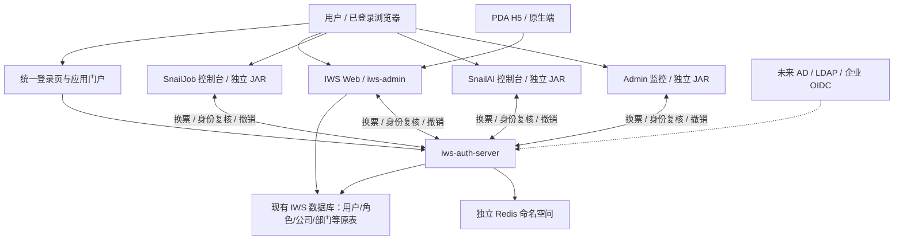
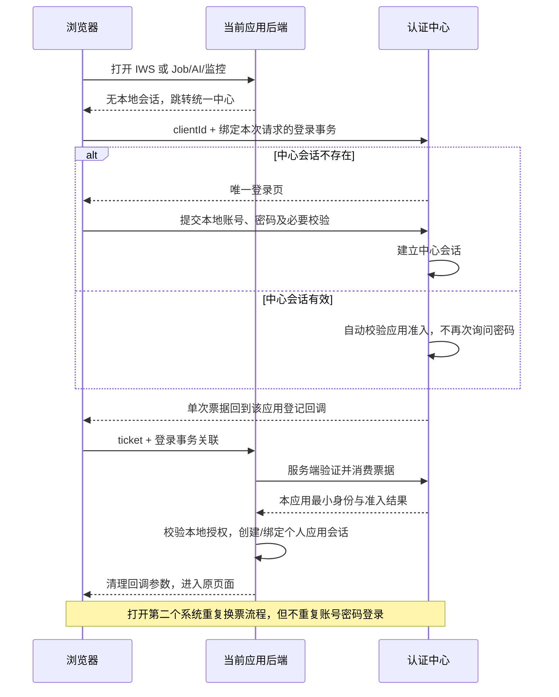
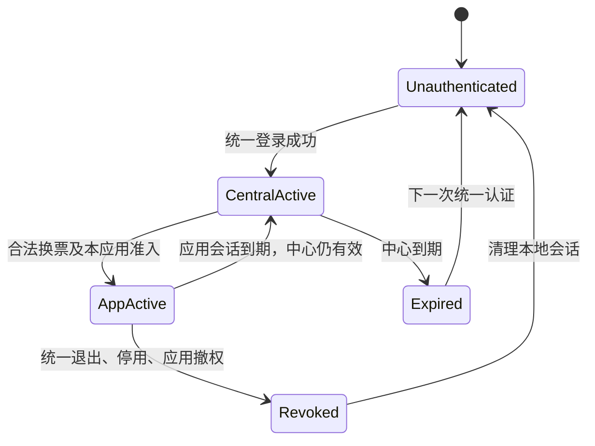
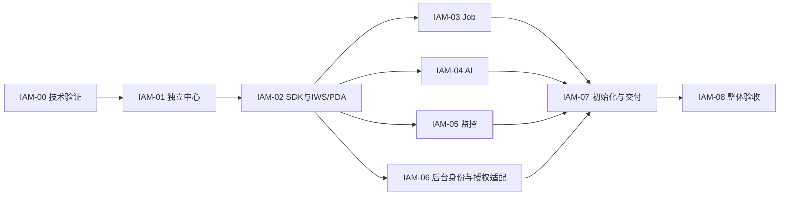

# IWS 统一身份认证中心完整方案

版本：V1.4，2026-11-03。状态：方案及细化实施步骤已编写，尚未实施、启动、部署或完成运行验收。沿用 V1.3 的“独立部署、统一认证接入，内部账号数据模型不变”边界；本版补齐代码提取、端点归属、客户端适配、验证与切换步骤。V1.0—V1.2 的平行身份库/账号组织模型建议继续作废。

## 1. 目标与已确认边界

建立可独立构建、独立启动的 `iws-auth-server`，统一项目内人员身份、凭据、登录、会话、应用准入和认证审计。用户在同一浏览器环境中只登录一次，即可进入所有已授权系统；打开 Job、AI、Admin 监控不再输入各自账号密码。

用户已明确的要求：

| 要求 | 首期交付含义 |
|---|---|
| 独立模块 | 单独可执行 JAR，包含统一登录页面；主业务服务停止时仍能登录、管理身份和进入其他存活应用 |
| 项目内认证统一 | IWS Web、PDA、SnailJob、SnailAI、Spring Boot Admin 监控均纳入；不能只统一主站 |
| 只登录一次 | 同一浏览器 SSO 会话有效期间复用统一身份；访问每个系统仍须通过其接入权限校验，直接访问也不能绕过 |
| 本地账号统一 | 首期使用本地账号；账号、密码、停用和重置在中心管理 |
| 现有统一管理账号 | 必须保留并纳入中心，沿用已有账号名与密码，关联 IWS、Job、AI、Admin 监控已有管理身份；不另建替代账号 |
| 现有账号管理体系 | 用户、角色、公司、部门树、岗位、菜单/权限及其关联模型不变；保留现有主键、字段、关系和管理规则，只调整代码装配、部署入口与认证接入 |
| 现有页面复用 | 登录、账号管理、角色分配及其他可复用页面沿用现有实现，不重新开发；只调整独立入口、路由、请求目标、认证上下文及必要适配，不复制维护第二套页面 |
| 企业身份源预留 | 预留 AD/LDAP、企业 OIDC 的身份来源及稳定关联，不在首期要求真实企业连接 |
| 标准化项目 | 本次不重建、迁移或归并现有账号模型，不因独立部署另造双结构或双写；不自动改动真实库 |
| HTTP 可用 | HTTP 和 HTTPS 都有明确可运行配置，不依赖安全上下文或第三方 Cookie 才能登录 |
| 本轮权限 | 只交方案、任务与验收合同；不修改业务代码、执行数据库写入、启动服务或发布 |

“所有系统”不等于所有用户拥有全部管理权限。登录确认同一个人，应用准入、功能权限和业务对象范围分别校验。中心默认应用门户展示该用户有权进入的系统，不弹出重复账号密码窗口或逐应用重复登录确认。

Job、AI、Admin 监控的交付目标统一表述为“接入统一身份认证，并实施系统接入权限控制”。复用一次登录不等于绕过认证，也不等于默认开放系统。人员必须同时满足有效统一身份、目标系统启用、有效系统接入授权，之后才由目标系统校验具体功能和资源权限。

“一次”限于一个有效登录上下文。不同设备、浏览器隐身窗口、PDA 原生客户端不天然共享浏览器 Cookie；PDA 通过统一登录页或已登录设备扫码授权免输密码建立会话，不复制长期 Token。中心退出、账号停用或会话到期后，下一次交互重新进入统一认证。

## 2. 当前事实与问题

本节依据 2026-11-03 当前工作树、已下载依赖和 dev 库只读查询；不是对现有认证能力的验收结论。

| 对象 | 已核实实现 | 设计影响 |
|---|---|---|
| 统一依赖 | 根 POM：Java 21、Spring Boot 4.1.0、Sa-Token 1.45.0、SnailJob 2.0.2、SnailAI 1.1.1 | 新中心继承项目父 POM；SSO 插件仍需验证实际锁定版本与 Boot 4 组合 |
| IWS 登录 | `AuthController /auth/login`、IAuthStrategy、SysLoginService；客户端、验证码、密码/短信/邮件/社交等分支位于 iws-admin | 认证策略从业务启动模块提取；不能让中心依赖整个 iws-admin |
| IWS 会话 | common-satoken 使用 JWT simple、Redis DAO，权限从 LoginUser/PermissionService 解析 | 保留业务会话适配，中心不向所有应用散发同一个业务 Token |
| IWS 权限上下文 | LoginUser 包含部门、岗位、菜单、角色和数据范围；SaPermissionImpl 依赖 system API | 复用既有模型及 PermissionService，按代码职责提取可复用服务，不另造身份/组织模型 |
| Job | 独立 JAR，18088，`/snail-job`；依赖中的 AuthenticationInterceptor、SystemUserServiceImpl 和 sj_system_user 构成原生认证 | 必须改造原生认证接缝，接入统一身份与系统接入权限，添加跳转入口不等于完成接入 |
| AI | 独立 JAR，18089，`/snail-ai`；原生 UserService、AuthenticationInterceptor、sai_user；本地依赖字节码显示 JWT 与本地用户凭据参与校验 | 不能用中心 Token 直接冒充原 AI JWT，也不能复制中心密码制造原生 Token |
| Admin 监控 | 独立 JAR，18090，`/admin`；Spring Security formLogin、httpBasic，当前关闭 CSRF | 人员登录接入统一中心；服务注册/Actuator 使用独立机器凭据；浏览器管理请求恢复 CSRF 防护 |
| Web 控制台入口 | monitor/snailjob 与 monitor/snailai 是 iframe 包装 | 需处理顶层 SSO、iframe 恢复和直接访问，不依赖隐藏 iframe/第三方 Cookie |
| PDA | uni-app，通过 clientId 调用 `/auth/login`，后续使用业务认证接口 | 统一身份来源，保留终端适配；H5 与原生分别验收 |
| 超管判断 | LoginHelper 当前按固定用户 ID 判断超级管理员 | 保留现有管理员身份及判断规则，不因拆分服务重编号或重定义账号权限 |

主站登录代码还直接依赖欢迎消息发布。新中心的登录成功不能依赖 IWS 消息模块、WMS 或 Job 服务；欢迎消息改成消费认证事件的可选业务行为，投递失败不改变登录结果。

数据库核验：当前 Spring 配置 active=dev，目标 `localhost:3306/innolux-iws`，MySQL 8.0.45；先执行 SHOW GRANTS，连接只有 SELECT/SHOW 权限。聚合结果为 sys_user 1、sys_role 3、sys_client 2、sj_system_user 1、sai_user 2。没有读取密码值，也没有据用户名认定这些账号属于同一人。sys_user.user_name、sys_client.client_id、sys_social.auth_id 在当前库没有对应唯一索引，不能将应用层查重误认为数据库唯一约束。

## 3. 推荐架构与选型

### 3.1 采用 Sa-Token SSO 模式三

首期推荐 **独立认证中心 + Sa-Token SSO 模式三 HTTP 换票 + 每应用独立受控会话**。协议处理复用框架，不自创统一 JWT 协议。

官方模式三支持中心与应用不共享 Redis、通过服务端通信验证登录票据；原生客户端可通过官方 HTTP 接口接入，前后端分离也有对应流程。这里的“HTTP 换票”描述传输方式，部署可以使用 HTTPS。[模式三](https://sa-token.com/sso/sso-type3.html)、[开放接口](https://sa-token.com/sso/sso-apidoc.html)、[前后端分离](https://sa-token.com/sso/sso-h5.html)。

| 候选 | 优点 | 本项目取舍 |
|---|---|---|
| 共享 Cookie、JWT 密钥和 Redis 登录对象 | 初期改动少 | 不采用：Cookie 不按端口隔离，原生安全框架不同，注销和权限边界容易混为全局状态 |
| Sa-Token SSO 模式三 | 复用现有技术栈；应用可使用不同安全框架和会话存储 | 推荐；核心成本在各原生系统适配与会话撤销，必须真实验证 |
| 独立 OIDC 产品或完整 OIDC Provider | 标准生态丰富 | 首期没有外部下游协议要求，暂不引入另一套大型部署和管理体系；未来有明确 OIDC 下游需求再单独评估 |

本中心首期不是 OIDC Provider。未来企业 OIDC 是中心的上游身份来源，不能将 Sa-Token SSO 票据、中心会话 Token、OAuth access token 和 OIDC ID token 混称同一种凭证。若未来需要对外提供标准 OIDC，应新增协议适配及相应验收，不让应用业务代码感知身份源变更。

技术验证前置：官方在线文档不保证与本地 1.45.0 API 完全一致；实施须锁定实际插件制品，验证回调白名单、单次票据、签名/重放检查、登出粒度和 Boot 4 适配。不能照抄文档样例就宣称已可用。

### 3.2 进程与依赖

新增模块建议如下，模块名是方案选择，不表示目录已经创建：

| 模块 | 职责 | 依赖边界 |
|---|---|---|
| 现有 `iws-api` JAR 内的 auth 契约包 | 统一认证/会话接入所需的最小传输契约，引用现有用户 ID 和账号语义 | 当前 iws-api 是普通 JAR，不改成聚合工程，不新增 iws-api-auth 子模块；现有 system API 契约继续复用 |
| `iws-modules/iws-auth` | 从现有 iws-admin/iws-system 提取认证及必需账号管理服务；增加 SSO 协议用例 | 复用现有实体、Mapper、Service 规则与 PermissionService；不依赖 iws-admin 启动模块，不拉入全部 WMS/process |
| `iws-extend/iws-auth-server` | 独立 Spring Boot 启动、SSO Server、既有账号管理 API、登录/门户资源 | 依赖提取后的服务；限定包扫描；独立 profile 和会话命名空间，连接同一套现有账号表 |
| `iws-common/iws-common-auth-client` | 框架客户端接入、换票、身份验证、应用会话登记/撤销、协议错误归一 | 薄 SDK；不主动注册全局 StpLogic，不替换 Job/AI/监控的业务安全上下文 |
| 各应用 auth adapter | 把已验证身份装配成本应用用户、角色、上下文和本地会话 | 随各应用独立构建；应用业务授权留在应用 |

Web 在现有前端仓库增加独立 auth-center 入口和 Vite 构建配置：共用 Vue/Element Plus/基础组件，拥有独立 router、store、API base、输出目录，不加载主站业务菜单或 WMS 页面。构建产物随 auth-server JAR 发布；可单独 `dev:auth`/`build:auth`，后端中心启动不要求 IWS Web dev server 存活。不为一个登录页新增整套前端仓库。

IWS 继续使用既有 LoginUser、SysUser、SysRole、SysDept、SysPost 和 PermissionService。认证传输只发送所需身份及权限结果，内部按现有查询装配，不通过创建另一套人员/角色/部门投影解决依赖问题。

独立启动是进程和代码依赖独立，不要求把数据库拆成另一套。首期中心与 IWS 连接同一现有数据库，复用基础账号表；IWS 保留业务查询与领域事务需要的读取及锁定。认证/账号管理的写入口由中心装配一次，主站已有管理页面复用并调用中心 API，不保留另一份独立实现。具体服务/Controller 可调整所属代码模块，但不改变表结构、主键、关系、菜单权限含义或既有校验。

## 4. 权威、权限与身份模型

### 4.1 数据归属

| 内容 | 唯一权威 | 应用中的处理 |
|---|---|---|
| 用户、登录名、密码、启停及用户部门归属 | 现有 sys_user 及现有账号服务 | 中心独立装配原认证/管理能力；IWS 引用原 user_id，不迁移凭据、不新建人员投影表 |
| 角色、用户角色、菜单权限、角色数据范围 | 现有 sys_role、sys_user_role、sys_menu、sys_role_menu、sys_role_dept 及现有权限服务 | 复用原授权和数据权限算法；系统接入权限也是既有角色权限的一部分 |
| 部门树、岗位及人员岗位关系 | 现有 sys_dept、sys_post、sys_user_post | parent_id、ancestors、排序、状态及关系不变，不建另一套组织树 |
| 公司、角色公司管理范围 | 现有 wms_company、wms_company_management_scope/grant 及现有公司服务 | 复用既有 company_id、role_id 和范围规则；不把公司自动等同部门根节点，不新增用户/部门公司字段 |
| 管理员资格 | 现有统一管理账号与既有超级管理员/角色权限规则 | 中心管理复用既有权限检查，不建新的中心管理员账号表或资格体系 |
| 客户端与认证配置 | 现有 sys_client、sys_config 和受控部署配置 | 登录渠道仍用原 client_id；SSO 目标应用标识/回调/签名在协议配置中登记并明确映射，不重建客户端账号模型 |
| WMS 仓库/对象范围、业务状态、完成屏障 | 现有 WMS 领域服务 | 每次领域写事务按既有门禁核验，SSO 成功不替代这些检查 |
| Job namespace/group/调度操作权限 | Job | 保留原生资源授权，绑定中心 subjectId；无明确授权则拒绝 |
| AI 应用、模型、知识库、资源与额度 | AI | 保留原生资源授权与审计，不能把能进 AI 控制台等同于能访问全部资源 |
| Admin 监控内部操作规则 | 现有监控安全链 | 保持原有控制台/接口权限规则；接入检查复用既有 monitor:admin:list，不另建监控角色体系 |

现有用户、角色、部门、岗位、菜单和权限管理页面与规则继续复用，调整其后端部署/调用目标。公司涉及仓库引用、范围替换和退役等业务时继续调用原公司领域服务，不为认证中心复制简化 CRUD。中心可独立登录并管理提取后的账号能力；公司业务服务不可用时明确该业务不可用，不影响认证中心就绪和其他系统登录。

系统接入权限复用已有 `sys_user_role → sys_role_menu → sys_menu.perms` 与 PermissionService，不再增加 `iam_app_grant` 或第二份授权名单。正式初始化源码已存在以下接入权限项，实施时核对目标库及原权限服务的实际结果；菜单显示只是表现，后端必须执行对应权限检查：

| 系统 | 进入系统前必须通过 | 进入后继续校验 |
|---|---|---|
| Job | 有效统一身份 + 既有 `monitor:snailjob:list` 权限 | namespace/group 及调度操作权限 |
| AI | 有效统一身份 + 既有 `monitor:snailai:list` 权限 | 应用、模型、知识库及其他资源权限 |
| Admin 监控 | 有效统一身份 + 既有 `monitor:admin:list` 权限 | 原有监控权限规则；机器接口仍使用机器凭据 |

没有原角色权限服务认可的接入权限则拒绝；通过原角色/菜单授权管理分配或撤销，不要求管理员再配置第二套准入。Job/AI 的本地资源角色不能自行扩大上述接入权限。换票、建立应用会话及后续受保护请求均校验；已有会话撤权后按 §7 失效，直接 URL、API、iframe 和长连接不能绕过。既有超级管理员的权限判断沿用原服务，不因 SSO 再创建另一条超管规则。

### 4.2 稳定身份

- SSO 协议中的 `subjectId` 只是现有 `sys_user.user_id` 的传输表示，以字符串传输避免精度丢失，不新发人员主键。
- 协议/执行审计区分 HUMAN 与 SERVICE；这是调用上下文分类，不新增 sys_user.user_type 取值或服务账号数据模型。服务调用继续使用既有专用凭据，不把后台调用伪装成人员登录。
- IWS 原 user_id、role_id、company_id、dept_id、post_id、menu_id 和关联全部保持。Job/AI 本地用户与资源关系也不重建；必要身份对应由受控适配配置及会话关联表达，不凭同名自动合并，不扩展统一账号数据模型。
- 目前已有的统一管理账号保留原账号名、密码、ID、角色和公司/部门关联；管理员语义沿用既有实现，不能在拆分时新建替代账号或给其他用户复制管理员权限。
- 身份结果引用现有 userId、deptId、显示信息及本次权限结果。authEpoch、权限缓存版本等是会话/缓存元数据，不要求给账号表新增字段；数据库当前状态和原权限服务为权威，不得返回密码摘要、中心密钥或其他应用完整权限。

### 4.3 沿用现有账号管理，不做人员归并或数据迁移

认证中心直接使用现有 sys_user 进行认证，现有 sys_role、公司、部门树、岗位及其关联继续作为内部管理体系。不将用户导入 iam_subject，不迁移 sys_user 中的密码，不复制角色权限和部门树。

Job/AI 使用统一身份接入后，原生本地用户记录仅供原业务资源权限及上下文适配，原生人员密码登录不再作为另一认证入口。既有用户对应关系不清时逐项核对，不能自动新增中心人员、改名、重编号、重置密码或批量合并；新增普通用户继续走现有用户管理。

目前已有的统一管理账号直接使用现有 sys_user 记录及密码校验规则，承担统一入口和中心管理，本文不记录实际密码。独立启动不要求再生成一个初始管理员；原各系统管理员记录、权限和审计引用按既有数据与受控对应保留。

### 4.4 现有统一管理账号的交付合同

1. 实施前以当前正式初始化配置和受控真实记录核对该账号及映射，不能猜测管理员账号名、默认生成新账号，或把同名的其他账号自动并入。种子与现场存在冲突时报告具体差异，不能覆盖已有凭据和权限。
2. 该账号在中心具有身份、应用接入授权和会话管理权限，并通过显式授权关联 IWS、Job、AI、Admin 监控已有管理员资格。使用现有账号密码在统一入口登录一次，即可在授权检查后使用这些系统的管理能力。
3. “统一管理账号”是同一个受认证主体在多个系统中的管理身份，不是所有普通用户共用管理员 Token。普通用户只能以自己的 subjectId 访问获准系统，不自动继承该账号的接入或管理权限。
4. 标准空库沿用现有正式初始化中的统一管理账号、用户/角色/菜单/公司/部门等种子，不新增第二份账号初始化。协议密钥通过受控渠道提供，不把实际密码、哈希或客户端密钥写进本方案或交接文字。
5. 初始化幂等；服务重启不能重置该账号密码、重复创建管理员、恢复已撤销的应用授权，或覆盖管理员后来作出的合法配置。
6. 既有超级管理员保护、用户停用/删除、角色授权和部门树校验均沿用原服务规则，不因提取模块而放宽，也不以独立部署为由另建一套管理员生命周期。

## 5. 统一登录、系统接入授权与前端交互

### 5.1 浏览器标准流程

统一门户默认入口建议 `/iam/`，登录 `/iam/login`。应用的原 `/login` 作为统一登录跳转页，不能继续接受原生用户名/密码。中心已有有效身份时复用该身份，目标应用接入权限仍必须校验；管理员已配置的接入授权无需每次点击应用再由用户确认，无授权则拒绝访问。

应用本地会话到期但中心会话仍有效时，自动重新换票；不要把这个过程显示成“请重新输入账号密码”。有中心身份但无应用资格或资源权限时返回 403，不能重定向成循环登录。

### 5.2 回调与 Token 处理

1. 应用后端保存短时登录事务，绑定随机 state、本应用、浏览器会话、受控站内 returnPath 和过期时间。中心只接受精确登记的回调地址；returnPath 不直接作为任意外部 URL。
2. 复用框架单次票据；后端按 clientId、签名和事务关联校验。票据核销并发只能一方成功；过期、错应用、重放、状态不符均拒绝。具体可扩展参数以锁定版本 POC 确认。
3. 中心 Token 永不通过 URL、localStorage 或 postMessage 发送给所有应用。URL 最多短时票据和非敏感事务标识；回调后立即跳转到干净地址，回调页不加载第三方资源，日志脱敏并使用 no-store/referrer 限制。
4. IWS 继续按本应用 Token/会话绑定调用 API，但 Token 只代表 IWS 会话。Job/AI 改为可撤销的本应用会话，不能再依赖中心密码或原本地密码作为签发/验签材料。
5. SPA 通过同源会话 bootstrap 获取本应用登录结果，业务 Token 只由受保护 JSON 响应交付，不放入重定向 URL。优先内存/会话级存储并复用现有 auth binding/generation 防止旧响应覆盖新身份。
6. 换票已消费但本地建会话失败时，重新发起统一认证流程；中心会话有效则复用身份并重新检查接入权限，不重用旧票据，也不把“建立会话”与 WMS 业务事实放入跨服务大事务。

同一应用多页签同时发起登录时，须核对锁定框架版本是否使较早票据失效；这类竞争只能触发有界的重新换票，复用有效统一身份并检查接入权限，不能出现密码重复输入或无穷重定向。事务关联和并发控制在服务端完成，不依赖仅 HTTPS 可用的浏览器锁。

### 5.3 iframe 与直接访问

IWS 菜单先通过受控启动路径完成目标应用 SSO，再加载其控制台。优先同站点路径代理，让 iframe 的会话 Cookie 成为第一方上下文；开发使用现有 Vite proxy，不能将“必须安装 Nginx”作为认证先决条件。

跨站部署或第三方 Cookie 不可用时，顶层页面跳转统一中心完成登录，再回到受控应用入口。需要回到嵌入页面时，由已验证 launchId 恢复；不得在 iframe 内反复显示登录框。postMessage 只传就绪/需重建会话等状态，严格验证 origin、source 和事务 ID，不传密码或 Token。无法嵌入时仍能顶层打开目标系统，统一身份和系统接入权限校验保持一致。

同一台主机不同端口的 Cookie 仍可能共享：各系统使用不同 Cookie 名和必要 Path，不依靠端口隔离；避免在同一 origin 的 localStorage 中共用 `token` 键。

### 5.4 PDA

| 终端 | 首期行为 |
|---|---|
| PDA H5 与同一浏览器环境 | 顶层进入中心，已有中心会话则复用统一身份，通过 PDA 接入授权后返回页面 |
| PDA 原生 WebView | 打开中心托管登录页；由一次性终端绑定结果返回应用，不能向任意 deep link 交付中心长期 Token |
| 已在 PC 登录，PDA 尚未授权 | PDA 显示短时一次性设备授权码/二维码，用户在已登录中心批准该设备；PDA 后端确认设备事务后创建自己的业务会话 |

设备授权需要轮询限频、有效期、单次消费、设备确认和拒绝状态；未知设备不能仅扫描静态“账号-密码”二维码取得长期身份。没有 App secret 的 PDA 是公共客户端，不内置共享后端密钥。不支持相应浏览器能力时使用一次性码输入/显示，不依赖 Web Locks 或安全上下文。

扫码只批准设备会话，不自动批准 WMS 业务命令；PDA 原生真机验证必须单列，H5 或模拟器通过不能替代真机。

## 6. Job、AI、Admin 的具体改造

### 6.1 Job

在 iws-snailjob-server 包装层增加 SSO controller、应用会话仓储和身份适配。将原 AuthenticationInterceptor 的本地 Token 校验替换为“已验证应用会话 → 本地用户/namespace 权限”，保持下游 UserSession/参数解析器所需语义；原生资源 ACL 继续执行。

sj_system_user 的原有结构和 Job 资源授权关系保持；适配器使用已确认的 sys_user.user_id 与 Job 本地用户对应，不能以 SSO 为由新增一套统一用户表或重建原关系。原人员登录/密码管理入口接到统一认证与已有用户管理，保留 Job 原生 namespace/group 授权管理。不能给每个进入 Job 的用户自动创建管理员。

调度客户端注册、任务执行、OpenAPI 和组凭据仍走专用机器认证，不要求后台执行器拥有浏览器会话。SSO 退出不等于取消已经受理的调度任务。

### 6.2 AI

在 iws-snailai-server 增加对应适配，将中心人员身份映射到 sai_user 及原生资源角色，继续在 AI 服务检查知识库、应用和模型资源权限。替换人用 Token 验证与会话存活检查，不通过调用原密码登录或复制密码摘要取得原生 JWT。

人员注册、密码修改、密码找回、登录入口统一接入现有账号管理与认证服务。sai_user 的数据模型及原生资源关联不变，不删除字段、不将账号批量改为空密码或写占位凭据；通过认证安全链接入使原人员密码入口不再生效，SSO 会话不使用原生人员密码作为 JWT 密钥。不能为了接入统一认证改造用户/资源数据模型。

AI OpenAPI 的 appId/app token、模型提供商密钥和后台服务主体独立于人的 SSO。中心注销后阻止该人员后续控制台操作，并在规定窗口内终止其受保护流式访问；不能误删模型 Key、停止所有后台 AI 服务或自动取消所有已受理业务。

### 6.3 Admin 监控

使用 SSO 验证结果构造 Spring Security Authentication/SecurityContext，并使用原生会话策略处理固定会话攻击防护与登出。移除日常 formLogin 和面向人员的静态 Basic 登录。

将安全链按人员控制台、实例注册 API 和 Actuator 读取/操作划分：人员链启用 CSRF、严格 CORS/来源和会话撤销；机器链使用专用服务凭据、最小路由权限及受控网络。GET 查询不能承担写操作。原来统一关闭 CSRF、frameOptions 的方式不作为新设计基线，嵌入来源只允许登记的 IWS 页面。

Actuator Basic Auth 如受现有客户端协议限制可作为机器传输适配保留，但账号是专门服务主体，不能继续复用人的统一管理员密码。中心及业务服务的监控注册失败不能阻断服务本身登录/启动。

### 6.4 第三方控制台源码与依赖

当前仓库中的 Job/AI UI 主要是构建后静态资源。实施须取得与锁定后端版本匹配、许可允许维护的前端源代码，形成可复现构建；登录守卫、bootstrap、退出和 401/403 行为需要在源代码层改造。禁止只改 logo、手工替换压缩 JS、禁用鉴权拦截器或注入共享管理员 Token 来冒充 SSO。

优先使用正式扩展点。确需修改上游认证类时，使用可追溯源码补丁/固定私有制品和精确装配排除，不依靠同名类 classpath 遮盖或全局允许 Bean 覆盖。SDK 不注册与原框架冲突的全局认证 Bean。锁定的 UI/后端源码取得与构建是 IAM-00 的验收前置，不是现有能力声明。

## 7. 会话、撤销、故障和并发合同

### 7.1 会话树

中心维护 `现有 userId → browser/device rootSid → client childSession` 的运行时关联。中心主会话与应用会话分开，不共享整个会话对象或读写对方会话命名空间。各应用记录 rootSid、现有 userId、clientId、会话/权限缓存标记和自身会话状态；这些是协议元数据，不新增账号表 revision/epoch 字段。

各应用建会话与中心登记不能假装成一个分布式事务。应用先准备不可用的本地会话，按登录事务 ID 幂等登记中心关联，再在确认根会话仍有效后激活；未完成登记有短时过期/清理，中心重试或应用崩溃不能重复创建主体和角色。新会话首次受保护请求必须取得有效准入状态，不能在登记/撤销竞争中凭旧 ticket 将已撤销身份恢复。具体框架回调与本地状态接缝在 IAM-00 固定并验证。

推荐初始参数集中在身份策略配置中，属于建议值，实施时可按班次调整：登录票据 60 秒且单次，登录事务 120 秒，中心绝对有效期 12 小时/空闲 30 分钟，应用绝对有效期不超过中心根会话，应用读请求状态租约最多 30 秒。不得把框架示例默认值散落各应用。

### 7.2 注销与撤权

官方支持多种单点注销粒度；项目界面必须选定清楚语义，不能把不同范围统称成功退出。[单点注销](https://sa-token.com/sso/signout.html?way=blog)。

| 操作 | 项目语义 |
|---|---|
| 默认“退出登录” | 撤销当前浏览器/设备 rootSid 和关联所有应用会话，回到统一入口 |
| “退出所有设备” | 撤销该 subject 全部根/子会话，更新全局 authEpoch |
| “仅退出当前应用” | 可作为次级明确操作；不宣称全系统退出，不自动立即又进入 SSO |
| 账号停用/密码重置 | 停止新登录/换票，撤销所有人员会话并审计 |
| 某应用资格撤销 | 按现有角色菜单服务撤销对应系统接入权限，失效权限缓存并撤销对应子会话，不修改其他应用权限 |
| 公司/部门/岗位/角色变化 | 读取同一套现有表和原授权服务，失效相应会话/权限缓存，不能只清前端菜单缓存或同步到另一份组织模型 |

账号/角色权限变更先按原服务提交原表，再失效会话和通知各应用；通知与原数据库事务不能假装原子。本版不为可靠通知新增身份 outbox 表：复用已有 Redis/通知机制作加速，通知失败通过 §7.3 的当前账号/权限在线校验及短租约兜底，不以通知成功与否作为授权权威。每个应用按协议事件标识幂等处理、记录可查询结果；回调必须认证、限时、防重放，不能接受浏览器伪造的 userId 登出请求。登出接口本身防 CSRF。

在线应用收到通知即撤销。通知失败时，通过短租约/在线身份复核保证读请求与长连接最长 30 秒后拒绝；写请求在取得新的中心准入证据后方可受理。中心已撤销后不再发放新的写入准入证据，UI 不把“已提交退出，部分应用待确认”伪称所有远端已立即处理。

### 7.3 写入授权的时间边界

写请求在业务数据库锁之前完成中心身份/应用准入检查，取得短时不可由客户端伪造的准入证据；锁内再检查本应用角色、公司范围和领域状态。不要持有 WMS 行锁等待认证中心 HTTP。

撤权与跨服务业务提交之间没有共同事务。本方案将“中心签发本次准入证据”定义为身份受理检查点：撤权前已获得合法证据的在途请求，可在证据时限内按领域门禁提交；撤权后新请求不得获得证据。禁止承诺分布式场景下“撤权提交后任何此前请求也绝不落库”。若业务确需更强的取消/执行栅栏，放在持久业务授权与资源提交协议中设计和验证。

### 7.4 故障策略

| 故障 | 允许行为 |
|---|---|
| IWS 主服务停止 | 中心仍能独立登录及管理；Job/AI/监控可按各自资格进入 |
| Job/AI/监控任一停止 | 其他系统与中心可用；门户显示不可用，不引导第二套密码登录 |
| 认证中心不可达 | 不允许新登录/换票/新的人员写入准入；已有读请求最多使用 30 秒未过期租约，之后明确拒绝 |
| 中心重启 | 使用持久数据库和可恢复 Redis，已有有效主会话按策略保留；状态丢失则重新统一认证，不自动信任旧应用长期 Token |
| Redis/凭据存储不可用 | 失败关闭，不回退原生密码、共享管理员或放行所有接口 |
| 回调重复/乱序 | 使用协议 eventId 和会话/缓存版本幂等，不新增账号字段；旧通知不能把已撤销会话恢复 |
| 浏览器多页签切换账号 | 当前 rootSid 显式切换；旧身份子会话和 SSE/WS 失效，旧响应不得覆盖新身份；未确认业务命令不自动重放 |

人员认证与已授权机器作业分开。关闭人的浏览器不应使独立调度执行器掉线；机器凭据被撤销则按机器调用和已受理任务的明确合同处理。

## 8. 计划事件与本轮 WMS 整改的衔接

身份认证中心不会自动修复[上一轮 8 项缺陷](C:/code/company/innolux-iws/work/inventory-completion-review-20261103/report.md)。空间父链、非空 UPDATE、退役迁移和对象复活仍由原 WMS 整改承担。

| 复评项 | 本方案提供 | 原业务仍需完成 |
|---|---|---|
| REV-01 后台无登录身份 | 稳定人员/服务主体、可信身份与应用资格证据、版本和审计关联 | WMS 创建持久业务执行授权，worker 使用受信主体，不能伪造 HTTP 登录 |
| REV-06 无 WMS ProcessAccessPolicy | 主体与应用准入统一契约 | 按持久业务对象、公司与监督范围实现策略，普通角色仍不得依赖 process:object:all |
| 其他 REV 项 | 统一操作者标识和身份变更通知 | 共享领域校验、写事务、规则生产来源、状态合同和真实链路测试 |

WMS 在受理时冻结 initiator、主体类型、业务范围、输入摘要、批准/执行授权 ID 与版本。后台实际 actor 是服务主体，同时记录 initiator；中心会话过期不使已受理任务变成匿名任务。

推荐人员受理任务的撤权规则：未执行的受保护写动作在取得新执行许可前复核主体和业务授权，已停用/撤权则挂起并要求有权人员重新授权；已取得许可的在途事务按 §7.3 处理。UNKNOWN 的资源和效果不能因撤权、退出或无法查中心而清除、释放或重放。已有长期机器作业使用独立 SERVICE 主体，不强行继承某个人的浏览器会话。

中心只证明身份和应用准入，不保存 WMS 储位集合或签发“允许任意操作库存”的通用授权。worker 不能从 LoginHelper 当前 ThreadLocal 猜测身份，也不能在后端代码 `login(超级管理员)` 绕过策略。平台 ActionContext/业务授权接缝按最小范围改造，并使用现有可表达的暂停/待处理状态与明确原因；需要增加状态时另经契约设计，不在 SDK 暗加状态。

## 9. 数据模型与接口边界

### 9.1 现有数据模型保持不变

首期不建立独立身份数据库，不执行账号模型拆库或迁移。认证中心连接现有 IWS 数据库，按职责复用现有实体、Mapper 和服务；各进程数据库账号权限按实际读取/管理范围配置。独立进程不意味着不同数据模型，也不禁止 IWS 在自己的领域事务中读取、锁定同一套角色和公司范围表。

| 沿用模型 | 本次处理 |
|---|---|
| sys_user | 原用户主键、登录名、密码、部门归属、状态及字段不变，不新增中心人员/凭据表 |
| sys_role / sys_user_role | 原角色、数据范围、状态与用户角色关系不变 |
| sys_menu / sys_role_menu / sys_role_dept | 原菜单/功能权限与角色数据范围关系不变；复用现有三项监控系统接入权限 |
| sys_dept | 原 parent_id、ancestors、排序及树规则不变，不另建组织树 |
| sys_post / sys_user_post | 原岗位和用户岗位关系不变 |
| wms_company / wms_company_management_scope / wms_company_management_grant | 原公司 ID、范围头、role_id 授权及领域校验不变，不创建 iam_company 或新增猜测的公司部门关联 |
| sys_client / sys_config / sys_social | 原客户端、系统配置及第三方绑定模型继续使用；仅在已有配置机制内维护 SSO 协议参数；企业源本次只留代码接口，不预建企业身份表 |
| sys_login_info / sys_oper_log | 沿用现有登录与操作审计模型、脱敏与记录机制；不另建身份审计体系 |
| sj_system_user / sai_user 及原生权限关系 | 保留本地结构及业务关系，通过适配接收统一身份，不作为另一套统一账号管理 |

中心/应用会话、SSO 票据、nonce、登录/设备事务及权限缓存沿用 Redis/框架存储能力并隔离命名空间。它们是统一认证所需运行状态，不是新账号主数据。回调白名单、客户端签名密钥引用和现有权限码映射使用受控配置；不为存配置新增用户/角色/公司/部门字段或关系表。

当前数据库状态与原权限服务仍是权威。缓存版本只用于加速失效，不能替代账号启停、凭据变更及角色菜单权限的复核。复用原有密码变更注销和权限失效能力，并验证跨进程后的通知失败、状态复核和会话失效。若后续发现某项功能必须改变账号模型，应另报具体必要性，不在本需求中默认实施。

### 9.2 对外能力合同

以下是规划的逻辑能力和路径命名，不是已经存在的可调用 API。SSO 协议端点使用锁定框架路由；业务 API 统一前缀，防止命名冲突。

| 调用方 | 能力 |
|---|---|
| 浏览器 | `/iam/login`、应用门户、个人资料/改密、在线设备、统一退出 |
| 应用浏览器入口 | 本应用 `/auth/sso/login`、`/auth/sso/callback`、受保护 `/auth/sso/session`、统一 `/auth/logout` 适配 |
| 应用后端 | 精确 client 换票、现有 userId/部门及必要身份结果、原权限服务的接入结果、应用会话登记与撤销确认 |
| 中心管理员 | 人员、组织岗位、客户端、应用准入、会话撤销、认证策略和审计 |
| PDA | 一次性设备授权申请/确认/拒绝/轮询；不能用前端 clientId 冒充机密客户端 |
| 机器主体 | 独立客户端认证与受限服务权限；浏览器 Token 不得作为 Job、AI OpenAPI 或 Actuator 凭据 |

原管理写操作沿用已有校验、事务、审计和并发约束，不为统一认证要求账号表新增 revision 字段。新增 SSO 会话/设备操作使用协议事务 ID 幂等，不重复创建用户或角色。区分身份失效 401、无应用或资源资格 403、并发协议冲突 409、依赖故障 503；不要全部返回“登录失败”或让前端无限重定向。

## 10. 安全与部署配置

| 参数 | 方案约定 |
|---|---|
| 中心端口/路径 | 建议 18091、`/iam`，通过配置集中定义；未检查现场是否空闲，不在本轮启动监听 |
| 浏览器地址与后端地址 | 分开配置 publicBaseUrl / internalBaseUrl；LAN 浏览器回调不得落到它自己的 localhost |
| HTTP / HTTPS | 两种 profile 都验收；HTTPS 使用 Secure Cookie；HTTP 配置不强制 Secure 或依赖 SameSite=None 才可工作 |
| Cookie | 中心 HttpOnly、适当 SameSite/Path；各应用名称隔离；Cookie 认证写接口配 CSRF/Origin 校验 |
| 回调白名单 | scheme、host、port、path 精确登记，禁止 `*`、任意 back/redirect；代理头仅信任已配置代理 |
| 机密客户端 | 每应用/环境不同密钥，配置引用与轮换，不放前端；框架签名保持启用并验证时间窗/nonce/重放 |
| 凭据 | 不再使用全项目同一 JWT 密钥；密码、机器凭据、模型 Key 和签名密钥分离 |
| 登录防护 | 中心统一错误计数、限频、验证码和短期锁定；密码修改/重置需要可验证身份，不允许原应用旁路 |
| 会话与日志 | 不在请求 URL、审计、截图、错误响应中保留有效秘密；下载/长连接也核验身份与对象权限 |

HTTP 功能兼容不提供传输保密；签名、ApiEncrypt 或票据短时有效都不能使纯 HTTP 具备 HTTPS 的保密和服务端身份保证。HTTP 用于明确的受控网络运行场景，方案与测试不把两种部署的安全保证混为一谈。

现有数据库、Redis 及认证配置齐备即可启动中心。中心 readiness 不依赖 Job、AI、监控、WMS 或消息模块在线。中心可被监控，但监控掉线不影响认证；会话状态校验及必要协议重试使用中心自身可运行能力，不依赖先登录 Job，也不要求新增 outbox 表。

首期支持单实例部署及可扩展的无本机状态多实例结构。多实例正式交付前验证共享中心 Redis、票据单次消费、分布式限频、投递竞争、时钟窗口和滚动重启；本方案不声明集群已经验收。

预期构建入口为后端 `mvnw -pl iws-extend/iws-auth-server -am package -Dmaven.test.skip=false` 和前端独立 `pnpm build:auth`；后者随实现新增，当前命令尚不存在。部署产物通过外部配置启动 `java -jar iws-auth-server.jar --spring.config.additional-location=file:<配置目录>/`。配置集中定义现有数据库/Redis、浏览器与内部基址、票据/会话策略、代理信任和密钥引用；密钥不作为示例字面量。依赖树证明中心可复用提取后的原账号服务而不启动 iws-admin、整套 WMS 或 process；构建成功不能替代独立运行验证。

## 11. 初始化、交付顺序与恢复

1. 原正式空库入口及账号种子继续使用，用户、角色、公司、部门树、岗位和权限关联的结构、主键及既有记录保持。已有统一管理账号直接用于中心，不初始化第二套人员或权限体系。
2. 中心部署配置登记应用回调、签名密钥引用和会话参数；Job、AI、监控接入原三项权限码，不另配置一份用户接入名单。各应用原生用户和资源权限关系保持，机器凭据仍单独使用。
3. 切换前核对现有账号与各应用对应和权限，记录结构/数据基线；不执行人员导入、凭据迁移、组织复制、角色重建、重编号或账号归并，不自动修改真实库。
4. 统一替换主站、PDA、各控制台的认证入口、会话校验和人员密码修改路径。目标部署采用匹配制品整体切换，不保留长期双认证；测试环境可分阶段验证，但不能将半接入状态交付为完整 SSO。
5. 默认不修改账号 DDL；现有三项权限种子已存在，不重复插入或新建平行授权。确需补充协议配置数据时只通过原配置机制和受控权限项办理，交付必要配置校验，不预设新增数据库脚本。
6. 上一轮 181 表/77 WMS 表/256 菜单是此前版本证据；本次不因拆进程改变账号表清单，核对当前正式基线的实际结构与数据摘要保持，不能用表数相同掩盖字段/关联变化。
7. 先在隔离库/端口完成真实联调，再对实际部署单独授权。切换/恢复按应用制品、路由、配置和会话命名空间办理，不以恢复服务为由回填或覆盖用户、角色、公司和部门数据。

交付制品包括 auth-server JAR/容器、复用现有管理页面的认证 UI 产物、薄 SDK/契约、四类服务适配、Web/PDA 接入、协议配置、现有模型/数据不变校验、部署/恢复手册、测试证据及源码/制品散列。本轮只交设计，不生成账号迁移/归并脚本。

## 12. 实施任务图

使用已有任务状态语义。下表是实施前规划：ready 表示前置可开始，不表示已获本轮实施/数据库写入权限；其余任务按真实验收解锁。主代理持续推进，不使用子代理。

| ID | 状态 / 依赖 | 范围与交付 | 关闭条件 |
|---|---|---|---|
| IAM-00 | ready / 无 | 技术验证：原账号服务提取边界、现有权限码、SSO 插件、原生安全接缝、Job/AI UI 源码构建与许可、Boot 4 装配 | 一中心一应用使用原 sys_user/角色菜单权限完成统一认证、接入与撤销；账号模型不变；票据重放拒绝；Job/AI 源码可复现构建；无全局 Bean 覆盖 |
| IAM-01 | pending / IAM-00 | 提取原认证与必要账号服务，独立 server/UI，复用用户/角色/部门/岗位/公司查询和原权限服务；中心会话/撤销基础 | 单独构建启动；同库原表认证；已有统一管理账号以原账号密码管理中心；主业务进程停止仍可认证/管理已提取账号能力；无新增身份数据模型，无双写，原树/权限/审计规则保持 |
| IAM-02 | pending / IAM-01 | 薄客户端 SDK、IWS 身份适配及独立前端入口、PDA H5/原生绑定 | 主站正式登录与会话切换；普通角色完成已授权查询，WMS 计划操作由 IAM-06 验收；中心凭据不外泄；HTTP 可用；PDA 真机单列 |
| IAM-03 | pending / IAM-02 | Job 统一身份、系统接入权限、原生用户上下文、namespace ACL 和机器调用边界 | 复用统一身份；无 Job 接入授权的用户通过直接 URL/API/已有会话均不能访问；非管理员资源隔离；无原生密码旁路；调度执行器未被人员 SSO 误阻断 |
| IAM-04 | pending / IAM-02 | AI 统一身份、系统接入权限、资源角色/控制台、流式撤销、app token 分离 | 无 AI 接入授权拒绝；有接入授权仍拒绝资源越权；注销/撤权后流式会话按期失效；模型 Key/机器 OpenAPI 不与人用 Token 混用 |
| IAM-05 | pending / IAM-02 | 监控统一身份、既有接入权限、安全链适配及注册/Actuator 机器认证 | 无 monitor:admin:list 权限拒绝；有权限后遵守原监控内部规则；不另建角色体系；无第二人员密码入口；监控注册/Actuator 机器认证保持可用 |
| IAM-06 | pending / IAM-02 | 对接现有 WMS/计划事件身份与授权上下文，关联 REV-01/REV-06，不新建业务授权模型 | 无 HTTP 会话真实 worker 使用可信来源身份及原公司/对象权限检查；UNKNOWN 不被退出清除；不伪造超管登录；需新增持久业务授权的部分回到独立 WMS 整改 |
| IAM-07 | pending / IAM-03、IAM-04、IAM-05、IAM-06 | 既有模型/数据不变校验，原空库入口联调，部署/路由配置及恢复手册 | 原用户/角色/公司/部门树/岗位/菜单权限及关联保持；既有统一管理账号原密码登录；三项接入权限由原角色授权；无迁移/归并/第二账号库；未授权真实部署则不得声称已部署 |
| IAM-08 | pending / IAM-07 | 同版完整整合、恢复与安全验收，更新任务/合同/交接 | §13 全部首期用例及本次影响到的 WMS 身份/权限回归通过，源码/JAR/UI/SQL 证据同版；原 WMS 独立整改门禁另列状态，不以认证完成宣称它们已修复，整体发布仍须满足适用门禁 |

这些依赖按共享 SDK 的实际交付划定，不要求使用并行代理。根 POM、公共认证类、初始化 SQL 和前端构建配置由主代理顺序整合，不为了多任务拆分制造兼容空壳。

### 12.1 执行原则与最小变更顺序

以下是实施时应执行的步骤，不是本轮已经执行的记录。子步骤沿用 IAM-00—IAM-08 归属，不另起一套任务状态。允许写入范围仅为所列模块及其真实依赖接缝；真实数据库只读，写入验证限获准的隔离环境。

先提取可复用代码，再启动中心，之后接主站和各独立系统，最后统一切换。中间版本只用于隔离验证，不对外保留两套人员密码登录。所有步骤遵循：

- 不改账号相关 DDL、主键、密码、部门树和用户/角色/公司关联；不自动创建替代管理员。
- 类和 Mapper 按职责移动一次，尽可能保留 Java 包名、接口、SQL 映射及行为，不能复制一份长期并存。
- 新增能力限 SSO、会话与协议配置、独立启动和必要适配；不顺带重构公司领域、WMS 状态机或新建权限引擎。
- 现有密码/短信/邮件/小程序/社交认证分支先查启用情况：已启用的需保持；未启用的显式受原开关控制，不用 mock 补齐必需服务，也不宣称真实第三方已验收。

### 12.2 IAM-00：冻结基线并证明技术接缝

1. **记录四类基线。** 后端/Web/PDA/设计仓库 HEAD、dirty/untracked 列表；相关源码散列；现有 JAR/UI 构建版本；当前配置解析到的 schema 与 Redis 命名空间。不得重置现有修改来获得干净基线。
2. **建立账号不变清单。** 通过只读连接记录 sys_user、sys_role、sys_user_role、sys_dept、sys_post、sys_user_post、sys_menu、sys_role_menu、sys_role_dept、sys_client，以及现有公司/角色公司范围表的结构和必要关系摘要。证据脱敏；不导出密码或全量个人信息。隔离测试中的结构与预期直接来源于这些原表和正式初始化。
3. **确认既有管理员与权限。** 核对当前统一管理账号的原 user_id、角色、公司/部门关联及各应用身份对应；验证三项 monitor 接入权限由原 PermissionService 返回。实际密码通过受控输入验证，不写在清单中。
4. **锁定技术制品。** 固定实际 Sa-Token SSO 版本以及 Job/AI 后端和 UI 源码；确认源码许可、构建命令和认证扩展点。当前仓库已有压缩 UI 不算可维护源码交付。
5. **最小真实 POC。** 在获准的隔离环境，用正式原账号结构启动最小中心与一个客户端，完成一次登录、票据核销、原角色权限拒绝及统一退出。验证错 client、回调越界、重放票据和重复回调拒绝；不以固定返回 userId 或共享管理员 Token 模拟成功。

输出：基线/依赖/路由清单、POC 源码与运行记录、提取文件清单、已启用认证分支清单、未解决技术限制。SSO 或原生 UI 接缝未跑通前，不关闭 IAM-00，也不按“已具备 SDK”解锁后续整合。

### 12.3 IAM-01-A：建立 Maven 边界，先只搬代码

**当前阻碍：** iws-system 的 POM 已依赖 iws-process、iws-endpoint、APK 解析及消息能力；直接依赖完整 iws-system 无法实现轻量独立中心。iws-api 本身为普通 JAR，可以直接承载少量认证契约。

1. 在父 POM 依赖管理、iws-modules 聚合中登记 `iws-auth`，在 iws-extend 登记 `iws-auth-server`；客户端 SDK 放入 iws-common 聚合。仅增加实际需要的依赖，不修改 Java/Boot 基线。
2. 将原账号查询/管理所需实体、BO/VO、服务接口、实现、Mapper 和 XML 成组移动到 iws-auth；原表、字段、Mapper namespace 和包名优先保持。原目录删除的是已移动的源码，不能同时留下两个 Bean/Mapper 定义。
3. iws-system 改为依赖提取后的 iws-auth，继续向其他业务提供原接口；角色查询、用户翻译/选择、部门和岗位读取不改成依赖 HTTP 往返才能工作的调用。
4. iws-auth-server 仅依赖提取后的模块和必要 common；不能反向依赖 iws-admin、完整 iws-system、WMS 或 process。company 相关业务仍在原模块，中心不为显示公司信息拉入全部仓储启动链。
5. 同时调整 Mapper XML 资源位置与扫描范围，检查打包产物中每个 namespace 只有一份。普通 `@MapperScan`/组件扫描不能在两个应用意外装配所有管理 Controller。

| 原位置/能力 | 处理方式 | 必须保留 |
|---|---|---|
| system 的 SysUser/Role/Dept/Post/Menu/Client/Config/Social 实体与关联实体 | 按实际依赖提取到 iws-auth，原 package 与公共接口优先不变 | 表映射、ID、状态和关联语义 |
| SysUserServiceImpl、SysRoleServiceImpl、SysDeptServiceImpl、SysPostServiceImpl | 移动原实现及完整必需依赖，不重写业务规则 | 授权校验、数据范围、树操作、导入导出等已有行为 |
| SysPermissionServiceImpl、SysMenuServiceImpl、PermissionService | 复用原权限算法与查询；区分权限事实和路由展示 | 原超管、角色菜单、数据权限计算 |
| 登录/操作审计服务及所需 Mapper | 提取最小原有记录能力，不带入所有监控/日志业务 Controller | sys_login_info/sys_oper_log 原模型与脱敏 |
| WmsCompanyServiceImpl、公司范围与审计 | 留在原领域模块；复用原入口和读查询契约 | 仓库引用、公司范围锁序、退役和审计规则 |
| APK、endpoint、process、消息、OSS 业务管理等非必要功能 | 留在原模块，按已有功能真实依赖逐项处理 | 不用空实现替代；登录不能依赖这些业务在线 |

验证：在同一 reactor 构建中心与主站及真实调用模块，避免读到旧本地 Maven JAR；核对 dependency tree 无反向循环；检查重复 Bean/Mapper、缺 XML 和原服务调用编译失败。此步只能关闭“代码提取可构建”，不能宣称 SSO 已完成。

### 12.4 IAM-01-B：明确认证、管理 API 与业务 API 的唯一归属

SysUserController 和 SysMenuController 同时包含管理与当前用户/路由能力，不能整包搬走后让 IWS 登录后的 getInfo/getRouters 失效。按方法职责拆装配，不改变其原数据模型与响应合同。

| 能力 | 运行进程 | 接入要求 |
|---|---|---|
| AuthController、CaptchaController、IAuthStrategy 各实现、SysLoginService、SysRegisterService、LoginSecurityConfigService | 认证中心 | 原密码、验证码、注册开关、登录失败次数等规则沿用 |
| 用户新增/编辑/删除/角色分配、角色管理、部门树、岗位、菜单授权、原账号配置管理 | 中心管理 API | 原接口校验、权限码、原表写事务；主站不保留第二份写 Controller |
| IWS `/system/user/getInfo`、`/system/menu/getRouters` 与实际业务需要的只读用户/角色选项 | iws-admin 的只读适配 Controller | 使用 IWS 自己的本地会话及原查询服务，不能把 IWS Token 当中心 Token 转发 |
| 公司新增/配置/范围替换/退役 | 原 WMS 公司领域入口 | 使用已有业务权限、引用和事务校验；不复制为中心简化 CRUD |
| Job/AI/监控本地资源授权与业务 API | 各自应用 | 先验证统一身份与原接入权限，再按原生业务规则执行 |

具体处理：

1. 将人员登录/管理 Controller 仅装配在 auth-server，业务只读适配仅装配在 iws-admin；不靠全局允许 Bean 覆盖解决冲突。
2. 中心复用原 `buildLoginUser` 所需用户/角色/部门/岗位和权限查询；IWS 也复用该装配逻辑建立本应用上下文，不复制两套字段计算。
3. 欢迎消息发布从登录必需链中移出，由可选的原消息能力接收事件；禁用消息时登录仍完成，启用时沿用原通知语义。
4. 现有 MenuDeploymentFilter 按当前进程 classpath/开关过滤路由，认证中心本身不加载 process/endpoint。中心不能用自己的部署路由过滤结果替代 IWS getRouters 或全局权限事实，否则会把业务菜单错误裁掉。
5. 头像/文件、字典翻译、Excel、SMS/邮件/社交等依赖逐项保留最小真实实现与原配置，配置关闭的能力不得反过来阻断基础账号密码登录。

关闭条件：中心独立运行时能用原管理员登录，并按原权限管理用户/角色/部门/岗位；IWS 保留正确 getInfo/getRouters 和业务查询；原写 API 不可通过另一个入口重复执行；原树和数据范围回归通过。

### 12.5 IAM-01-C：启动中心并复用原管理页面

1. 新建独立 Application、限定扫描、配置文件和日志/健康入口，连接原数据库；使用独立中心会话命名空间，不自动执行账号初始化或 DDL。当前 common-satoken 默认不读取 Cookie；中心如采用浏览器 Cookie 会话，须用中心专用配置启用所需读取并验证 CSRF，不能把该设置全局传播给原 Bearer 客户端。
2. 在 Web 仓库增加 `vite.auth.config.ts`、独立入口/router/store 和 `dev:auth`/`build:auth`。直接复用 `src/views/login.vue` 及 `src/views/system/user`、role、dept、post、menu、client 等实际页面组件与原 API 类型；统一登录入口仍使用原登录页，不另写一个中心登录页，也不复制出一份长期分叉页面。
3. 中心页面直接使用中心自己的认证上下文和 API。主站可在同站 `/iam/**` 下展示相同组件入口；跨站部署采用顶层进入中心管理页，不要求第三方 Cookie 可用才能管理账号。
4. 当前全局 request.ts 会附带 IWS Bearer Token；中心页面使用明确独立的请求实例/运行配置，不能把 IWS Token 误发到中心管理 API。Cookie 方案使用 HttpOnly、CSRF 与来源校验；已有人员登录请求加密能力按原支持方式复用。
5. 中心 UI 构建产物纳入 auth-server JAR，目录/base path 与 `/iam` 匹配；主站仍使用自己的构建产物和 router，不能要求主站 dev server 才能显示中心登录页。

页面接入前形成“原组件—原操作—目标路由/API—必要适配—回归结果”清单；页面和交互复用是实施约束，不能只复用样式或接口后重写表单、表格和授权流程。

| 复用范围 | 已有组件或能力 | 允许调整 |
|---|---|---|
| 登录入口 | `src/views/login.vue` 及其已有验证码、校验和启用中的登录方式 | 请求目标、登录成功回调、SSO 返回地址及独立运行所需上下文；保留原界面与交互 |
| 账号管理 | `src/views/system/user/index.vue`、`view.vue` 及原新增/编辑、停启用、密码重置等操作 | 中心 API 与权限上下文；保留原字段、校验和操作规则 |
| 角色分配 | `src/views/system/user/authRole.vue`、`src/views/system/role/authUser.vue`、`selectUser.vue` 及角色页既有授权能力 | 路由和请求归属；用户分配角色、角色分配用户、菜单授权及数据范围沿用原实现 |
| 组织与权限管理 | 现有部门树、岗位、菜单、客户端管理页及其选择器、权限指令和通用组件 | 依赖装配及请求配置；公司相关页面继续调用原公司业务能力，不重写简化版公司管理 |
| 个人设置 | `src/views/system/user/profile` 下资料、头像、密码、第三方绑定和在线设备等已有页面 | 按实际归属接入中心会话/API；保留现有可用操作 |

新增前端内容仅覆盖原页面没有的 SSO 回调、必要应用导航和状态反馈；实施前先查现有布局及导航能否承担，能复用则直接复用。独立 router/store 是装配与会话边界，不是重写现有页面、业务校验或整套前端基础设施的理由。

关闭条件：停止 iws-admin、Job、AI 和监控进程后，中心仍可通过原账号登录并管理已提取的账号功能；原公司业务暂不可用时明确提示，不误判为中心登录失败；没有新增用户/角色/组织表或第二管理账号。按复用清单实际操作原登录、账号增改、角色双向分配、菜单授权及数据范围，确认原字段、校验、按钮权限和交互保持；检查无第二套登录或账号/角色页面实现。

### 12.6 IAM-02-A：先完成统一客户端 SDK 与权限检查

SDK 对调用方仅提供所需接缝：开始登录、核销票据、读取当前原账号/接入权限、登记/撤销应用会话。方法参数和返回值引用已有 userId/clientId；内部隐藏框架路由、签名、state、过期、网络超时和错误分类。

1. 中心按配置校验 clientId、精确回调和目标权限码。三项监控权限仍调用原 PermissionService；`sys_client.grant_type` 是现有登录策略配置，不能擅自解释成目标系统访问权限。
   登录渠道标识与目标应用标识分别命名：原 Web/PDA 登录 clientId 继续引用现有 sys_client；Job/AI/监控的 SSO application/client 标识在受控协议配置中登记，明确与登录渠道和接入权限码的映射。不能因现有登录渠道只有两条就自动插入三套人员账号，或把两种 clientId 的有效性检查混用。
2. 为每次登录保存随机 state、受控 returnPath、clientId 和短时浏览器事务；回调验证并消费票据后，建立目标应用自己的会话。
3. 维护 rootSid/子会话与必要运行时版本，放在框架/Redis 中，不给 sys_user/sys_role 新增 epoch/revision 列；权限撤销以原表及原服务现值为准。
4. 明确无权限返回 403、依赖异常返回 503、无有效会话返回 401；后端 API 不返回一段登录页 HTML 当业务响应。
5. SDK 不注册全局 StpLogic、通用 AuthenticationInterceptor 或本地超级管理员回退；三种原生安全框架由各自适配器建立上下文。

关闭条件：使用有/无原 monitor 权限的普通用户跑真实 HTTP；错应用、假 state、过期/重放票据、重复回调、权限撤销、中心不可达均符合 §7；无中心 Token 外传。

### 12.7 IAM-02-B：接入 IWS、PDA 与前端身份绑定

1. IWS 原登录页改成统一中心跳转入口。中心有效会话复用身份；无会话才显示一次原账号密码输入，成功后回到受控原页面。
2. IWS 后端通过 SDK 校验身份及现有账号状态，按原服务装配 LoginUser，发放 IWS 本地会话；旧前端主站 Token 不传给 Job/AI/监控。
3. 保留 Web 当前 auth binding/generation 的竞争保护：切换账号、旧 401、旧菜单/用户响应不能把新会话清掉；SSE/WS 绑定当前身份，未确认命令不自动重放。
4. 现有用户/角色/部门等管理菜单进入中心的原页面/服务；当前用户 getInfo、IWS 业务路由仍来自主站，不从中心的 classpath 过滤菜单生成。
5. PDA H5 走同一顶层流程；原生端使用中心托管页或短时设备事务。PDA 不嵌入后端 client secret、不使用静态账号密码二维码，不向未知 deep link 交付长期 Token。

关闭条件：原管理员、普通有权/无权用户实际登录；原公司范围、部门数据范围及树结构行为一致；HTTP LAN 可运行；PDA H5 与原生真机证据分开。未具备真机时该项保留未验收，不能用构建通过关闭。

### 12.8 IAM-03：Job 接入步骤

1. 在独立服务增加 SSO 入口、回调、当前会话和退出适配，启动时不依赖 iws-admin 在线。
2. 在目标版本原 AuthenticationInterceptor/UserSession 解析接缝之前验证统一身份及 `monitor:snailjob:list`。确认对应原 sj_system_user 与资源授权，不凭同名自动合并、不自动授管理员。
3. 把验证后的原用户/角色/namespace 信息交给原生业务权限检查。不能简单跳过 AuthenticationInterceptor，也不能只在页面加载时检查一次接入权限。
4. 用匹配源码修改控制台登录守卫、bootstrap、401/403 和统一退出；原密码登录不再提供旁路，原用户/资源表结构不变。
5. 调度客户端、group 凭据、注册、执行及 OpenAPI 走原机器认证。人员退出只撤销相关人员会话，不使执行器掉线或取消全部已受理任务。

关闭条件：有接入权限但无某 namespace 权限仍拒绝；无接入权限直接 URL/API 拒绝；原用户资源关联保持；退出/撤权后既有会话受控失效；真实调度客户端回归通过。

### 12.9 IAM-04：AI 接入步骤

1. 增加同样的 SSO 生命周期适配，入口及受保护请求检查 `monitor:snailai:list`。
2. 在目标版本 AuthenticationInterceptor/UserService 接缝处，将统一身份关联到现有 sai_user 和原资源权限上下文；SSO 会话验证不使用原生人员密码作为签名密钥。
3. 控制台通过受保护 bootstrap 获得本应用状态，原密码登录/注册/改密路由接回已有统一账号管理；不删除/重建原用户、资源、额度或密码字段。
4. 对普通请求、流式响应及 WS 分别处理会话失效；权限撤销后达到 §7 时限即拒绝/断开，不以页面已打开继续放行。
5. appId/app token、模型服务商 Key、后台服务调用不走人的浏览器会话，不被人员退出自动清空。

关闭条件：真实控制台进入和资源操作；无接入/无资源权限分开拒绝；流式撤销、模型/知识库 ACL、机器 OpenAPI 和原数据关系回归通过。

### 12.10 IAM-05：Admin 监控接入步骤

1. 按实际路径清单划分浏览器控制台、实例注册接口、Actuator 机器请求，不能给整个 `/admin/**` 或 `/actuator/**` 全部 permitAll。
2. 人员通过统一中心及原 `monitor:admin:list` 验证后，由适配器建立 Spring Security SecurityContext/本地会话；不向前端提供静态 Basic 密码。
3. 原 formLogin 改为统一入口；原内部操作权限规则保持，CSRF、回调与来源校验按浏览器会话方式装配，不另造监控角色模型。
4. 注册/Actuator 机器凭据沿用专用配置与原路由契约；检查 auth-server 自身的监控注册失败不阻断其启动或登录。
5. iframe、直接地址、监控退出和实例详情刷新都验证；鉴权必须覆盖 API，而非只隐藏主站菜单。

关闭条件：原权限用户可进入、无权限用户直接调用拒绝，原监控功能保持，注册和 Actuator 机器认证正常，退出和中心故障策略可观察。

### 12.11 IAM-06：仅适配后台身份接缝，不扩充业务模型

1. 列出因拆分认证受影响的 LoginHelper、PermissionService、WmsCompanyAccessPolicy、ProcessObjectAuthorizer 调用，区分 HTTP 人员调用与 ProcessTrustedInvocation 后台调用。
2. HTTP 请求从已验证的本应用会话取得原 userId；后台身份只能来自可信实例/持久业务单/既有审计创建者及其绑定校验，不相信请求随意传入的 userId。
3. 当前 WmsBusinessTaskSnapshot 未暴露发起人字段，不能假设已有 `initiatorId()`；先核对既有业务表和 Mapper 可提供的可信字段。必要时扩展读取 DTO/查询，不为了认证接入新增账号或业务授权表。
4. 必须让后台使用原角色/公司范围规则时，提供显式主体参数的窄适配，复用原查询与锁规则；不 `login(管理员)`、不伪造浏览器 Token，也不让 currentUser=null 自动通过。
5. REV-06 的 WMS 对象策略按原公司/业务对象数据复用；不通过给用户授 `process:object:all` 解决。空间层级、规则 provider、非空范围与退役等其他缺陷继续留在原 WMS 整改，不混进认证拆分。
6. 若原持久数据不足以安全支持某后台授权，应标明原 WMS 任务阻碍及所需业务决定；新增持久授权模型需在该业务整改中另行处理，不突破本次“账号模型不变、只独立统一”的范围。

关闭条件：一个无 HTTP 登录态的真实 worker 场景通过，越权/伪造来源拒绝；正常退出不清 UNKNOWN 或释放未知资源；原公司授权及锁序保持。不能以一次静态 mock 通过替代后台真实执行。

### 12.12 IAM-07：配置收口及受控切换

配置项集中在各环境一处：中心浏览器基址、内部基址、应用 callback/launch/logout 地址、clientId、签名密钥引用、Cookie 名/Path、可信代理和会话参数。已有三项权限码保持，不加入另一张人员白名单。

| 切换阶段 | 必须完成的动作 | 失败时处理 |
|---|---|---|
| 预检 | 确认同一源码/JAR/UI版本、原表基线、账号与权限结果、回调可达、端口/代理和密钥配置 | 停止切换，不写账号数据修通 |
| 隔离启动 | 先中心，再 IWS，再 Job/AI/监控；用原结构隔离库做联调 | 各服务独立定位，不能靠开启无鉴权模式排障 |
| 入口切换 | 原人员登录统一指向中心；账号管理 API 与页面调用目标同时更新，旧密码入口关闭 | 按整套前端/后端/路由版本恢复，不能长期双认证 |
| 会话处理 | 保留用户数据，按新会话命名空间要求一次重新登录；Cookie/本地存储键隔离，不 flush 整个 Redis | 仅清理已确认属于本次会话的命名空间，不能删除业务锁或任务状态 |
| 验收/交付 | 执行 §13，记录失败/未验证和制品散列；实际部署另按授权进行 | 不发布“全系统完成”，记录受阻项 |

新增中心不会要求第一次启动时给所有用户自动补权；授权仍按原角色管理。源码移动也不要求运行 DDL 或密码升级脚本。任何确需修改数据库的提议都先说明其与本边界的关系，不因“初始化”默认取得写入权限。

### 12.13 IAM-08：验证顺序与最小证据包

按失败能最早定位的顺序执行，修复新问题后只重跑受影响检查；无变化不重复同一整套验证：

1. **构建与装配：** 匹配 JDK 21；同 reactor clean 构建/测试中心、主站及受影响模块，避免旧 target 类和本地 JAR；检查无循环依赖、重复 Mapper/Bean 与错误的管理 Controller 装配。
2. **原模型与权限：** 正式原 SQL 建隔离库；核对 DDL/ID/关联不变；原管理员、普通角色、部门树、角色数据范围和公司授权行为回归，正常登录审计字段更新按原规则允许。
3. **协议与状态：** 用真实 Redis/HTTP 验证 state、签名、票据单次消费、会话登记、重放、超时、通知失败和短租约兜底。
4. **逐应用业务：** 执行各适配步骤关闭条件，普通用户与原管理员分开；检查原机器调用仍可运行。
5. **浏览器与终端：** 一次输入账号密码后访问 IWS/Job/AI/监控；直接地址、iframe、HTTP/HTTPS、禁止第三方 Cookie、多页签身份切换；PDA 真机单列。
6. **故障恢复：** 关闭主站验证中心独立；中心/应用分别重启；撤销通知失败、角色移除、账号停用、密码修改、长连接失效与无登录 worker；断言实际身份、权限与业务事实，而非只看 HTTP 200。

证据包记录：命令及退出码、源码/制品散列、环境/profile/目标、执行时间、原表核对摘要、真实请求与权限结果、浏览器/真机材料、失败与未执行项、恢复步骤。不得记录密码、哈希、有效票据或完整 Token。仅满足单项关闭条件才更新相应 IAM 状态；完整任务图仍须组合验收。

### 12.14 实施暂停点与后续恢复

实施开始后的下一安全动作是 IAM-00 的基线清单与技术 POC，不是先迁移数据库或生成一套新账号。源码提取之后尚未切换时可按已记录修改范围恢复代码装配；正式切换后的恢复必须使用同版 UI、JAR、路由和配置，用户、角色、公司和部门数据保持不回填。

缺少 Job/AI 匹配源码、无法明确原生认证接缝、PDA 真机不可用或原 WMS 后台身份来源不足时，分别记录对应任务阻碍与解除条件；可独立完成的代码/验证继续推进，不能靠放宽认证或更改账号模型消除阻碍。本轮仅细化上述步骤，未授予启动、部署或真实数据库写入权限。

## 13. 统一验收清单

| 验收 ID | 必须实际观察的结果 |
|---|---|
| SSO-01 | 清除会话后在统一入口输入一次账号密码；为测试用户显式授予 IWS、Job、AI、Admin 监控接入权限，逐系统校验授权后访问，不重复输入密码；记录认证次数、接入授权结果及各应用真实用户信息 |
| SSO-02 | 分别从 Job、AI、监控直接地址开始登录，再打开其余系统；仍只认证一次，原页面/深链接正确恢复 |
| SSO-03 | 每个应用显示当前真实 subject 和正确本地用户，不能将普通用户映射成统一管理账号；已有统一身份但无目标系统接入权限时，门户、直接 URL/API、iframe 均拒绝；有接入权限但无功能/资源权限也拒绝；撤销接入权限后已有会话不能绕过，不能循环登录或自动提权 |
| SSO-04 | 原用户注册/改密/重置能力及权限校验复用，入口统一路由到中心的同一套原服务/原表；无第二认证源或重复写实现，不迁移密码数据 |
| SSO-05 | IWS 主服务停止时，中心可登录，Job/AI/监控可独立进入；任一子服务故障不阻断其他应用 |
| SSO-06 | HTTP LAN、HTTPS、同站 iframe、跨站顶层跳转、禁止第三方 Cookie 情况分别验证；不把配置存在当作可用 |
| SSO-07 | 默认退出撤销当前根下全部应用；其他浏览器/设备保持与选定粒度一致；退出所有设备才撤销全部 |
| SSO-08 | 账号停用、密码重置、应用撤权后新换票/写入准入拒绝；读请求和 WS/SSE/AI 流在规定窗口内失效 |
| SSO-09 | 票据重放/并发核销/超时/错应用、state 伪造、开放重定向、签名错误、重放回调、CSRF 均拒绝 |
| SSO-10 | 中心/应用各自重启、回调丢失、通知失败/重试后，按当前原表状态与原权限服务拒绝已停用/撤权会话；缓存与通知不能恢复旧权限，审计和实际会话一致 |
| SSO-11 | 多页签换账号、旧 401 晚到、旧权限响应、重新登录后 SSE 重建均绑定新主体；未确认业务命令不被自动重放 |
| SSO-12 | Job namespace、AI 资源、监控查看/操作、IWS 公司和行级权限用普通角色验证，不只用初始管理员 |
| SSO-13 | 调度客户端、AI OpenAPI、监控注册、Actuator 使用各自机器身份；人员统一退出不导致正常后台机器认证失效 |
| SSO-14 | PDA H5、原生登录回调、已登录 PC 批准设备、拒绝/过期/重复设备码；真机材料单列，不用静态检查替代 |
| SSO-15 | 无浏览器登录的受信 worker 依持久执行授权推进真实业务；人用会话过期、停用、撤权和 UNKNOWN 各有正确结果 |
| SSO-16 | 沿用原正式空库与原账号/组织/权限种子，不新增身份库；当前制品使用同一套原表启动、登录并进入四系统执行允许操作，再同库重启复验 |
| SSO-17 | 扫描构建物、日志、URL、截图和前端存储，确认没有中心 Token、密码摘要、client secret 或共享管理员注入；各系统 Cookie/本地存储键无冲突 |
| SSO-18 | 中心数据库/Redis不可用时错误明确、无认证绕过；写前身份检查与数据库锁顺序符合 §7.3，负载和超时按实际场景压测 |
| SSO-19 | 目前已有的统一管理账号使用原 user_id、账号名、密码和既有角色/公司/部门关联登录中心，按原权限服务使用各系统管理能力；提取、切换、原空库、重试及重启不改名、不重置、不重复创建、不恢复已撤销授权；原管理员保护规则保持 |
| SSO-20 | 拆分前后用户、角色、公司、部门树、岗位、菜单及各关联表的 DDL/主键/字段和原有关系保持；原账号/密码/组织/授权记录无迁移性变化，登录时间/IP、审计及测试中明确执行的管理操作只产生原规则允许的预期差异；数据范围和树行为一致；不新增 iam 账号/组织/授权表或账号 epoch/revision 字段；接入权限仍由原角色菜单链计算 |

测试分层：纯函数测试验证协议/状态规则；真实 MySQL/Redis 验证原模型/权限行为保持、票据并发、会话失效及通知失败兜底；真实 HTTP 与普通角色验证安全链；浏览器验证完整跨系统登录和退出；PDA 原生单独真机验证。所有证据标明源码/制品散列、配置、执行时间、调用链和领域结果；不得用 Mock、HTTP 200、打开弹窗或复制相同密码替代整体验收。

## 14. 决策、待补输入与本轮交付边界

已接受：独立部署和统一认证接入，内部账号数据模型不变；沿用现有用户、角色、公司、部门树、岗位和权限关联；保留现有统一管理账号及其账号、密码、ID、角色和组织关系。Job、AI、Admin 监控通过原角色菜单权限链校验接入，不再建准入名单；一次登录不代替权限检查。首期本地账号，企业身份源只预留代码接缝。

推荐待实施验证：Sa-Token SSO 模式三、原账号服务的代码提取与单一写入口、同站优先与顶层回退、会话参数、撤销窗口、后台执行授权接缝、现有管理页面复用和独立 UI 构建。这些是实现建议，不改变已明确的数据模型边界，也不表示已经运行通过。

后续实际部署需核对：各环境浏览器可达地址/路径、代理拓扑、现有数据库/Redis及凭据渠道、既有角色菜单授权、各应用原用户对应、PDA 平台/回调能力和班次有效期。不要求另行提供人员归并或新组织树。企业身份源地址/元数据只在真实接入阶段需要。

本轮已完成源码与依赖静态核对、官方文档核对和真实 dev 库只读结构/聚合查询，并按最新要求修订方案。没有运行 SSO POC、编译新中心、启动服务、改 SQL、迁移账号或执行浏览器/真机集成。本方案不作为原 WMS 不通过项已经修复的证据，原任务图状态未被自动改成完成。

## 15. 依据

- [当前根 POM](C:/code/company/innolux-iws/pom.xml)、[独立扩展模块](C:/code/company/innolux-iws/iws-extend/pom.xml)。
- [现有认证入口](C:/code/company/innolux-iws/iws-admin/src/main/java/com/innolux/iws/web/controller/AuthController.java)、[密码策略](C:/code/company/innolux-iws/iws-admin/src/main/java/com/innolux/iws/web/service/impl/PasswordAuthStrategy.java)、[LoginUser 组装](C:/code/company/innolux-iws/iws-admin/src/main/java/com/innolux/iws/web/service/SysLoginService.java)。
- [Sa-Token 配置](C:/code/company/innolux-iws/iws-common/iws-common-satoken/src/main/java/com/innolux/iws/common/satoken/config/SaTokenConfig.java)、[权限适配](C:/code/company/innolux-iws/iws-common/iws-common-satoken/src/main/java/com/innolux/iws/common/satoken/core/service/SaPermissionImpl.java)、[固定 ID 超管判断](C:/code/company/innolux-iws/iws-common/iws-common-satoken/src/main/java/com/innolux/iws/common/satoken/utils/LoginHelper.java:238)。
- [监控安全链](C:/code/company/innolux-iws/iws-extend/iws-monitor-admin/src/main/java/com/innolux/iws/monitor/admin/config/SecurityConfig.java)、[Job 包装配置](C:/code/company/innolux-iws/iws-extend/iws-snailjob-server/pom.xml)、[AI 包装配置](C:/code/company/innolux-iws/iws-extend/iws-snailai-server/pom.xml)。
- [Job iframe](C:/code/company/ui/innolux-iws-web/src/views/monitor/snailjob/index.vue)、[AI iframe](C:/code/company/ui/innolux-iws-web/src/views/monitor/snailai/index.vue)、[Web 登录](C:/code/company/ui/innolux-iws-web/src/api/login.ts)、[PDA 登录](C:/code/company/ui/innolux-iws-pda-plus/api/login.js)。
- Job 原生认证依据本地 `snail-job-server-web:2.0.2` JAR 的 AuthenticationInterceptor/SystemUserServiceImpl；AI 依据 `snail-ai-server-admin:1.1.1` JAR 的 AuthenticationInterceptor/UserService 的 javap 结果。仅用于确认当前接缝，未将其解释为已有 SSO 扩展点可直接启动。
- [WMS 最新复评与交接](C:/code/company/innolux-iws/work/inventory-completion-review-20261103/report.md)、[原在库管理设计](C:/code/company/innolux-iws-inventory-design/docs/inventory-management-design-20261026.md)、[原实施任务图](C:/code/company/innolux-iws-inventory-design/work/inventory-implementation-tasks-20261027.md)。

本文是本次统一身份认证需求的权威方案；原 WMS 合同和任务继续作为各自业务依据。实施后按本方案任务同步必要合同、设计、初始化、任务和交接，项目文档仅进入个人文档交付边界，不混入来源仓库产品提交。
