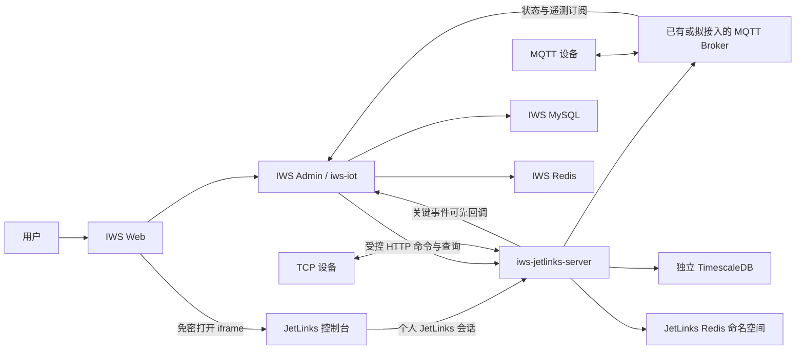
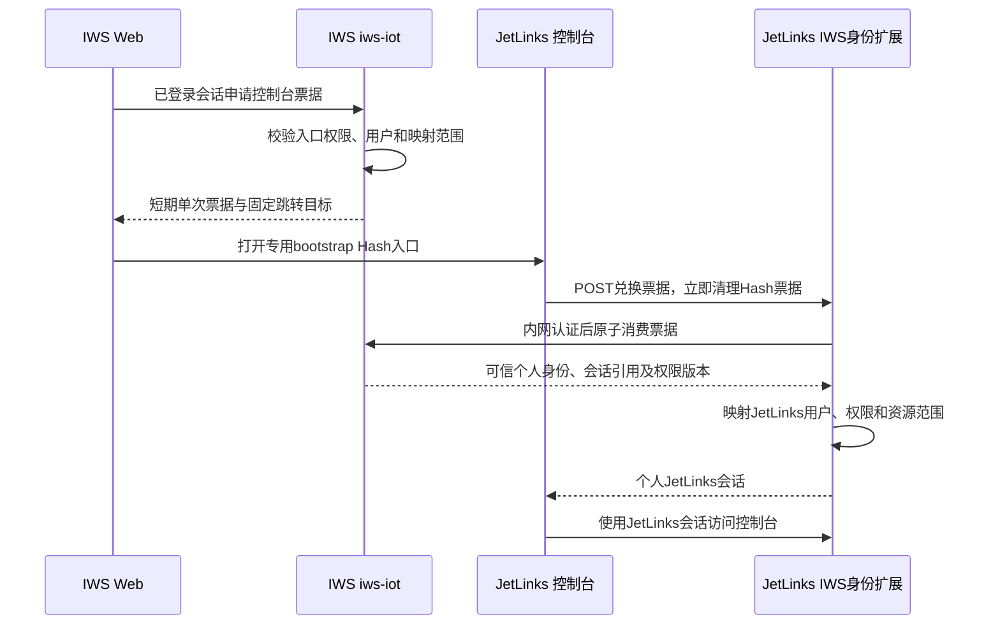
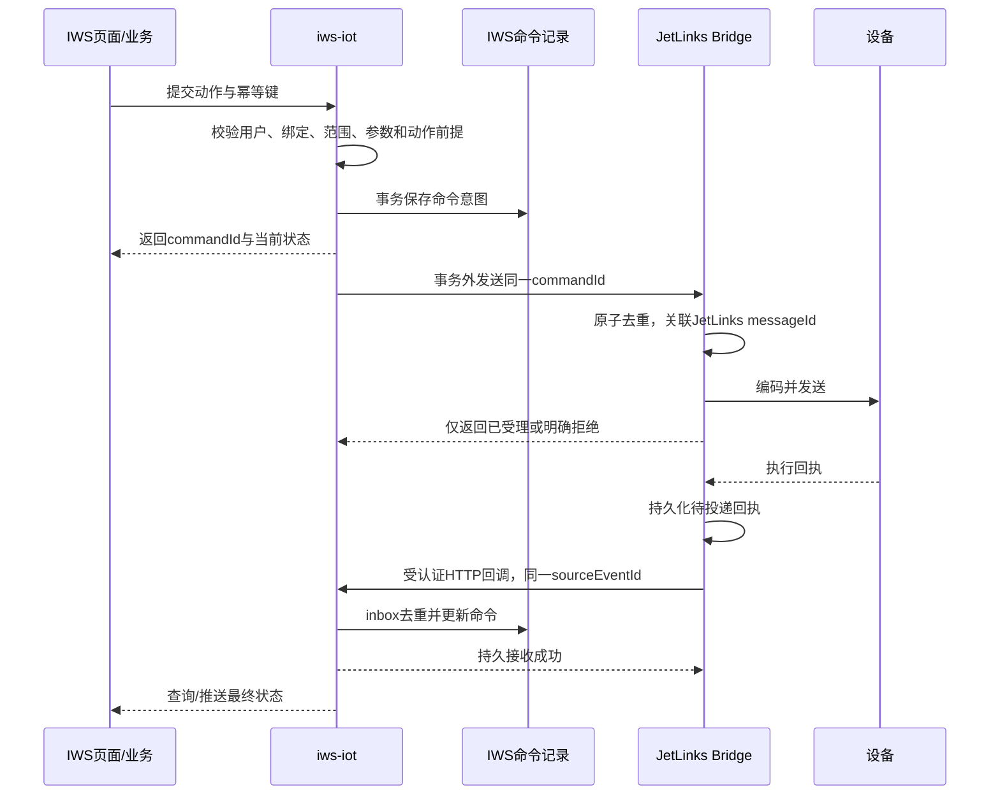

# JetLinks 接入 IWS 完整方案

日期：2026-10-26。状态：方案完成，尚未实施。适用：IWS 后端、Web、JetLinks 社区版及设备协议包；本轮不修改业务代码、不启动服务、不执行数据库写入、不提交或推送。

## 1 建设决定

JetLinks 按现有 job 的方式接入：**继承 IWS 父 POM、统一 Java 21 和 Spring Boot 4.1.0、独立打包启动，由 IWS 提供统一入口和业务接口。**

用户已接受独立扩展服务，最新明确要求继承 IWS 依赖体系。因此不采用独立 Boot 版本、不在子模块覆盖 Boot 3.4 BOM、不把 Boot 4 适配失败后的独立版本运行当作交付替代。

统一入口应达到：登录 IWS 后直接使用设备功能，设备工程人员可以进入 JetLinks 控制台而不再次输入密码；普通操作人员在 IWS 页面查看设备和执行被授权的业务指令。两个后端进程、两个独立前端构建保留，但用户从 IWS 使用。

### 1.1 已核实事实

| 项目 | 当前证据 | 对方案的影响 |
| --- | --- | --- |
| IWS | 根 POM 声明 Java 21、Boot 4.1.0；Web 为 Vue 3、TypeScript、Element Plus、Pinia | 新模块继承当前基线，不降低主系统版本 |
| job | `iws-job` 随 `iws-admin` 运行；`iws-snailjob-server` 继承 `iws-extend`，独立 JAR/进程 | 复制这种模块和进程分工，不声称 job 独立管理 Boot 版本 |
| job 页面 | iframe 加载 `/snail-job`；Vite/Nginx 代理；没有 IWS 换票登录 | iframe 入口可参考，单点登录需新增 |
| MQTT | `iws-common-mqtt` 已有 Mica MQTT 客户端及监听器；当前监听主要记录日志 | 复用客户端基础设施；订阅规范、幂等消费、命令闭环需要实现 |
| JetLinks 后端 | 社区 `2.11` 分支固定提交 `d81b571db19658d974f5ce652dd82d904cabf485`，声明 Java 17、Boot 3.4.10、Spring 6.2.11、hsweb 5.0.2-SNAPSHOT | 统一父 POM 前必须进行 Boot 4 / Spring 7 适配，当前未证明可直接启动 |
| JetLinks 前端 | `2.11` 分支固定提交 `1b1c0e5df5fcded0c4b939532ac334c264f28b47`；Vue 3、Ant Design Vue，Vite base 为 `/`，Hash 路由 | 保留独立控制台，避免将 Ant Design Vue 混入 IWS Element Plus 主应用 |
| JetLinks 存储 | 默认 PostgreSQL/TimescaleDB，Redis；设备历史默认策略 `timescaledb-row` | 新增一个 TimescaleDB 实例；不将完整设备历史写入 IWS MySQL |
| JetLinks 协议 | 社区源码存在协议 JAR 加载器、MQTT/TCP 接入及设备功能调用 | 平台接入能力可复用；具体型号、轮询驱动和协议包仍需逐项验证 |

`2.11` 是分支，不是本次核验到的发布 tag。后续构建必须锁定上述源码及依赖，不能依赖分支最新状态或可变 SNAPSHOT。根 LICENSE、前端/子模块、协议包及其依赖分别核对，不能将一个仓库的许可自动推广到所有制品。

### 1.2 首期范围

- 产品、设备、物模型、协议包、网络组件、实时/历史数据与诊断：复用 JetLinks 控制台中经版本验证存在的页面。
- IWS 原生页面：设备关联、设备状态、业务指令、指令结果和接入健康。
- MQTT 与 TCP 设备接入；复用已有或拟接入 Broker，设备协议统一由 JetLinks 处理。
- 完成一个 MQTT 模拟设备、一个 TCP 模拟设备、一个实际设备型号的接入闭环。
- 首期单实例 JetLinks；IWS 多实例需要竞争保护与幂等，不承诺 JetLinks 集群能力已经完成验收。

视频、AI、组态、大屏、OTA、其他工业协议、PLC 轮询、现场设备安全联锁不自动纳入。实际型号需要主动采集时，应把驱动连接、轮询、重连和释放纳入该型号交付，不能只交编解码 JAR 即宣称完整采集。

## 2 总体结构



该图中的 HTTP 业务桥接、免密登录、可靠回调为拟新增能力，不是现有链路。

设备只保留一条权威接入链：MQTT 设备经 Broker 交给 JetLinks，TCP 设备直连 JetLinks。IWS 不同时解析同一设备原始报文，也不绕过 JetLinks 直接向设备下发同一业务命令。

| 权威数据 | 归属 |
| --- | --- |
| 用户、岗位、IWS 功能权限、工厂/仓库业务范围 | IWS |
| 协议版本、产品物模型、连接状态、设备原始历史、设备通信回执 | JetLinks |
| IWS 业务对象与 JetLinks 设备的关联、指令意图、业务完成记录 | IWS |
| 设备物理动作最终事实 | 设备回执与现场确认合同；不能用 HTTP 200 或 MQTT PUBACK 代替 |

## 3 模块、源码与构建

### 3.1 与 job 对应

| 现有 job | JetLinks 拟新增 | 职责 |
| --- | --- | --- |
| `iws-modules/iws-job` | `iws-modules/iws-iot` | 随主服务运行，提供权限、绑定、命令、回执及业务适配 |
| `iws-extend/iws-snailjob-server` | `iws-extend/iws-jetlinks-server` | 继承 IWS 版本，独立启动设备服务 |
| SnailJob Server Starter | JetLinks 最小源码适配组件 | 不假设存在可直接用于 Boot 4 的官方 JetLinks Server Starter |
| `views/monitor/snailjob` | `views/iot/console` | 统一控制台入口；JetLinks 入口增加身份交换 |

初期 HTTP 客户端与 DTO 放在 `iws-iot` 内部，不为单一消费者预先新增 `iws-common-jetlinks` 或一套通用集成框架。`iws-admin` 仅依赖 `iws-iot`，不依赖 JetLinks、hsweb、R2DBC 或其服务端实体。

### 3.2 拟定目录

```text
innolux-iws/
├─ pom.xml                                  统一 Java/Boot/BOM 和第三方版本
├─ iws-modules/iws-iot/                      IWS 业务门面与集成实现
├─ iws-extend/
│  ├─ pom.xml                               现有父 POM，增加模块注册
│  ├─ iws-jetlinks-server/                   可执行 JAR、启动类、IWS 身份/消息桥
│  └─ iws-jetlinks-components/               适配后的 JetLinks 最小源码模块集合
├─ script/docker/jetlinks/                  设备服务、控制台、TimescaleDB 部署配置
├─ script/sql/                              IWS 增量结构与菜单脚本
└─ docs/jetlinks-iws-integration-design.md   本方案
```

`iws-jetlinks-components` 是同一 Maven reactor 内的组件集合，其父链也继承 `iws-extend → innolux-iws`。内部模块清单由依赖闭包核对确定，只纳入设备、协议、网络、鉴权、文件、消息网关、TimescaleDB 等实际运行依赖，不能为了减少目录而删掉必需组件。

JetLinks 上游 Java 包名、版权和来源保持可追溯，IWS 新增代码使用 `com.innolux.iws.iot`。不将社区源码一律改包，也不复制第三方源码后失去升级依据。记录基线提交、补丁、依赖锁定及许可清单。

控制台保留独立构建目录，建议 `iws-extend/iws-jetlinks-server/console`，保留自己的锁文件与 UI 组件体系；通过独立镜像或静态目录发布。IWS Web 仅新增业务页面与 iframe 容器，不引入控制台全部组件。

### 3.3 Boot 4 适配验收门槛

1. 先生成根项目与 JetLinks 的依赖树，建立实际冲突清单。Boot、Spring Framework、Reactor、Netty、Jackson 等由 IWS 根版本体系统一；不得在 JetLinks 子 POM 偷渡旧 BOM。
2. 逐项核验 Boot 4 自动配置/Starter 拆分、Spring 7 API、Jakarta、WebFlux、R2DBC、验证、日志、监控与序列化。重点检查 hsweb 和 easyorm 的公开 API、自动配置与二进制兼容。
3. 对不兼容的第三方组件选择已证实兼容版本；无可用版本且属于必要能力时做最小源码适配，保存许可证和补丁。第三方版本集中定义，不静默使用可变 SNAPSHOT。
4. 保留 JetLinks 的 WebFlux 进程与 IWS 的 MVC 进程，不混合启动，也不让 JetLinks 扫描 IWS 全部模块。普通公共模块只在确认不传入 MVC/Sa-Token 假设后复用。
5. 先通过独立 JAR 启动、鉴权、数据库、协议加载、MQTT/TCP、WebSocket、序列化及停机释放验证，再进入页面和业务实施。
6. 若尚未通过，报告具体依赖/源码阻碍，继续修复统一版本方案；不得宣布原版 Boot 3.4 运行即完成，也不擅自改变用户确定的继承关系。

仅 `mvn package` 成功不代表通过。必要验收包括完整 reactor 构建，确认 IWS 主服务依赖树没有出现 JetLinks 服务端组件，以及打包制品的实际运行行为。部署镜像必须使用本 reactor 生成的适配 JAR 和 Java 21 运行时，并记录构建来源与实际 Boot 版本；不能在统一 POM 下只放一个启动包装器、镜像内部仍运行上游 Boot 3.4 原版制品。

## 4 页面与统一身份

### 4.1 使用入口

IWS 增加一级菜单“设备中心”：设备总览、设备关联、指令记录、接入状态、设备控制台。产品/物模型/协议等复杂页面在控制台内完成，不在两个系统各维护一套。

| 用户 | 使用方式 | 权限边界 |
| --- | --- | --- |
| 仓库操作员 | IWS 原生页面，只展示关联设备和允许指令 | IWS 功能权限与对象范围双重校验 |
| 设备工程师 | 从 IWS 免密打开 JetLinks 控制台 | 映射个人 JetLinks 用户和明确设备范围，不共用管理员 |
| 平台管理员 | 管理协议、网络组件与角色映射 | 单独授权，操作可归因；IWS 管理员不自动变成 JetLinks 超级管理员 |

设备在线与数据新鲜度分别展示。Broker 断线或数据过期显示“数据过期/链路异常”，不能直接将缓存值显示成设备实时事实。指令页面区分已提交、已受理、设备执行成功、失败和结果未知。

### 4.2 控制台部署

生产优先同站独立子域，例如配置中的 `console-origin`。控制台在该域根路径运行，API 使用其 `/api`，WebSocket 通过相同域的 `/api/messaging/*` 转发。这样契合上游 Vite 根路径和 Hash 路由，并隔离两个前端的 LocalStorage。

与 job 相同的是统一菜单和独立服务，URL 不必机械使用同源子路径。开发环境采用两个可解析的本地域名/站点验证；普通跨站 iframe 的 Cookie、浏览器策略和证书必须实测。同源子路径方案若后续采用，需重新验证 base、静态资源、存储键和路由，不作为未经验证的替代。

iframe 只允许固定配置的控制台 origin。CSP `frame-ancestors` 只允许 IWS，`postMessage` 必须同时校验 origin、source 和消息类型；不为方便而允许任意站点嵌入。文件上传、下载、刷新、深链接、全屏和 WebSocket 都纳入验收。

### 4.3 拟新增单点登录

JetLinks 原有 HTTP 令牌为 `X-Access-Token: <token>`，不是 IWS Bearer Token。现有第三方用户绑定不等于 IWS 换票登录。以下流程需要开发，并以前置验证为门槛：



- 默认票据有效期 30 秒，原子单次消费；绑定 `audience`、目标 origin、IWS 会话引用、用户、随机值和权限版本。过期、重放、目标不符均拒绝。
- 独立 bootstrap 路由适配现有 Hash router；票据不放普通 URL query、access log、Referer 或持久浏览器存储。bootstrap 无第三方分析脚本，兑换后立即清理地址。
- 兑换由 JetLinks 服务端通过受认证内网通道调用 IWS，不能接受前端自报角色、用户 ID 或仓库范围。具体认证 Provider 与 Token 创建方法在 Boot 4 POC 中确认。
- 不传递 IWS 长期 Token、不共享管理员、不保存用户 IWS 密码。身份映射缺失或被禁用时拒绝；不能按同名账号自动合并。
- IWS 退出、禁用用户、权限变化后吊销关联会话。普通请求最长 30 秒复核窗口；协议上传、网络启停、命令下发等敏感动作即时复核。IWS 不可达时停止新登录和敏感操作。
- 已建立 WebSocket 必须在复核超期或会话吊销后关闭，并使重新连接失败。上游只在握手时解析身份，不能声称其已有自动联动退出。
- 后端必须落实资源权限，隐藏菜单不是访问控制。未完成工程师资源范围校验前，控制台只向明确全设备授权的管理员开放，不能向普通仓库角色开放。

### 4.4 两类后端身份

浏览器控制台使用个人 JetLinks 身份。IWS 后端调用使用独立、最小权限服务身份，凭据只在服务端；具体社区 `api-client` 签发方式未完成核验，不能将 Swagger 文档当作已具备的服务账号机制。

若社区机制无法满足要求，在同一 JetLinks 服务中新增窄的 IWS Bridge API，使用受认证服务身份，仅开放绑定范围内的查询和业务动作。命令带操作者引用与审计字段，身份以服务端可信上下文为准。普通用户无权通过通用代理调用任意 JetLinks URL。

## 5 MQTT、设备接入与协议包

复用已有或拟接入的 Broker，不默认再部署第二个 Broker。设备原 Topic 和设备凭据由 JetLinks 的 MQTT Client 接入及协议包处理。IWS 只订阅标准化后的北向 Topic，不订阅原始设备 Topic 执行业务。

| 流向 | 规划 Topic | 说明 |
| --- | --- | --- |
| JetLinks → IWS | `iws/{environment}/iot/{platformCode}/device/{deviceId}/telemetry` | 最新属性；可有限使用 retained 作为展示快照 |
| JetLinks → IWS | 同前缀 `/state` | 连接事实和发生时间；不能单靠 MQTT 连接事件代替设备业务状态 |

Topic 为本方案拟定北向合同，不是 JetLinks 或现有 IWS 已有规范。标准化转发必须检查社区实际能力，若内置规则不能满足则由最小 Bridge 订阅设备消息后实现。Topic 不携带密码或令牌，客户端 ACL 限定环境、平台和方向。

消息至少有 `schemaVersion`、`sourceEventId`、`platformCode`、`deviceId`、`messageType`、`occurredAt`、`receivedAt`、`properties`；时间使用带时区格式或统一 epoch 毫秒。设备协议能提供时增加 `bootId/sequence`，避免设备重启后序号冲突。解析后的数据须校验物模型、大小、精度和设备归属。

遥测用于展示，可限流、合并和丢弃过期值；乱序数据保留历史但不能覆盖更近的实时快照。无可靠序号时标明“按接收时间”，不能声称掌握真实设备先后顺序。retained 快照、回补和重复上报不得触发一次性仓储动作。

关键业务事件和指令最终回执走第 6 节的持久接收链，不能把当前自动 ACK 的 MQTT 监听器当成可靠业务入站。QoS 1/2 和 PUBACK 不等于业务事务提交。

协议包由工程师上传到 JetLinks，登记协议 ID、版本、SHA-256、SDK 版本、适用型号及许可。先停用目标接入或进入维护窗口，检查在途命令，再测试、发布和切换；失败恢复上一已验证制品。JAR 可以执行 JVM 代码，只允许可信工程师使用经审阅的制品；不将类加载器当作安全沙箱。

首个 MQTT/TCP 协议必须覆盖身份、属性、上下线、指令、回执、异常报文、TCP 拆包和重连。TCP 接收型与平台主动轮询型分开验收。已有 JAR 不跨版本盲用，不把 JetLinks 协议包声明成其他平台可直接加载的通用格式。

## 6 命令、回执与一致性

### 6.1 IWS 门面

拟新增 `/iot` 下的绑定管理、设备查询、控制台票据、命令提交/查询和可信事件接收。前端统一使用现有请求、`R<PageResult<Vo>>`、反馈和权限能力。以下是设计职责，不代表接口已经存在。

`iws-iot` 内部只保留实际调用：查询设备、查询当前属性、提交指定动作、查询命令证据、接收标准化事件。设备动作使用允许清单与参数校验，不允许浏览器直接提交任意设备服务名、Topic、URL 或协议配置。

### 6.2 命令执行



拟定状态：`PENDING → DISPATCHING → ACCEPTED → SUCCEEDED / FAILED`；发送或执行结果无法确定时为 `UNKNOWN`；仅未开始发送的 `PENDING` 允许 `CANCELLED`。同步设备成功回复可以直接进入终态，不强制绕经 ACCEPTED。

- `commandId` 在一次业务效果全程不变；客户端幂等键和规范化载荷摘要一起校验。相同键同摘要返回原记录，不同摘要拒绝。
- 另由服务端根据业务类型、业务对象、动作步骤和版本生成稳定 `businessEffectKey`，与客户端请求键分开。一个业务效果只能指向一条命令；更换请求键、用户或页面都不能绕过。未决、UNKNOWN 或已经成功的效果不得创建第二条物理命令。重新执行须先取得明确未执行/安全补偿证据，经有权限的恢复入口审计处理，不能靠调用方随意增加版本号绕过。
- 命令记录兼作待发送意图，不再为首期复制一套通用 outbox 框架。事务提交后由有租约和 CAS 的发送器认领，避免多个 IWS 实例同时发送。
- 实际发送前重新核验发起用户是否仍有效及被授权、绑定是否启用且版本匹配、设备是否仍属于允许范围、业务单据与动作前提、设备最新状态与数据新鲜度。复核失败且尚未调用外部服务时记为 FAILED，原因标明 NOT_SENT，并释放占用；绑定被改动不得把旧命令迁往新设备。业务前提依赖锁或版本时，以发送准入时的本库版本/资源门禁约束，不能只校验提交时快照。
- DISPATCHING 租约到期不等于可以重新发送。新 worker 先查 JetLinks 持久接单和发送证据；不能证明未发出时进入 UNKNOWN，且原 worker 的迟到响应只能通过 commandId 和状态版本合并。JetLinks 侧必须原子认领命令并校验相同 businessEffectKey/载荷，避免 IWS 多实例或网络重试造成第二次设备发送。
- JetLinks Bridge 持久保留 `commandId → messageId` 和发送事实。原有功能调用接口未证明支持调用方幂等键和独立结果查询，因此物理动作不直接依赖该接口重试。
- 在“已发到设备、尚未保存发送事实”窗口发生崩溃时，不可承诺软件侧 exactly-once。若设备不支持幂等命令与结果查询，标记 UNKNOWN，禁止自动重发具有物理副作用的动作。
- 连接失败且能证明未发送的命令才可按有限退避重试；HTTP 超时、进程崩溃、设备超时均不能自动等同失败。设备在线但执行状态未知也不能再次下发。
- 每个动作定义超时、参数范围、允许设备状态、是否可安全重试、完成证据和取消含义。默认只启用可查询、可关联回执的动作；危险现场动作仍受 PLC/设备联锁控制。

UNKNOWN 的收敛只允许：收到能够关联原 commandId/messageId 的可信迟到回执，或查询得到满足该动作完成合同的设备事实，转为 SUCCEEDED/FAILED；确认设备从未执行则记录未执行证据后进入受控恢复。仅有连接恢复、平台受理记录或当前普通属性不能据此判定成功/失败。人工核对必须由有范围权限的人员提交原因、证据及当前状态版本，并保留审计；不允许一个“重试”按钮直接抹掉 UNKNOWN。UNKNOWN 期间业务效果占用保持有效，后续新请求只能读取/核对原命令。

### 6.3 可靠接收与补偿

关键事件采用受认证 HTTPS 回调：JetLinks Bridge 先持久记录待投递项，失败继续以同一事件 ID 重试；IWS 在 MySQL inbox 持久接收并去重后才确认。消费失败留待重试，不撤销已经对来源确认的持久记录。

同一个 IWS 数据源中的业务状态/库存写入、业务效果键登记及 inbox 完成标记必须在同一事务提交。若调用既有计划事件入口或其他模块导致无法共用事务，接收端必须按稳定业务效果键幂等，先回读其已持久结果再完成 inbox；不得用“外部调用成功后再单独标记 inbox”替代。必须验证业务提交后、inbox 标记前崩溃的重投不会重复推进单据或库存。

JetLinks 侧的去重、待投递项及其持久化使用独立 JetLinks 数据库，不能写 IWS 业务表。设备事件捕获到待投递记录之间的崩溃窗口，必须通过同存储事务或基于持久消息游标的重放补齐；POC 不能证明时，该事件不能作为自动推进库存的可靠来源。

IWS 唯一去重键为 `(platformCode, sourceEventId)`，同键不同摘要隔离告警。指令终态不得被晚到的 ACCEPTED 覆盖；冲突回执保留原文摘要并进入人工核对，禁止静默改判。未知设备、缺失绑定、错环境、错设备的回执不得推进业务。

断线恢复后，从已确认游标回补关键事件并对账在途命令；遥测通过 JetLinks 当前属性重新同步。回补事件保留原始 ID、时间和重放标识。物理动作结果只能依据设备完成合同，不以普通属性缓存推断。

## 7 IWS 业务和计划事件接入

设备数据不会直接修改库存。`iws-iot` 完成来源认证、设备绑定、去重和证据保存后，交由明确的 WMS 业务服务校验单据、数量、位置与状态。首次交付只验证选定业务，不把所有告警接成自动出入库。

需要串联已有计划事件时复用 `iws-endpoint/iws-process`，不在 JetLinks 新建第二个 WMS 流程引擎。接线按项目指南分别登记：

| 事件 | 方向 | 完成含义 |
| --- | --- | --- |
| 下发设备业务命令 | OUTBOUND | 只完成一次调用；受理不代表设备成功 |
| 设备结果回执 | INBOUND / RESULT_CALLBACK | 关联原 `originOutboundEventId`，核对来源与结果证据 |
| 更新本地单据或库存事实 | INTERNAL / SAME_TX | 仅本库业务写入，复用已有检查点与本地效果键 |

上述为后续选定业务的接入设计，尚未注册业务 Bean。现有实例定位、任务挂载、可信身份策略、对象范围和定义发布仍按项目平台执行；不假设回调可以隐式建实例，不通过切换默认开关自动启用现场计划。

## 8 数据、权限和配置

### 8.1 拟新增持久数据

下表是逻辑模型，不是已部署表结构或本轮 SQL。物理字段、索引与幂等迁移在实施时确定，并通过真实库只读核验与隔离库事务测试。

| IWS 逻辑表 | 必要内容与约束 |
| --- | --- |
| `iws_iot_device_binding` | 平台码、JetLinks 设备 ID、工厂/仓库范围、业务对象类型与主键、状态、版本；有效设备绑定唯一，停用保留历史 |
| `iws_iot_user_link` | IWS 用户与 JetLinks 个人用户映射、允许角色/范围、状态和权限版本；双向唯一，不按用户名隐式合并 |
| `iws_iot_command` | commandId、客户端请求键/摘要、服务端 businessEffectKey、绑定版本快照、设备与动作、操作者、状态、messageId、租约、时间及证据；请求和业务效果分别约束唯一，CAS 状态更新 |
| `iws_iot_inbox` | 来源事件 ID/摘要、类型、设备、可信来源、关联命令、处理状态/次数、时间及错误；来源组合唯一 |

JetLinks Bridge 另保存命令去重与关键事件待投递记录，采用其数据库管理机制；不跨库事务、不双写同一库存事实。实时快照优先 Redis 缓存，完整历史留在 JetLinks，首期不重复建立 IWS 时序历史库。

首个业务关联优先使用实际存在的库区主键 `wms_warehouse_zone.zone_id`。工厂/仓库字段在当前库允许空值，空值不能理解为全范围；自动操作绑定必须由服务端解析出明确范围。设备、工位等未核验的业务实体不得凭名称编造关联。

数据保留周期按业务定义：原始遥测、关键回执、命令与审计分别配置；未对账记录、UNKNOWN 命令及未消费 inbox 不因通用清理任务被删除。

### 8.2 权限与审计

IWS 拟定权限包括 `iot:device:list`、`iot:binding:edit`、`iot:command:execute`、`iot:command:query`、`iot:console:open`、`iot:integration:manage`，最终菜单脚本只创建菜单，不自动给所有角色授权。

每次查询和执行在后端验证对象范围；用户不能通过替换设备 ID、绑定 ID、commandId、工厂或仓库参数越权。停用绑定阻止新动作，在途结果仍按冻结绑定归属处理。修改设备绑定、协议和身份映射必须记录操作者、原因、前后版本与关联审计 ID。

### 8.3 配置集中定义

拟增加 `iws.iot` 配置段，以下为配置合同，键名尚未实现：

| 配置 | 用途/首期建议 |
| --- | --- |
| `enabled`、`commands-enabled`、`console-enabled` | 初始全关闭，可分别启用 |
| `platform-code`、`environment-code` | 稳定平台与环境标识，区分回调和 Topic |
| `jetlinks.api-base-url`、`console-origin` | 内网服务地址、固定浏览器 origin |
| `credentials-ref`、`callback-credentials-ref` | 服务凭据引用，非明文密码 |
| `sso.ticket-ttl-seconds`、`sso.recheck-seconds` | 首期均建议 30；敏感动作即时复核 |
| `mqtt.topic-prefix`、`mqtt.qos` | 北向主题前缀与传输策略；不表示事务可靠性 |
| `telemetry.stale-after-seconds` | 按实际设备上报周期配置 |
| `command.dispatch-batch-size`、`command.lease-seconds` | 发送器限流与认领；租约不授权未知命令重发 |
| `callback.retry`、`retention` | 有界退避、隔离、保留与告警 |

地址、端口、数据库、Topic 和凭据引用集中定义；页面只获取非敏感配置。部署端口通过同一环境参数注入，不在 POM、Nginx、Compose、文档脚本分别写死。内部 JetLinks HTTP 端口建议另选空闲端口，现场 MQTT/TCP 端口依据已有 Broker 和设备网络确定。

## 9 部署、启用和恢复

JetLinks 单独镜像、独立 JAR、配置、日志、协议文件与健康检查；继承父版本不意味着与主服务共进程。TimescaleDB 独立库/账号，Redis 可以复用实例但需独立命名空间和权限；正式环境按负载决定是否独立实例。首期不为平台完整度额外部署 ES、Kafka、Nacos 等无关组件。

Compose 使用明确网络和端口映射，不复制现有 `privileged + host network` 作为默认。协议包、数据库、事件积压和命令记录持久化；服务进程使用受限账号。Windows 手动运行按项目端口绑定规则核验，不在本轮启动监听进程。

实施和上线顺序：

1. 完成许可、源码与依赖冻结；在同一父 POM 下完成 Boot 4 适配 POC。
2. 部署隔离测试环境，建立 TimescaleDB、协议文件卷和凭据引用；默认关闭现场命令。
3. 交付 IWS 可重复执行的结构/菜单升级及 JetLinks Bridge 结构升级；经授权在指定环境执行。不要重跑从零初始化脚本覆盖非空库。
4. 先部署关闭功能开关的 IWS 与 JetLinks，验证原有系统及 job 不受影响。
5. 开启只读查询和受限控制台，完成单点登录、范围、退出与浏览器验收。
6. 接入 MQTT/TCP 模拟器，完成协议生命周期、命令、回执、断线和崩溃验证。
7. 绑定一个实际型号和一项明确业务，先只读、再小范围打开命令，保留运维观察窗口。

停用时先禁止新命令，处理或保留在途命令和 UNKNOWN，再暂停现场接入。回退可独立回退前端、IWS 门面、JetLinks 和协议制品，但需保持消息合同与数据库结构可读；不删除 inbox、命令或设备历史。数据库版本不能安全回退时关闭功能并修复前进，不自动 DROP 或倒灌旧备份。

### 9.1 运维观察

至少观察 JetLinks/Broker/数据库连通、最后设备消息时间、遥测延迟、关键事件积压与最老年龄、发送队列、UNKNOWN 命令、协议版本、SSO 失败和吊销延迟。健康接口与业务就绪分开：进程存活但 Broker/存储不通时不可显示“采集正常”。

## 10 实施阶段与统一验收

以下为方案阶段划分，不是已创建的实施任务或已通过的检查。

| 阶段 | 交付 | 必须通过的验收 |
| --- | --- | --- |
| A 统一构建 | 根版本对齐、适配源码、独立 JAR/控制台、依赖与许可清单 | Java 21/Boot 4.1.0 下真实启动；身份、数据库、MQTT/TCP、协议、WS 可用；主服务无服务端依赖污染 |
| B 统一入口与身份 | IWS 菜单、iframe、换票、个人映射、退出 | 不重复输入密码；票据重放/过期拒绝；越权直连拒绝；退出/禁用后 30 秒内普通访问与 WS 失效，敏感操作即时拒绝 |
| C 设备与数据 | 绑定、北向 MQTT、状态、实时/历史查询 | MQTT/TCP 两类模拟器；断线/重复/乱序/retained/重连；设备状态与数据新鲜度准确 |
| D 命令闭环 | 命令意图、去重、结果关联、可靠 inbox/待投递 | 重复请求不产生新物理动作；超时/崩溃为 UNKNOWN；回调重复/冲突/丢包恢复；权限和参数被后端校验 |
| E 现场业务 | 一个实际型号、一个选定仓储业务及运维手册 | 真实设备完成证据；业务前提与对象范围正确；必要时按 INBOUND/OUTBOUND/INTERNAL 接入既有计划平台 |

重点失败场景：错误协议 JAR/依赖、服务已接单响应丢失、设备已动作服务崩溃、回执先于受理响应、IWS 双实例抢占、旧回执晚到、绑定改动、无绑定事件、Broker 重启、数据库失败、控制台刷新和下载、用户被禁用但 WS 仍连接。

对 MQTT/TCP 协议使用真实报文 fixture 与模拟器；对 inbox、唯一约束、CAS、租约和事务使用允许的隔离数据库；对 Boot 4/hsweb/R2DBC 与浏览器使用实际运行验证。Mock 不能代替上述结果，查询结构也不能证明写入和现场动作。

## 11 当前证据、限制与待补输入

### 11.1 本轮完成的核验

- 只读核对 IWS 后端 HEAD `c72dc53e4` 的当前工作树、Web 页面、MQTT 基础设施、父 POM 与扩展服务包装；已有 9 个后端修改保持原样，Web 工作树干净。
- 当前 `dev` 配置解析目标为 `localhost:3306/innolux_iws`。通过 database-readonly MCP 先执行 SHOW GRANTS，账号仅有 SELECT / SHOW DATABASES / SHOW VIEW。
- 真实库 `sys_menu` 中有任务调度中心，组件 `monitor/snailjob/index`、权限 `monitor:snailjob:list`、`is_frame=N`；这是 IWS 内部页面包 iframe，不是数据库外链标记。
- 仅查询命名包含 `iot/device/equipment` 的表名，结果为空；这不证明不存在其他命名的设备相关模型。库区相关主键和范围字段已查：`zone_id bigint`，`plant_code/warehouse_code varchar(50)` 且可空。
- 核对 JetLinks 固定提交的依赖、默认存储、HTTP/WS 鉴权、前端 base/router、设备调用及协议加载基础能力。

### 11.2 仍需实施验证

Boot 4 兼容、单点登录 Provider、服务身份签发、资源范围、30 秒吊销与主动断 WS、标准化 MQTT 转发、可靠关键事件捕获和回补均未运行验证。本方案将它们列为交付项，不描述为开源版已经开箱具备。

上游当前设备功能调用支持 `/device-instance/{deviceId}/function/{functionId}`，经外部 `/api` 前缀访问，返回设备功能 output 的流；未证明具备 IWS 所需的 commandId 幂等及独立最终结果查询合同。实施使用 Bridge 补齐，且区分同步成功、异步受理和 UNKNOWN。

待现场提供：首个设备厂商/型号/协议文档及样例报文、主动或被动采集方式、Broker 地址与认证/ACL、网络可达范围、点位/频率/规模/保留周期、生产域名和证书、岗位范围以及首个指令的安全与完成合同。在这些信息缺失时可以完成模拟器和平台建设，不能宣称完成真实设备或产能验收。

### 11.3 依据

- 本地：[IWS 父 POM](../pom.xml)、[扩展父 POM](../iws-extend/pom.xml)、[SnailJob POM](../iws-extend/iws-snailjob-server/pom.xml)、[MQTT 配置](../iws-common/iws-common-mqtt/src/main/java/com/innolux/iws/common/mqtt/config/MqttAutoConfiguration.java)、[现有 Nginx](../script/docker/nginx/conf/nginx.conf)。
- 本地：[计划事件公共指南](plan-event-public-platform-guide.md)、[业务接入指南](../.agents/skills/iws-plan-event-project/references/integration.md)。
- 上游：[后端固定提交](https://github.com/jetlinks/jetlinks-community/tree/d81b571db19658d974f5ce652dd82d904cabf485)、[前端固定提交](https://github.com/jetlinks/jetlinks-ui-vue/tree/1b1c0e5df5fcded0c4b939532ac334c264f28b47)。
- 上游：[默认运行配置](https://github.com/jetlinks/jetlinks-community/blob/d81b571db19658d974f5ce652dd82d904cabf485/jetlinks-standalone/src/main/resources/application.yml)、[协议加载器](https://github.com/jetlinks/jetlinks-community/blob/d81b571db19658d974f5ce652dd82d904cabf485/jetlinks-components/protocol-component/src/main/java/org/jetlinks/community/protocol/AutoDownloadJarProtocolSupportLoader.java)。
- 上游：[设备功能控制器](https://github.com/jetlinks/jetlinks-community/blob/d81b571db19658d974f5ce652dd82d904cabf485/jetlinks-manager/device-manager/src/main/java/org/jetlinks/community/device/web/DeviceInstanceController.java)、[WS 鉴权](https://github.com/jetlinks/jetlinks-community/blob/d81b571db19658d974f5ce652dd82d904cabf485/jetlinks-components/gateway-component/src/main/java/org/jetlinks/community/gateway/external/socket/WebSocketMessagingHandler.java)。

本地方案归属个人文档交付，不进入来源仓库产品提交。本轮没有授予业务实施、数据库写入、服务启动或远端发布权限。
