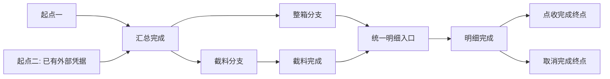

# IWS 计划、事件与状态机完整设计方案

日期：2026-10-22。状态：方案评审稿，仅交付文档，尚未实施。目标项目为 `innolux-iws`；经验来源为越南奇宏 SMT-PCBA 的接口日志、过账事件与重试实现。用户指定数据库为 `localhost:3306/innolux_iws`，覆盖当前 dev 配置的端口选择；本次不修改配置、代码、SQL 或数据库。

## 1. 结论与文档入口

新增可选后端模块 `iws-modules/iws-process`，承载计划定义、事件编排、状态校验及检查点恢复；按用户最新要求，系统/IP/环境配置单独归属 `iws-modules/iws-endpoint`，提供可独立启用的基础配置可视化页面，process按需依赖其配置读取能力。Web增加基础配置、计划配置、总览和两级执行链查看。复用现有MyBatis-Plus、事务、鉴权、字典、日志、锁、SnailJob及Warm-Flow；模块职责和开关见§18，不新建调度平台或第二套执行引擎。

核心模型是“业务统一调度计划 + 版本化有向流程图 + 任务计划实例 + 分支 token + 固定起止状态的事件 + 执行检查点”。整事件执行和整事件跳过共用一个更新入口；屏蔽过账另在执行路径内跳过指定类型的操作。续跑调用原更新入口，从已记录检查点继续。

统一监督调度是实际长期运行的 `planRole=SUPERVISOR` 计划，不只是配置或扫描任务。每个业务内的每个计划类型、调度范围独有一个监督实例，模式为 `QUEUE`（队列计划）或 `IMMEDIATE`（即时计划）；监督只含 `DECISION` 决策事件和 `LOCAL` 本地事件，两者均为 `INTERNAL`。其有限调度轮次、准入/恢复/重启决定和对应子计划都有持久记录。完整增补契约以 [§17](#17-两类长期监督调度计划的实施契约) 为准；§3、§10、§11、§13 的通用规则按该节区分监督与业务角色。

事件采用最小动作粒度：有网络交互的事件只能是一个 INBOUND 入站逻辑调用或一个 OUTBOUND 出站逻辑调用，两方向互斥；另允许 eventDirection=INTERNAL 的无网络事件，只执行一个受控的同模块内部本地动作。每个事件仍只有一个逻辑效果、一个源/目标状态；IN/OUT 事件恰有一个调用合同，INTERNAL 不绑定调用合同、inbound/outbound receipt、方向记录或 CALL permit，而绑定一个 localActionKey/version。不同请求、不同接口或多个独立效果必须拆事件，即使系统相同也不合并。入站触发后出站抛账、出站提交后入站回调也分别建事件。重复投递/安全重试是同一逻辑动作的多次请求记录，不代表允许第二项动作；HTTP 响应/ACK 属于原请求协议，不是另一项出站抛账。

配套材料：

- [分场景及整合时序图](plan-event-state-machine-sequences.md)：配置、挂载、确认、执行、跳过、分支、异常、续跑、监督及整合场景。
- [源码与数据库核验依据](plan-event-state-machine-evidence.md)：已有能力、实际来源、数据库只读快照及未验证边界。
- [前后端修正工作包](#13-前后端修正工作包)：后端文件、Web 页面、API/DTO、权限、交互和验收逐项对应。
- [模块复用与新增实施计划](plan-event-state-machine-implementation-plan.md)：复用、M01-M12 与编码细节；§19–§23 补充等待触发、统一 HTTP、出入站记录、全部场景、设计模式复核、单调用最小化及对应验收。

本方案中的类名、表名和命令名均为拟议设计，除明确列为来源的内容外，不代表当前项目已经实现。

展示与代码命名分离：计划/事件/状态/事件类型/分支/调用合同/系统及调度任务的 displayName、状态标签和操作说明使用中文；允许 SAP 等必要专名缩写及编号，不能只用英文技术码充当展示名。代码类/方法/字段、枚举值、业务 code、权限、接口路径、executor 和 bizId 保持英文稳定标识。中文名不参与分支判断、唯一性或恢复；前端缺字典时使用内置中文标签或“未配置中文名称（code）”，不只显示原始英文码。历史快照保持不变，缺中文名通过只读展示映射补充，不能借改名重写已发布定义或运行事实。

### 1.1 本轮已经明确的要求

| 要求 | 本方案采用的含义 |
| --- | --- |
| 计划的多系统过账模式 | 计划版本按 `system_code` 各保存一条单值记录；不同系统可采用不同 `AUTOMATIC / MANUAL_CONFIRM / BYPASS`，事件按自身系统码解析，挂载时固化快照 |
| 事件最小动作粒度 | 有网络交互时每事件仅 INBOUND 或 OUTBOUND、一个不可变调用合同；另允许 INTERNAL 无网络事件执行一个本地动作。多入站/多出站/入站后出站拆事件，可靠重试原调用不算新增调用 |
| 屏蔽过账的精确范围 | 仅跳过 OUTBOUND 非本系统接口抛账的唯一调用；INBOUND、本系统 action、查询及控制各自事件 |
| 首次过账确认 | 人工模式下，前置未满足的事件先等待前置；前置满足但未确认的事件待人工处理。一次确认放行对应范围的当前及后续事件 |
| 确认后失败 | 立即回到待人工处理，后续命令叫“事件重试”；不重新做首次过账确认，也不自动进入失败退避 |
| 跳过事件 | 保留图中的事件边及状态迁移，完全不执行该事件内部业务操作 |
| 状态校验 | 源状态和目标状态都必须有校验；分支共享的状态复用同一校验器 |
| 调度 | 使用现有 SnailJob；当前开关关闭不构成阻断，后续按需启用已获用户认可 |
| 工程约束 | 能复用已有能力必须复用；少量必要扩展，不制造复杂工具体系 |
| 统一业务调度 | 业务分组登记计划类型；每个业务的每类计划及调度范围有独有长期监督计划，只含决策/本地事件；队列与即时两种模式及调度记录见 §17 |
| 前后端同步修正 | 后端提供版本配置、计划命令、调度控制和两级执行描述 API；Web 提供配置、实例总览、计划链和事件详情 |
| 工作流复用 | 已确认 IWS 集成 Warm-Flow 1.8.9；可复用人审、任务和轨迹，外部事件恢复仍以领域表为事实源 |
| 配置版本编辑 | 计划与事件配置页可切换查看版本；只有最新草稿可修改，旧/已发布版本只读，可复制为新草稿 |
| 代码绑定动作 | 动作实现、校验器、分支条件、恢复协议和固定节点身份只能查看或选择已注册实现；需改代码的移动/改绑动作禁用 |
| 全动作审计 | 配置、执行、编辑、删除、确认、暂停、取消、重试、续跑、分支决策和调度控制均记录操作者/系统、时间、前后状态、版本、结果和关联证据 |
| 权限与租户 | 复用 Sa-Token、动态菜单、数据权限和前端权限指令；当前项目无可用多租户实现，不预造 tenant_id，后续引入时按独立隔离清单升级 |
| 后端接口权限复用 | 复用现有 Sa-Token 拦截器、`@SaCheckPermission`、`StpUtil.checkPermission` 和 `@DataPermission`；Service 另校验对象、状态、版本，不搭建第二套权限框架 |

业务任务的具体唯一键、首批接入的实际业务流程和各事件的真实业务状态值尚未指定。本文给出可实现的公共契约及 SMT 示例，不把示例状态直接映射为当前 WMS 表的既有状态。

## 2. 已有实现带来的约束

旧 PCBA 将领域事件、外部请求明细、接口日志和运维投影分开：领域事件决定恢复位置，接口日志只记录交互，运维投影只承担展示和命令路由。新模块沿用这种职责划分，不把 URL、请求体或日志表变成事件执行依据。

旧方案已经考虑稳定 `eventKey`、载荷摘要、CAS 认领、租约、外部成功与本地同步分离、常驻监督器和空闲 worker 停机。应迁移这些规则和适配经验，不直接复制旧项目的 Java 8、Quartz、表名或 PCBA 专属业务判断。

需主动区别当前实现与本次新语义：旧确认方案在失败后仍按有限重试规则推进；本次人工确认模式要求执行失败立即待人工处理。旧模式 provider 根据全局屏蔽与按箱开关推导模式；本次改为计划版本内按系统分别维护的单值显式配置。旧实现曾在同一业务过程包含本地投影、多次 HTTP 和外呼；目标按一事件一调用拆图，只迁移其中可独立验证、幂等和恢复的单次调用，不能把旧过程整体作为一个事件合同。

## 3. 业务、任务和计划的关系

### 3.1 身份和唯一性

```text
业务 business_id
  ├─任务 task_id=A → 计划实例 plan_instance_id=PA → 固定计划版本 V3
  └─任务 task_id=B → 计划实例 plan_instance_id=PB → 固定计划版本 V5
```

- 一个业务可包含多个任务；一个业务任务挂载一个计划实例。
- `plan_code` 是计划定义的稳定唯一标识，`plan_version` 是发布版本，`plan_instance_id` 是一次任务执行的实例标识，三者不可混用。
- `plan_type` 是业务统一调度所使用的计划分类，如整箱、截料、返料；一个类型可以有多个版本或定义，由业务挂载规则唯一解析，不与实例 ID 混淆。
- 当前单租户任务唯一约束建议为 `(business_type, task_key)`，要求 task_key 在该业务类型内唯一；若业务只保证单据内唯一，P1 明确把 business_id 纳入键。未来正式引入租户后才增加 tenant_id。任务确需重开时由业务创建新任务身份，不清空旧实例重用历史。
- 挂载通过业务提交的类型、系统范围、任务键和路由条件选择一个已发布计划版本；匹配零个或多个均返回明确错误，不任取第一条。
- 实例对计划版本、节点、状态、各系统过账模式、分支规则及处理器版本引用形成不可变快照。配置变更只用于新版本及此后新建/新挂载实例；旧计划定义版本继续保持原配置，旧计划实例无论运行中还是已结束均保留原快照。
- 初次挂载可生成事件占位。前驱未满足为 WAIT_PREDECESSOR；前驱已满足但唯一 INBOUND 请求/载荷未到才是 WAIT_EXTERNAL_TRIGGER。OUTBOUND/INTERNAL 输入未齐保持 WAIT_PREDECESSOR，INTERNAL 不等待任何外部/本地服务“触发”。不得拼造请求或提前执行点收。
- 迟到业务信号只激活该版本预留的事件，不修改图结构。新增节点通过新版本承载，运行中实例迁移另做显式方案。

### 3.2 小接口挂载

对业务只暴露 attachTask、receiveTrigger（替代旧 signal）、confirmPosting、retryEvent、pause/resume、queryPlan 等 HTTP 能力。挂载/受理不外呼，也不在 Controller 中逐个调用事件工具。

以上挂载后异步驱动适用于 QUEUE。IMMEDIATE 专用 execute-immediate 同步返回最终成功或明确错误，Controller仍只调用应用服务，不直接操作事件；原retryEvent/失败退避不得用于重做已终结的即时计划，未知恢复规则见 §17.5。

业务模块经 HTTP 挂载/触发，包括同 JVM 后端其他模块；业务创建与待发送标记在调用模块事务内提交，挂载受理在接收请求的独立事务内。复用现有业务待挂载/待发送标记和幂等扫描，不为本需求引入消息平台。重复挂载相同任务返回既有实例；关键输入摘要不一致则拒绝。HTTP 实现以原 PCBA 参考仓库和 IWS 已有封装核验为准，不新造通用传输体系。

首次挂载事务保存实例、选中的起点集合、token、事件占位和调度唤醒标记。事务提交后尝试唤醒 worker；唤醒失败由常驻监督器扫描修复，不能让已提交的业务任务丢失。

### 3.4 多方入站与多目标出站

用户补充确认：多个外部系统或本地服务都可能调用 IWS 接口抛账；IWS 也可能调用多个外部系统或本地服务接口抛账，不能假设“本地”一定是直接方法调用。以下是满足该范围的建议契约，具体协议、是否必须同步返回完成和来源范围在 P1 映射，不擅自改变已有对接接口。

| 链路 | 接收/执行责任 | 统一约束 |
| --- | --- | --- |
| 多系统/本地服务 → IWS 触发接口 | 入站身份与协议转换后调用 `receiveTrigger`，持久受理回执和触发事实 | 调用者码不决定系统过账模式；等待前驱/触发/确认后才由 worker 执行 |
| 外部已完成业务动作 → IWS 通知 | 独立 INBOUND REPORT_COMPLETED_EFFECT 事件，绑定已发生效果 | 只记录可验证事实；若还需另一业务效果，由新事件承载，不能再次执行已报告效果 |
| IWS → 系统 A → 系统 B | 按业务效果与系统模式划分有序事件 | A 成功 B 失败保留 A，不回滚/重发 A；各系统独立确认及恢复 |
| IWS → A/B 并行 | 冻结 AND 分支，各分支有独立事件/幂等键/回执 | 汇合等待本次期待集合，不以一次 HTTP 受理代替业务完成 |
| 后端其他模块 → IWS 触发接口 | 包括同 JVM 的 WMS/其他业务模块，统一经 HTTP 受理 | 调用模块先提交真实业务数据及持久待触发记录，再发送；不持锁同步自调 |
| IWS → 本地服务、后端其他模块或自身 action 接口 | 一律 HTTP，经过发送意图、幂等、超时和结果协议 | 不因同 JVM/同机/同库而加入调用方事务，不递归调用本事件触发端点 |
| 本模块内部本地动作 | INTERNAL 事件调用一个注册 LocalAction，不使用 HTTP | 无 receipt/HTTP 方向/CALL permit；跨模块或第二动作必须拆事件 |
| 外部 → IWS 结果回调 | 独立 INBOUND 结果事件，绑定 originOutboundEventId 与外部调用关联 | 不能作为出站事件自己的第二个入站调用，也不再次抛账 |

`callerSystemCode` 表示来源，事件 `system_code` 表示本事件使用哪个系统的模式，`targetSystemCode` 表示实际业务效果所属系统，`endpointRef` 表示部署接入点。代理网关所在系统与最终效果系统可不同，不能按 URL/服务进程重写 targetSystemCode。用户已明确统一 HTTP，因此 INBOUND/OUTBOUND 的 transport 固定 HTTP、不提供 RPC/直接 Java 业务调用；`endpointRole=TRIGGER_EVENT/EXECUTE_ACTION/RESULT_CALLBACK/QUERY/CONTROL`、`completion=SYNC/ASYNC` 分别定义入口角色与完成协议。INTERNAL 无 transport/endpointRole；编排内部纯计算/Mapper 和接收端内部业务方法不属于跨模块/服务的业务接口调用。

“本地服务”包含同一 Spring Boot 应用里的其他后端模块，不只指另一部署。模块边界与部署拓扑独立：其他模块由自己的 HTTP 客户端调用入口，以稳定 moduleCode/服务身份区分调用者；端点地址由受控环境配置解析。跨 HTTP 不传播 Spring 事务或依赖当前线程的登录/数据权限上下文，业务调用者、原操作人、允许业务范围由可信上下文显式传递并核验。调用模块在本库事务内写真实业务数据和待触发记录，提交后 HTTP，失败幂等补发；不得持有该数据行锁等待同 JVM HTTP 请求，也不能只依赖 afterCommit 内存回调防丢。

每个有网络交互的事件只有一个政策系统归属和一个调用方向/合同；同系统两次独立调用也要两个事件。INTERNAL 是明确的零网络方向，仍有 systemCode 归属但无调用合同/请求/回执/CALL permit，只执行一个已注册本地动作。多个必需入站各建 INBOUND 事件，AND 汇合后才触发后继；多个出站按依赖/并行拆分。适配器仅映射本事件单次协议，不得隐藏转发、鉴权刷新、查询对账或级联抛账；需跨模块/外部 HTTP 的额外交互都要独立事件。连接建立、传输内部行为、原请求响应及引擎数据库读写不算业务调用。

INBOUND 在本平台只受理/校验/消费本次请求及其可验证证据，不因载荷写着“执行抛账”就转发业务 HTTP；若需调用 WMS/其他模块执行业务，后继另建 OUTBOUND action。实际业务接收端在处理本次唯一 HTTP 请求的自身事务中调用内部 Service 是该请求内部实现，不算另一项业务调用；跨模块转发或另一个业务效果仍须拆事件。接收端已完成效果必须以证据记录，不由后续引擎再执行一次。

self HTTP 若发送和接收都由平台管理，O_SEND 与 I_RECEIVE 分属两个事件并共享 correlation/effect 关联。两者可以从共同已就绪前驱建立各自分支，I_RECEIVE 挂载时即允许接收，不能把“O 已收到 I 的响应”设置为 I 处理本次请求的前驱；需要最终收口的后继在两者完成后汇合。异步回调 I_RESULT 则可以依赖 O_SUBMIT 的受理事实，因为接收早到回调只存证据、不阻塞对端提交响应。发布时同时检查 DAG 和这类响应依赖，避免配置无环而运行时互等。

调度资源也不得互等：默认同平台入站 HTTP 在可靠回执提交后立即返回受理，不等待同池 worker 消费 I。若既有合同必须同步业务完成，接收端在自身请求事务内完成该次唯一业务效果并保存可信证据，I 随后只消费证据；不允许 HTTP 线程等待一个只能由 sender 当前占满的 worker/并发额度执行的 I。P1 核对实际响应合同与资源分组，不以增加线程数掩盖因果闭环。

### 3.3 业务必须有统一调度计划

`BusinessSchedule` 是按 `business_code` 唯一的业务调度分组，保留允许类型、类型优先级和共享资源规则。真正的统一监督计划以 `(businessScheduleCode, planType, scheduleScope)` 唯一；不同业务、不同类型各自拥有一个长期监督实例及冻结版本，不按具体单据或任务重复创建。`scheduleScope` 由业务注册规则根据仓库/设备等受控业务事实解析，默认非空 `DEFAULT`；请求方不能随意更换范围绕过串行或即时互斥。具体 `business_id` 的任务实例是 `planRole=BUSINESS` 子计划，挂载后绑定唯一 `supervisorInstanceId`。

```text
业务调度分组 business_schedule_code
  ├─WHOLE_BOX监督计划 / DEFAULT / QUEUE → 多条整箱任务计划实例
  ├─CUT_MATERIAL监督计划 / DEFAULT / QUEUE → 多条截料任务计划实例
  └─RETURN监督计划 / DEFAULT / IMMEDIATE → 同时最多一条返料任务计划实例
```

以上类型和模式仅为示例，不是首批业务映射。没有已发布且启用的对应监督计划，或类型未登记，拒绝挂载/即时执行。QUEUE 可在监督人工暂停期间受理新的挂起任务，但不准入；IMMEDIATE 暂停时立即拒绝。类型停用停止普通新认领，保留已发生效果和安全收敛路径，不等于事件跳过。

同一业务的调度资格只有一个权威入口。各类型监督以本库事实决策、提交子计划准入及控制意图；跨类型竞争同一业务资源时仍按业务分组统一排序与原子资源占用，不允许各监督先预留共享 CALL 许可再排队造成饥饿。worker 每次认领重验监督绑定、计划名额及业务门禁，不绕过监督自行启动一个新子计划。

业务调度排序为：计划类型优先级 → 实例运行优先级 → 事件运行优先级 → 就绪时间 → 稳定 ID。运行优先级可通过现有权限/审计命令调整，不修改冻结的流程图和过账模式。实例类型、图版本及业务归属保持不变。

复用 SnailJob 固定执行器推进各类型监督的到期轮次。长期是持久生命周期，不是一个永久占线程的 Job。默认每个监督范围一条幂等物理监督任务，`bizId` 以技术键生成并校验长度；子计划不再各建物理监督任务。即时请求由同一监督准入服务同步执行一轮决策/本地事件，随后在独立业务驱动层执行子计划，不依赖下一次 SnailJob tick。

## 4. 配置结构与发布规则

### 4.1 计划配置

| 配置 | 必需内容 |
| --- | --- |
| 计划身份 | `plan_code`、`plan_type`、版本、业务类型、名称、发布状态、`self_system_code`；当前不加租户字段 |
| 计划角色 | `planRole=BUSINESS/SUPERVISOR`；监督绑定唯一业务/类型/范围和 QUEUE/IMMEDIATE 模式；业务实例绑定 supervisorInstanceId，详细约束见 §17 |
| 过账控制 | 每个 `system_code` 一条 `posting_mode=AUTOMATIC/MANUAL_CONFIRM/BYPASS`、首次确认策略及异常策略 |
| 图入口 | 可选起点、起点选择规则、必需业务信号、输入是否关闭的判定 |
| 图出口 | 可达终点集合、完成策略 `ALL_SELECTED / ANY_SUCCESS` |
| 异常 | 本计划唯一 `exception_state_code`、失败分类规则、分支故障隔离策略 |
| 调度 | 职责分组、监督周期、worker 单轮上限、空闲停止时间、并发资源键 |
| 发布快照 | 配置摘要、注册处理器版本、发布人及时间 |
| 版本选择 | `version/no`、状态、最新标记、创建/发布人及时间；查询支持任意历史版本，编辑仅允许最新草稿 |

第一版采用无环图 DAG。多分支、多起点、多终点不需要循环。真实业务返工如需循环，后续增加有界迭代和独立轮次标识；禁止将同一事件键反复重置模拟循环。

计划版本状态为 `DRAFT / ACTIVE / RETIRED`。“最新版本”按同一 `plan_code` 的最大版本号确定，且必须处于 `DRAFT` 才可编辑；每个 `plan_code` 最多一个 `ACTIVE`，新实例只解析该版本。`plan_code` 同时代表唯一的挂载路由命名空间，不同路由使用不同 `plan_code`，不引入可变 `route_scope`。发布新版本在同一事务中把同计划旧 `ACTIVE` 改为 `RETIRED`，旧版本内容不变，旧实例继续引用旧版本。若最大版本已 `ACTIVE`，界面只读；点击修改必须先原子复制更高版本的 `DRAFT`。编辑接口同时校验 `versionId`、最新标记和草稿状态，不能仅相信前端按钮。

数据库可用可空 `active_key`、`latest_key` 做并发守卫：仅 `ACTIVE` 行的 `active_key=plan_code`，仅最新草稿的 `latest_key=plan_code`，其余为 `NULL`，分别建立唯一索引；发布事务同时切换状态和键。

计划业务版本号 `planVersion` 与并发修订号 `revision` 分开：普通草稿保存只递增聚合 revision，所有子项写命令的 expectedVersion 都指它；复制才创建新 versionId/planVersion。已存在最新草稿时复制返回该草稿冲突，不静默废弃其编辑权。逻辑删除不复用历史版本号，也不使旧版本恢复可编辑。具体流程见实施计划 §11.1、§15.1。

ALL_SELECTED 为默认：所有正常选中且必需的路径收口，并且业务输入已关闭、没有等待输入的必需节点后才完成。预发布 recoveryForEventCode 分支不进入正常 expected 集合，不占用正常完成屏障；仅 O_UNKNOWN+recoveryRequested 时创建恢复 token。O 在非 UNKNOWN 终结时该分支 NOT_SELECTED，QUERY 成功也只提供原 O 恢复证据，不单独推进正常完成。ANY_SUCCESS 只用于明确允许竞争路径的计划，胜出后处理其余在途及已产生副作用路径，安全收敛才结束。

### 4.2 系统维度的单值模式和系统字段

用户已明确：不是整个计划只有一个模式，而是“计划版本 + 系统码”各一条单值记录。一个计划涉及 MID-WMS、SAP、MES 等多个系统时，可分别采用不同模式，不同系统事件执行各自的过账行为。事件不保存可独立改写的模式，只在运行时解析所属实例冻结的该 `system_code` 配置。

系统定义与环境IP配置关联，供统一屏蔽菜单选择：参考PCBA的 `IpConfigEnum → ip_config.name → protocol/ipaddr/port` 解析方式，按下节维护稳定系统目录及其环境地址，不仅维护一组无法辨认目标的字典码。目标IWS尚无已核验可复用的ip_config模块，需要最小移植并适配现有CRUD/鉴权；不把参考能力写成目标已有。计划版本保存 `self_system_code`；实例挂载时冻结系统身份、调用绑定及整个系统模式映射。sys_config只可提供新草稿默认值，不能覆盖旧实例快照。

模式唯一键仍为计划版本+系统码，不在事件上另存可变模式。每个事件声明 systemCode、eventDirection 及唯一归属：IN/OUT 有 callContract/operationKind，INTERNAL 有 localActionKey/version；跨系统或同系统多次独立动作均拆事件。INTERNAL 不使用 BYPASS/CALL 资源但可遵守系统首次确认。入站 caller 与政策系统分开；同系统的不同事件可共享冻结模式及确认事实。

模式屏蔽只适用于 eventDirection=OUTBOUND、mode=BYPASS、kind=EXTERNAL_POSTING 且 targetSystemCode!=selfSystemCode 的单一出站调用；不按 URL 判断。入站事件不能被此规则假装未收到或已完成；本系统出站 action、查询/控制照常按各自独立事件执行。

命中时该事件唯一出站调用记 SKIPPED_MODE、sent=false，不发送；只在屏蔽合同及后继产物约束成立时完成本事件逻辑迁移，不能声称外部已过账。查询/本系统 action 等后继都是独立事件，是否继续由图依赖和产物合同决定。enabled=false 为整事件 SKIP、终态 SKIPPED；enabled=true+BYPASS 仍是执行策略，事件结果可 SUCCESS 但必须同时展示“抛账已屏蔽”。

### 4.2.1 外部系统、系统IP与一次性抛账配置菜单

用户本轮明确：自动收集计划内全部事件涉及的外部系统信息，提供一次性配置菜单，针对个别系统屏蔽，其余系统继续按原合同抛转。本节为对应实施契约，菜单设置作用于当前BUSINESS计划最新草稿；发布后供新实例使用。既有运行实例继续原快照，不因目录改IP或全局默认改变而隐式屏蔽/重新发送。SUPERVISOR仅自动本地调度，不提供该屏蔽菜单。

#### 系统身份与地址分开保存、联合展示

| 对象 | 关键字段/唯一性 | 规则 |
| --- | --- | --- |
| 系统定义 `iws_endpoint_system`（拟议） | systemCode稳定唯一、displayName中文、enabled、revision；系统码停用仍保留引用 | 独立endpoint模块拥有；一个逻辑系统可有多个地址，本系统由计划selfSystemCode明确，不按IP判断 |
| 环境定义 `iws_endpoint_environment`（拟议） | environmentCode稳定唯一、中文名、enabled、revision | 基础配置页面可维护多个环境；当前运行环境来自部署配置，不由页面选中环境决定 |
| 环境地址 `iws_endpoint_address`（拟议） | environmentCode + endpointRef非空唯一；protocol、host（IP或域名）、port、basePath、enabled、revision、可空credentialRef | 参考ip_config集中地址管理；同一local/网关端点可被多个系统引用，地址只一处；system/address关联见§18，不存逐接口路径，HTTP以外的SAP RFC不自动视为可用端点 |
| 调用合同绑定 | 固定targetSystemCode、endpointRef、相对apiPath及合同版本 | 同系统多独立接口仍拆多个事件；网关/代理部署接入点与业务目标分开，不按网关IP改政策系统 |
| 计划系统模式 | planDefinitionVersionId + systemCode唯一，mode仍为AUTOMATIC/MANUAL_CONFIRM/BYPASS | 按系统整体配置，不能在菜单中只屏蔽同系统某个IP却让同系统其他接口偷偷自动发送；需要业务上独立模式的目标须先定义不同逻辑系统并重新发布 |

运行环境来自可信部署上下文；计划接口POST/PUT的environmentCode必须匹配当前运行环境。独立基础配置页可在授权范围维护多个环境，修改的是所选环境配置，不改变运行环境。前端显示“中文系统名（systemCode）＋环境＋协议/IP或域名/端口＋端点用途”，带observedAt/revision；实例冻结身份/模式与现地址观察分列。DTO/审计不返回user/password、token、credential值或额外敏感原文；地址给具备endpoint:address:query且相同范围者，只有计划查询权限者显示别名/状态/摘要，不强迫授予地址维护权限才能选择屏蔽。

不从源库复制真实IP或凭据，不把源枚举值自动转换成目标已有字典：参考 `midWms/sap/mes/iwms/pcbaWmsLocal/local` 只作为P1显式映射候选。例如midWms→MID_WMS需登记稳定映射；pcbaWmsLocal不能直接映成新IWS的selfSystemCode。目标系统码取已登记目录，禁止用户手输一个IP就生成系统身份。

#### 汇总必须覆盖所有事件，不能由页面当前行拼凑

后端从所选版本完整定义读取所有事件、调用合同及方向，包括全部候选分支、disabled事件、结果/恢复QUERY事件；不只收集当前可执行或已选中路径。IN/OUT按政策systemCode、targetSystemCode及可信caller候选收集关联，按systemCode去重，保留一个系统的全部endpointRef、eventCode/name、方向、kind/purpose、合同版本及归属角色。INTERNAL不推导外部地址；本系统事件单列说明，不进入“外部抛账可屏蔽”集合。目录未登记的系统以UNREGISTERED错误行呈现，不能静默丢弃或按同名/同IP合并。

每行返回三组事件：`bypassableEvents`（可屏蔽的OUTBOUND外部EXTERNAL_POSTING）、`unaffectedEvents`（同系统INBOUND/QUERY/CONTROL等不受屏蔽）、`disabledEvents`（已整事件禁用，显示模式但不重复计屏蔽效果）。一个事件只有一个原调用合同/目标，汇总不会把多个效果藏入事件。OUTBOUND外部抛账要求policy systemCode=targetSystemCode；不一致发布拒绝，避免用户勾SAP却影响MID-WMS。caller仅是来源、endpoint仅是接入地址，均不自动取得模式所有权。相同IP的不同逻辑系统保持两行，一个逻辑系统的多个IP/接口汇成一行并可展开。

主行展示当前模式、屏蔽勾选、关联接口/事件数量、可屏蔽/不受影响明细及地址状态。不含可屏蔽事件的系统只读，说明“仅入站/查询/控制，不支持屏蔽抛账”；并非因此删除其原人工确认/模式事实。整事件enabled=false与BYPASS分别显示，灰色行仍在完整汇总中；今后重新启用必须重做发布检查。

明确区分 `displaySystems` 与 `policySystems`：前者为policy/target/caller关联系统并集，后者仅为完整定义实际声明的政策systemCode集合（含INTERNAL归属/本系统）。完整模式向量仅覆盖policySystems及其已有只读策略，弹窗只编辑允许行，其余保留值一并校验；来源/网关若仅是关联信息，不额外创建system_policy。仅来源/目标引用行标记“无政策归属”、currentMode=null、modeEditable=false，不伪造默认模式、不进入写入集合。例如INBOUND caller=SAP、policy=MID_WMS时，SAP可展示地址/来源但不新增SAP策略；有独立SAP政策事件才进入policySystems。登记来源系统不用其配置IP充当入站身份认证/白名单。停用/缺少系统目录行不静默改成别的系统。

#### 一次弹窗、逐系统选择、一次原子保存

屏蔽菜单按用户要求保留在现有 `/process/definition`：`definition/edit.vue`的“系统模式”页签通过 `ExternalSystemPostingDialog.vue`一次展示全计划系统，不新增独立屏蔽或事件配置路由。用户随后明确IP/环境配置拆独立模块并需要基础配置可视化页面，因此共享目录维护改归§18的“系统接入配置”基础菜单，覆盖前一版“IP只允许嵌套抽屉”的限制。计划弹窗仅只读地址关联，按权限提供“查看/维护地址”链接到基础页（保留system/ref/env筛选和受控returnTo），不复制第二份编辑表单。离开前处理计划/单事件未保存内容，返回重取catalogRevision并重新影响预览；只汇总服务器完整版本。

1. 初始勾选当前mode=BYPASS的系统，其余保持原AUTOMATIC或MANUAL_CONFIRM。用户只勾选某系统，界面预览将其改BYPASS，未选择系统保留原值；取消既有BYPASS时必须显式选择恢复到AUTOMATIC或MANUAL_CONFIRM，不擅自恢复自动抛转。中文菜单注明未屏蔽不等于立即发送，仍受前驱/确认/恢复/资源等门禁。
2. 支持搜索和“本次选中系统设为屏蔽/恢复指定模式”，但保存载荷为完整当前系统模式向量；选中行只是批量编辑便利，不把过滤后未见行删除或默认为自动。仅按systemCode提交，不能按IP/name提交；请求附expectedVersion、catalogRevision、environmentCode、commandKey、reason。
3. 点击“影响预览”由后端按完整图重算，展示将零发送的O事件、继续抛转的系统/事件、不受影响的入站/QUERY/CONTROL、已有Skip及依赖结果事件的替代合同检查。BYPASS的O_SUBMIT必须有I_RESULT显式skip替代，否则预览/保存/发布均拒绝；不伪造回调。
4. 一次保存同事务校验最新BUSINESS草稿、定义/目录revision、全部system集合与模式唯一、编辑能力/权限、完整图屏蔽/产物合同，并批量写原system_policy和追加逐系统前后差异审计。任一行非法、目录地址变更、图变更、摘要/命令冲突都整体不保存；返回冲突并重新获取全表，不用前端循环调用单系统PUT制造部分成功。已有单系统接口改用同一聚合保存服务，只作为一次单行patch入口，不能绕过全图校验。
5. 成功返回新definitionRevision、catalogRevision与最终影响报告；弹窗关闭后回读完整草稿。发布仍校验全图，旧/已发布版本仅可查看或复制新草稿，实例不提供隐式批量模式覆盖。

地址状态与屏蔽状态独立。缺失/停用/多匹配地址明确显示UNCONFIGURED/DISABLED/AMBIGUOUS，不自动设BYPASS、不把网络故障当作屏蔽。BYPASS命中且skipContract有效的事件无需发送地址即可零发送；保存该屏蔽选择不要求网络探活。其它必需QUERY/CONTROL/非屏蔽出站仍须唯一有效地址，发布/挂载/执行按其资格报配置缺失，不能以“已屏蔽该系统”放行真实发送。未屏蔽其余系统仍按原合同调用自己的地址，不通过被屏蔽系统转发成隐藏第二调用。

计划/实例冻结系统与endpointRef的逻辑绑定，不复制永久不变的IP。未产生SEND_INTENT的首次发送按当前环境唯一地址解析；仅当systemCode/endpointRef归属一致、协议/合同兼容时可用，地址换了不改变模式。T2在SEND_INTENT同事务记录endpoint配置id/revision、无凭据的规范化目标摘要和该次请求目标；从此同一logicalCallKey的所有安全重试/UNKNOWN对账保持原目标身份，不自动按新IP重发或故障切换。恢复QUERY可按其自身声明的端点查原correlation，但不能把原业务效果切到另一系统。旧地址不可用则明确配置冲突/待对账；需要换目标续发必须另立有证据的受控修订方案，不把“修改IP”作为恢复重放授权。

#### 接口与实施边界

下列计划接口统一前缀 `/process`，基础目录API归 `/endpoint`（见§18）；均为目标设计，未创建端点或表。

| 方法/路径 | 权限与返回 |
| --- | --- |
| GET `/definition/{versionId}/external-systems` | process:definition:query；ExternalSystemPostingOptionsVO：definitionRevision/catalogRevision/environmentCode/asOf、完整system rows、地址、模式、三组事件、allowedModes/reasons |
| POST `/definition/{versionId}/system-policies/preview` | process:definition:query；提交完整向量及版本/目录环境，返回PostingImpactVO（mode差异、受影响/继续/不受影响事件、合同错误、摘要）；纯本库校验无探活/发送 |
| PUT `/definition/{versionId}/system-policies` | process:definition:edit；完整向量+commandKey/expectedVersion/catalogRevision/environmentCode/reason，原子保存全部行；返回新revision和最终报告 |

接口ID/revision用字符串；计划汇总/预览/保存使用同一服务，DTO不返回原实体/凭据。目录/IP由iws-endpoint唯一持有，process通过其窄配置只读接口解析，不在WMS、job、前端复制地址。基础配置跨计划共享，不保存计划模式、事件或执行记录。不增加HTTP平台/网络扫描；M02/M03/M05/M09/M10及D43-D48、场景33/34覆盖，真实system映射、环境和地址值由P1核对后配置。

catalogRevision由endpoint模块的持久目录控制行单调递增（含系统/环境/地址/关联变化），可信部署environmentRevision另入摘要。使用同一数据库事务管理器时，process保存先经endpoint只读接口对目录控制行加共享锁、读快照并比对revision，再锁definition/策略做CAS；endpoint配置变更先独占锁该控制行再改目录/写自身审计/递增revision。统一先目录控制→定义，不反向加锁；缺失地址/新关联也由此保护，无需endpoint查询process引用或依赖MySQL缺失行的隐式锁。预览不持长锁，PUT重读重算；目录变更即冲突重取，不信任前端影响事件/bypassable值。锁语义须D45隔离测试；该配置读取/锁为基础设施协作，不是跨模块业务动作，不制造额外HTTP事件。

### 4.3 事件配置

| 字段 | 约束和用途 |
| --- | --- |
| `event_code` | 同版本稳定唯一的事件节点标识，不因重试改变 |
| `event_role` | `BUSINESS/DECISION/LOCAL`；监督只能 DECISION/LOCAL 且方向 INTERNAL；业务事件保持 BUSINESS，不把本地业务动作混作调度动作 |
| `event_type_key`、`event_type_version` | 精确版本的单动作类型能力，声明兼容方向、IN/OUT唯一合同或INTERNAL本地动作、证据校验/恢复及编辑能力 |
| `event_direction`、`call_contract_key/version`、`local_action_key/version` | INBOUND/OUTBOUND 恰一个调用合同；INTERNAL 无调用合同/收发合同，恰一个已注册本地动作。类型须声明兼容方向，拒绝双调用、多个动作或内部动作夹带网络 |
| `system_code` | 选择实例冻结的系统模式及业务归属；不作为 caller、URL 或客户端实现的唯一选择键 |
| `enabled` | `false` 使用跳过策略，事件边仍然保留 |
| `source_state_code`、`target_state_code` | 一条事件只能固定从一个状态转至一个状态 |
| `operation_key` 或 `local_action_key` | IN/OUT冻结唯一调用处理能力（kind/目标/HTTP endpoint/role/completion）；INTERNAL只冻结一个已注册本地动作及事务/恢复合同；不提供 steps[]/多动作 |
| `edit_policy`、`graph_edit_policy`、`locked_fields` | 由注册动作/校验器元数据派生；代码绑定字段不可在草稿中改写 |
| `skip_allowed`、跳过合同 | 是否允许整事件跳过及输入输出契约；OUTBOUND 唯一调用的 BYPASS 与整事件禁用分开 |
| 前驱与后继 | 显式事件依赖，不能仅用排序号表达流程 |
| 分支与汇合 | `XOR / AND`、条件注册名、默认分支、`join_code` |
| 入站匹配 | INBOUND 绑定一个 trigger/call 合同及可信候选来源；只接纳一个逻辑效果，多必需请求拆多个入站事件汇合 |
| 完成标准 | OUTBOUND 明确 BUSINESS_COMPLETION 或 ACCEPTANCE；INTERNAL 以本地事务提交及检查点证明；异步回调必须另一个 INBOUND 事件，对账查询必须独立 OUTBOUND QUERY；HTTP 状态不替代合同证据 |
| 异常和恢复 | 分类规则、可回退条件、检查点策略、幂等能力声明 |
| 调度属性 | 默认优先级、资源组、重试规则、空闲停止参数 |

调整 `enabled`、系统模式、状态或事件默认发布新版本。页面可以切换查看任意历史/已发布版本，但除最新草稿外均为只读；已发布版本不可就地覆盖，需要修改时从所选版本复制新草稿并成为最新版本。新配置从新计划实例开始生效；旧计划实例不自动迁移。运行中临时跳过应为独立、有权限且可审计的实例命令，只允许未开始且无副作用的事件；必须重新校验下游约束，不覆盖已冻结或已成功的执行策略。

### 4.4 发布必须检查

1. 所有起点能到达合法终点；必需节点可达，没有环、孤立节点或悬空依赖。
2. 状态码在当前计划版本内唯一；所有事件源/目标、异常状态存在且校验器完整。
3. 顺序事件满足前一目标状态等于后一源状态；一个状态的分支共享相同源状态及初始校验器。
4. XOR 条件互斥或有显式优先级与唯一默认分支；同时命中多条且未声明规则时拒绝执行。
5. AND 的 fork/join 成对，记录期待分支集合；多起点在汇合时同样声明期待根分支范围。
6. `enabled=false`、手动整事件跳过，以及 BYPASS 命中的抛账操作都必须满足各自层次的跳过契约；下游若必需实际业务产物，又没有已有数据或替代输入，拒绝发布/命令。不得把查询或非抛账操作配置为 BYPASS 的匹配对象。
7. 操作、校验器、分支条件和恢复策略均已通过 Spring 注册，名称及实现版本明确；禁止配置任意 Java 类名、SQL 或脚本。分支节点统一经 `BranchSelector` 决策，事件内部不另写选路分支。
8. 每个参与系统都有且只有一个有效模式，事件系统码必须存在于模式映射；人工确认覆盖所选系统集合，事件操作不能内嵌绕过该系统的自动重试。
9. 每个可恢复操作声明幂等键、成功证据和未知结果的处置；不能恢复的操作明确进入人工处理。
10. 校验 INBOUND 唯一匹配/效果去重、OUTBOUND 唯一完成合同或 INTERNAL 唯一本地动作；端点角色不混用。ACCEPTANCE 只允许“已受理”目标并有独立结果事件；BUSINESS_COMPLETION 不接受仅受理；INTERNAL 不接受任何收发请求事实。
11. 类型精确版本兼容 INBOUND/OUTBOUND/INTERNAL、单一合同或本地动作及状态；新增能力不修改生命周期引擎、不接受在线脚本/类名。
12. 有网络事件方向唯一、调用绑定恰一；INTERNAL无网络调用且仅一 local action。禁止多步骤/多信号/请求后转发/本地动作隐藏HTTP。异步提交必须有独立结果事件，self HTTP O/I 两事件且无响应/前驱/资源环。
13. 监督版本只能引用注册为 `DECISION/LOCAL` 的 INTERNAL 调度能力，禁止业务动作/调用合同/receipt/CALL permit；每轮仍为有限无环图。即时版本必须通过 §17.5 的同步可完成性校验，不能仅凭某次当前状态看起来无需等待而放行异步图。

### 4.5 可编辑动作分类与硬锁

计划配置页不能把“配置数据”和“代码能力”混在一起编辑。每个事件动作、状态校验器、分支条件、恢复适配器和 Warm-Flow 节点扩展都必须在启动时注册元数据，由后端计算 `editCapabilities`；前端据此显示编辑、选择或只读，不自行猜测。

| 类别 | 典型字段/动作 | 允许的编辑方式 |
| --- | --- | --- |
| 展示配置 | 计划名称、说明、事件显示名、运维描述、显示顺序 | 最新草稿可直接修改；不改变执行语义 |
| 运行参数 | 优先级、空闲阈值、可配置超时/重试上限、人工处理说明 | 仅当注册元数据声明可配置；发布新版本或走独立的实例优先级命令 |
| 已注册能力重绑 | `operation_key`、`validator_key`、`branch_condition_key`、`recovery_policy_key`、系统适配器 | 只能从服务端注册目录选择；仅最新草稿；实现内容不可编辑。`rebindable=false` 时只读 |
| 图结构 | 源/目标状态、边、前后驱、事件顺序、XOR/AND、fork/join、起点/终点 | 只允许最新草稿，并需全图校验；若节点注册为 `graph_edit_policy=CODE_FIXED`，移动或改边按钮禁用 |
| 代码实现 | 新操作算法、接口协议、校验逻辑、分支条件逻辑、恢复/补偿算法、幂等键和检查点协议、代码版本 | 必须改代码并发布后端；配置页最多显示当前实现和“需代码扩展”，不能在线编辑 |
| 既有 Warm-Flow 标识 | 流程模型类型、节点编码、节点类型、节点专属监听器/表单/按钮处理所依赖的身份 | 保存/发布后不可就地修改；变更必须新建流程定义版本并复核代码绑定。运行实例沿用旧定义快照 |
| 执行事实 | 已提交 token 状态、事件尝试、外部成功检查点、请求日志、确认事实 | 不属于配置，不允许任何配置动作直接改写；只通过受控运行命令和权限校验改变 |

现有 Warm-Flow 编辑器动作可按以下规则落位：

| 现有动作 | IWS 计划配置中的处理 |
| --- | --- |
| 修改流程/节点名称、说明 | 最新草稿可编辑；写入新版本后由新实例使用 |
| 切换经典模型/仿钉钉模型 | **锁定**。现有设计器本身提示切换会重置节点且保存后不支持修改；只能新建独立流程定义并评审 |
| 调整节点画布位置 | 画布坐标不参与业务执行；本方案配置页不提供自由画布，故不开放 |
| 拖拽连线、跨分支移动、改变顺序/网关 | 结构变更，只允许新版本；注册为 `graph_edit_policy=CODE_FIXED` 的节点禁止移动、改边或改类型 |
| 修改节点编码、节点类型 | **代码绑定锁定**。申请人节点识别、历史轨迹、流程事件和通知依赖 `nodeCode`，只能在新建定义版本中变更并复核代码 |
| 配置审批人、候选人、抄送、表单、按钮权限 | 仅当现有处理器支持时作为新版本配置；不得改变运行中实例 |
| 修改节点监听器、条件表达式、扩展处理器 | 只能选择已注册实现；算法或协议变化必须改代码并发布新的 `capability_version` |
| 发布、取消发布、复制、激活/挂起定义 | 复用现有版本/审批生命周期；IWS 计划只允许复制出新草稿，旧定义和旧实例不改写 |
| 修改运行中任务、实例变量、办理人 | 属于运行操作，不进入计划/事件配置页面；按现有权限和审计命令处理 |


这里的“移动”分为两种：

- 改变节点在画布上的 `x/y` 显示坐标：只是布局信息，不改变业务依赖；本方案第一版没有自由画布，因此不提供此类编辑。
- 把节点移到另一条边、调整前后顺序、改入/出边或分支层：属于拓扑变更。只有最新草稿、`graph_edit_policy=EDITABLE_NEW_VERSION` 且所有受影响的操作/校验器声明兼容时才能修改；否则相应“移动/插入/删除边”动作只读，并返回 `CODE_REFACTOR_REQUIRED`。已发布版本和运行中实例永不移动。

Warm-Flow 的现有实现也提供边界证据：设计器把“经典模型/仿钉钉模型”的切换标为保存后不支持修改；发布时用首个中间节点确定申请人节点，任务、历史轨迹和流程事件又按 `nodeCode` 关联。因此已发布流程的模型类型、节点编码、节点类型及代码监听器依赖的节点身份不能作为普通编辑项。审批人、表单、按钮和扩展属性可在前端配置的，也只能进入新定义/新版本，不能改变正在运行实例的图。

动作注册元数据至少包含 `capability_key`、`capability_version`、`edit_policy=EDITABLE/REGISTERED_ONLY/CODE_FIXED`、`rebindable`、`graph_edit_policy=FREE/EDITABLE_NEW_VERSION/CODE_FIXED`、`locked_fields[]` 和 `code_change_reason`。前端对代码绑定动作显示锁图标、当前实现和原因，不显示可编辑控件；服务端在保存单事件或复制/发布时重新校验，拒绝修改未开放字段，不能只靠按钮隐藏。

同一能力目录扩展到 eventType、triggerContract、SingleActionOperation及LocalAction，复用注册/版本/编辑门禁，不建插件市场或动态加载平台。类型与状态扩展分开：新业务类型组合既有等待、确认、执行、分支及恢复协议，不可直接改 event_status。纯元数据组合不需新增Handler；确有新协议才补HTTP或本地动作实现。旧实例冻结类型版本，缺实现阻断而不回退。详见实施计划§19.6。


## 5. 状态模型与校验

### 5.1 三类状态分别保存

| 状态 | 管理对象 | 示例 |
| --- | --- | --- |
| 计划运行态 `plan_status` | 实例的整体管理结果 | `CREATED / RUNNING / MANUAL_PENDING / EXCEPTION_HOLD / PAUSED / COMPLETED / FAILED_FINAL / CANCELLED` |
| 流程状态 `state_code` | 一个分支 token 当前所处的业务流程位置 | `SUMMARY_READY / DETAIL_READY / RECEIPT_READY / FINISHED / EXCEPTION_HOLD` |
| 事件执行态 `event_status` | 固定状态边的执行生命周期 | `WAIT_PREDECESSOR / WAIT_EXTERNAL_TRIGGER / MANUAL_PENDING / PENDING / PROCESSING / RETRY_WAIT / SUCCESS / SKIPPED / NOT_SELECTED / FAILED_FINAL` |

计划状态不能代替所有 token 的流程状态。并发分支可能同时处于不同状态；返回查询必须展示活动状态集合，不能强行给整个计划写一个“当前业务状态”。统一异常状态是同一计划配置共享的流程状态，失败分支的 token 进入它，其他分支的既有成功事实保留。

`MANUAL_PENDING` 是事件执行门禁，不等同于流程 token 一定在异常状态。首次等待确认没有失败，也没有错误报文；执行失败才记录异常分类、停留位置和恢复证据。

token 可另有 `token_status=ACTIVE/BLOCKED/FINISHED` 管理元数据，不替代 `state_code`，也不复制事件的 PENDING/PROCESSING 生命周期。

### 5.2 抽象状态类型与校验器

状态定义建议保存 `state_code`、名称、`kind=START/NORMAL/END/EXCEPTION`、`validator_key`、输入/输出契约。Java 侧只定义很小的状态描述和 `StateValidator` 契约，不为每个状态建继承层级。

校验器提供两类检查，属于同一个校验组件：

- `validateStructural`：实例版本、token 所属、源状态、分支范围、前驱完成、状态版本、租约所有权及输入结构。
- validateBusiness：仅检查本事件已持久的入站/响应/原始业务证据，不临时发 HTTP 查询或执行业务更新。调用已成功时只验成功证据，不重验“尚未抛账”等旧前提；模式屏蔽验替代合同而非外部产物。缺新证据时明确等待/人工，需查询则独立 QUERY 事件。

每个事件的源状态和目标状态都必须指向校验器。顺序边的目标校验器与后继源校验器使用同一状态定义。AND/XOR 从共同状态分支时共享该初始校验器，分支特有条件是参数或独立的路由条件，不复制一组相似初始状态机。

目标态以本事件唯一合同为准：BUSINESS_COMPLETION证明该效果完成，ACCEPTANCE只证明已受理，INBOUND结果证明对应回调已确认；不能混为“已过账”。模式屏蔽保留SKIPPED_MODE，纯跳过只证明允许逻辑推进。后继依赖真实产物时必须有可信事实/替代合同，否则发布拒绝，不允许恒true校验。

无需每个源/目标各新建一套引擎。一个 `EventUpdateService` 调用共享状态校验器即可满足初态校验、终态校验和状态转换要求。

### 5.3 事件生命周期及有效状态

```text
INBOUND WAIT_PREDECESSOR --前驱满足但唯一请求未到--> WAIT_EXTERNAL_TRIGGER(BUSINESS_TRIGGER/RESULT_CALLBACK)
INBOUND WAIT_EXTERNAL_TRIGGER --唯一请求到达/输入满足--> MANUAL_PENDING(未首次确认) 或 PENDING
OUTBOUND WAIT_PREDECESSOR --前驱及数据就绪--> MANUAL_PENDING(未首次确认) 或 PENDING
INTERNAL WAIT_PREDECESSOR --前驱及本地输入就绪--> MANUAL_PENDING(未首次确认) 或 PENDING
MANUAL_PENDING(FIRST_CONFIRM) --首次确认--> PENDING
PENDING / RETRY_WAIT(已到期) --CAS认领--> PROCESSING
OUTBOUND PROCESSING --BUSINESS_COMPLETION 取得可信完成证据--> SUCCESS
OUTBOUND PROCESSING --ACCEPTANCE 取得可信受理证据--> SUCCESS(outcome=ACCEPTED，仅提交完成)
INTERNAL PROCESSING --唯一本地动作事务提交并保存证据--> SUCCESS
独立 INBOUND 结果事件 --前驱满足尚无结果请求--> WAIT_EXTERNAL_TRIGGER(RESULT_CALLBACK)
INBOUND WAIT_EXTERNAL_TRIGGER --唯一匹配请求持久化且确认满足--> PENDING(仅处理本次入站)
INBOUND 结果事件 --超期无确定结果--> MANUAL_PENDING(EXECUTION_FAILED) + token异常停留
PROCESSING --执行成功--> SUCCESS
PROCESSING --允许跳过且推进成功--> SKIPPED
PROCESSING --人工确认模式失败--> MANUAL_PENDING(EXECUTION_FAILED)
PROCESSING --自动模式可重试失败--> RETRY_WAIT
PROCESSING --需人工或重试耗尽--> MANUAL_PENDING(EXECUTION_FAILED)
MANUAL_PENDING(EXECUTION_FAILED) --事件重试准入通过--> PENDING
MANUAL_PENDING(EXECUTION_FAILED) / RETRY_WAIT(已到期且无未收口副作用) --有权限最终失败--> FAILED_FINAL
```

SUCCESS/SKIPPED/NOT_SELECTED/FAILED_FINAL 为当前事件实例终态。NOT_SELECTED 是路由未选中，不冒充跳过成功。新尝试递增 attempt_no，已完成调用/本地动作证据、受理/未知结果与审计不可擦除。

前置失败时后继仍为 `WAIT_PREDECESSOR`，展示阻塞事件及原因，不把后继计为失败或累计其重试次数。实际可执行性由同一服务计算，供调度和查询共用；不得分页后再改状态导致筛选及总数不一致。

计划聚合按事实计算：全部必需路径完成才 `COMPLETED`；有未知/部分成功待处理则 `EXCEPTION_HOLD`；有待人工节点则 `MANUAL_PENDING`；其余有活动路径为 `RUNNING`。人工 `PAUSED` 是独立运行控制门禁，查询同时返回暂停前事实和异常数量，避免一个标签掩盖分支信息。

等待正常外部触发或未超期的异步结果属于活动计划的等待原因，不新增同名计划业务态、不计失败/自动重试次数，也不占可执行 rank；超过已配置等待期限由监督明确分类。有效否定结果若已经是确定失败，按 §9 立即记录失败，人工模式不借“等触发”继续自动发送；证据可以在暂停时接收，但暂停未恢复不得认领。

FAILED_FINAL 只由有权限的终止命令从未占用有效租约且已排除未收口副作用的允许状态产生；PROCESSING 必须等当前代次收口。取消先禁止新认领，并在每步 SEND_INTENT 准备事务重验 cancelRequested；取消前已提交意图视为可能在途，取消后不准新增业务发送意图，只允许受控结果消费及安全收敛。无活动副作用且无未知结果时才 CANCELLED，否则记录取消请求并待收敛/人工。PAUSED 阻止新认领、保留分支事实。终结顺序按已完成、已安全取消、必需路径最终失败判定，不用一个管理标签抹掉未决效果。

### 5.4 等待外部触发的准入与事实

WAIT_EXTERNAL_TRIGGER 只属于 INBOUND 事件，waitReason=BUSINESS_TRIGGER/RESULT_CALLBACK，分别等待唯一入站业务请求/独立结果回调。OUTBOUND 不在发送后等待自己的第二项入站调用，响应未知进入异常/人工；结果事件以 originOutboundEventId 关联，但保留独立身份。INTERNAL 不进入该状态，输入取自前驱已提交事实/本地配置，不接收外部请求，也不伪造 receipt。

首次准入：前驱/分支 → 本事件输入 → 系统首次确认 → 调度/资源。INBOUND 输入是唯一有效请求，未到为 WAIT_EXTERNAL_TRIGGER；多个必需入站是多个事件+AND。OUTBOUND 输入来自前驱已提交事实；INTERNAL 输入来自前驱和本地配置。后两者均不接收额外触发请求；前驱不足 WAIT_PREDECESSOR，齐备后直接检查确认。INTERNAL 无 CALL 资源准入。提前入站先持久归属本事件，不越前驱。

首次确认可先保存，该系统后续事件继承。未收到请求的 INBOUND 继续等待，OUTBOUND 不因已确认而越过前驱。执行失败人工门禁不被重复请求或结果证据自动清除。回调归属独立结果事件，不修改原出站载荷/模式/能力版本；其可信证据可被原出站异常恢复只读引用，但不得把同一回调重新绑定为原出站的入站调用。

enabled=false 遵守事件方向及跳过合同。入站默认先真实收到再可跳过逻辑处理，不虚构 receipt；允许无请求跳过须新版本显式替代输入。出站由前驱就绪。INTERNAL 的 skip 只禁止本地动作并做逻辑迁移；正常执行时本地动作不得转发 HTTP。BYPASS 只作用于 OUTBOUND 外部抛账。被 BYPASS 的出站若配置独立结果事件，必须有显式替代 skip 合同，否则发布拒绝。取消仍需排除实际在途/未知效果。

## 6. 过账确认、自动过账与跳过的精确规则

### 6.1 人工确认模式：采用本次最新要求

确认按 `(plan_instance_id, system_code)` 保存持久事实。一个计划可有多个系统的确认记录；整计划“过账确认”可一次确认选择的所有人工模式系统，并返回实际确认的系统集合，不能让 SAP 的确认意外覆盖未选中的 MID-WMS。自动模式和屏蔽模式不产生首次确认记录。

| 时点与条件 | 事件状态 | 行为 |
| --- | --- | --- |
| 首次创建，前驱未满足 | `WAIT_PREDECESSOR` | 记录还需要触发/确认；不执行、不计失败 |
| INBOUND 前驱满足，唯一请求未到 | WAIT_EXTERNAL_TRIGGER/BUSINESS_TRIGGER或RESULT_CALLBACK | 等待真实输入，不产生失败/attempt/发送意图 |
| INBOUND 已收到或OUTBOUND前驱数据就绪，尚未确认 | MANUAL_PENDING/FIRST_CONFIRM | 等待系统首次确认，不把OUTBOUND设计成同时接收入站 |
| 首次确认 | 已就绪者 `PENDING`；前驱/触发不足者分别保持对应等待 | 原子保存确认与当前放行；不绕过前驱或触发 |
| 确认后生成/激活的事件 | 按前驱、触发进入 `PENDING` 或相应等待态 | 继承既有确认，不重新确认 |
| 任意本轮执行失败 | `MANUAL_PENDING`，原因 `EXECUTION_FAILED` | 立即停止该事件自动重试，分类保存源态或统一异常停留态 |
| 用户发起事件重试 | 校验通过后 `PENDING` | 从本调用失败检查点恢复，保留首次确认；已有效果不重发，多事件各自由图依赖驱动 |

这里“确认后开始自动重试阶段”指事件由调度自动推进；失败重新待人工处理具有更高优先级，因此该模式不设置失败后自动退避重放。客户端、调度器或操作内部不得另有隐藏重试破坏这一语义。新一次人工事件重试再失败，仍立即待人工。

首次确认不是业务完成证明，也不是无条件补偿授权。确认和新事件创建统一锁序，以实例及系统上下文为边界；确认事务回滚时不能遗留已放行事件。各系统已有的第一次确认操作者与时间保持不变，事件重试另记审计。

### 6.2 模式与是否启用的组合

| 配置 | 事件就绪后的处理 |
| --- | --- |
| `enabled=true + AUTOMATIC` | 执行策略；可重试失败按有限退避，达到阈值或未知结果待人工 |
| `enabled=true + MANUAL_CONFIRM` | 首次确认后执行策略；每次失败立即待人工 |
| `enabled=true + BYPASS` | 仅匹配 OUTBOUND 非本系统 EXTERNAL_POSTING，唯一调用 SKIPPED_MODE、sent=false；其他独立事件照常按依赖执行；INBOUND 不被屏蔽 |
| `enabled=false` | 跳过策略；仍满足前驱、声明的触发及人工确认门禁，不伪造触发 |
| 不允许整事件跳过却配置禁用 | 发布拒绝，不静默降级；各 OUTBOUND 事件的 BYPASS 独立评估 |

执行和跳过不越依赖；一个接口若隐藏多个独立业务效果或额外转发，不能作为本平台一个原子事件合同。按最小调用原则拆分为受控事件，或在接入前最小调整既有业务接口；仅凭“对外一个 URL”不允许把多系统调用藏在其中。接收端内部完成本次单一效果所需的数据库读写/业务方法不算第二项调用；跨模块 HTTP 及独立抛账必须显式拆分。

BYPASS 本身不增加人工首次确认；未被屏蔽的独立 OUTBOUND 事件按各自依赖自动调度，失败按其自动模式规则处理。任何模式都满足依赖、唯一输入、确认及资源门禁。

## 7. 多起点、多分支、多终点与索引

### 7.1 固定转换与分支 token

事件为有向边 `S1 --E1--> S2`。同一 `S1` 出现多条候选边时：

- XOR：按冻结条件选中一条；保存选中结果及输入摘要，其余标记 `NOT_SELECTED`。重试复用选择结果，避免环境变化跑入另一分支。
- AND：记录期待分支集合并为每条分支建立 token，携带 `fork_scope_id + branch_key`。同一个初始状态校验器在同一 scope 内复用。
- AND 汇合：每条入边仍只有固定的源态/目标态；到达共享目标状态后分别记录分支到达事实。目标状态校验器可校验本分支到达，后继出边的初态校验增加“期待分支均到达”条件；该条件由共享状态校验器按入/出边上下文处理。

这样无需用一个事件同时从多个状态转移，也不会把单个标量状态在并发分支之间互相覆盖。汇合的最后一条分支通过同库条件更新关闭屏障并创建唯一后继 token/事件；重复到达不能重复生成后继。

多起点可选择一个入口，或同时激活多个根入口；实例固化 `selected_root_set`。跨根汇合显式绑定期待根集合，不能等待未选择的起点。多终点根据计划的完成策略聚合，不用 `MAX(state)`、最大序号或最后完成时间判断结束。

XOR 汇合按当前决策 scope 的已选路径判断前驱，不等待未选路径的静态前驱。未选路径的关闭只传播到本次选择后确定不可达的后代；多个分支共享的汇合及后继仍保留。活动路径集合用于后继激活、AND 期待集合和计划完成判定，避免未选分支留下永久等待节点。

### 7.2 统一分支选择工具 `BranchSelector`

按用户补充要求，新增一个小型分支决策工具，所有分支节点统一调用。它复用已发布分支配置、现有业务条件判断 service 和 Spring 注册处理器，不新造表达式语言或规则引擎。

对外契约建议为 `select(planVersion, decisionNode, scope, inputSnapshot)`，返回 `selectedBranchKeys`、`decisionInputHash`、`ruleVersion` 和可读的选择理由。`scope` 明确实例、fork 轮次和分支层级，避免不同箱/料号共用错误决策。

固定行为：

1. XOR 返回唯一分支。没有命中时仅使用已声明的默认分支；多命中且无明确优先级时返回配置/业务冲突，进入待人工，禁止按遍历顺序选路。
2. AND 返回本次需激活的分支集合；期待汇合集合同步冻结。无条件 AND 直接返回全部已配置分支；条件 AND 只选择显式声明可选的分支，不能省略必需分支。
3. 多起点需要规则选入口时复用该工具，挂载时固化结果。中途分支依赖运行产物时在到达节点后再首次决策，不提前猜测未来结果。
4. 同一个 `(instance, decision_node, fork_scope)` 只产生一次有效决策。更新流程在同库事务中同时保存决策结果、创建分支 token 并标记未选事件 `NOT_SELECTED`。可将有界决策记录保存在现有 token/attempt 的结构化字段，不强制新增独立表。
5. 重试先读取既有决策；输入摘要改变不自动重新选路，返回冲突等待业务修订。并发首次决策由唯一范围和版本条件去重。
6. 该工具不执行事件、不调用外部接口、不直接更新业务状态。汇合准入仍由共享状态校验器负责；它不重新选择已经完成的分支。

跳过事件到达分支节点后也通过该工具选择后继，选择依据只能使用真实可用或已声明替代的输入，不能读取虚构的“跳过产物”。



图中起点一/二及整箱/截料是 XOR 示例，两个结束方向也需业务条件互斥；不能将该示意当作同时执行所有分支的 AND。真实 AND 示例见时序图文档。

### 7.3 推荐索引，不采用并查集作为主结构

并查集只能回答无向连通性，无法保留边方向、先后依赖、条件分支、汇合与失败位置；也不适合动态撤销分支。可以离线检查是否存在孤立连通分量，但本需求无需为此额外引入并查集实现。

推荐复用数据库索引与轻量内存邻接表：

| 查询 | 实现 |
| --- | --- |
| 版本内后继/前驱 | `next[event_code]`、`previous[event_code]`，发布时构建，按配置版本缓存 |
| 发布 DAG 与可达性 | 拓扑排序、DFS/BFS，复杂度 `O(V+E)` |
| 实例活动链 | 按 `plan_instance_id + token_status`、`event_status` 查询活动 token 与事件 |
| 汇合条件 | 按 `instance + fork_scope + join_code + branch_key` 唯一到达事实，比较期待集合 |
| 待执行与重试 | 索引 `schedule_scope + event_status + next_retry_time + priority + id`，最终排序按就绪时间和事件 ID 稳定打破并列 |
| 续跑位置 | 事件当前 `attempt_id` 与 token 的 `blocked_event_id` 直接定位，不扫描日志猜测 |
| 全链路详情 | 冻结定义图叠加事件执行态、活动 token、检查点及请求明细 |

第一版不建全量祖先/后代闭包表。图规模实测需要时再增加版本缓存；查询优化不改变依赖事实来源。

## 8. 统一更新流程：执行、跳过与续跑

### 8.1 只保留必要职责

| 组件（拟议） | 责任与复用 |
| --- | --- |
| `BusinessSchedule` 与控制入口 | 统一业务可挂载计划类型、优先级及资源准入，复用 SnailJob 控制 tick |
| `PlanService` | 挂载、信号、首次确认、暂停恢复和查询；复用事务及权限 |
| `EventUpdateService` | 唯一事件推进入口，处理认领、校验、固定状态转换、检查点和完成事务 |
| 执行/跳过两种策略 | 可在同服务内组合；执行调用 operation，跳过完全不调用 operation |
| `StateValidator` | 只读本库持久证据、LocalAction checkpoint、状态/版本及结构；新的远端事实只能由预发布 recoveryForEventCode 的 OUTBOUND QUERY 获取 |
| `BranchSelector` | 统一 XOR/AND 分支决策及入口选择；复用业务条件 service，更新事务保存结果 |
| `SingleActionOperation` | 单动作能力：INBOUND 消费唯一请求/证据；OUTBOUND 发唯一 HTTP 合同；INTERNAL 执行唯一注册 `LocalAction`。无步骤列表、隐式 HTTP、第二动作 |
| `TriggerReceiptService` | 外部/本地服务入站的可信身份、受理去重、触发/结果关联及持久唤醒；不直接推进 token，不成为第二套事件执行器 |
| `SchedulerAdapter` | 对 SnailJob 的薄接线适配，只接收唤醒/停机等控制意图，不决定业务状态 |

这些是职责，不要求每项都拆独立 Maven 模块或多层接口。使用 Spring 已有 Bean 注入，按显式 `(capabilityKey, capabilityVersion)` 建只读索引；启动时检查重复和缺失。BranchSelector 统一流程选路，注册表只查找能力，不是工厂。业务 HTTP 及日志上下文优先复用参考仓库的实际方式；不以系统数量预建通用 ExternalSystemAdapter、HTTP 网关或新客户端体系。

### 8.2 固定推进步骤

1. 读取冻结事件配置、前置条件、业务信号、模式与确认事实。获取执行资格，非就绪事件不计失败。
2. 用事件状态、版本和到期时间做 CAS 认领，递增 lease_epoch 并保存 owner/lease_until。记录 attempt、updater/operation、源态快照和配置摘要；每次后续业务发送意图也按相同控制锁序重验取消，不能只在认领时检查。
3. 校验本事件唯一动作的源态、方向及证据；SKIP 不外呼/不执行本地动作。已完成/屏蔽事实只恢复编排收口。
4. EXECUTE 按方向处理：INBOUND 消费已关联请求/证据；OUTBOUND 发唯一 HTTP，T2 重验取消/取得容量/意图后事务外发送；INTERNAL 执行唯一 LocalAction，不得 HTTP、跨模块 Service 或启动第二动作。外部BUSINESS_COMPLETION要可信业务成功，ACCEPTANCE仅受理；异步结果由独立INBOUND处理。查询/控制需HTTP时均为独立OUTBOUND。
5. 收口事务复核唯一动作证据及目标结构。INTERNAL LocalAction 优先在同一数据库事务中提交业务效果、localEffectKey 幂等事实、本地检查点、token/事件终态和审计；确需独立事务时，动作先原子提交效果与检查点，T5 只读取证据并完成编排。没有已提交效果或检查点才可安全重试；有已提交效果只补编排，不重复 LocalAction。未声明这种边界或动作可能跨模块/发 HTTP 的不得注册为 INTERNAL。若有分支统一取/复用决策并原子更新 token、事件终态、决策/到达事实、后继和审计。
6. 写持久化 `wake_pending` 控制标记；提交后尝试唤醒后继。失败由监督扫描处理，不引入额外消息服务。

发送意图、检查点、失败记录及最终收口都必须检查 `event_id + version + lease_epoch + owner`，源 token 也做版本检查。影响零行返回竞争失败，不执行下一步副作用。不能只在认领时校验租约，最后无条件更新。

外部系统不接受 fencing token 时，本地租约不能阻止过期进程已发出的请求。只能结合外部幂等键、请求结果查询和未知结果停留控制重复；不能宣称 CAS 提供跨系统恰好一次执行。

回收租约先 CAS 撤销旧执行权。没有 SEND_INTENT，且旧执行者依协议无法再写入意图，才能判定确定未发送；存在意图而无可信结果一律视为未知，发送时间早晚不改变此结论。一次查询“未找到”不足以排除迟到请求，重新发送必须有可靠幂等或已排除旧执行/迟到请求的业务证据。人工模式失败不得通过租约回收绕过待人工门禁。

### 8.3 跳过的事务边界

跳过必须执行：源/目标结构校验、跳过准入、token 的 `source -> target` 转换、事件 `SKIPPED`、审计和后继唤醒标记。上述操作同一事务完成，任一失败回滚，不出现事件已跳过而 token 仍在源态。

跳过不得执行：载荷重组后外呼、业务实际更新、LocalAction、操作内部判断、数量累计、库存收口或补偿。它可以读取配置/状态作校验。领域审计/checkpoint 记 SKIPPED、sent=false；INTERNAL 不产生请求/方向记录，OUTBOUND 也不因 sent=false 创建 request_detail。

### 8.4 异步拆为出站提交与入站结果

异步计划最少为 O_SUBMIT（OUTBOUND）→ I_RESULT（INBOUND）→ 依赖结果的后继事件。O_SUBMIT 的完成合同若为 ACCEPTANCE，可信 ACK/任务号证据保存后可将本事件 SUCCESS、outcome=ACCEPTED，目标态中文“已提交/已受理”，绝不显示“过账已完成”。I_RESULT 目标才是“结果已确认”，前驱满足但无结果请求为 WAIT_EXTERNAL_TRIGGER/RESULT_CALLBACK。整个计划必须把最终结果事件纳入必需完成屏障；未确认结果不能因提交事件成功而 COMPLETED。

回调只属于 I_RESULT，按其冻结合同与 originOutboundEventId/effectKey/幂等键/可信来源匹配。早到时先将回执及入站记录绑定 I_RESULT，仍按前驱保持 WAIT_PREDECESSOR；O_SUBMIT 短事务提交后，唤醒/扫描重算 I_RESULT，不依赖进程内通知。不同事件各有租约，回调接收不修改 O 的活动 revision、不抢任何 lease、不清人工失败门禁。

O_SUBMIT 响应丢失时仍 UNKNOWN，不能按 ACCEPTANCE 自动成功或重发；可信早到回调可作为 O 恢复的只读佐证，引用相同业务效果和外部任务身份，并保留回调唯一所有权 I_RESULT。缺少可信关联证据保持人工；需主动 HTTP 查证时创建明确的 OUTBOUND QUERY 事件/恢复分支，不能在 operation/validator 内增加一次隐藏查询。I_RESULT 的失败/超期/迟到依模式记录异常；已终态事件不复活。

线程 lease 结束不等于物理资源释放。O 受理后把需继续保留的资源占用转到持久调用链控制，以 originOutboundEventId 为稳定关联，由 I_RESULT 或明确安全终止协议 CAS 释放一次；O 成功不得自动丢占用，I 认领不重复申请同一已持有 permit。事件终态而结果仍待确认时，监督继续检查未收敛调用链；安全取消允许只消费结果与释放资源，禁止新业务发送。

T1 认领只做控制、状态和资源容量预检，不扣资源，也不创建 CALL 控制；T2 在同一事务原子执行容量占用、创建 schedule_control(scopeType=CALL, scopeKey=O事件ID)、写 INTENT/IN_FLIGHT permit、SEND_INTENT、requestId 和审计。T2 无容量时不发送并回退等待/释放本轮认领；不存在 T1 已扣容量但 T2 尚无 CALL 行的崩溃窗口。

CALL 控制精确状态为 INTENT/IN_FLIGHT/ACCEPTED/WAIT_RESULT/RELEASED；ACK 可信时在同一收口事务转 ACCEPTED/WAIT_RESULT，ACK 未写回仍按 INTENT/IN_FLIGHT 占用。O_UNKNOWN 是判定而非 event_status：当前事件最新 attempt/checkpoint 的 effectResult=UNKNOWN，或存在 SEND_INTENT 且无最终可信结果，同时尚未取得最终证据。QUERY、I_RESULT 与安全终止均用该同一判定。

需自动 HTTP 查证的流程在发布版本预留独立 OUTBOUND QUERY 事件，声明 recoveryForEventCode、证据输入和准入条件。它属于显式恢复分支：仅当对应 O_UNKNOWN 已持久化且有审计的 recoveryRequested 时创建恢复 token，不以 O_SUCCESS 作前驱，不进入正常 expected 集合/完成屏障，也不放开异常 scope 的普通后继。O 在其余可终结状态完成时，未激活的 QUERY 为 NOT_SELECTED；QUERY 成功只把查询证据只读关联给原 O 收口，不替代 I_RESULT、不伪造 receipt、不推进普通完成。QUERY 不参加业务容量预检/扣量，不申请新 permit，而是挂靠原 O 的同一条 CALL control，登记独立 QUERY intent/request；因此 O 未知占用的容量不会阻塞恢复查询，最终仍由该链收口或安全终止释放一次。

## 9. 异常条件、统一停留与恢复

### 9.1 配置可判断的异常结果

规则采用有类型的分类与按顺序匹配的条件项，如 `failure_phase`、`effect_result`、`retry_count`、明确业务错误码；条件注册到现有代码，不用错误文本关键词或任意脚本表达式。

| 证据与条件 | 流程处理 | 恢复要求 |
| --- | --- | --- |
| 仅校验失败/事务已回滚，确认无外部副作用且源态仍有效 | 保持源态，或对已记录暂态做 CAS 恢复源态 | 修正前提后重用原 updater；不回滚其他事件 |
| 请求确定未发送或明确未产生副作用 | 按规则保持/恢复源态 | 人工模式失败立即待人工；自动模式可有限退避 |
| 单动作已成功，编排收口失败 | 失败 token 进入统一 EXCEPTION_HOLD | 保留 HTTP/local action 证据，只补编排；后续业务调用独立事件 |
| 超时、连接中断、响应丢失，结果未知 | 统一 `EXCEPTION_HOLD` | 查询外部或人工对账；不能按普通网络错误盲目重发 |
| 计划前一事件成功、后一事件失败 | 仅失败事件 token 异常停留，成功事件不变 | 恢复失败事件，不把前一调用合并回放；补偿另有明确事件及授权 |
| CAS/租约过期 | 当前执行者停止推进 | 监督判断事实；已发送结果未知时停留，不立即抢占重发 |

AUTOMATIC/BYPASS 已有本事件唯一调用的可信完成证据、仅编排收口待补且规则明确允许时，可保存 RETRY_WAIT/nextRetryTime/recoveryRequested，只恢复本库事实，不再 HTTP。未知结果或未证明安全的效果停人工；MANUAL_CONFIRM 任意本轮失败仍立即人工。后续本地业务模块 action 是另一个 OUTBOUND 事件，不借“本地恢复”在当前事件中增加调用。

“回到初始状态”是当前失败事件的局部恢复。它不代表物理设备倒转、撤销库存或回滚外部系统。默认直到完成才迁移 token，因此大部分无副作用失败本来就在源态，无需制造一次回退操作。

异常规则不能把已成功外呼的事实改成“未调用”，也不能覆盖成功兄弟分支。计划默认隔离失败分支，其他独立分支可完成；配置 `PAUSE_PLAN` 时只停止新的认领，正在执行的分支按检查点收口。异常分支未恢复前不能将计划标为完成。

### 9.2 稳定的恢复定位

保存 blockedEventId/lastAttemptId、类型/方向、updater及唯一 callContract 或 localAction 版本、源态/目标态、动作 checkpoint/幂等键。INBOUND另存canonical receipt，结果事件存originOutboundEventId；INTERNAL只存本地动作证据，不造requestId。

续跑按“失败 token → 被阻塞事件 → 该事件最后有效执行尝试”查询。不能按整个计划最新日志时间选择所谓最后更新工具：并行成功分支可能比失败分支晚结束。

原 updater 与 operation 引用在新进程启动后必须可解析；不从数据库反射任意类。处理器升级破坏兼容时保留旧版本适配器或显式迁移，不能让事件自动换成另一个实现。

### 9.3 事件重试步骤

1. 校验权限、命令幂等键、计划控制态、目标事件、前驱与活动租约；成功、跳过、最终失败事件不得复活。
2. 获取失败事件及其最后有效尝试，读取来源策略和操作检查点。命令只持久化本事件的 `recovery_requested` 与待执行资格，重复提交只能生成一个待执行尝试，不在 HTTP 请求线程对账或过账。
3. 原 updater 只检查持久证据；未知先保持待对账。已存可信成功证据可补收口；明确无效果且具可靠幂等/排除迟到请求才能重试原调用；需要新 HTTP 查证时另建/启用已发布 QUERY 事件，不在本次恢复夹带查询。
4. 验证通过后用条件更新将 token 恢复本事件源态并记“恢复中”；只恢复流程游标，不清除已成功调用/受理证据。中间恢复态不能被其他执行者抢占。
5. 复用原 updater 和唯一调用合同：SKIP 仍零调用；INBOUND 只消费原请求证据；OUTBOUND 已成功/受理/屏蔽者只补编排，未发送或具可靠幂等/无效果证据者才重试同一逻辑调用。额外投影、查询、补偿等跨模块 HTTP 均是独立事件，不在恢复入口新增。
6. 目标证据满足后提交成功及后继激活。后继缺前驱为 WAIT_PREDECESSOR；INBOUND后继缺真实请求才 WAIT_EXTERNAL_TRIGGER；OUTBOUND/INTERNAL不进入外部触发等待。无后继且结束屏障满足才终结。
7. 恢复再失败，保留新增检查点并按模式重新待人工/退避；不撤销首次确认，不重置其他成功事件。

`EXCEPTION_HOLD` 期间普通执行不得直接消费失败 token；人工事件重试或上述明确配置的安全本地恢复候选可由同一 worker 按 `recovery_requested` 认领，仍经过业务统一调度、到期时间与资源准入，并审计请求来源。此时只允许恢复指定事件，不先将整个计划改为 RUNNING。恢复成功清除该事件停留及请求标记，其他异常仍保留；全部异常消除后重新计算计划运行态。人工 `MANUAL_PAUSED` 优先于恢复资格，需先显式恢复暂停；异常隔离策略造成的停新认领则允许已授权的定向恢复，二者不可混淆。

操作外部成功但本地检查点写入失败属于结果未知窗口，必须用外部幂等和对账修复；审计日志出现成功不自动等于业务完成。旧项目日志可作为线索，不能用日志表 UPDATE 替代事件恢复协议。

## 10. 调度复用、自动启停、排列和插队

### 10.1 复用现有 SnailJob

目标项目已有 `iws-common-job`、`iws-job` 和 `iws-snailjob-server`；当前 `iws-job` 主要为执行器示例。复用其注解执行器、日志、服务端任务配置及调度能力，不复制旧 PCBA 的 Quartz。现有源码未证实的动态管理 API 不当成现成业务接口。

选择在现有 `iws-job` 中新增极薄的业务统一调度、事件 worker 和 SnailJob 适配器接线，显式增加单向 `iws-job → iws-process`。process 只声明调度端口，不依赖 job 或 SnailJob SDK；外部业务操作仍在业务模块。只需 `businessScheduleExecutor` 与 `planEventWorkerExecutor` 两种固定执行器。前者按监督实例推进有限轮次的决策/本地调度事件，后者执行已准入的 QUEUE 子计划业务事件；不同时保留第二处执行器实现。IMMEDIATE 使用相同更新入口的同步业务驱动，不经异步 worker 排队。

已从 SnailJob 2.0.2 依赖产物核实按 `bizId` 创建、更新、查询、触发及启停任务的客户端 API；复用这些 API 实现薄适配器，不再新写任务管理能力。签名及证据见配套核验文档。

后续按用户授权启用 `snail-job.enabled`、核对服务端和命名空间，并接通执行器。当前关闭不是阻断，不因此另造本地定时任务替代 SnailJob。本轮不实际开启或启动服务。

### 10.1.1 中文运维任务名

用户明确要求定时任务名称使用中文。SnailJob 后台显示的监督任务名采用“计划监督－{业务中文名}－{计划类型中文名}－{范围中文名}”，事件 worker 使用“计划事件－{业务中文名}－事件执行－{职责中文名}”。任务中文名由同一命名函数生成，按目标字段长度校验，过长返回配置问题，不静默截断使名称无法区分。

job_name 是运维展示名；稳定 bizId、执行器注解名、参数键及能力 key 不改为中文，不以展示名定位/去重/恢复。创建和更新任务都同步中文名，历史记录保留当时展示快照；改业务显示名不删除重建任务。UI 同时展示中文名及可复制技术键。

### 10.2 长期监督计划与物理任务映射

“每类计划有其长期统一监督计划”分两层：

- 每个 `(businessScheduleCode, planType, scheduleScope)` 有唯一持久 SUPERVISOR 实例、计划版本、轮次和事件记录；每个子计划仍有独立运行控制记录，记录暂停/等待/恢复。
- 默认每个监督实例对应一条 SnailJob 物理任务定义，复用同一 `businessScheduleExecutor` 和稳定 `bizId`，不按事件、任务单、版本另建执行器或无限线程。
- 监督只决策并通过 LOCAL 提交本库调度效果；适配器提交后应用控制平台意图，业务 worker 执行子计划，具体边界见 §17.2。

子计划终态只关闭其运行控制并安全释放 PLAN_SLOT，不结束长期监督实例。监督没有“队列空就 COMPLETED”的正常出口，空闲仅令 worker 休眠、监督记录 AUTO_IDLE 并按周期继续检查。旧版本/已结束子计划按原绑定由该监督继续安全收敛；不存在每个子计划再递归创建监督计划。

每个事件也有独立的调度资格和到期时间，但事件 worker 默认按业务职责组承载，查询时统一应用所有允许计划类型及其优先级。逻辑自动停机不等于必须逐事件调用服务端启停 API。使用已经核实的 API 物理启停组 worker，同时以持久控制态作为执行准入依据。

### 10.3 监督职责和可恢复控制意图

控制记录区分 `AUTO_IDLE / AUTO_RUNNING / MANUAL_PAUSED`，保存期望状态、已观测状态、版本、最近活动时间和待唤醒标记。人工暂停不允许监督器自动覆盖；手动恢复后由监督重新计算是否有到期工作。

业务统一控制执行器推进监督计划中的决策/本地调度事件，只负责控制及修复执行资格：

1. 扫描已提交的唤醒标记、到期事件、可安全恢复的过期租约和后继待激活检查点。
2. 有到期工作则恢复对应 worker；未来 `RETRY_WAIT` 不计当前 backlog。
3. 持续无到期工作且超过空闲时间则自动休眠 worker；首次待确认、前置等待和人工异常不会空转成执行任务。
4. SnailJob 不可达时保留控制意图，下轮补偿；不撤销业务成功，也不清空事件。
5. 未知外部结果只标记待对账/人工处理，不在控制线程执行业务续跑。恢复工作同样由 worker 认领。

### 10.4 排列、插队与公平

排序仅作用于已满足依赖、确认、到期和资源门禁的候选：先按业务统一调度配置的 `plan_type_priority` 降序，再按 `instance_priority`、`event_priority` 降序，就绪时间及 ID 升序。类型优先级通常高于单事件插队；如需跨类型插队，必须通过业务调度层的显式提升命令并审计，而非事件自行越权。

人工插队只提高尚未认领的任务/事件在允许资源组的运行优先级；不能越过依赖、抢断 `PROCESSING`、绕过首次确认或改写成功事件。类型停用不等于事件跳过，应停止新认领并保留其等待与恢复记录。

多任务竞争同设备/库区时复用已有锁能力，资源键由业务 adapter 提供，数据库事件 CAS 为最终认领依据。并发使用 token/分支范围；汇合最终化再以实例屏障短锁串行，避免所有普通分支都持有整个计划长锁。

第一版公平采用 §17.4 的普通候选保底窗口，配置和审计均落到现有职责组；无需新建独立队列中间件。监督轮次有批量/时长上限，监督任务只执行自己的决策/本地调度事件，不执行子计划业务事件。

SnailJob 平台自动重试与领域重试不能叠加。事件业务失败已被持久化后，执行器正常返回“本轮已处理”；仅调度基础设施异常交给平台处理，重复回调由 CAS 去重。默认事件执行器平台 `max_retry_times=0`，由领域规则决定自动模式的重试资格。

## 11. 建议数据模型与事务

以下是新增模块的逻辑模型，不是已部署表结构，也不是本轮待执行 DDL。主键、审计字段、逻辑删除和权限沿用 IWS 现有基类与项目约定；当前不新增 tenant_id。并发版本需在新实体显式声明，不能假定 BaseEntity 自带。发布版本、执行记录和历史事实不能因软删除破坏唯一性。新版本只能新增行，不能覆盖旧版本；实例只引用挂载时的版本，旧计划及旧实例不因新配置发布而迁移。

### 11.1 第一版必要持久化对象

| 拟议表/对象 | 关键内容与约束 |
| --- | --- |
| `iws_business_schedule` | business_code 唯一，业务统一调度配置、启用、并发/资源组和公平规则 |
| `iws_business_schedule_plan_type` | 调度配置 + plan_type 唯一，可挂载类型、类型优先级、启用状态；各受控 scope 的监督绑定存 schedule_control，不另造定时任务平台 |
| `iws_process_definition` | `plan_code + version` 唯一，planRole、业务类型、起终点策略、异常状态、发布摘要；监督版本含调度模式/配置；`active_key/latest_key` 唯一索引及发布事务共同保证同 `plan_code` 最多一个 ACTIVE、一个最新草稿 |
| `iws_process_system_policy` | `plan_definition_version_id + system_code` 唯一，单值过账模式、首次确认策略及失败规则 |
| 外部基础配置（归iws-endpoint） | system/environment/address及关联、目录revision/独立审计；详见§18，不在process重复建系统/IP表；process只保存模式及绑定快照 |
| `iws_process_state` | 版本 + 状态码唯一，名称/运维描述、状态类型、校验器、条件描述及参数 |
| `iws_process_event_definition` | 版本+事件码唯一，类型/方向、IN/OUT唯一callContract或INTERNAL唯一localActionKey/version、中文名、系统、启用、固定源/目标、完成/跳过/恢复合同；无steps[]/多信号槽 |
| `iws_process_edge` | 版本 + 前驱 + 后继 + 分支键唯一，路由与汇合条件；简单顺序也显式存边 |
| `iws_process_instance` | BUSINESS任务唯一及supervisorInstanceId、scope、holdStart；SUPERVISOR无taskKey，按scope唯一绑定、保存roundNo/轮次版本；两种角色均冻结定义，角色互斥字段/唯一键见 §17.7 |
| `iws_process_system_context` | 实例 + 系统唯一，模式快照、首次确认事实、操作者与时间 |
| `iws_process_token` | 实例、分支范围、当前状态、阻塞事件、token 版本；区分 BRANCH 与不参与事件候选的 SCOPE 协调记录，保存唯一决策、期待集合和汇合屏障；见实施计划 §14.2 |
| `iws_process_event` | 稳定键、token、方向、IN/OUT唯一合同或INTERNAL本地动作、唯一业务效果/输入摘要、执行态、waitReason/deadline、originOutboundEventId（结果事件）、重试/租约和最后尝试 |
| `iws_process_attempt` | 事件+尝试号唯一，原 updater/contract或localAction版本、IN接收证据/OUT单意图与完成证据/INTERNAL本地执行证据、屏蔽结果、源态及错误；不存steps[] |
| `iws_process_trigger_receipt` | 入站触发/结果回执；caller + callContractKey/version + sourceRequestId 唯一，载荷摘要、input/effectKey、业务/唯一INBOUND事件、canonical标记、外部任务关联、处理状态/证据及原ACK；待关联可扫描，不存凭据 |
| `iws_process_request_detail` | 方向、purpose/kind、本端requestId/对端关联、唯一所属event/可空attempt/receipt、HTTP/业务结果及脱敏内容；重投多明细不增加事件调用合同，不提供日志重放权 |
| `iws_process_action_audit` | 追加式动作审计：配置/运行动作、操作者或系统、时间、前后状态/版本、命令键、结果、原因和关联实例/事件/attempt/调度批次；命令回执记录另带可空唯一 receiptKey、请求摘要和最小结果，见实施计划 §14.3 |
| `iws_process_schedule_control` | scopeType=BUSINESS/SUPERVISOR/PLAN/PLAN_SLOT/CALL + scopeKey + 职责唯一；SUPERVISOR持久唯一scope绑定/epoch/轮次，PLAN_SLOT保存子计划准入占用；CALL以原O事件ID保存SEND_INTENT起的permit/资源、状态INTENT/IN_FLIGHT/ACCEPTED/WAIT_RESULT/RELEASED及交接revision；QUERY只挂靠CALL，不新建permit；详见 §17.7 |

出入站观测复用参考机制，补必要 request_detail/接线，不把参考表当目标已部署。检查点简化为 attempt 的单调用记录，event 唯一效果及 receipt CAS 去重，不再有 stepKey/信号槽列表。实际重试/重复到达各有请求明细，多明细不代表一个事件支持多个调用合同。

不要一次预建归档总表、闭包表、补偿引擎、插件市场或通用规则语言。第一版完成真实链路后，根据审计量和保留规则决定归档。

### 11.2 稳定事件与载荷

单租户事件键基于 instance/eventCode/branchInstance。INBOUND/OUTBOUND 业务键为 eventKey + callContractVersion + effectKey；INTERNAL 为 eventKey + localActionVersion + localEffectKey。键跨 attempt 不变，不再需要 stepKey。请求 requestId/attemptId 分开。异步 O/I 键不同，通过 originOutboundEventId/correlation/effectKey 关联；INTERNAL 没有 requestId/方向记录。

载荷在真实业务信号到达时固化并计算摘要，同键不同载荷拒绝覆盖。token 初始占位可以没有请求载荷；`payload_ready` 之前不能发送。恢复不根据当前库存重算并覆盖旧请求，业务纠错需要独立、可追溯的修订命令。

同一入站逻辑调用可被安全重投/可信来源转发，来源请求去重后仍以本事件 unique logicalEffectKey/hash CAS 应用一次，异摘要冲突。一个事件可有多条来源 receipt 证据，但只能有一个 applied/canonical_receipt_id；CAS 只应用该 canonical，其他保留为替代来源/冲突证据，查询不重复计数。多个独立效果拆多个 INBOUND 事件。未挂载且合同允许则持久待关联，不猜版本建实例；否则明确未关联拒绝。结果回调归属独立 I_RESULT，主动查询结果归属独立 QUERY。

查询链路为 business → task → instance → token/event；INBOUND在事件层关联triggerReceipt/入站requestDetail，OUTBOUND关联发送/结果记录，INTERNAL只关联LocalAction审计/checkpoint。入站可早于attempt，不能强制经attempt；INTERNAL不得出现伪造HTTP明细。日志无重试权，敏感字段脱敏。

### 11.2.1 出入站抛账记录

复用参考仓库“HTTP 边界捕获 + 业务方法接口日志 + 请求上下文关联”的分层方式，兼容 direction=INBOUND/OUTBOUND。平台查询同一请求明细逻辑模型，至少支持下列信息；目标缺少日志表时在 process 内补必要表，不建独立日志平台。

| 维度 | 要求 |
| --- | --- |
| 身份与方向 | 本平台 requestId、direction=INBOUND/OUTBOUND、sourceRequestId、caller/receiverSystemCode、moduleCode、endpointContract/version、purpose=TRIGGER_EVENT/EXECUTE_ACTION/RESULT_CALLBACK/QUERY/CONTROL、operationKind；INTERNAL不创建此记录 |
| 业务关联 | logicalEffectKey、业务任务、可空 instance/唯一 event/attempt、triggerReceiptId、externalTaskId；入站可能早于实例/attempt，不伪造关联 |
| 调用链 | correlationId、parentRequestId、peerRequestId（已知时）；同 JVM HTTP 的出站和接收端入站各一条方向记录，不覆盖彼此 |
| 事实层次 | 接收/发送起止、HTTP 状态、受理/业务结果、effectResult、原始业务码、证据及脱敏摘要；HTTP 200 和 ACK 不自动等于抛账完成 |
| 跳过与未发送 | BYPASS/整事件跳过 sent=false 仅在 attempt/checkpoint/领域审计；不生成 OUTBOUND 方向记录。已真实收到的 INBOUND 记录保留 |

列表区分 HTTP 交互次数、入站受理次数和逻辑业务抛账次数：两个方向记录、重复请求、callback/查询不是多次业务过账。仅有接口日志、无事件完成证据的历史记录显示“业务结果未关联/未确认”；不批量从旧日志生成可执行事件，不提供日志级重放 HTTP。平台既能从计划进入明细，也能从方向记录反查业务/回执，支持未关联计划的记录检索。

入站可靠受理回执与 HTTP 观测日志分责；ACK 前必须保存回执和必要入站关联，客户端出站日志缺失也不能撤销已经发生的效果。日志落库失败按其既有观测保障处理，不用观测日志替代 SEND_INTENT/检查点。敏感正文只在已有报文权限下懒加载；来源身份由现有可信接入机制核验，不采信请求体自报用户。

入站记录必须关联本方向的唯一 INBOUND 事件，已知时 ACK 前同事务保存 receipt、requestDetail.instanceId/eventId/callContractKey 和审计；提前到达可仍 WAIT_PREDECESSOR，前驱满足未到请求则 WAIT_EXTERNAL_TRIGGER。不伪造 step/attempt。结果回调绑定独立 I_RESULT 并引用 originOutboundEventId/原请求/任务ID；两个事件共享调用链导航，各请求仍只有一个所属 eventId。多个必需入站在计划链上分别显示，AND汇合，不在事件详情堆多个独立信号。

早于挂载的入站保留 requestId+receiptId+业务键，监督在事件占位生成后按冻结合同唯一绑定，绑定与输入应用/唤醒同一事务；多匹配/异摘要明确冲突，不任取第一个。跨来源同效果保留每个来源 receipt 与到达明细，但只有一个 canonical；CAS 只应用一次，非 canonical 不改变事件输入。入站/出站明细共享查询 DTO，互相以来源键/调用链引用；本端 requestId 独立，不把对端键当本地主键。外部无对端日志时只展示现有证据。

### 11.3 调度执行描述与运维查询

按用户补充要求，业务统一调度计划必须提供可查询的执行描述。它是根据现有定义、事件、token、检查点和控制记录生成的读模型，不另外维护一条容易过时的可编辑总描述，也不新建运维数据库。

执行描述入口按 `business_schedule_code` 查询，可按具体 `business_id`、任务、计划类型和实例筛选。返回 `as_of`、业务调度配置版本、分页及排序说明，队列位次明确所属的 `schedule_scope`/资源组，不把互不竞争的资源混为同一全局顺序，供后续 Web 运维页面使用；本轮不实现页面或接口。

| 信息 | 建议返回内容 | 生成规则 |
| --- | --- | --- |
| 已执行计划名称 | `executed_plans`：计划显示名、实例 ID、类型、任务、开始/结束时间、运行结果、完成摘要 | “已执行”表示已结束的实例，标明 COMPLETED/FAILED_FINAL/CANCELLED，不能混为成功；当前正在执行另列 |
| 待执行计划名称，按优先级 | `pending_plans`：名称、实例/任务、类型、类型优先级、实例优先级、队列位次、就绪时间、阻塞原因 | 与 worker 同一规则；前置、外部触发、远端结果、首次确认、资源、未来重试分别列原因；等待无执行 rank |
| 正在执行计划所处事件 | running_plans[].branches[]：实例、token/分支范围、事件名/码、方向/唯一调用、执行态、尝试号、租约和开始时间 | 并发计划/分支按数组显示，不取最后日志或最大状态。异常/人工也展示最后事件 |
| 已达状态描述 | `current_state`：状态码、中文名、运维描述、实际到达时间、最近已完成事件 | 取 token 的已提交 state_code。正在执行事件未收口时仍显示源态；进入统一异常态后保留异常前已达状态和事件源态快照 |
| 已达状态校验条件 | `current_state.validation`：validator_key、规则版本、结构/业务条件及所需事实、最近结果、证据引用、校验时间 | 说明来自冻结状态定义与注册校验器描述；结果取持久审计，不根据状态名称推断通过 |
| 待进入状态描述（下一个） | `next_states`：下一次迁移的事件目标态、描述、是否已决定、分支条件/屏障 | 当前边执行中时为其固定 target；边已结束而分支未选择时列各候选后继事件的 target 并标 CANDIDATE，已选择后只列实际后继事件的 target；后继的 source 是已达状态，不能重复当作下一目标；终态返回空并说明已结束 |
| 待进入状态校验条件 | `next_states[].validation`：结构/业务条件、前驱/信号、缺失项及最近结果 | 说明与实际共用校验器，BYPASS 的 SKIPPED_MODE/替代输入和纯跳过的结构合同分别标注 |
| 异常状态描述 | exception：统一异常状态、失败事件/调用合同、失败分类、effect_result、可否续跑、阻塞理由、原源/目标、检查点及对账要求 | 仅实际异常返回；FIRST_CONFIRM 是等待，UNKNOWN 明确外部结果待确认 |

定义中的校验条件需提供稳定 `condition_code`、中文说明、类型、所需事实和证据引用。复用现有 Java 校验器返回的描述及结果，不维护第二份可执行表达式。条件不要求暴露任意 SQL、Java 代码或敏感请求；运维读到的是业务说明，如“汇总已完成本地同步”“所有本次选中的截料分支已到达汇合”“该系统已首次确认”。

每条条件的最近结果可为 `PASS / FAIL / NOT_EVALUATED / NOT_APPLICABLE`，同时记录规则版本、校验时间和执行模式。首次进入人工等待、尚未执行目标校验时必须显示 NOT_EVALUATED，不能提前显示通过；模式屏蔽的抛账实际产物条件显示 NOT_APPLICABLE 并附屏蔽合同，不伪造外部已成功。

普通查询及“重新校验”仅使用本库已存证据/结构，不发送额外 HTTP。确需获取远端新事实时使用独立 OUTBOUND QUERY 事件或受控证据导入，记录其来源；不能把查询藏在原事件 validator/retry 内。原执行与最新观察分开保存。

读模型在一个数据库一致性读快照内关联计划、token、事件与检查点，并回传版本；后续对多个数据源补充的观测单列观察时间，不能标为同一原子时点。事件最新状态、分页筛选、总数和队列顺序由同一服务生成，禁止在前端翻页后再重排/补状态。

计划内有多个就绪事件时，实例待执行优先级由其最高可调度事件和统一排序规则确定；暂无可执行事件的实例单列 waiting 队列，保留类型/实例优先级但不占可执行 rank。已开始却等待下游或人工处理的计划仍属于活动计划，不重复放入“从未开始的待执行计划”。后台实际对候选事件跨实例排序，计划展示按该实例首个候选位置聚合，不虚构整个计划连续占用执行权。

此处为业务事件执行顺序读模型；新增监督的 `queueRank` 是未准入子计划的候选序位（主§17.4），`PLAN_SLOT` 才表示整个计划准入占用。两者分别返回，不把已准入活动实例重新放回未准入队列。容量暂满的候选仍可显示候选rank及WAIT_PLAN_SLOT，缺依赖/确认/人工挂起无rank；公平窗口作用于子计划准入，已准入内部事件沿原排序，页面必须区分这两个层级。

可读示例（仅模拟，不是实际数据）：

```text
业务统一调度：SMT出库
已执行：整箱计划-任务A（已完成）
待执行：整箱计划-任务B（类型80/实例0/事件10，第1候选）
        截料计划-任务C（类型60/实例0/事件10，第2候选）
正在执行：截料计划-任务D / 分支箱X / 事件“出库明细抛账”
已达状态：DETAIL_READY，明细已具备处理条件
已达条件：汇总已完成本地同步=PASS；截料分支已汇合=PASS
待进入：DETAIL_DONE，明细处理完成
待进入条件：未屏蔽的抛账成功或存在模式屏蔽证据；本地同步完成
异常：EXCEPTION_HOLD，外部结果待确认；发送意图SEND_INTENT未取得确定结果
恢复：先对账；不得直接再次抛账。首次确认仍有效
```

### 11.4 事务不变量

- 编排端挂载/确认/跳过各自同库短事务；其他业务模块的数据与待触发记录在调用模块事务内，跨 HTTP 的挂载/信号受理另有自己的事务，不声称原子跨请求。
- 认领、成功检查点、本地完成分别使用适合其事实的事务；外呼不持有数据库长事务等待。
- 事件完成、token 推进、屏障到达、后继创建和唤醒标记同事务提交。
- 后继创建唯一冲突必须比较定义/载荷摘要；不能吞掉冲突假装幂等。
- 采用统一锁序：业务/资源控制（同类稳定排序）→ 实例控制（需要时）→ 决策/汇合 scope → 分支 token → 事件 → attempt/后继；不在 worker 持有分支锁时反向申请控制锁。汇合先锁同一 scope 再读取到达集合，实例终结从锁序起点进入专用短事务，详见实施计划 §13.3、§14.2。
- 租约过期后的旧执行者不能覆盖新尝试；归档/清理不得删除仍被实例恢复引用的检查点。

### 11.5 全动作审计

已有 `@Log` 记录 HTTP 入口的访问行为，但其切面在调用返回后异步处理，当前字段也不能证明领域状态迁移、分支决策、外部调用或定时 worker 行为。因此领域审计以追加式 `iws_process_action_audit` 为权威，通过 `commandKey + business/instance/event/attempt/requestId` 关联；现有操作日志只作入口层补充，不假设已有 `trace_id`。若后续统一增加请求追踪字段，可在不改变领域审计主键的前提下再关联。

| 审计字段 | 要求 |
| --- | --- |
| 动作身份 | `audit_id`、`action_code`、`action_source=USER/SYSTEM/SCHEDULER/EXTERNAL_CALLBACK`、`command_key`、可选 `trace_id` |
| 操作者 | `actor_user_id/actor_name`；系统任务使用稳定系统账号，并记录 `scheduler_job_id/job_batch_id` |
| 对象关联 | 业务调度、计划版本、实例、token、事件、attempt、请求 ID；允许为空但不得缺所属层级；正式引入租户后再加租户关联 |
| 时间 | `occurred_at`、`duration_ms`、请求开始/结束；统一记录时区来源，web 按业务时区展示 |
| 来源 | 客户端 IP、User-Agent、接口路径或执行器；敏感字段脱敏 |
| 状态变化 | `before_status/before_version`、`after_status/after_version`、关键摘要 hash；不保存完整敏感载荷 |
| 业务语义 | 操作原因、确认系统集合、选择分支、跳过原因、失败分类、结果 `SUCCESS/REJECTED/FAILED/PARTIAL/UNKNOWN` |
| 证据 | event/attempt/request、checkpoint、请求追踪、关联审计 ID；不拥有重试权 |

必须审计：配置草稿创建/修改/复制/校验/发布/删除，计划挂载、触发、逐系统确认、暂停/恢复/取消、优先级、事件重试、最终失败、重新校验、执行/跳过、INTERNAL本地动作、分支决策、异常、自动恢复、调度控制、能力升级和归档。审计与命令/状态变更同事务；外部调用跨事务时发送意图/结果分别审计并用attempt/request关联；INTERNAL用localAction/checkpoint关联且不伪造request。审计失败普通命令不成功；已提交证据保留，外部成功而checkpoint/审计未提交时按未知对账。

权限拒绝和请求级前置拒绝由拟新增的命令入口接线记录 `REJECTED_DENIED/REJECTED_VALIDATION`，包含操作者、动作、对象标识和原因摘要。接线显式早于 Sa-Token，并结合 MVC 异常处理覆盖参数拒绝；业务拒绝在原事务回滚后以独立审计事务记录，避免一并回滚。接线只捕获已注册 `/process/**` 写命令，不持久化完整请求体，详见实施计划 §15.3。

enabled=false 纯跳过只记录逻辑迁移与审计，不 SEND_INTENT/业务调用；BYPASS 只记录本 OUTBOUND 唯一调用 SKIPPED_MODE。其余调用各在自己事件记录。已真实收到的 INBOUND 不会被屏蔽或跳过抹除。

手工动作记录当前登录人；监督、worker、自动恢复和平台触发记录固定系统账号而不是伪造人工用户。删除只允许未发布且未被引用的最新草稿，采用逻辑删除并先写完整前态审计；已发布版本、旧计划、运行/历史实例及审计记录不得物理删除，必要归档只转移查询位置，不改变审计链。

审计查询权限与执行详情分离：`process:audit:query` 查看审计时间线，敏感请求正文沿用 `process:event:request`，普通只读用户不自动获得报文权限。审计表不提供删除或更新接口。


## 12. 模块依赖与复用清单

```text
iws-admin：组装按需引入的模块
  ├─iws-endpoint：可独立启用的系统/环境/共享IP配置、只读目录接口及基础页面API
  ├─iws-process：计划定义与运行时，包 api / controller / domain / mapper / service / runtime / support
  │   ├─现有 core、web、mybatis、security、log、redis/lock（按实际需要）
  │   ├─iws-endpoint：配置读取/同库revision门禁，非业务action，不反向依赖process
  │   └─可选审批 HTTP 接线（复用 workflow 既有 HTTP 合同，提交后持久关联同步）
  ├─iws-job → iws-process：两个 SnailJob 执行器及调度适配实现，复用 common-job
  └─iws-wms/其他后端模块：HTTP action/事实查询，业务提交后 HTTP 挂载/触发
```

现有 `iws-workflow` 的审批/人工流程能力和 SnailJob workflow 示例需先核对能否直接满足目标；它们不天然等于具有外部成功检查点、纯跳过和失败续跑语义的领域事件引擎。若首批实际业务能够完整复用某现有工作流，优先采用；目前已核对的能力不足以替代本文恢复契约，因此只增加最小的领域编排，不扩建通用 BPM 产品。

HTTP 命令/查询 DTO 沿用现有项目 API 风格；不为同 JVM 其他模块提供绕过 HTTP 的业务执行方法。无需把全部内部引擎类型塞入 iws-api，已有审批合同保持原状。

| 能力 | 复用入口 | 最小新增 |
| --- | --- | --- |
| 定时调度与远程日志 | SnailJob、`iws-common-job`、现有执行器模板 | 监督/worker 薄执行器与控制适配 |
| 人工审批与轨迹 | `iws-workflow`、Warm-Flow 定义/实例/任务 API、现有 Web 审批页 | `WorkflowApprovalAdapter`，审批完成写回同一确认命令；简单确认不强制启动审批 |
| 事务/Mapper/分页 | 现有 Spring 事务、MyBatis-Plus、`BaseMapperPlus`、`PageQuery` | 新领域表的 Mapper 与条件更新 |
| 锁与缓存 | 现有 Redis/锁依赖 | 业务资源键，配置版本缓存；不以缓存替代数据库事实 |
| 系统/IP/环境与状态展示 | iws-endpoint最小移植参考IP解析；复用字典、权限、页面组件 | 独立基础配置页面和目录；状态定义由process版本管理，不把系统码字典当现成IP能力 |
| 日志与审计 | 现有操作日志；借鉴旧 PCBA 接口日志关联方式 | 目标缺少的请求明细与检查点记录 |
| 执行/跳过/续跑 | 同一个更新 service、参考仓库 HTTP 调用/日志方式及既有业务端点 | 两个策略；续跑复用原 operation/检查点，不新造 HTTP 平台 |
| Web 管理台 | 现有动态菜单、权限、字典、表格/对话框 hooks、`IwsFeedback` | 计划配置、实例总览、领域执行图、计划/事件两级详情组件 |

## 13. 前后端修正工作包

本节把方案落到可直接评审的后端文件、Web 文件、API 和页面职责。具体文件名是拟议实现，不表示已经获批编码。前后端以同一版本化定义及同一命令入口为准；Web 只展示后端生成的执行事实，不在浏览器重算状态。

### 13.1 工作流与开源项目选型

已确认 IWS 现有 `iws-modules/iws-workflow` 集成 Warm-Flow 1.8.9，数据库存在 `flow_definition`、`flow_instance`、`flow_task`、`flow_his_task`、`flow_node` 等表和对应 Web 定义、实例、待办、已办页面。Warm-Flow 可复用人审节点、待办办理、审批记录和流程轨迹，不需要再引入第二套审批引擎。

| 候选能力 | 可复用部分 | 不交给它的职责 | 结论 |
| --- | --- | --- | --- |
| Warm-Flow 1.8.9（已集成） | 多级人工审批、驳回、待办、审批记录、流程实例轨迹 | 外部抛账成功检查点、事件租约、自动重试、原事件续跑、纯跳过 | 保留复用；人审可选接入，领域事件表仍是执行事实 |
| SnailJob 2.0.2（已集成） | 固定执行器、触发、启停、日志、动态任务管理 | 计划业务状态、人工确认、外部成功事实 | 保留复用；只承担控制面和 worker 触发 |
| LiteFlow 2.16.1.2（已集成） | 进程内编排和人审任务办理链 | 持久化长任务、失败恢复、跨重启租约 | 不为本需求扩展为事件引擎 |
| Temporal | 持久工作流、活动重试和崩溃恢复成熟 | 需要新增服务、持久化、Worker 部署及前端适配 | 后续跨系统可靠编排规模显著扩大时再评估 |
| Flowable/Camunda | BPMN、人工任务、审计成熟 | 引入第二套运行时状态，事件领域检查点需另行适配 | 当前不引入 |
| Spring Statemachine | 进程内状态机模型 | 分布式认领、定时任务、持久恢复 | 不引入 |

采用 SnailJob 调度 + Warm-Flow 可选人审 + 新模块领域事件存储。简单确认经 process HTTP 命令；多级审批复用 workflow HTTP 启动/查询/办理，businessId 关联计划实例，审批提交后以持久关联驱动同一幂等 HTTP 确认，不共享审批事务直写 process。flow_status 不代替 event_status，进程事件只作提交后加速提示。

选择此组合的原因是开发与运维成本最低：调度、审批、权限、菜单、日志和前端基础交互都已有入口；新增工作集中在领域定义、恢复检查和两级执行读模型。

### 13.2 后端修正范围

新增iws-modules/iws-process与独立iws-endpoint，modules/admin/root版本管理按§18显式装配。process → endpoint只读配置能力+公共基础，job → process+已有common-job；endpoint不反向依赖process，process不反向依赖job/WMS。业务动作仍在WMS/其他模块HTTP接收端内部实现，配置读取不执行跨模块业务动作。

| 后端区域 | 拟议文件/类 | 修正内容 |
| --- | --- | --- |
| 配置 CRUD | `controller/BusinessScheduleController`、`PlanDefinitionController`、对应 service/mapper/BO/VO | 业务调度、计划版本、状态、事件、边、系统策略草稿与发布；删除仅限未使用最新草稿并写审计 |
| 实例命令 | `PlanInstanceController`、`PlanInstanceService` | 挂载、逐系统首次确认、暂停/恢复、安全取消和查询；信号统一到入站触发合同 |
| 业务入站 | 现有业务 Controller 或必要的触发/结果 Controller、`TriggerReceiptService` | HTTP 可信身份、来源回执、效果关联、等待门禁；QUEUE异步受理；IMMEDIATE仅专用应用服务同步驱动，见§17 |
| 执行命令 | `PlanEventController`、`EventUpdateService` | 事件重试、最终失败、重新校验、优先级、执行/跳过统一入口 |
| 执行读模型 | `ExecutionOverviewService`、`PlanChainQueryService`、`EventTraceQueryService` | 已执行、待执行、活动计划、多分支链、事件尝试与请求详情 |
| 审计 | `ProcessAuditService`、`ProcessAuditController` | 追加式领域动作审计、时间线查询和敏感字段脱敏 |
| 命令拒绝审计 | `ProcessCommandAuditInterceptor` | 在鉴权/参数/业务前置拒绝时记录操作者、命令键、对象和原因；不保存完整正文 |
| 能力注册/编辑门禁 | `SingleActionOperationDescriptor`（含LocalAction）、`StateValidatorRegistry`、`BranchSelector`、`EditCapabilityResolver` | 按方向注册唯一HTTP/local动作、校验器、条件、恢复；计算字段级editCapabilities并拒绝越权patch |
| 运行时 | `PlanEventWorkerExecutor`、`BusinessScheduleExecutor`、`SchedulerAdapter` | 复用 SnailJob，按业务统一优先级有界执行 |
| 人工审批适配 | `WorkflowApprovalAdapter`（可选） | 复杂审批时调用现有 Warm-Flow，完成结果走幂等确认命令 |
| 发布资源 | `script/sql` 幂等升级、菜单/权限/字典 SQL | 新表索引、菜单、按钮权限和状态字典；本阶段只计划，不执行 |

建议包结构 api/controller/domain/bo/domain/vo/domain/model/mapper/service/runtime/support，窄协议接线按需放 adapter。Controller 只做参数、权限、日志和响应；事务/CAS/迁移在 service；能力按显式 key/version 从 Spring 注册实例解析，不把 Bean 名当持久协议或接受任意类名。

后端 API 建议如下，统一前缀 `/process`，权限统一为 `process:*`；模块名、Controller 路由和 Web 目录保持同一归属：

| 方法 | 路径 | 权限示例 | 用途 |
| --- | --- | --- | --- |
| GET | `/schedule/page` | `process:schedule:list` | 业务调度分页 |
| POST/PUT | `/schedule` | `...:add/edit` | 维护业务调度基本配置 |
| GET | `/schedule/{id}/plan-types` | `...:query` | 查询允许挂载计划类型及优先级 |
| PUT | `/schedule/{id}/plan-types` | `...:edit` | 原子保存排序/启停/资源组 |
| GET | `/schedule/{id}` | `process:schedule:query` | 业务调度详情、类型行和版本 |
| GET | `/schedule/{id}/supervisors`、`/supervisor/{id}` | `process:schedule:query` | 类型/范围监督计划、冻结版本、模式及控制状态 |
| GET | `/supervisor/{id}/rounds`、`/supervisor/{id}/dispatch-records` | `process:schedule:query` | 轮次/调度记录分页；查询参数及 DTO 见 §17.8 |
| POST | `/supervisor/{id}/pause`、`/resume`、`/restart-worker` | `process:schedule:pause/resume/restart` | 带 commandKey/expectedVersion/reason；重启仅修复平台接线，不重置事件/效果 |
| POST | `/instance/{id}/hold-start`、`/release-start`、`/priority` | `process:instance:hold/release/priority` | QUEUE 未开始实例挂起/放行/插队；已准入暂停仍用原 pause，不释放名额 |
| POST | `/schedule/{id}/execute-immediate` | `process:instance:execute` | IMMEDIATE 同步结果；无队列/受理成功语义，错误和回执契约见 §17.8 |
| GET | `/schedule/{id}/commands/{commandKey}` | `process:instance:query` | 同步调用断开后的命令回执及关联计划，不触发恢复/重新执行 |
| GET | `/schedule/options` | `process:schedule:list` | 筛选选项 |
| DELETE | `/schedule/{id}` | `process:schedule:remove` | 仅删除未被引用的最新草稿配置；逻辑删除并先写前态审计 |
| GET | `/definition/page` | `process:definition:list` | 计划定义及版本分页 |
| GET | `/definition/{versionId}` | `...:query` | 返回状态、事件、边和逐系统模式完整草稿 |
| GET | `/definition/{versionId}/edit-capabilities` | `...:query` | 返回字段级可编辑性、代码绑定原因和允许的新版本变体 |
| POST | `/definition/draft` | `...:add` | 新建计划草稿；不接受既有版本内容的批量覆盖 |
| PUT | `/definition/{versionId}/base` | `...:edit` | 更新计划基本信息，携带 `expectedVersion`，字段白名单由 EditCapabilityResolver 返回 |
| PUT | `/definition/{versionId}/system-policies/{systemCode}` | `...:edit` | 更新单个系统模式/确认策略，携带 `expectedVersion`；模式码和系统码唯一 |
| PUT | `/definition/{versionId}/states/{stateCode}` | `...:edit` | 更新单个状态说明及可配置字段，携带 `expectedVersion`；代码绑定校验器不可替换 |
| PUT | `/definition/{versionId}/events/{eventCode}` | `...:edit` | 一次保存一个事件及其关联边/分支规则，携带 `expectedVersion` |
| DELETE | `/definition/{versionId}/events/{eventCode}` | `...:remove` | 仅最新草稿；先校验无代码锁定、无实例依赖且删除后图仍合法，再写审计 |
| POST | `/definition/{versionId}/copy` | `...:copy` | 复制已发布/历史版本为新草稿 |
| POST | `/definition/{versionId}/validate` | `...:publish` | 结构、校验器、跳过合同及可达性校验 |
| POST | `/definition/{versionId}/publish` | `...:publish` | 原子将当前最新草稿置 ACTIVE，同计划旧 ACTIVE 置 RETIRED；内容不可变 |
| DELETE | `/definition/{versionId}` | `process:definition:remove` | 仅允许删除未发布、未被实例引用的最新草稿；审计后逻辑删除 |
| GET | `/definition/options` | `...:query` | 系统码、操作类型和分支条件选项 |
| GET | `/definition/{versionId}/external-systems` | `process:definition:query` | 完整图外部系统汇总、当前环境地址、模式及屏蔽影响；不从前端分页行拼凑 |
| POST | `/definition/{versionId}/system-policies/preview` | `process:definition:query` | 完整模式向量影响预览，无网络/业务发送 |
| PUT | `/definition/{versionId}/system-policies` | `process:definition:edit` | 最新BUSINESS草稿的逐系统模式一次原子保存；字段/版本/目录合同见§4.2.1 |
| GET | `/instance/{id}` | `...:query` | 计划摘要、逐系统模式、token 和当前事件 |
| GET | `/instance/{id}/chain` | `process:instance:chain` | 完整计划执行链：节点、分支、事件、已/下一状态和校验条件 |
| GET | `/execution/overview` | `process:execution:list` | 按 `businessScheduleCode` 返回已执行、待执行（统一排序）、运行中、异常摘要 |
| POST | `/instance/attach` | `process:instance:attach` | 受控补挂任务；幂等返回既有实例 |
| POST | `/instance/{id}/confirm-posting` | `...:confirm` | 校验并确认明确选择的系统集合；一次事务保存各自确认事实 |
| POST | `/instance/{id}/pause`、`/resume` | `...:pause`、`...:resume` | 人工控制；暂停不唤醒、恢复重新算资格 |
| POST | `/instance/{id}/cancel` | `process:instance:cancel` | 安全取消计划；先禁止新认领，未收口副作用不得伪报取消成功 |
| POST | `/event/{eventId}/retry` | `process:event:retry` | QUEUE事件重试排队，不在请求线程执行业务；IMMEDIATE确定终态禁止，未知恢复另按§17.5显式准入 |
| POST | `/event/{eventId}/finalize` | `process:event:finalize` | 仅对允许状态标记最终失败，不抢占活动租约 |
| POST | `/event/{eventId}/revalidate` | `process:event:revalidate` | 无副作用重新校验并持久记录本次观察 |
| GET | `/event/{eventId}` | `...:query` | 唯一方向/调用合同、源目标、模式/结果、attempt、请求重投及相关事件 |
| GET | `/event/{eventId}/attempts` | `...:query` | 分页尝试/检查点/接口请求链 |
| GET | `/event/{eventId}/requests/{requestId}` | `process:event:request` | 单请求详情，出入站方向及关联，敏感内容按权限脱敏 |
| GET | `/requests/page` | `process:request:list` | 出入站抛账记录，支持未关联实例的入站及非计划历史记录 |
| GET | `/requests/{requestId}` | `process:request:query` | 方向记录详情和对端/父请求/回执关联；正文仍需 process:event:request |
| GET | `/instance/{id}/audit` | `process:audit:query` | 实例配置、运行、异常和恢复动作时间线 |
| GET | `/event/{eventId}/audit` | `process:audit:query` | 单事件跨 attempt 的动作审计 |
| GET | `/audit/page` | `process:audit:query` | 按业务调度、操作者、动作、结果和时间筛选 |
| PUT | `/event/{eventId}/priority` | `...:priority` | 仅调整未认领候选优先级 |

所有写命令使用 `@RepeatSubmit` 防重复点击，以数据库唯一键/版本条件保证真正幂等；查询和命令沿用现有数据权限范围。当前项目没有可用租户实现，不添加 tenant_id 条件；未来启用租户模块时再按隔离清单补充。分页查询返回 `R<PageResult<T>>`，详情返回 `R<T>`，沿用现有 Web 约定。

此处 @RepeatSubmit 指人工管理命令；业务入站/回调复用已有系统接入鉴权、来源请求键及持久回执，不套用户点击防重。触发/结果 POST 优先复用现有业务路径，缺少时在 process 内补薄入口；DTO 区分 REQUEST_EXECUTION、REPORT_COMPLETED_EFFECT 和 RESULT_CALLBACK，URL/响应随对接合同确定，不重写既有外部协议。

### 13.3 前端修正范围

前端使用现有 Vue 3、Element Plus、Pinia、`request`、`useDict`、`v-hasPermi`、`IwsFeedback` 及通用 hooks；计划事件领域页不使用 `IwsCrudPage`。菜单仍由后端动态路由返回，不把新页面写死在静态路由中；新增菜单、按钮权限必须和 API 权限一致。

| 前端区域 | 拟议文件 | 复用/职责 |
| --- | --- | --- |
| API/类型 | `src/api/process/{schedule,definition,instance,execution,event,types}.ts` | 使用现有 `request`、`PageResult`，ID 统一字符串防精度丢失 |
| 业务调度页 | `src/views/process/schedule/index.vue`，编辑用弹窗 | 列表和聚合编辑；计划类型/优先级用上下移动按钮，不支持编辑运行中实例快照 |
| 计划版本配置页 | `.../definition/index.vue`、`edit.vue` | 同页配置系统模式/状态/事件类型、事件间依赖/分支；每事件选择入站/出站/仅本地处理，IN/OUT恰一调用合同，INTERNAL恰一本地动作；无事件内多步骤表单 |
| 计划链详情 | `.../instance/detail.vue` | 静态定义图叠加 token 状态、分支、已达/下一状态和校验说明 |
| 执行总览与实例管理 | `.../execution/index.vue` | 计划分类与控制命令，增加出入站抛账记录页签，按方向/用途/结果筛选及事件回查；无计划记录可独立查看 |
| 执行链组件 | `src/views/process/components/ExecutionChain.vue`、`ProcessStatusTag.vue` | 多分支泳道、中文状态标签；字典失败用内置中文/未知状态提示并附英文码 |
| 事件配置编辑器 | `.../components/EventConfigEditorDrawer.vue` | 一次只承载一个事件；按 editCapabilities 渲染，代码绑定字段和锁定的移动/改边/删除动作只读 |
| 事件详情 | `.../components/EventExecutionDrawer.vue` | 展示唯一方向/调用合同、中文结果、attempt/checkpoint与请求重投；关联后继结果事件，不显示多步骤编辑器 |
| 审计时间线 | `.../components/AuditTimeline.vue` | 展示动作、操作者或系统账号、时间、前后状态/版本、结果、原因和关联证据；只读且不提供删除 |
| 确认/重试 | `PostingConfirmDialog.vue`、`RetryEventDialog.vue` | 逐系统勾选确认；显示首次确认与失败重试的区别及原因 |
| 外部系统抛账配置 | `ExternalSystemPostingDialog.vue` | 计划配置→系统模式页签汇总系统，逐系统屏蔽并原子保存；地址只读摘要，维护链接到独立endpoint基础页，返回重取目录/预览 |
| 审批复用 | 现有 `views/workflow/processInstance/index.vue`、`components/Process/flowChart.vue`、`approvalRecord.vue` | 复杂多级审批沿用现有页面；计划详情以事件模块为主，不把审批节点混入事件节点 |

计划事件是领域执行模型，计划定义、实例、执行链不使用 `IwsCrudPage`。该组件面向字段平铺的 `wms_*` 元数据表，无法表达计划类型子表、逐系统模式、状态边、分支 token 和发布校验；当前后端通用 CRUD 也只真实接入供应商。本模块统一使用 `request`、普通 `el-table`、现有页面外壳、`Pagination`、`useSearchReset/useSearchToggle`、`useDialogState`、`v-hasPermi` 和 `IwsFeedback`。API 列表统一 GET + `PageQuery`，读取 `R<PageResult<T>>` 的 `data.rows/total`。

建议页面结构：

1. `/process/schedule`：业务调度列表、计划类型优先级、资源/并发、操作审计。
2. `/process/definition`：计划版本列表。`edit.vue` 是计划配置与事件配置的唯一页面，顶部提供版本切换，六个页签组织“基本信息、系统模式、状态定义、事件与边、分支与汇合、发布检查”；不提供独立事件配置菜单或第二套事件维护表单。旧/已发布版本只读，最新草稿才显示保存/单事件编辑；“基于此版本新建草稿”复制后成为最新版本。第一版使用状态表、事件边表和分支表的可控表单，不新建自由画布。
3. `/process/execution`：唯一计划总览和实例管理入口；顶部选择业务调度，展示已执行、按优先级待执行、正在执行和异常/待人工，并在行内提供受控补挂、逐系统确认、暂停/恢复/取消。
4. `/process/instance/detail`：隐藏详情路由；上方计划摘要与系统模式，中央分支链，右侧当前事件；`instanceId` 通过 query 传入。
5. 事件抽屉分“执行概览、校验条件、尝试/检查点、接口请求、审计”五个区域；执行总览和计划配置页提供只读审计入口。敏感请求正文按后端权限脱敏。

隐藏编辑/详情路由由后端菜单 SQL 提供，`visible=1`、`activeMenu` 指回列表页，不修改前端静态 `constantRoutes`。

计划版本配置共享同一页面上下文，但事件按单条聚焦编辑。版本选择器可载入任意版本进行查看；只有 `is_latest=true && status=DRAFT` 的版本可以进入编辑态。事件列表默认只读，点击“编辑”后在同一页面的侧栏或抽屉中只展开一个事件的配置；保存时只提交 `eventCode + eventDefinition + 关联 edge/branch patch + expectedVersion`，服务端在同一事务再次校验它是最新草稿、状态引用、操作元数据、分支规则和汇总屏障，并返回同一业务版本的新 revision。其他事件不得同时进入编辑态；未保存切换需确认。计划基本信息、逐系统模式和状态定义可在各自页签维护，发布按钮始终读取服务器上的完整草稿并执行全图校验。越权保存旧版本返回明确的“版本已过期/只读”错误。

事件编辑器只渲染 `editCapabilities` 允许的字段。`edit_policy=CODE_FIXED` 的动作显示只读、锁标识和当前实现版本；`graph_edit_policy=CODE_FIXED` 的节点隐藏移动/改边控件；`REGISTERED_ONLY` 只允许从服务端目录重选兼容实现。需要新增动作实现、校验器、接口协议或恢复算法时，前端显示“需代码重构并发布新版本”，不提供在线类名或脚本入口。后端保存单事件时再次比对允许字段，禁止通过构造请求绕过界面。

所有草稿写入口（基本信息、系统模式、状态、事件和结构）都必须携带 `expectedVersion`，并在同一 `EditCapabilityResolver` 门禁下执行：校验目标仍是最新草稿、字段属于白名单、代码绑定值未改变、引用关系完整。不能只保护事件保存而放开状态或系统策略接口。

为了把易错规则与页面解耦，增加两个轻量 hook 和三个纯函数模块：`hooks/process/usePlanExecution.ts` 负责快照、轮询、过期和取消；`hooks/process/useProcessDict.ts` 负责字典兜底；`views/process/definition/definitionDraft.ts` 校验系统码唯一、事件引用和版本完整性；`views/process/instance/postingConfirmation.ts` 计算可确认系统及命令结果；`views/process/execution/executionPresentation.ts` 统一结果、阻塞和状态文案。对应纯函数测试覆盖这些规则，不复制后端业务判断。

第一版执行图采用“分支泳道 + 节点/边状态表”的结构化视图，优先复用项目现有 Element Plus 与 ECharts，不引入新的流程设计器或拖拽库；配置编辑使用表单和行操作，不提供自由画布。图只读并消费后端链 VO。

### 13.4 两级执行描述契约

计划执行描述以 `PlanChainVO` 返回，至少包含：

```ts
interface PlanChainVO {
  planInstanceId: string;
  planCode: string;
  planName: string;
  planVersion: string;
  taskKey: string;
  planStatus: string;
  instanceVersion: string;
  priority: { planType: number; instance: number; event: number };
  systemContexts: Array<{
    systemCode: string;
    mode: 'AUTOMATIC' | 'MANUAL_CONFIRM' | 'BYPASS';
    confirmed: boolean;
    confirmedAt?: string;
    confirmedBy?: string;
    confirmable: boolean;
    eventCount: number;
  }>;
  asOf: string;
  graph: { nodes: StateNodeVO[]; edges: EventChainEdgeVO[] };
  branches: BranchChainVO[];
  exception?: ExceptionDescriptionVO;
}
```

`BranchChainVO` 必须同时携带 `tokenStatus`、`tokenVersion`、真实 `stateCode`、`currentState`、`nextStates`、`events`；`EventChainEdgeVO` 携带 `eventId`、`eventVersion`、事件源/目标状态、执行状态、模式、最近 attempt、阻塞/校验详情。多并发分支不能压成单一“当前节点”。已有、来源和最新观察分别有版本/时间。前端按后端排序显示，不自行把状态文本当通过或失败；`NOT_EVALUATED`、`NOT_APPLICABLE` 明确区分。

EventExecutionVO 返回 eventId/version/code/name、eventDirection、eventTypeKey/version、唯一 callContract 或 localActionKey/version、systemCode/mode、source/target、eventStatus、单动作 outcome/sent/checkpoint、attemptNo、blockedReason、validations、请求重投明细及 canRetry/canRevalidate/canFinalize。INTERNAL的请求字段恒空，仅展示本地动作结果/事务证据/审计；IN/OUT无本地动作。删除currentStep/steps[]/stepKey，不能把多事件结果合并成一个事件。ACCEPTED与业务成功分开展示。

VO 补 waitReason/expectedCallers/deadline/correlationId/externalTaskId、所属入站 receipt、originOutboundEventId/相关结果事件及唯一 HTTP 合同。等待回调的是独立结果事件，界面将 O 标“提交已受理”、I 标“等待结果/结果已确认”，SUCCESS 标签必须带对应合同中文目标，不把提交完成误作整计划过账完成。敏感正文不进总览，入站无 attempt 仍可查看。

计划总览接口按业务调度范围返回已结束计划、按真实优先级计算的 pendingPlans（含 queueRank、resourceScope、eligible、blockReason）、活动计划及逐分支摘要。外部触发/远端结果等待无执行 rank；已开始等待下游/人工/远端结果者为活动计划。列表只提供导航，展开后才读取完整链和事件详情，避免一次加载所有 DAG。

### 13.5 前后端命令时序边界

确认按钮只提交计划实例、明确 `systemCodes`、`instanceVersion` 作为 `expectedVersion` 和 `commandKey`；后端锁定实例、校验各系统仍为 `MANUAL_CONFIRM`、权限和状态，再原子保存确认并把当前就绪事件改为 `PENDING`，提交后唤醒。默认勾选当前人工模式、未确认且可确认的系统，用户可逐项取消；请求携带非人工系统时整体拒绝，不静默忽略。重试/最终失败/重新校验使用 `eventVersion`；重试提交原因和 `commandKey`，后端校验失败 token、租约、恢复条件并排队，实际恢复由 worker 执行。暂停/恢复/取消使用 `instanceVersion`，各分支命令使用 `tokenVersion`。Web 不得直接调用外部系统或在本端推断成功。

页面刷新采用显式刷新加可配置轮询（建议仅对执行总览“正在执行”/异常页签每 10 秒），页面隐藏时停止轮询；不要求 WebSocket。轮询失败保留上次快照并标记“快照已过期”，不能把旧数据当作实时事实。所有长操作显示服务端处理中/待人工，不以按钮 loading 的成功代替状态查询。

### 13.6 前端与后端验收补充

1. 计划配置页在同一页面完成计划与事件配置，但事件一次只允许编辑一个；其余事件保持只读。切换页签或事件前提示未保存修改，事件保存后刷新版本，发布时对完整图统一校验。逐个 `system_code` 显示一条模式；同一系统不能保存两个值；不同系统可分别人工、自动、屏蔽。发布后旧实例仍显示旧快照，新实例使用新快照。
2. 计划总览能查看已执行计划名称、结果和时间；待执行计划按统一类型/实例/事件优先级展示并说明等待原因；正在执行计划显示分支级当前事件；异常计划显示统一异常停留和恢复条件。
3. 计划详情能展开每个分支，显示当前状态描述、已到达状态的条件及最近结果、下一目标及其校验条件；多分支并行时分别可定位。
4. 事件详情与计划详情使用同一事件状态/权限契约，能查看 attempt、外部成功检查点、未知结果和请求明细；列表不返回完整报文，单请求详情按权限懒加载。不把日志成功当成事件完成。
5. 普通用户只读；确认、重试、重新校验、最终失败、插队、暂停/恢复、取消分别复用现有接口权限；按钮隐藏只是交互提示，后端注解与对象校验负责拒绝越权。当前无租户实现；未来启用后还必须阻止跨租户访问。
6. 轮询、分页、筛选和刷新后状态一致；空数据、后端错误、旧快照、403 和权限失败有中文说明，不显示伪造进度。字典未加载仍用中文标签或缺失提示加原码，代码/枚举仍为英文。
7. 计划配置保存/复制/发布/删除、挂载、确认、暂停/恢复/取消、事件执行/跳过/重试/最终失败/重新校验、分支决策和调度控制均能在审计时间线中定位操作者或系统账号、时间、前后状态/版本及结果；审计失败时命令不返回成功。

完整权限码矩阵、角色建议和未来多租户隔离规则见[模块复用与新增实施计划 §10](plan-event-state-machine-implementation-plan.md#10-权限复用与租户边界)。

## 14. 实施顺序与可验证交付

本节是后续实施计划，不代表本轮已授权改代码或执行升级。模块创建、条件装配、复用边界和 M01-M12 具体动作见[模块复用与新增实施计划](plan-event-state-machine-implementation-plan.md)。按真实依赖推进，先做最小纵向链路，再扩展分支，不一次开发所有配置界面。

全部代码完成并通过最终验收后，必须再完成 M12 独立平台使用/接入 Skill；覆盖最终实现的全部公开接入点，不限于接入/修改事件、修改/新增计划。入口按渐进式披露组织，详细步骤/真实示例按任务引用，生成后使用 darwin-skill 优化指南的触发、按需加载与可操作性；最终 Skill 是使用资料，不包含平台优化方案或优化评估报告。交付范围、真实接入点对照与完成条件见[实施计划 §7.1](plan-event-state-machine-implementation-plan.md#71-最终使用-skill-的交付要求)。当前只记录后续交付要求，不提前创建尚无代码依据的 Skill。

| 阶段 | 依赖 | 交付与退出条件 |
| --- | --- | --- |
| P1 业务映射 | 本方案评审 | 明确业务统一调度、允许计划类型及优先级；选真实任务键、系统码、源/目标、操作类型/目标系统、产物及确认范围，形成两条实际链路样本 |
| P2 最小配置和挂载 | P1 | 单模块骨架、版本配置、状态注册、顺序图发布校验、幂等任务挂载；不接真实过账 |
| P3 统一事件更新 | P2 | EXECUTE/SKIP、CAS/租约、INBOUND消费、OUTBOUND单次HTTP检查点、INTERNAL本地动作事务、O_SUBMIT/I_RESULT拆分 |
| P4 模式与恢复 | P3 | 计划版本+系统单值模式快照、逐系统首次确认、失败即待人工、自动模式有限退避、异常停留与事件重试 |
| P5 分支与查询 | P3、P4 | 统一 BranchSelector、多起点、XOR、AND 汇合、多终点；业务调度执行描述、活动链/校验条件/异常查询，排序筛选一致 |
| P6 调度接线 | P3、P4 | 启用已有 SnailJob，业务统一控制/各计划逻辑监督/worker、允许类型及优先级、持久唤醒、空闲休眠、人工暂停与插队 |
| P7 Web 管理台 | P2-P5 | 业务调度/计划配置、实例总览、计划链、事件抽屉、逐系统确认与重试；复用现有表格、权限和反馈组件 |
| P8 首批业务接入 | P5、P6、P7 | 整箱/截料等真实业务适配，旧执行权隔离，隔离环境全链路及发布演练 |
| P9 最终使用资料 | 所有纳入交付代码及 P8 最终验收完成 | 完整接入点清单、独立使用 Skill、渐进披露引用与真实示例；darwin-skill 优化/验证完成，不以指南创建代替代码验收 |

上线前确认目标数据源为用户指定的 `localhost:3306/innolux_iws`，不得把 dev 的 `3307` 默认值当成当前目标。新增表/索引需要独立幂等升级脚本与只读结构核验；准备脚本不代表执行授权。

旧 PCBA 不在本次改造范围。若未来迁移已有任务，先停止旧执行者，保留成功检查点，明确新旧事件键与模式映射；不从接口日志批量生成待执行事件，不回放历史过账，不将存量未知结果自动恢复为可发送。

## 15. 场景验收矩阵

| 编号 | 验收场景 | 可观察结果 |
| --- | --- | --- |
| A01 | 同业务两个任务、同任务重复挂载 | 两个独立实例；重复挂载不重复创建，不同关键载荷拒绝 |
| A02 | 不同系统分别为人工/自动/屏蔽 | 每系统独立单值模式，实例冻结；BYPASS仅适用对应 OUTBOUND 非本系统 EXTERNAL_POSTING；INBOUND/查询/控制各自事件 |
| A03 | 人工模式首次就绪/未就绪事件 | 分别待人工/待前置，实际调用均为零 |
| A04 | 一次首次确认及之后新激活事件 | 当前就绪放行，后续继承；确认不绕过前置或提前生成业务动作 |
| A05 | 确认后失败和多次事件重试 | 每次失败立即待人工；首次确认事实不变，无自动退避/隐藏外呼 |
| A06 | 禁用事件跳过成功 | token 从配置源态到目标态，事件 SKIPPED；operation/库存/外呼调用均零 |
| A07 | 跳过的目标校验或写入失败 | 跳过事务整体回滚，不出现孤立终态；下游缺产物的配置发布失败 |
| A08 | 外部成功、本地失败 | 保留成功证据；恢复只补本地，外呼次数不增加 |
| A09 | 未发送、已发送结果未知、部分成功 | 按证据分别源态停留或统一异常停留；未知不盲目重放 |
| A10 | 并发分支成功与失败交错结束 | 恢复准确定位失败分支原尝试，不选择全计划最后时间，兄弟成功不回滚 |
| A11 | XOR、AND、多起点/终点 | 统一 BranchSelector；XOR 只选一路；AND 全部期望分支到达才唯一放行；未选根不阻塞；重试复用决策；多终点按策略收口 |
| A12 | worker 崩溃、旧租约返回、重复调度 | 旧执行者收口被 fencing/CAS 拒绝，未知副作用保持停留，成功事件不复活 |
| A13 | 监督空闲停机、新任务唤醒、服务端暂不可达 | 持久标记可恢复；监督不跑业务；人工暂停不被覆盖 |
| A14 | 插队、资源竞争和公平 | 只改变合法候选顺序，不越依赖、不抢断执行，不使普通队列无限饥饿 |
| A15 | 分页状态筛选与详情/调度 | 相同依赖与确认规则；等待不累计重试；总数与列表一致 |
| A16 | 操作版本升级与配置发布 | 运行实例保持原快照，缺处理器拒绝启动/恢复，不自动切换实现 |
| A17 | 终态、手动终止和取消 | 无继续消费；已成功外部事实保留，未收敛副作用不能伪报取消成功 |
| A18 | 请求审计与跳过 | 每真实请求独立 request_id；跳过 sent=false 仅在审计/checkpoint，不产生 OUTBOUND 方向记录；日志无执行权 |
| A19 | 业务统一调度的多个计划类型 | 未登记类型挂载拒绝；已登记按类型/实例/事件优先级统一排序，各计划无法绕过；停用只停新认领 |
| A20 | 抛账/查询/控制/本系统动作组合 | 每次调用一个独立事件，BYPASS仅匹配OUTBOUND外部抛账；INBOUND/其他事件不被隐式屏蔽 |
| A21 | 调度执行描述 | 已执行/待执行/活动计划分类及名称准确，候选位次与worker一致；并发分支分别展示事件及已达/下一状态和校验说明；异常/终态/未校验不伪报通过 |
| A22 | 前后端配置与命令契约 | 逐系统模式唯一，前端确认/重试/暂停的请求与后端权限、事务、幂等和状态门禁一致；无伪造执行结果 |
| A23 | 计划链和事件抽屉 | 多分支链路可展开到事件、attempt、请求；状态、条件说明和时间前后端一致，空/错误/权限场景可辨识 |
| A24 | 计划与事件统一配置 | 同一计划版本页面内编辑基本信息、逐系统模式、状态、事件、边和分支；事件列表只读，一次只展开并保存一个事件，切换未保存时提示，发布时校验完整图，不存在独立事件配置入口 |
| A25 | 新旧计划配置隔离 | 每个计划最多一个 ACTIVE 版本供新实例挂载；发布新配置只影响新计划及新实例，旧版本转 RETIRED 但内容不变，旧实例的模式/状态/事件/边保持快照，不自动迁移或重跑 |
| A26 | 配置版本切换与编辑门禁 | 可查看所有版本；仅最新草稿可编辑/保存，旧/已发布版本只读；基于旧版本复制才产生新的最新草稿，前端与后端都拒绝越权修改 |
| A27 | 代码绑定动作只读 | 动作/校验器/分支条件/恢复实现及代码固定节点身份不能在线改写；移动/改拓扑按 graph_edit_policy 限制；服务端拒绝越权字段并返回明确代码重构原因 |
| A28 | 全动作审计 | 配置编辑/复制/发布/删除、挂载、确认、暂停/恢复/取消、执行/跳过/重试/续跑、分支和调度动作均有操作者或系统账号、时间、前后状态/版本、结果、原因及关联证据；审计不可修改删除 |
| A29 | 外部触发与前驱/确认交错 | WAIT_PREDECESSOR、WAIT_EXTERNAL_TRIGGER/BUSINESS_TRIGGER、首次确认分别按事实显示；提前触发可持久化，不越依赖、不清失败门禁 |
| A30 | 多来源入站与同效果重复 | 来源请求同键异参拒绝，跨来源同效果只应用一次；独立效果不误去重；ACK 不等于执行成功 |
| A31 | 多系统及后端其他模块 HTTP | 统一 HTTP、独立政策系统事件；同 JVM 业务提交后再触发，调用者身份不依赖 ThreadLocal，不递归自触发 |
| A32 | 异步受理/早回调/超时/迟到 | 受理只等待结果，早到不丢、有效结果统一 worker 消费，未知不重发，失败/终态不被回调复活 |
| A33 | 出入站记录和历史兼容 | 两向均可查询，入站无 attempt 可关联；同一次 HTTP 两向记录按调用链关联，逻辑过账不双计，旧日志不自动重放 |
| A34 | 事件类型扩展与兼容 | 新类型/版本注册后仅供新发布定义，旧实例引用不变；缺能力阻断；共享执行器/状态机不随类型数量增加 |
| A35 | 展示中文/代码英文 | 前端所有展示名与任务名中文，英文标识独立；字典缺失中文兜底，改名不改身份/唯一键/恢复关联 |
| A36 | 入站关联等待事件 | 唯一 INBOUND 事件/调用合同/回执绑定，早到挂载后关联，无假 attempt；不同方向属于各自事件，以调用链导航 |
| A37 | 一事件一动作 | INBOUND/OUTBOUND互斥且仅一个调用合同/效果；INTERNAL零网络且仅一本地动作。拒绝steps[]/多信号/隐式外呼或本地动作内网络 |
| A38 | 异步原子拆分 | O提交和I结果两个事件；O接受仅提交完成，I未确认计划不结束；早回调/ACK未知/资源交接均可恢复且不重发 |
| A39 | 仅本地处理事件 | 无HTTP/收发回执/方向记录/CALL permit，前驱及确认齐全后执行一个本地动作；事务失败回滚或按 checkpoint 恢复，不出现伪造请求 |
| A40 | 各业务各类唯一长期监督 | scope唯一、绑定不可绕过；仅决策/本地事件；空队列不结束监督，有限轮次可恢复且不重复调度效果 |
| A41 | 队列串行/并行、先挂起及插队 | PLAN_SLOT 限制整计划并发；已开始等待仍占名额；未开始挂起无rank/名额；插队不抢占且窗口保底可验证 |
| A42 | 即时单计划同步返回 | 并发一胜一BUSY；整个计划成功才成功；确定失败即报错且不后台重试；未知/超时保留占用，同key不重复执行 |
| A43 | 监督轮次、控制重启及前端记录 | 旧epoch不能提交；平台失败意图可补做；按轮次/子计划定位决策与本地事件，权限/版本冲突/分页口径一致 |
| A44 | 系统目录/IP及一站式屏蔽配置 | 同一计划配置菜单内从完整事件图按系统去重，地址仅辅助识别；一次原子保存指定系统BYPASS，其余保留模式；缺地址/同IP/新IP不自动屏蔽或改写历史快照，详见D43-D46 |
| A45 | 独立IP环境模块及基础页面 | endpoint可独立启用和维护系统/环境/共享地址，process按需依赖；启停组合/菜单/权限正确；计划页跳转维护后重取目录，不改变模式和旧目标，详见D47/D48 |

验证采用现有测试框架及 MySQL 兼容隔离环境。纯 Mock 验证策略选择；真实 Mapper/事务测试验证唯一性、条件更新、并发与回滚；外部响应桩验证确定成功、未知结果和重复投递。真实 SnailJob 联调另验接线、重启和启停，不把数据库存在任务行当成服务已运行。

本次完成的是设计、来源核验和文档检查；未执行上述代码测试、服务启动、真实过账或数据库写入。

## 16. 与原始十四项需求的对应

| 原始项 | 设计落点 |
| --- | --- |
| 1 系统字段与过账模式 | §4.2、§6，计划版本+系统单值策略、实例快照 |
| 2 启用、初态和终态 | §4.3、§4.4 |
| 3 跳过且状态一致 | §5.2、§8.3，纯跳过合同与原子推进 |
| 4 抽象状态与校验机 | §5.1、§5.2 |
| 5 计划状态机、初终校验和固定转换 | §5、§7、§8；共享校验器与 Spring 注册，无逐边工厂 |
| 6 可扩展、多分支多起终点 | §4、§7.1、§7.2，统一 BranchSelector |
| 7 链路查询和索引 | §7.3，邻接表与数据库索引 |
| 8 异常进入条件、回初态/统一停留 | §9.1 |
| 9 多任务与唯一计划 | §3、§11；§3.3 增补业务统一调度及计划类型优先级 |
| 10 事件定时任务、长期监督、插队 | §10，业务统一调度复用 SnailJob 与各计划持久监督控制态 |
| 11 统一事件更新工具 | §8.1、§8.2 |
| 12 执行含操作、跳过不操作 | §6.2、§8.3 |
| 13 原更新策略与操作检查点续跑 | §9.2、§9.3 |
| 14 可选后端模块及复用 | §12、§13、§14 |

本次追加需求另由以下章节覆盖：前后端同步修正见§13；工作流复用/选型见§13.1；两级执行描述见§11.3、§13.4；计划类型统一调度见§3.3、§10；INBOUND/OUTBOUND/INTERNAL单动作及O/I拆分见§1、§4、§5、§8；HTTP/双向记录/类型扩展见§11.2、§12、§13；最终使用Skill见§14与实施计划§7.1。

## 17. 两类长期监督调度计划的实施契约

本节补充 2026-10-22 的三项要求，是本轮拟交付的实施基线。用户已明确“各业务各类独有监督、长期运行、只允许决策/本地事件、展示调度记录、队列/即时两类”；唯一范围、轮次、名额、同步响应、错误码及页面细节是据此提出的实现规则，待最终审阅，不冒称已经获得业务确认。若与前文未区分角色的“监督不执行事件/HTTP 入口只受理”表述冲突，以本节的角色和入口范围为准。

### 17.1 身份、版本与职责

| 概念 | 唯一身份与生命周期 | 可执行内容 |
| --- | --- | --- |
| 业务调度分组 | BusinessSchedule/businessScheduleCode，按业务唯一 | 允许类型、类型优先级、跨类型共享资源规则 |
| 监督调度计划 | SUPERVISOR 定义版本 + 唯一 `(scheduleId, planType, scheduleScope)` 的长期实例 | 决策/本地调度事件；mode=QUEUE/IMMEDIATE；监督所有绑定子计划的执行资格、恢复、worker 重启 |
| 业务任务计划 | BUSINESS 定义版本 + 业务任务唯一实例；必有 supervisorInstanceId | 原单动作三方向业务事件，绑定后的监督归属不可由请求改写 |
| SnailJob 任务 | 根据监督身份稳定生成的 bizId；与定义版本/中文名分离 | 周期唤醒监督、触发队列 worker、报告平台状态；不作为领域执行事实 |

监督实例不套用“业务任务必须有 taskKey/输入关闭即完成”的规则，不再被另一个监督递归管理。其长期 `planStatus=RUNNING`，人工暂停为 PAUSED，配置/本地持久化故障可为 EXCEPTION_HOLD；控制 `AUTO_IDLE/AUTO_RUNNING/MANUAL_PAUSED` 与计划状态分开。空队列及子计划终态都不使监督 COMPLETED。恢复同一监督身份及原轮次，不通过删行重建实现重启。

监督版本冻结 mode、activePlanLimit、scope 解析能力版本、轮次图、fairnessWindowSize、执行/等待上限和平台参数。发布新版本不自动切换运行监督；显式 `POST /supervisor/{id}/activate-version` 使用 `process:schedule:edit` 和 commandKey/expectedVersion/reason，只允许暂停且无开放轮次、无占用 PLAN_SLOT、无未收敛 CALL/平台在途控制时原子切换并审计。暂停先禁止新准入/新轮次，当前有限轮次可只收口已有意图或将其尚未执行分支标为暂停拒绝并关闭，不能因pause永久留下OPEN。旧轮次引用旧版本；若条件不满足则明确冲突，不能迁移半轮图。QUEUE↔IMMEDIATE切换还要求无未终结子计划（包括挂起/待执行），否则MODE_SWITCH_BLOCKED；同模式切换时未准入子计划保持原BUSINESS快照及监督身份，新监督版本必须兼容这些类型/快照，否则拒绝切换。

### 17.2 监督允许的两种事件

`eventRole` 与 `eventDirection` 是独立维度。业务定义仅 `BUSINESS`；监督定义仅 `DECISION/LOCAL` 且 direction 恒为 INTERNAL。两种监督事件仍各绑定一个精确版本 LocalAction 和一个 localEffectKey，复用现有事件/attempt/审计，不另造调度引擎或每种模式一个 Job。

监督仅使用本系统自动控制策略，不参与业务系统首次确认/人工过账/BYPASS；其状态校验为本库scope、轮次、revision、epoch及调度不变量，不能套用子计划库存/单据状态校验。必需DECISION/LOCAL禁止enabled=false或人工Skip以绕过准入/恢复门禁；可选分支由已发布决策选NOT_SELECTED。暂停、修改监督策略须走专门控制命令/新版本，不借业务事件跳过来控制。

| 监督角色 | 一个事件的一项逻辑效果 | 禁止 |
| --- | --- | --- |
| DECISION（决策事件） | 根据本库一致事实计算并保存一次候选/恢复分类、输入摘要、选中集合和原因，BranchSelector 决定下一边 | HTTP、业务状态更新、调用子计划 action、申请 CALL permit、顺带执行调度控制 |
| LOCAL（本地事件） | 通过一个注册调度动作，在一个本库事务提交一次准入、释放名额、恢复标记或 worker 期望状态变更；互相独立效果拆不同事件 | 外呼、任意 SQL/脚本、跨模块 Service、清除 UNKNOWN、重置业务事件、在动作里跑完整子计划 |

决策与本地提交间事实可能改变。LOCAL 必须在统一锁序下重新检查 revision、门禁和容量；旧候选失效记 `STALE_CANDIDATE`，本轮结束/下一轮重算，不强行按旧决策执行。若一轮选出多个候选，为每个候选实例化独立 LOCAL 事件，以 childPlanInstanceId 区分稳定效果键，不用一个本地动作隐藏批量独立准入。

监督 LOCAL 只写 `wake_pending + desiredState + revision` 等本库控制意图。提交后由现有 SchedulerAdapter 在事务外调用 SnailJob OpenAPI 幂等应用；这是控制平台接线，不是监督事件内的 OUTBOUND 业务事件，不为它伪造 receipt/方向记录。意图提交成功不等于平台执行成功，平台结果单独追加调度审计并携带 desiredRevision/observedRevision。服务端不可达时保留差异，后续轮次补做。

“只允许本地事件”不能拿来把跨业务模块动作塞进 process。子计划业务仍由业务 worker/即时驱动调用同一个 EventUpdateService 执行原方向合同。监督只请求恢复资格、调整控制意图和重启 worker；恢复本地检查点、对账 QUERY、发送业务 HTTP 均在子计划各自事件中完成。

### 17.3 长期运行与有限轮次

不把循环边加入版本 DAG。监督每次 tick/即时请求创建一个 `roundNo` 单调递增的有限轮次，复用冻结图：读取事实 → 决策 → 选中 LOCAL 事件 → 轮次收口。轮次状态为 `OPEN/COMPLETED/FAILED`；无候选也完成该轮，并记录候选数/未选原因摘要，避免逐个等待实例制造重复审计。暂停后的同轮继续，事务失败的事件沿原键重试；若轮次失败，显式保存失败原因，不能无记录跳号。

实例主键不变；监督事件/BRANCH/SCOPE/效果唯一键全部带 `supervisorInstanceId + roundNo + eventCode + branchIdentity`。重启时先续未收口轮次，再创建下一轮；不能重置 roundNo、attempt 或 localEffectKey。监督控制行原子推进 roundNo，最多一个开放轮次，`epoch/owner/leaseUntil/revision` 阻止多节点 tick 和请求重复建轮。控制锁只在短事务持有；不得持锁等待平台或业务 HTTP。

进程死亡、调度线程租约过期只撤销旧 epoch，不证明子计划没有执行。已准入 PLAN_SLOT、CALL、SEND_INTENT 和本地成功检查点均保留。监督把可恢复类别和待唤醒意图落库，安全恢复交子计划执行器；旧执行者迟到结果必须经原事件 fencing/CAS 验证，不覆盖新代次。

即时请求与周期tick共用同一开放轮次门禁；若已有其他轮次正在推进，当前请求立即返回 `SUPERVISOR_BUSY`（不等待下一轮、不创建子计划/名额），下次主动尝试用新commandKey。若同key命令已存在则优先读回原命令，不因轮次忙返回另一结果。即时准入轮次在本库LOCAL提交后立即关闭并释放监督lease，子计划整个执行期间只持其PLAN_SLOT/业务lease，不持监督轮次锁；周期监督仍可记录阻塞与观测，不并发调用即时业务驱动。

### 17.4 QUEUE：串行、并行、挂起与插队

1. `activePlanLimit=1` 为串行，大于 1 为并行；参数必填且为正整数。限制整个子计划的准入数量，不是同一时刻的 HTTP 数或事件数。每个已准入子计划有一个 PLAN_SLOT，从首次准入持续至整个计划安全终结。
2. 未开始 `holdStart=true` 的任务可先挂载、收触发证据、查看等待；仍为 CREATED，等待原因 HELD_BEFORE_START，不占 PLAN_SLOT、无可执行 rank。`release-start` 只清挂起并重算资格；下一次监督成功准入才进入 RUNNING。不能用它绕过前驱、确认、输入或资源门禁。
3. 已准入后等待回调、人工处理、未来重试、暂停或未知结果仍占 PLAN_SLOT；后续就绪任务不能借“当前无可执行事件”越过串行限制。COMPLETED/FAILED_FINAL/安全 CANCELLED 且无在途/未知副作用才在终结事务释放一次。长期占用展示具体阻塞原因，人工可恢复原计划，不提供强制释放未知占用按钮。
4. `hold-start` 仅未准入且未开始可用；已开始使用原 pause/resume，pause 不释放名额。挂载时明确 `holdStart`，默认 false；监督暂停期间新任务强制按挂起受理并在响应说明。
5. 未准入候选按类型/实例/事件优先级、就绪时间、稳定 ID 排序。`priority` 命令显式设置 instancePriority/eventPriority（有界整数、发布配置给出范围），不任意提交队列位置；跨类型提升须业务调度权限，不抢断 PROCESSING，不改变已冻结业务图。
6. 第一版公平只用 `fairnessWindowSize=K` 保底窗口，发布要求 K 为正整数。每 K 次成功准入中至少一次选最久已就绪普通候选，其余按优先级；普通指未人工提升的候选，进入/退出资格时按当前就绪时间与稳定 ID 排序。无普通候选不积累欠账；失败/失效决策不计成功准入。窗口计数在业务共享竞争 scope 控制行随准入事务更新，查询返回下一保底位置，与 worker 使用同一算法。前端不另算 rank；资源阻塞者标 WAIT_RESOURCE，不冒充已获发送资格。K 的业务数值须首批映射明确。

PLAN_SLOT 与 CALL permit 独立：仅本地 INTERNAL 的业务计划也受 activePlanLimit 约束；监督事件自身不占子计划名额/CALL。OUTBOUND 仍仅 T2 原子取得 CALL 容量，QUERY 挂靠原 CALL。串行计划可在内部并行分支执行多个事件，但不能启动第二个子计划；需事件层串行时由 DAG/事件资源规则另行约束。

跨类型共用公平竞争scope时，K由BusinessSchedule在该资源scope统一配置，所有参与QUEUE监督版本必须引用同一配置版本/数值，冲突拒绝发布/切换；IMMEDIATE不参与队列窗口。保底以每个固定K次成功准入窗口的最后一个名额为保留位，前面若已经选过普通候选则该窗口末位仍可按优先级；无普通候选时末位正常调度且窗口重置。查询基于当前计数及冻结候选快照模拟相同次序，返回rank仅为asOf时点的候选序位，无容量时可有候选序位但eligible=false/WAIT_PLAN_SLOT，不表示已准入。holdStart、缺前驱/输入/确认者rank=null；已准入活动计划不再占未准入queueRank，其内部事件顺序另在链路展示。共享CALL资源只在实际发送T2扣量，不因展示rank预扣。

### 17.5 IMMEDIATE：单计划、同步结果、失败即报错

模式固定 `activePlanLimit=1`，不提供队列、holdStart、插队或自动退避重试。公共 `/instance/attach` 对该模式拒绝 `MODE_MISMATCH`，必须走专用同步入口；队列执行器不得认领即时计划。支持已经具备输入、确认及所有必需入站证据的有界同步 DAG，任一可选路径可能进入未来外部触发、结果回调、首次人工确认、人审、未来重试或 ACCEPTANCE 异步提交时，发布/绑定即时模式直接拒绝。图仍可有纯本地动作和 BUSINESS_COMPLETION 出站，仍走原业务幂等、检查点与状态校验。

具体处理顺序：可信身份和参数校验 → 按 commandKey 读回既有命令 → 监督 DECISION 生成本次准入决定 → LOCAL 短事务重验监督 revision/租约、任务唯一、输入和全部起始门禁，原子取得 PLAN_SLOT、挂载业务实例、写命令 PROCESSING 回执及审计 → 提交 → 同步业务驱动逐个就绪事件调用 EventUpdateService → 按证据收口子计划、命令回执和名额 → 返回。LOCAL 不调用驱动；驱动在事务外、不同职责层执行，没有数据库长事务等待外部 HTTP。初始忙/暂停/门禁不满足不建新业务实例、不占新名额；拒绝回执和调度记录仍保留，用户再次主动尝试需新 commandKey。

| 情况 | 同步返回与后续 | 名额 |
| --- | --- | --- |
| 已有其他计划或同一范围竞争输家 | `BUSY`，附阻塞实例；无排队/202成功受理 | 不新占用 |
| 监督已有开放轮次被其它执行者占用 | `SUPERVISOR_BUSY`，立即明确重试原因；不等待tick | 不新占用 |
| 监督暂停/未就绪/模式不符 | `SUPERVISOR_PAUSED/NOT_READY/MODE_MISMATCH` | 不新占用 |
| 整计划确定 COMPLETED | `SUCCEEDED`，返回计划最终结果、完成时间及链路 | 同终结事务释放 |
| 确定业务失败，当前无在途/未知，部分已成功效果均有可信证据且按失败合同可安全终结 | `FAILED`，错误立即返回，子计划 FAILED_FINAL；不得后台自动重试；保留先前成功步骤 | 同终结事务释放，不声称回滚先前成功 |
| 出站意图无确定结果、仍在途、本地提交结果未知 | `RESULT_UNKNOWN`，立即明确报错并标需对账；保持 EXCEPTION_HOLD/原检查点 | 保留；不能靠 lease 到期释放 |
| 失败已确定但运行时违反安全失败合同，暂不能安全终结 | `FAILED_HOLD`，失败即时报错并列出安全收口缺项；EXCEPTION_HOLD | 保留，按可信证据显式安全终结 |
| 到执行期限但尚不能证明终态 | `RESPONSE_TIMEOUT`，返回命令/实例查询入口；停止新的事件发送，旧在途仅收证据与安全收口 | 保留直到确定收敛 |

“即时”表示该调用同步得到完成或明确错误，不承诺网络失效仍能取得业务最终事实。HTTP 客户端断开/代理超时后，服务端的 `commandKey` 回执仍可查；不撤销已提交事实、不自动换键重做。不确定结果只允许显式恢复原实例/证据收敛（原 QUERY 协议适用），占用期间新计划一律 BUSY。已确定 FAILED_FINAL 如需重新业务执行，创建新 taskKey 并显式引用原实例及成功证据；P1 必须定义跨任务效果去重合同，否则不得新任务重发已有成功效果。禁止把“重启”实现为清空 checkpoint 重跑全图。

执行期限 `maxExecutionMs`、单调用超时、lease/续租集中配置。每次事件认领和 T2 复验剩余期限；客户端/反向代理超时必须大于服务端执行期限加响应余量。无法保证此关系时，UI 明示请求超时需查命令，不能承诺获取最终结果。具体毫秒数属于首批部署映射，发布缺参拒绝，不硬编码一个任意值。

执行期限落为准入事务保存的绝对 `executionDeadline`，不会因重投、lease续租或查询延后。单次HTTP的连接/取连接/读超时和总体调用预算均不得超过剩余期限扣除响应收口余量；剩余预算不足以启动已注册动作则零发送，直接期限错误，不启动30秒动作再只等待1秒。INTERNAL只接受注册为有界、支持事务/语句超时及执行代次检查的动作，禁止不可中断阻塞、隐含长任务；全部可达路径须有safeFailureContract（前缀部分成功如何安全终结），未注册预算/失败合同则即时绑定发布拒绝。

请求应用服务用有界执行资源驱动同一EventUpdateService并同步等待截止时间，不另造状态机或持久异步业务队列；资源不足立即NOT_READY。等待期限与驱动执行解耦：到期用当前revision保存 `stopRequested`、RESPONSE_TIMEOUT审计并返回，阻止新的认领/发送；不通过中断线程推断旧动作回滚。仍在途动作允许在原epoch下保存晚到证据和安全收口，deadline之后不得启动后继；不能在deadline检查后被调度暂停几十秒又无检查发送，发送边界再次核验。期限线程与完成线程按控制锁序CAS竞争，已确定终态优先返回实际结果，超时不得覆盖确定成功。数据存储不可用时可能无法持久保存超时响应，这时返回基础设施错误并保留原commandKey，不能宣称回执已成功写入。

异常防线：运行时若出现“业务失败已确定、但safeFailureContract不能安全终结”的合同违反，立即 `FAILED_HOLD` 错误，计划停EXCEPTION_HOLD、保留PLAN_SLOT和已成功效果，绝不误标RESULT_UNKNOWN/FAILED_FINAL或释放名额。后续只能按合同修正真实业务事实并导入可信证据，经原revalidate确认安全后显式finalize为FAILED_FINAL；finalize有原权限/原因/版本校验且禁止在途/未知。无安全终结证明继续保持FAILED_HOLD，监督记录阻塞并拒绝新计划，不提供强制解锁或自动补偿。该状态是运行时合同异常处置；含已知无法安全收口路径的图在发布时即拒绝即时模式。

### 17.6 统一恢复、暂停和重启语义

| 命令/自动行为 | 能改变的事实 | 不允许 |
| --- | --- | --- |
| 监督 pause/resume | 人工控制 revision、期望状态、普通新准入门禁；恢复重新计算 | 覆盖业务暂停、首次确认、失败人工门禁；暂停不阻止已发生效果入站持久取证/安全释放 |
| restart-worker | LOCAL 只保存“确保期望 Job 存在并运行”的控制意图；适配器幂等补建/触发并记录观测 | 重建子计划、重置轮次/attempt/本地效果键、盲重发 OUTBOUND；暂停时命令拒绝，不能隐式 resume |
| 租约扫描/恢复 | 当前代次判定、安全可重入的本地收口与待恢复标记 | 把超时推断为未执行；给 IMMEDIATE 失败开启自动业务重试 |
| 监督/类型停用 | 停普通新准入/发送；保留未知证据消费及安全收敛路径 | 伪造 CANCELLED、丢弃 CALL/PLAN_SLOT、永久关闭所有恢复查询 |

业务已在 IMMEDIATE 响应中失败但仍 UNKNOWN 时，后续对账更新其命令结果为 `SUCCEEDED/FAILED` 并保留原 RESPONSE_TIMEOUT/RESULT_UNKNOWN 响应审计；不改写当时返回事实。禁止返回结果在同一命令里来回覆盖已确定终态。

### 17.7 必要字段、唯一性与事务

仍使用 §11.1 的表，不新增第二套监督事件/尝试表。下列为目标逻辑模型，字段未部署，实施 DDL 需以当前 MySQL 结构核验再生成升级。

| 现有拟议对象增补 | 必须保证的约束 |
| --- | --- |
| definition/event_definition | planRole；监督 mode/activePlanLimit/fairnessWindowSize/maxExecutionMs 等冻结配置；eventRole 与 localAction 精确能力；角色与方向交叉校验 |
| schedule_control SUPERVISOR | `(scheduleId, planType, scheduleScope, duty)` 非空唯一，绑定 supervisorInstanceId 非空唯一；保存 roundNo/roundStatus/epoch/lease/revision/desired/observed/wake_pending；历史暂停/删除不释放该身份给重复监督 |
| instance | BUSINESS 任务唯一键只作用于 BUSINESS，SUPERVISOR 使用显式角色专用唯一键；不可只依赖可空 taskKey 的复合索引；BUSINESS 的 supervisorInstanceId/scope/modeSnapshot 必填，holdStart/firstAdmittedAt 可查询 |
| token/event/attempt | 监督键加入非空 roundNo；BUSINESS 固定 roundNo=0 保持原逻辑键。attempt/localEffectKey 关联原轮次，不把无限轮次拼到 planCode/Java 类名里 |
| schedule_control PLAN_SLOT | `(supervisorInstanceId, childInstanceId, duty=PLAN_SLOT)` 唯一，状态 HELD/RELEASED；监督控制行下原子检查活动计数/占用，终结与释放同事务；多节点不能先count再各自插入绕过上限 |
| action_audit | dispatchId、supervisorInstanceId、supervisorDefinitionVersion、roundNo、supervisorEventId/attemptId、可空 childInstanceId、commandKey、decision/result/reason、slotBefore/After、epoch、控制revision、平台任务/批次、操作者、开始/结束/耗时；正常意图同事务追加，拒绝回滚后独立记录 |
| command回执（复用 action_audit） | 即时专用receiptKey=`IMMEDIATE:scheduleId:commandKey` 唯一，摘要包含planType/scope/taskKey/输入摘要/动作；其它命令仍使用原actor/action/target键。唯一回执锚点只写一次，后续PROCESSING/原响应/结果变更追加关联审计、以锚点和序号重建当前结果，不UPDATE旧audit；实例/控制revision的CAS保证只一个最终确定结果，不使用单机内存Future保证幂等 |

锁序沿用“业务/资源控制（稳定排序）→ SUPERVISOR控制/PLAN_SLOT → 业务实例控制 → scope/token → event/attempt → audit”；LOCAL 与子计划终结释放从控制层起点进入专用短事务，禁止拿 token 锁后反向抢监督锁。初始即时准入与回执同事务；同 commandKey 异摘要冲突，已存在PROCESSING同键返回“原命令处理中”并查询原实例、不新执行。同 taskKey 换 commandKey 仍受任务唯一约束，返回原实例/冲突，不占第二名额。

所有修改引用 expectedVersion 的对象明确：监督控制用 supervisorVersion，轮次提交用 epoch/roundRevision，业务命令用 instance/eventVersion。配置 version、运行 revision、lease epoch、roundNo 互不替代。read model 输出字符串 ID/版本以保留长整型精度。

### 17.8 API、DTO、页面与调度记录

路径统一以前缀 `/process`，权限沿用 §13.2 的命名，不新增公共请求客户端或另造响应框架：

| 入口 | 输入/响应及冲突规则 |
| --- | --- |
| `/schedule/{id}/supervisors` | GET，按 planType/scope/mode/status 筛选，返回标准 `R<PageResult<SupervisorSummaryVO>>`；asOf/版本、实例绑定、模式、名额上限/已占、最近轮次、中文状态/阻塞、desired/observed |
| `/supervisor/{id}` | GET，SupervisorDetailVO：摘要+冻结定义/轮次图+最近错误+allowedActions/reason；运行和配置版本分列 |
| `/supervisor/{id}/rounds` | GET，按 roundNo/status/时间分页，返回 RoundVO：开始/结束、候选/选中数、决策原因、事件链/尝试、旧epoch拒绝及配置版本 |
| `/supervisor/{id}/dispatch-records` | GET，筛选 roundNo/childInstanceId/commandKey/action/result/时间；按 occurredAt DESC,auditId DESC 排序，返回 DispatchRecordVO，字段见 §17.7；分页、总数与数据权限同源 |
| `/supervisor/{id}/pause/resume/restart-worker/activate-version` | POST，各路径独立；commandKey/expectedVersion/reason，切换另带 definitionVersionId；结果为控制意图已提交并返回 desired/observed，不把平台未完成说成完成 |
| `/instance/attach` | QUEUE 才允许，输入补 planType/holdStart；scope 服务端解析，返回 supervisorInstanceId/mode/queueStatus/eligible/blockReason/queueRank/instanceVersion；非可执行等待 rank=null |
| `/instance/{id}/hold-start/release-start/priority` | POST，各路径独立；commandKey/expectedVersion/reason；priority 另带目标优先级。实例已准入的 hold-start 拒绝 ALREADY_ADMITTED，版本过期返回 VERSION_CONFLICT |
| `/schedule/{id}/execute-immediate` | POST，commandKey/taskKey/businessId/planType/输入；scope 服务端解析。输出 ImmediateExecutionVO：commandKey、resultCode、中文message、可空instanceId、supervisorInstanceId、startedAt/finishedAt、effectResult、需对账说明及queryUrl；不返回“排队成功” |
| `/schedule/{id}/commands/{commandKey}` | GET，与原业务范围鉴权；同 DTO 最新事实+originalResponseCode/asOf；PROCESSING 表示原命令仍处理，不启动任何动作 |

`SUPERVISOR_BUSY` 同为即时明确错误结果；确定失败后的原命令不可重执行。未产生原回执且客户端仅因网络失败不知结果时，也先按原key查询/重投，不因结果查询暂未找到就生成新key。`NOT_FOUND` 查询结果仅表示该时点无可见回执，客户端保留原key由用户重试同一请求。监督版本切换的MODE_SWITCH_BLOCKED走既有版本/状态冲突错误返回。

即时UNKNOWN显式恢复复用 `/event/{eventId}/retry` 命令，但必须带 `recoveryOnly=true`，只允许原版本已发布的对账QUERY或本库检查点收口，不可重新发送原OUTBOUND/重新执行业务LocalAction。缺参、确定终态或恢复会产生新业务效果则拒绝；后台仅执行该次显式恢复资格，不得自动退避重试、执行尚未开始的后继业务动作。证据证明原事件完成后，若全图已完成则收口SUCCEEDED；尚有未执行业务后继则以可安全终结的FAILED收口并给出后续业务修订要求，不把超时后的业务继续运行藏在“恢复”中。

显式 `recoveryOnly` 由既有 `planEventWorkerExecutor` 承接唯一例外候选 `executionPurpose=RECOVERY_ONLY`，这是“队列worker不认领即时普通业务”的例外，不开启即时普通队列。认领必须具备该次显式恢复命令、原实例仍占PLAN_SLOT、原epoch已安全撤销/无活跃业务动作，并且目标是原预发布QUERY或无新效果的本库证据收口；QUERY仍挂靠原CALL、不占新permit。完成一次即消费资格，基础设施补唤醒不增加业务重试次数，失败只保存错误等待新人工决定。ImmediateExecutionService不被这个worker调用，原业务后继不进入候选；证据齐全但无法安全终结走FAILED_HOLD，而非强行FAILED。新增SUPERVISOR_BUSY/FAILED_HOLD纳入下方resultCode及中文字典，分别显示“监督正在处理其他轮次”“业务失败，等待安全收口”。

每次显式恢复命令持久独立 `recoveryDeadline` 和有限预算，来自已发布恢复合同；原executionDeadline及stopRequested保持原值。仅绑定该恢复命令的RECOVERY_ONLY候选在认领/QUERY发送边界按recoveryDeadline检查，允许原执行期限已过后的授权查询/证据收口；普通业务及后继仍按原deadline拒绝，不能借QUERY许可恢复新业务发送。恢复超期不自动延长/重试，只保留原占用和错误，等待下一次显式决定。

即时有效请求的领域结果统一放现有 `R.ok(data)` 的 data.resultCode，包含 SUCCEEDED/FAILED/BUSY/NOT_READY/SUPERVISOR_PAUSED/MODE_MISMATCH/RESULT_UNKNOWN/RESPONSE_TIMEOUT/PROCESSING；`R.code=200` 仅表明响应可解析，不能作为计划成功。参数/鉴权/摘要或版本冲突沿现有 R 错误约定返回，不改全局 Axios 拦截器。该选择保留失败时的 instanceId/queryUrl，避免既有 request.ts 将非200封装直接 reject 后丢失业务关联。Web process API/hook 必须检查 resultCode：仅 SUCCEEDED 用成功反馈；PROCESSING 显示原命令处理中；其余立即 iwsFeedback 错误并保留可查询详情。现有全局 request.ts 默认50秒超时，本功能可按服务端公开执行期限显式覆盖单次请求 timeout，不改全局默认；网络 reject 使用原 commandKey 查询回执，禁止自动再提交新命令。

页面扩展现有 `src/views/process/schedule/index.vue`：业务列表→类型/范围监督列表→监督详情抽屉（轮次/调度记录/子计划），复用已有链视图和事件抽屉；新增 `components/SupervisorDetailDrawer.vue`、`components/DispatchRecordTable.vue`，API/类型仍在 `src/api/process/schedule`，不另造管理后台。每行展示中文监督名/模式、范围、运行态、已占/上限、最近轮次/错误、worker期望与观测，日志可跳到“监督轮次事件→子计划→业务事件/attempt”，平台日志只是附加证据。

QUEUE 子计划区按未准入候选/挂起等待/已准入活动/历史分类；已准入等待回调仍显示占用，不能混入未开始队列。挂起/放行/插队按钮按 allowedActions/reason、权限及当前版本渲染。IMMEDIATE 区不显示排队/挂起/插队按钮，提供执行及命令结果查看；加载中防重复点击，页面隐藏/断网只中止读操作，不能当作取消执行。轮询复用原代次保护/过期提示，不在浏览器重排 rank 或补造调度记录。

新增权限 `process:schedule:pause/resume/restart`、`process:instance:hold/release/priority/execute` 配套菜单/按钮 SQL 与后端检查。调度记录沿 schedule:query 并按既有数据范围过滤，禁止借 commandKey/实例ID跨范围读日志；报文仍使用原敏感正文权限。前端字段、状态中文字典、可用动作及拒绝原因均由上述 DTO 确定，不能交由页面开发自行推断。

### 17.9 可实施性结论与首批业务边界

公共引擎、监督/业务角色、两种调度协议、恢复/版本/持久化不变量、API/DTO、前端交互及验收已逐项定义；后续代码实施以本节及实施计划 §24/D35-D42 为共同基线，场景27-32覆盖新增行为。能够开展 M01-M10 公共能力开发，不能把历史库快照或文档渲染当作并发/业务执行验收。

整项真实业务接入仍有 P1 必填映射：每条业务链的 taskKey/planType/scope解析、真实业务状态/动作、幂等及安全失败合同、模式、并发数、公平K、超时参数、资源键和权限范围。实施前必须形成两条实际链路的逐事件映射并补入本方案，未确定不能由开发者猜测；尤其不可把异步真实业务强行配置为 IMMEDIATE。本轮确定的是公共方案可进入最终审阅，尚不是“所有业务配置已齐全、可直接上线”的结论。

P1 的真实输入以本节清单及实施计划§18/§24为准；架构默认按本文落点推进。若这些输入表明已有能力完整满足某一职责，应缩减该部分新增实现，继续遵守复用优先原则，不擅改已审阅的外部行为。

## 18. 独立系统端点模块与基础配置可视化页面

IP/环境配置采用独立模块、按需供iws-process引入，并提供基础配置页面。模块暂定名 `iws-endpoint`，与业务计划引擎明确分责；屏蔽策略菜单在计划配置，基础目录有自己的菜单/页面。

### 18.1 模块、依赖及可选装配

| 归属 | 内容 | 禁止 |
| --- | --- | --- |
| iws-modules/iws-endpoint，包com.innolux.iws.endpoint | 系统目录、环境、共享地址/关联、目录revision、配置独立审计；管理HTTP及供消费者用的窄只读配置接口 | 不依赖process/job/wms，不保存计划模式/任务/事件，不调用业务HTTP、不扩成网关或调度引擎 |
| iws-process | 图与实例、system_policy、单动作执行/监督、调用合同引用systemCode/endpointRef、SEND_INTENT目标快照；计划页汇总屏蔽菜单 | 不建第二套系统/地址表、不写endpoint Mapper、不在内部LocalAction夹带跨模块业务 |
| iws-admin/iws-modules/root BOM | endpoint/process Maven模块注册及版本集中管理；宿主明确装配需要的依赖和开关 | 不依靠前端隐藏按钮代替后端模块启停；不把optional传递依赖误当宿主已装配 |

process声明对endpoint的可选Maven依赖（optional=true只控制下游传递，不省略process自身编译依赖）。宿主需要process时显式装配两者；endpoint单独使用无需process包。均由条件配置注册Bean/Controller，避免process=false但缺endpoint jar时组件扫描提前链接不可用类型；无条件配置仅读取字符串开关并给出明确缺依赖错误，类型化接线放ConditionalOnClass与开关双条件内部配置。复用现有Spring条件配置，不实现动态下载插件。

| endpoint包/开关 | process包/开关 | 结果与验收 |
| --- | --- | --- |
| 有，iws.endpoint.enabled=true | 无或iws.process.enabled=false | 仅基础目录/API/页面可用，不能出现计划菜单/后台扫描 |
| 有，true | 有，true | process读取配置能力；当前环境必须有有效映射；业务调度另按原SnailJob条件启用 |
| 缺包或false | 有，true | 启动明确失败，说明缺模块/开关/目录能力；不能返回空目录或自动BYPASS |
| 缺包或false | 缺包或false | 两类功能不注册/不返回菜单，其他应用能力正常 |

启用endpoint但暂无地址时，基础页面允许录入，应用不因空目录无法启动；启用process则要求部署 `iws.endpoint.current-environment` 非空并指向enabled环境。业务合同所需地址在发布/挂载/发送边界逐项验证，不因某个未使用系统未配地址让整个基础模块无法运行。环境选择器是配置浏览/维护范围，不能切运行current-environment；运行切环境属部署变更，重启/发布前核验，旧SEND_INTENT的目标及环境保留，不能借切环境重试。

同JVM配置读取允许通过endpoint暴露 `EndpointCatalogReader`（名称拟议）的窄接口：读取系统/环境/端点快照、解析给定system/ref/current-env、在消费者当前同库事务中读取共享锁保护的catalogRevision。它只读配置，既不执行跨模块业务，也不向外发请求；原“跨模块业务统一HTTP”继续适用于挂载/触发/业务action。process不反向给endpoint注入计划Service，也不把底层Mapper公开为接口；独立部署/不同事务管理器不在第一版支持范围，不能声称跨HTTP有本库原子性。

### 18.2 配置对象与共享引用

endpoint第一版对象为：`iws_endpoint_system`（systemCode唯一）、`iws_endpoint_environment`（environmentCode唯一）、`iws_endpoint_address`（environmentCode+endpointRef唯一）、`iws_endpoint_system_address`（systemCode+addressId唯一关联）、`iws_endpoint_catalog_control`（唯一目录revision控制行）、`iws_endpoint_audit`（追加配置审计）。关联只表示该系统可使用该地址，不保存apiPath/业务动作；同一local网关地址供SAP/MES等系统共享，一系统可关联多个端点。合同必须引用已登记关联，不按IP猜归属。

地址页可先创建未关联系统的端点，列表明示“未关联”，业务发布/解析不允许使用未登记关联；系统页从已有端点多选建立关联，不复制IP。环境码、系统码、endpointRef发布引用后保持稳定，不提供物理删除/改码；第一版统一采用启停，不因缺process而无法判断是否能删。解除system-address关联仅停用，旧历史保留；未来真需删除另做引用核验方案。

目录对象的enabled/revision、更新人与时间及中文名必填；地址protocol限定http/https、host单独保存域名/IPv4/IPv6，不接受混入凭据/查询串的完整URL，port为1–65535或空（默认协议端口），basePath为规范相对根路径（可空）、不含接口操作/密钥；URI由组件规范拼接IPv6括号/斜线，避免直接拼错。参考IpConfig接受完整URL的历史输入在迁移时显式拆分并核验，解析失败不猜。credentialRef只引用现有安全配置机制，hasCredential只表示是否配置，认证参数不进普通DTO/audit/导出。

目录所有更新 `commandKey/expectedVersion/reason`、权限及作用环境范围必检，原子保存对象/关联、目录revision与endpoint自身audit；重投原结果，异参冲突。共享端点修改前展示endpoint能独立计算的受影响system关联及环境，不声称掌握process合同/运行实例。计划内“影响预览”由process追加其合同/事件影响，只在process已启用且用户具相应权限时展示链接，不让endpoint查询process表或反依赖process才能保存。

### 18.3 基础配置页面、API与权限

Web新增一级基础菜单“系统接入配置”，包含“系统定义”“环境配置”“系统地址”三个页面；目录/IP的可视化指正常管理表格、筛选、表单及关联明细，第一版不造网络拓扑编辑器。菜单归属endpoint，不隐藏在process目录下，endpoint独立部署也可使用。

| 页面 | 列表/筛选 | 表单/交互 |
| --- | --- | --- |
| src/views/endpoint/system/index.vue | 系统码/中文名/启停、关联端点数、更新时间 | 新增/编辑说明/启停；关联多个已有地址（显环境、IP、引用系统）；code被引用不可改；共享影响摘要 |
| src/views/endpoint/environment/index.vue | 环境码/中文名/启停，当前运行环境只读标识 | 新增/编辑说明/启停，不能把某行选中即设为当前；停用当前环境明确提示将阻止新配置解析，需有权限/原因确认 |
| src/views/endpoint/address/index.vue | environment/system/endpointRef/host/启停、关联系统、hasCredential、更新时间 | 协议/host/port/basePath/credentialRef表单、关联system；共享修改影响提示、版本冲突重取、不返回秘密值；无自动连接测试按钮 |

三个页面复用现有普通CRUD表格/分页/useDialogState/反馈及权限，不采用只支持wms_*注册表的IwsCrudPage。`src/api/endpoint/{system,environment,address}`提供领域API/类型，不新建HTTP客户端。列表GET+PageQuery读取R<PageResult<T>>的data.rows/total，单详情R<VO>，写接口沿既有R结果，ID/revision字符串。

| 完整API（前缀/endpoint） | 权限 | 语义 |
| --- | --- | --- |
| GET /systems/page、/systems/{systemCode}；POST /systems；PUT /systems/{systemCode} | endpoint:system:list/query/add/edit | 目录CRUD/启停，写信封含版本/命令/原因 |
| GET /environments/page、/environments/{environmentCode}；POST /environments；PUT /environments/{environmentCode} | endpoint:environment:list/query/add/edit | 多环境配置，current标记只读 |
| GET /addresses/page、/addresses/{id}；POST /addresses；PUT /addresses/{id} | endpoint:address:list/query/add/edit | env/ref唯一共享地址，创建expectedVersion=ABSENT；修改同对象revision；列表只返安全字段 |
| PUT /systems/{systemCode}/addresses | endpoint:system:edit，且关联地址需address:query | 原子保存完整有效关联集合/停用解绑；目录revision与审计同事务 |
| GET /audit/page | endpoint:audit:query | 独立配置审计，含对象/环境/前后非敏感摘要/操作者/版本/命令，追加不可改删 |

地址创建可以同时带systemCodes并校验system:edit，保存地址+关联同事务；无该权限只能建未关联地址。系统启停和环境启停只控制新解析/新准入，不证明已有业务未发送，绝不清除process事实或取消已发生CALL。未启用endpoint后端不注册API；菜单接线在当前菜单返回服务按宿主enabled能力过滤endpoint/process所属菜单及其子路由，不假定前端硬编码配置是权威。无权限或能力的链接隐藏，后端仍验证。

计划页只按process权限读模式/关联摘要，具endpoint配置查询权限者可看实际地址、跳到基础页并带受控筛选；“返回计划”只接受内部已登记路由/版本ID，保留未保存内容的正常离开提示。返回后即使表面IP相同也重取revision并重预览，先前预览不能继续保存；修改共享IP不改system_policy，旧实例仍保持模式，原SEND_INTENT仍保留原请求目标。

### 18.4 实施就绪与验证

M01增加endpoint骨架/版本管理/可选装配条件，M02增加基础目录/独立审计和约束，M03/M05只通过reader读取，M10交付上述基础页面和计划跳转；D47验证模块启停/依赖/空目录/当前环境，D48验证真实浏览器CRUD/关联共享影响/权限/冲突/跳转回刷。DB只读结构只能证明当前部署状态，模块缺失/事务/并发需后续隔离构建和MySQL兼容测试；本轮仅方案与图表，不创建模块或页面代码。
