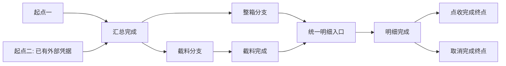

# IWS 计划、事件与状态机完整设计方案

日期：2026-10-21。状态：方案评审稿，仅交付文档，尚未实施。目标项目为 `innolux-iws`；经验来源为越南奇宏 SMT-PCBA 的接口日志、过账事件与重试实现。用户指定数据库为 `localhost:3306/innolux_iws`，覆盖当前 dev 配置的端口选择；本次不修改配置、代码、SQL 或数据库。

## 1. 结论与文档入口

新增一个可选后端模块 `iws-modules/iws-process`，承载计划定义、事件编排、状态校验及检查点恢复；Web 增加管理配置、计划总览和两级执行链查看。复用现有 MyBatis-Plus、事务、鉴权、字典、日志、锁、SnailJob，以及已接入的 Warm-Flow 人工审批能力；不新建调度平台、通用接口重放器或第二套执行引擎。

核心模型是“业务统一调度计划 + 版本化有向流程图 + 任务计划实例 + 分支 token + 固定起止状态的事件 + 执行检查点”。整事件执行和整事件跳过共用一个更新入口；屏蔽过账另在执行路径内跳过指定类型的操作。续跑调用原更新入口，从已记录检查点继续。

配套材料：

- [分场景及整合时序图](plan-event-state-machine-sequences.md)：配置、挂载、确认、执行、跳过、分支、异常、续跑、监督及整合场景。
- [源码与数据库核验依据](plan-event-state-machine-evidence.md)：已有能力、实际来源、数据库只读快照及未验证边界。
- [前后端修正工作包](#13-前后端修正工作包)：后端文件、Web 页面、API/DTO、权限、交互和验收逐项对应。
- [模块复用与新增实施计划](plan-event-state-machine-implementation-plan.md)：直接复用、参考、必须新增、按需启用和 M01-M11 动作拆解。

本方案中的类名、表名和命令名均为拟议设计，除明确列为来源的内容外，不代表当前项目已经实现。

### 1.1 本轮已经明确的要求

| 要求 | 本方案采用的含义 |
| --- | --- |
| 计划的多系统过账模式 | 计划版本按 `system_code` 各保存一条单值记录；不同系统可采用不同 `AUTOMATIC / MANUAL_CONFIRM / BYPASS`，事件按自身系统码解析，挂载时固化快照 |
| 屏蔽过账的精确范围 | 仅跳过非本系统的接口抛账类型操作，不跳过本系统操作、外部查询或其他非抛账动作 |
| 首次过账确认 | 人工模式下，前置未满足的事件先等待前置；前置满足但未确认的事件待人工处理。一次确认放行对应范围的当前及后续事件 |
| 确认后失败 | 立即回到待人工处理，后续命令叫“事件重试”；不重新做首次过账确认，也不自动进入失败退避 |
| 跳过事件 | 保留图中的事件边及状态迁移，完全不执行该事件内部业务操作 |
| 状态校验 | 源状态和目标状态都必须有校验；分支共享的状态复用同一校验器 |
| 调度 | 使用现有 SnailJob；当前开关关闭不构成阻断，后续按需启用已获用户认可 |
| 工程约束 | 能复用已有能力必须复用；少量必要扩展，不制造复杂工具体系 |
| 统一业务调度 | 一个业务必须有统一调度计划，集中登记可挂载的计划类型及其优先级，计划不得各自绕过统一排序 |
| 前后端同步修正 | 后端提供版本配置、计划命令、调度控制和两级执行描述 API；Web 提供配置、实例总览、计划链和事件详情 |
| 工作流复用 | 已确认 IWS 集成 Warm-Flow 1.8.9；可复用人审、任务和轨迹，外部事件恢复仍以领域表为事实源 |
| 配置版本编辑 | 计划与事件配置页可切换查看版本；只有最新草稿可修改，旧/已发布版本只读，可复制为新草稿 |
| 代码绑定动作 | 动作实现、校验器、分支条件、恢复协议和固定节点身份只能查看或选择已注册实现；需改代码的移动/改绑动作禁用 |
| 全动作审计 | 配置、执行、编辑、删除、确认、暂停、取消、重试、续跑、分支决策和调度控制均记录操作者/系统、时间、前后状态、版本、结果和关联证据 |
| 权限与租户 | 复用 Sa-Token、动态菜单、数据权限和前端权限指令；当前项目无可用多租户实现，不预造 tenant_id，后续引入时按独立隔离清单升级 |
| 后端权限兜底 | 所有 `/process/**` 接口必须有权限注解或显式内部标记；Service 再校验对象、状态、版本和业务范围，默认拒绝 |

业务任务的具体唯一键、首批接入的实际业务流程和各事件的真实业务状态值尚未指定。本文给出可实现的公共契约及 SMT 示例，不把示例状态直接映射为当前 WMS 表的既有状态。

## 2. 已有实现带来的约束

旧 PCBA 将领域事件、外部请求明细、接口日志和运维投影分开：领域事件决定恢复位置，接口日志只记录交互，运维投影只承担展示和命令路由。新模块沿用这种职责划分，不把 URL、请求体或日志表变成事件执行依据。

旧方案已经考虑稳定 `eventKey`、载荷摘要、CAS 认领、租约、外部成功与本地同步分离、常驻监督器和空闲 worker 停机。应迁移这些规则和适配经验，不直接复制旧项目的 Java 8、Quartz、表名或 PCBA 专属业务判断。

需主动区别当前实现与本次新语义：旧确认方案在失败后仍按有限重试规则推进；本次人工确认模式要求执行失败立即待人工处理。旧模式 provider 根据全局屏蔽与按箱开关推导模式；本次改为计划版本内按系统分别维护的单值显式配置。旧 BYPASS 经验可以复用，但必须明确操作类型：屏蔽非本系统的接口抛账步骤，其余操作继续；“禁用整个事件”才完全绕过该事件内部操作。不能将二者合并为同一判断。

## 3. 业务、任务和计划的关系

### 3.1 身份和唯一性

```text
业务 business_id
  ├─任务 task_id=A → 计划实例 plan_instance_id=PA → 固定计划版本 V3
  └─任务 task_id=B → 计划实例 plan_instance_id=PB → 固定计划版本 V5
```

- 一个业务可包含多个任务；一个业务任务挂载一个计划实例。
- `plan_code` 是计划定义的稳定唯一标识，`plan_version` 是发布版本，`plan_instance_id` 是一次任务执行的实例标识，三者不可混用。
- `plan_type` 是业务统一调度所使用的计划分类，如整箱、截料、返料；一个类型可以有多个版本或定义，由业务挂载规则唯一解析，不与实例 ID 混淆。
- 任务唯一约束建议为 `(tenant_id, business_type, task_key)`。任务确需重开时由业务创建新任务身份，不清空旧实例重用历史。
- 挂载通过业务提交的类型、系统范围、任务键和路由条件选择一个已发布计划版本；匹配零个或多个均返回明确错误，不任取第一条。
- 实例对计划版本、节点、状态、各系统过账模式、分支规则及处理器版本引用形成不可变快照。配置变更只用于新版本及此后新建/新挂载实例；旧计划定义版本继续保持原配置，旧计划实例无论运行中还是已结束均保留原快照。
- 初次挂载可生成图中的事件实例占位记录；真实业务动作未发生时 `payload_ready=false`、`WAIT_PREDECESSOR`，不得拼造请求或提前执行点收等动作。
- 迟到业务信号只激活该版本预留的事件，不修改图结构。新增节点通过新版本承载，运行中实例迁移另做显式方案。

### 3.2 小接口挂载

对业务只暴露 `attachTask`、`signal`、`confirmPosting`、`retryEvent`、`pause/resume`、`queryPlan` 等必要能力。挂载不外呼，不在 Controller 中逐个调用事件工具。

同库业务创建与挂载可加入现有事务。跨库或异步挂载优先复用已有可靠消息能力；当前消费者没有可靠消息设施时，用业务任务的“待挂载”持久标记加幂等扫描恢复，不为本需求引入新消息平台。重复挂载相同任务返回既有实例；关键输入摘要不一致则拒绝。

首次挂载事务保存实例、选中的起点集合、token、事件占位和调度唤醒标记。事务提交后尝试唤醒 worker；唤醒失败由常驻监督器扫描修复，不能让已提交的业务任务丢失。

### 3.3 业务必须有统一调度计划

增加 `BusinessSchedule` 业务统一调度配置，以 `business_code` 稳定唯一标识；租户启用时纳入租户范围。`business_type` 选择对应调度配置，具体业务单 `business_id` 下的所有任务计划都归属它。这里的业务调度计划不同于一个任务的流程计划实例。

```text
业务统一调度计划 business_schedule_code
  ├─计划类型 WHOLE_BOX，优先级 80 → 本业务多条整箱任务计划实例
  ├─计划类型 CUT_MATERIAL，优先级 60 → 本业务多条截料任务计划实例
  └─计划类型 RETURN，优先级 40 → 本业务多条返料任务计划实例
```

数值仅为排序示例，不是现有业务优先级。调度配置至少包含业务码、允许挂载的 `plan_type`、类型优先级、类型启用状态、共享资源范围、并发上限和公平规则。没有有效统一调度计划，或计划类型未登记，不允许新任务挂载；运行中已挂载任务若类型被停用则停止新认领并保留事实，不撤销正在执行的副作用。

同一业务的调度资格只有一个权威入口。各计划监督先判断本计划是否就绪、可恢复、应暂停/停留，再由业务调度统一决定跨计划执行顺序。worker 查询候选必须应用这一业务调度配置，不允许每个计划独立选择最高优先级后同时抢占同一资源。

业务调度排序为：计划类型优先级 → 实例运行优先级 → 事件运行优先级 → 就绪时间 → 稳定 ID。运行优先级可通过现有权限/审计命令调整，不修改冻结的流程图和过账模式。实例类型、图版本及业务归属保持不变。

使用现有 SnailJob 承载业务统一调度 tick；同一个控制 tick 可遍历各计划的持久逻辑监督，避免再建一组功能重复的控制任务。需要每计划物理监督任务时仍受业务统一准入和排序约束。

## 4. 配置结构与发布规则

### 4.1 计划配置

| 配置 | 必需内容 |
| --- | --- |
| 计划身份 | `plan_code`、`plan_type`、版本、业务类型、名称、发布状态、适用租户、`self_system_code` |
| 过账控制 | 每个 `system_code` 一条 `posting_mode=AUTOMATIC/MANUAL_CONFIRM/BYPASS`、首次确认策略及异常策略 |
| 图入口 | 可选起点、起点选择规则、必需业务信号、输入是否关闭的判定 |
| 图出口 | 可达终点集合、完成策略 `ALL_SELECTED / ANY_SUCCESS` |
| 异常 | 本计划唯一 `exception_state_code`、失败分类规则、分支故障隔离策略 |
| 调度 | 职责分组、监督周期、worker 单轮上限、空闲停止时间、并发资源键 |
| 发布快照 | 配置摘要、注册处理器版本、发布人及时间 |
| 版本选择 | `version/no`、状态、最新标记、创建/发布人及时间；查询支持任意历史版本，编辑仅允许最新草稿 |

第一版采用无环图 DAG。多分支、多起点、多终点不需要循环。真实业务返工如需循环，后续增加有界迭代和独立轮次标识；禁止将同一事件键反复重置模拟循环。

计划版本状态为 `DRAFT / ACTIVE / RETIRED`。“最新版本”按同一 `plan_code` 的最大版本号确定，且必须处于 `DRAFT` 才可编辑；每个 `plan_code` 最多一个 `ACTIVE`，新实例只解析该版本。`plan_code` 同时代表唯一的挂载路由命名空间，不同路由使用不同 `plan_code`，不引入可变 `route_scope`。发布新版本在同一事务中把同计划旧 `ACTIVE` 改为 `RETIRED`，旧版本内容不变，旧实例继续引用旧版本。若最大版本已 `ACTIVE`，界面只读；点击修改必须先原子复制更高版本的 `DRAFT`。编辑接口同时校验 `versionId`、最新标记和草稿状态，不能仅相信前端按钮。

数据库可用可空 `active_key`、`latest_key` 做并发守卫：仅 `ACTIVE` 行的 `active_key=plan_code`，仅最新草稿的 `latest_key=plan_code`，其余为 `NULL`，分别建立唯一索引；发布事务同时切换状态和键。

`ALL_SELECTED` 为默认：所有选中且必需的路径收口，并且业务输入已关闭、没有等待信号的必需节点后完成。`ANY_SUCCESS` 只用于明确允许竞争路径的计划：胜出后先禁止其余路径认领，处理正在执行及已产生副作用的路径；只有取消已安全收敛才结束实例，不能一条成功就删除其他路径。

### 4.2 系统维度的单值模式和系统字段

用户已明确：不是整个计划只有一个模式，而是“计划版本 + 系统码”各一条单值记录。一个计划涉及 MID-WMS、SAP、MES 等多个系统时，可分别采用不同模式，不同系统事件执行各自的过账行为。事件不保存可独立改写的模式，只在运行时解析所属实例冻结的该 `system_code` 配置。

复用现有系统字典/配置管理能力维护系统码，如 `MID_WMS / SAP / MES / WCS / LOCAL`。计划版本保存 `self_system_code`，用于判断“非本系统”的接口抛账；实例挂载时把整个系统模式映射与系统码一起冻结。使用现有 `sys_config` 可提供新计划默认模式，但旧实例始终使用自身快照。

模式配置唯一键是 `(plan_definition_version_id, system_code)`，同一版本同一系统只能一行、一个值。不得在同一系统内再按事件覆盖模式，也不得把一个系统值应用到其他系统。事件绑定主要 `system_code`；operation 各步骤声明 `kind` 和 `target_system_code`，目标系统原则上与事件系统一致，确需跨系统的复合动作应拆为对应系统事件，以便每种行为各自使用正确的模式记录。

`BYPASS` 的唯一匹配规则是：`mode == BYPASS && operation.kind == EXTERNAL_POSTING && operation.target_system_code != self_system_code`。其中 `EXTERNAL_POSTING` 表示接口抛账类型；操作类型随注册实现声明并在配置中核验，不用 URL 关键词猜测。本系统码来自现有应用/系统配置，`LOCAL` 操作归属于本系统。

命中时只跳过该操作步骤，记录 `SKIPPED_MODE` 和 `sent=false`，不调用它的实际操作方法。查询、外部控制、本系统接口动作、本地投影、库存或资源处理等其他步骤继续正常执行及校验。`enabled=true` 的事件仍走执行策略，完成配置的状态迁移后为 `SUCCESS`；步骤是否真实抛账单独展示，不能据此声称外部已过账。`enabled=false` 才是整事件跳过，事件终态为 `SKIPPED`。

### 4.3 事件配置

| 字段 | 约束和用途 |
| --- | --- |
| `event_code` | 同版本稳定唯一的事件节点标识，不因重试改变 |
| `system_code` | 选择接口适配器、审计归属及实例快照中的对应模式记录 |
| `enabled` | `false` 使用跳过策略，事件边仍然保留 |
| `source_state_code`、`target_state_code` | 一条事件只能固定从一个状态转至一个状态 |
| `operation_key`、操作类型/目标 | 执行策略使用的注册名；步骤声明 kind、target_system_code，整事件跳过不调用任何步骤 |
| `edit_policy`、`graph_edit_policy`、`locked_fields` | 由注册动作/校验器元数据派生；代码绑定字段不可在草稿中改写 |
| `skip_allowed`、跳过合同 | 是否允许整事件跳过及其输入输出契约；接口抛账步骤的模式屏蔽与此分开 |
| 前驱与后继 | 显式事件依赖，不能仅用排序号表达流程 |
| 分支与汇合 | `XOR / AND`、条件注册名、默认分支、`join_code` |
| 业务信号 | 是否需要真实业务触发、载荷就绪条件 |
| 异常和恢复 | 分类规则、可回退条件、检查点策略、幂等能力声明 |
| 调度属性 | 默认优先级、资源组、重试规则、空闲停止参数 |

调整 `enabled`、系统模式、状态或事件默认发布新版本。页面可以切换查看任意历史/已发布版本，但除最新草稿外均为只读；已发布版本不可就地覆盖，需要修改时从所选版本复制新草稿并成为最新版本。新配置从新计划实例开始生效；旧计划实例不自动迁移。运行中临时跳过应为独立、有权限且可审计的实例命令，只允许未开始且无副作用的事件；必须重新校验下游约束，不覆盖已冻结或已成功的执行策略。

### 4.4 发布必须检查

1. 所有起点能到达合法终点；必需节点可达，没有环、孤立节点或悬空依赖。
2. 状态码在当前计划版本内唯一；所有事件源/目标、异常状态存在且校验器完整。
3. 顺序事件满足前一目标状态等于后一源状态；一个状态的分支共享相同源状态及初始校验器。
4. XOR 条件互斥或有显式优先级与唯一默认分支；同时命中多条且未声明规则时拒绝执行。
5. AND 的 fork/join 成对，记录期待分支集合；多起点在汇合时同样声明期待根分支范围。
6. `enabled=false`、手动整事件跳过，以及 BYPASS 命中的抛账操作都必须满足各自层次的跳过契约；下游若必需实际业务产物，又没有已有数据或替代输入，拒绝发布/命令。不得把查询或非抛账操作配置为 BYPASS 的匹配对象。
7. 操作、校验器、分支条件和恢复策略均已通过 Spring 注册，名称及实现版本明确；禁止配置任意 Java 类名、SQL 或脚本。分支节点统一经 `BranchSelector` 决策，事件内部不另写选路分支。
8. 每个参与系统都有且只有一个有效模式，事件系统码必须存在于模式映射；人工确认覆盖所选系统集合，事件操作不能内嵌绕过该系统的自动重试。
9. 每个可恢复操作声明幂等键、成功证据和未知结果的处置；不能恢复的操作明确进入人工处理。

### 4.5 可编辑动作分类与硬锁

计划配置页不能把“配置数据”和“代码能力”混在一起编辑。每个事件动作、状态校验器、分支条件、恢复适配器和 Warm-Flow 节点扩展都必须在启动时注册元数据，由后端计算 `editCapabilities`；前端据此显示编辑、选择或只读，不自行猜测。

| 类别 | 典型字段/动作 | 允许的编辑方式 |
| --- | --- | --- |
| 展示配置 | 计划名称、说明、事件显示名、运维描述、显示顺序 | 最新草稿可直接修改；不改变执行语义 |
| 运行参数 | 优先级、空闲阈值、可配置超时/重试上限、人工处理说明 | 仅当注册元数据声明可配置；发布新版本或走独立的实例优先级命令 |
| 已注册能力重绑 | `operation_key`、`validator_key`、`branch_condition_key`、`recovery_policy_key`、系统适配器 | 只能从服务端注册目录选择；仅最新草稿；实现内容不可编辑。`rebindable=false` 时只读 |
| 图结构 | 源/目标状态、边、前后驱、事件顺序、XOR/AND、fork/join、起点/终点 | 只允许最新草稿，并需全图校验；若节点注册为 `graph_edit_policy=CODE_FIXED`，移动或改边按钮禁用 |
| 代码实现 | 新操作算法、接口协议、校验逻辑、分支条件逻辑、恢复/补偿算法、幂等键和检查点协议、代码版本 | 必须改代码并发布后端；配置页最多显示当前实现和“需代码扩展”，不能在线编辑 |
| 既有 Warm-Flow 标识 | 流程模型类型、节点编码、节点类型、节点专属监听器/表单/按钮处理所依赖的身份 | 保存/发布后不可就地修改；变更必须新建流程定义版本并复核代码绑定。运行实例沿用旧定义快照 |
| 执行事实 | 已提交 token 状态、事件尝试、外部成功检查点、请求日志、确认事实 | 不属于配置，不允许任何配置动作直接改写；只通过受控运行命令和权限校验改变 |

现有 Warm-Flow 编辑器动作可按以下规则落位：

| 现有动作 | IWS 计划配置中的处理 |
| --- | --- |
| 修改流程/节点名称、说明 | 最新草稿可编辑；写入新版本后由新实例使用 |
| 切换经典模型/仿钉钉模型 | **锁定**。现有设计器本身提示切换会重置节点且保存后不支持修改；只能新建独立流程定义并评审 |
| 调整节点画布位置 | 画布坐标不参与业务执行；本方案配置页不提供自由画布，故不开放 |
| 拖拽连线、跨分支移动、改变顺序/网关 | 结构变更，只允许新版本；注册为 `graph_edit_policy=CODE_FIXED` 的节点禁止移动、改边或改类型 |
| 修改节点编码、节点类型 | **代码绑定锁定**。申请人节点识别、历史轨迹、流程事件和通知依赖 `nodeCode`，只能在新建定义版本中变更并复核代码 |
| 配置审批人、候选人、抄送、表单、按钮权限 | 仅当现有处理器支持时作为新版本配置；不得改变运行中实例 |
| 修改节点监听器、条件表达式、扩展处理器 | 只能选择已注册实现；算法或协议变化必须改代码并发布新的 `capability_version` |
| 发布、取消发布、复制、激活/挂起定义 | 复用现有版本/审批生命周期；IWS 计划只允许复制出新草稿，旧定义和旧实例不改写 |
| 修改运行中任务、实例变量、办理人 | 属于运行操作，不进入计划/事件配置页面；按现有权限和审计命令处理 |


这里的“移动”分为两种：

- 改变节点在画布上的 `x/y` 显示坐标：只是布局信息，不改变业务依赖；本方案第一版没有自由画布，因此不提供此类编辑。
- 把节点移到另一条边、调整前后顺序、改入/出边或分支层：属于拓扑变更。只有最新草稿、`graph_edit_policy=EDITABLE_NEW_VERSION` 且所有受影响的操作/校验器声明兼容时才能修改；否则相应“移动/插入/删除边”动作只读，并返回 `CODE_REFACTOR_REQUIRED`。已发布版本和运行中实例永不移动。

Warm-Flow 的现有实现也提供边界证据：设计器把“经典模型/仿钉钉模型”的切换标为保存后不支持修改；发布时用首个中间节点确定申请人节点，任务、历史轨迹和流程事件又按 `nodeCode` 关联。因此已发布流程的模型类型、节点编码、节点类型及代码监听器依赖的节点身份不能作为普通编辑项。审批人、表单、按钮和扩展属性可在前端配置的，也只能进入新定义/新版本，不能改变正在运行实例的图。

动作注册元数据至少包含 `capability_key`、`capability_version`、`edit_policy=EDITABLE/REGISTERED_ONLY/CODE_FIXED`、`rebindable`、`graph_edit_policy=FREE/EDITABLE_NEW_VERSION/CODE_FIXED`、`locked_fields[]` 和 `code_change_reason`。前端对代码绑定动作显示锁图标、当前实现和原因，不显示可编辑控件；服务端在保存单事件或复制/发布时重新校验，拒绝修改未开放字段，不能只靠按钮隐藏。


## 5. 状态模型与校验

### 5.1 三类状态分别保存

| 状态 | 管理对象 | 示例 |
| --- | --- | --- |
| 计划运行态 `plan_status` | 实例的整体管理结果 | `CREATED / RUNNING / MANUAL_PENDING / EXCEPTION_HOLD / PAUSED / COMPLETED / FAILED_FINAL / CANCELLED` |
| 流程状态 `state_code` | 一个分支 token 当前所处的业务流程位置 | `SUMMARY_READY / DETAIL_READY / RECEIPT_READY / FINISHED / EXCEPTION_HOLD` |
| 事件执行态 `event_status` | 固定状态边的执行生命周期 | `WAIT_PREDECESSOR / MANUAL_PENDING / PENDING / PROCESSING / RETRY_WAIT / SUCCESS / SKIPPED / NOT_SELECTED / FAILED_FINAL` |

计划状态不能代替所有 token 的流程状态。并发分支可能同时处于不同状态；返回查询必须展示活动状态集合，不能强行给整个计划写一个“当前业务状态”。统一异常状态是同一计划配置共享的流程状态，失败分支的 token 进入它，其他分支的既有成功事实保留。

`MANUAL_PENDING` 是事件执行门禁，不等同于流程 token 一定在异常状态。首次等待确认没有失败，也没有错误报文；执行失败才记录异常分类、停留位置和恢复证据。

token 可另有 `token_status=ACTIVE/BLOCKED/FINISHED` 管理元数据，不替代 `state_code`，也不复制事件的 PENDING/PROCESSING 生命周期。

### 5.2 抽象状态类型与校验器

状态定义建议保存 `state_code`、名称、`kind=START/NORMAL/END/EXCEPTION`、`validator_key`、输入/输出契约。Java 侧只定义很小的状态描述和 `StateValidator` 契约，不为每个状态建继承层级。

校验器提供两类检查，属于同一个校验组件：

- `validateStructural`：实例版本、token 所属、源状态、分支范围、前驱完成、状态版本、租约所有权及输入结构。
- `validateBusiness`：本次实际未完成操作所需的真实业务事实，以及操作后应成立的业务结果，由业务适配器读取或校验。恢复时已成功步骤只验证成功证据，不重新要求“尚未抛账”等已被实际操作改变的初始条件；被模式屏蔽的步骤检查屏蔽合同，不要求不存在的外部结果。

每个事件的源状态和目标状态都必须指向校验器。顺序边的目标校验器与后继源校验器使用同一状态定义。AND/XOR 从共同状态分支时共享该初始校验器，分支特有条件是参数或独立的路由条件，不复制一组相似初始状态机。

事件目标状态的逻辑契约与实际产物契约要分清。执行成功满足结构及本次实际执行步骤的业务后置条件，模式屏蔽的抛账步骤保留 SKIPPED_MODE 事实；整事件跳过只证明允许的逻辑推进，不证明库存或外部单据真实产生。后继的业务校验若依赖这些产物，跳过契约必须提供已有事实/替代输入，否则配置不可发布。禁止通过“校验器永远返回 true”绕过真实业务条件。

无需每个源/目标各新建一套引擎。一个 `EventUpdateService` 调用共享状态校验器即可满足初态校验、终态校验和状态转换要求。

### 5.3 事件生命周期及有效状态

```text
WAIT_PREDECESSOR --前驱/信号满足--> MANUAL_PENDING(未首次确认)
WAIT_PREDECESSOR --已确认或非人工模式--> PENDING
MANUAL_PENDING(FIRST_CONFIRM) --首次确认--> PENDING
PENDING / RETRY_WAIT(已到期) --CAS认领--> PROCESSING
PROCESSING --执行成功--> SUCCESS
PROCESSING --允许跳过且推进成功--> SKIPPED
PROCESSING --人工确认模式失败--> MANUAL_PENDING(EXECUTION_FAILED)
PROCESSING --自动模式可重试失败--> RETRY_WAIT
PROCESSING --需人工或重试耗尽--> MANUAL_PENDING(EXECUTION_FAILED)
MANUAL_PENDING(EXECUTION_FAILED) --事件重试准入通过--> PENDING
MANUAL_PENDING(EXECUTION_FAILED) / RETRY_WAIT(已到期且无未收口副作用) --有权限最终失败--> FAILED_FINAL
```

`SUCCESS / SKIPPED / NOT_SELECTED / FAILED_FINAL` 为当前事件实例终态。`NOT_SELECTED` 表示路由未选中，不经过初态到终态迁移，不冒充“跳过执行成功”。新尝试递增 `attempt_no`，原成功步骤和审计不可擦除。

前置失败时后继仍为 `WAIT_PREDECESSOR`，展示阻塞事件及原因，不把后继计为失败或累计其重试次数。实际可执行性由同一服务计算，供调度和查询共用；不得分页后再改状态导致筛选及总数不一致。

计划聚合按事实计算：全部必需路径完成才 `COMPLETED`；有未知/部分成功待处理则 `EXCEPTION_HOLD`；有待人工节点则 `MANUAL_PENDING`；其余有活动路径为 `RUNNING`。人工 `PAUSED` 是独立运行控制门禁，查询同时返回暂停前事实和异常数量，避免一个标签掩盖分支信息。

`FAILED_FINAL` 只由有权限的终止命令从未被当前租约占用的事件产生：允许 `MANUAL_PENDING`，以及已到期且已排除未收口副作用的 `RETRY_WAIT`；`PROCESSING` 必须等当前执行代次收口或经监督确认结果，不允许强改状态。计划 `CANCELLED` 由取消命令产生，先在事务中禁止新认领；没有活动副作用或无未知结果时置终态，存在执行中/未知结果时记录取消请求，由当前执行代次安全收口后转 `CANCELLED`，否则待人工。`PAUSED` 阻止新认领但不改写各分支事实；恢复后重新计算。计划终止优先级：已安全完成 → `COMPLETED`；用户已取消且副作用已收敛 → `CANCELLED`；全部必需路径不可恢复失败 → `FAILED_FINAL`；其余按异常/人工/运行事实展示。

## 6. 过账确认、自动过账与跳过的精确规则

### 6.1 人工确认模式：采用本次最新要求

确认按 `(plan_instance_id, system_code)` 保存持久事实。一个计划可有多个系统的确认记录；整计划“过账确认”可一次确认选择的所有人工模式系统，并返回实际确认的系统集合，不能让 SAP 的确认意外覆盖未选中的 MID-WMS。自动模式和屏蔽模式不产生首次确认记录。

| 时点与条件 | 事件状态 | 行为 |
| --- | --- | --- |
| 首次创建，前驱/业务信号未满足 | `WAIT_PREDECESSOR` | 记录还需要首次确认；不执行、不计失败 |
| 首次创建，前驱满足，尚未确认 | `MANUAL_PENDING`，原因 `FIRST_CONFIRM` | 等待首次过账确认，无异常报文 |
| 首次确认 | 已就绪者 `PENDING`，未就绪者继续 `WAIT_PREDECESSOR` | 原子保存确认与当前放行；不绕过前驱，不提前执行业务动作 |
| 确认后生成/激活的事件 | 按前驱进入 `PENDING` 或 `WAIT_PREDECESSOR` | 继承既有确认，不重新确认 |
| 任意本轮执行失败 | `MANUAL_PENDING`，原因 `EXECUTION_FAILED` | 立即停止该事件自动重试，分类保存源态或统一异常停留态 |
| 用户发起事件重试 | 校验通过后 `PENDING` | 从失败检查点续跑，保留首次确认事实和已成功步骤 |

这里“确认后开始自动重试阶段”指事件由调度自动推进；失败重新待人工处理具有更高优先级，因此该模式不设置失败后自动退避重放。客户端、调度器或操作内部不得另有隐藏重试破坏这一语义。新一次人工事件重试再失败，仍立即待人工。

首次确认不是业务完成证明，也不是无条件补偿授权。确认和新事件创建统一锁序，以实例及系统上下文为边界；确认事务回滚时不能遗留已放行事件。各系统已有的第一次确认操作者与时间保持不变，事件重试另记审计。

### 6.2 模式与是否启用的组合

| 配置 | 事件就绪后的处理 |
| --- | --- |
| `enabled=true + AUTOMATIC` | 执行策略；可重试失败按有限退避，达到阈值或未知结果待人工 |
| `enabled=true + MANUAL_CONFIRM` | 首次确认后执行策略；每次失败立即待人工 |
| `enabled=true + BYPASS` | 执行策略；仅将非本系统的 EXTERNAL_POSTING 操作步骤记 SKIPPED_MODE；本地、查询、控制及本系统步骤照常执行 |
| `enabled=false` | 跳过策略；仍满足前驱与人工确认门禁，确保首次所有适用事件的规则一致 |
| 不允许整事件跳过却配置禁用 | 发布拒绝，不静默降级；不影响其内部接口抛账步骤按模式屏蔽 |

执行和跳过均不能越过依赖。一个现有事件包含必须的本地更新与接口抛账时，可以保留已有业务 service，由操作步骤适配明确屏蔽抛账、继续本地处理，无需为屏蔽模式强制重构拆事件。整事件跳过策略仍不得执行任何内部业务动作。

BYPASS 本身不增加人工首次确认；未屏蔽步骤直接自动调度，其失败按自动模式的有限重试/人工异常规则处理。三种模式都必须满足真实依赖、信号及资源门禁，“直接自动执行”不表示越过这些条件。

## 7. 多起点、多分支、多终点与索引

### 7.1 固定转换与分支 token

事件为有向边 `S1 --E1--> S2`。同一 `S1` 出现多条候选边时：

- XOR：按冻结条件选中一条；保存选中结果及输入摘要，其余标记 `NOT_SELECTED`。重试复用选择结果，避免环境变化跑入另一分支。
- AND：记录期待分支集合并为每条分支建立 token，携带 `fork_scope_id + branch_key`。同一个初始状态校验器在同一 scope 内复用。
- AND 汇合：每条入边仍只有固定的源态/目标态；到达共享目标状态后分别记录分支到达事实。目标状态校验器可校验本分支到达，后继出边的初态校验增加“期待分支均到达”条件；该条件由共享状态校验器按入/出边上下文处理。

这样无需用一个事件同时从多个状态转移，也不会把单个标量状态在并发分支之间互相覆盖。汇合的最后一条分支通过同库条件更新关闭屏障并创建唯一后继 token/事件；重复到达不能重复生成后继。

多起点可选择一个入口，或同时激活多个根入口；实例固化 `selected_root_set`。跨根汇合显式绑定期待根集合，不能等待未选择的起点。多终点根据计划的完成策略聚合，不用 `MAX(state)`、最大序号或最后完成时间判断结束。

XOR 汇合按当前决策 scope 的已选路径判断前驱，不等待未选路径的静态前驱。未选路径的关闭只传播到本次选择后确定不可达的后代；多个分支共享的汇合及后继仍保留。活动路径集合用于后继激活、AND 期待集合和计划完成判定，避免未选分支留下永久等待节点。

### 7.2 统一分支选择工具 `BranchSelector`

按用户补充要求，新增一个小型分支决策工具，所有分支节点统一调用。它复用已发布分支配置、现有业务条件判断 service 和 Spring 注册处理器，不新造表达式语言或规则引擎。

对外契约建议为 `select(planVersion, decisionNode, scope, inputSnapshot)`，返回 `selectedBranchKeys`、`decisionInputHash`、`ruleVersion` 和可读的选择理由。`scope` 明确实例、fork 轮次和分支层级，避免不同箱/料号共用错误决策。

固定行为：

1. XOR 返回唯一分支。没有命中时仅使用已声明的默认分支；多命中且无明确优先级时返回配置/业务冲突，进入待人工，禁止按遍历顺序选路。
2. AND 返回本次需激活的分支集合；期待汇合集合同步冻结。无条件 AND 直接返回全部已配置分支；条件 AND 只选择显式声明可选的分支，不能省略必需分支。
3. 多起点需要规则选入口时复用该工具，挂载时固化结果。中途分支依赖运行产物时在到达节点后再首次决策，不提前猜测未来结果。
4. 同一个 `(instance, decision_node, fork_scope)` 只产生一次有效决策。更新流程在同库事务中同时保存决策结果、创建分支 token 并标记未选事件 `NOT_SELECTED`。可将有界决策记录保存在现有 token/attempt 的结构化字段，不强制新增独立表。
5. 重试先读取既有决策；输入摘要改变不自动重新选路，返回冲突等待业务修订。并发首次决策由唯一范围和版本条件去重。
6. 该工具不执行事件、不调用外部接口、不直接更新业务状态。汇合准入仍由共享状态校验器负责；它不重新选择已经完成的分支。

跳过事件到达分支节点后也通过该工具选择后继，选择依据只能使用真实可用或已声明替代的输入，不能读取虚构的“跳过产物”。



图中起点一/二及整箱/截料是 XOR 示例，两个结束方向也需业务条件互斥；不能将该示意当作同时执行所有分支的 AND。真实 AND 示例见时序图文档。

### 7.3 推荐索引，不采用并查集作为主结构

并查集只能回答无向连通性，无法保留边方向、先后依赖、条件分支、汇合与失败位置；也不适合动态撤销分支。可以离线检查是否存在孤立连通分量，但本需求无需为此额外引入并查集实现。

推荐复用数据库索引与轻量内存邻接表：

| 查询 | 实现 |
| --- | --- |
| 版本内后继/前驱 | `next[event_code]`、`previous[event_code]`，发布时构建，按配置版本缓存 |
| 发布 DAG 与可达性 | 拓扑排序、DFS/BFS，复杂度 `O(V+E)` |
| 实例活动链 | 按 `plan_instance_id + token_status`、`event_status` 查询活动 token 与事件 |
| 汇合条件 | 按 `instance + fork_scope + join_code + branch_key` 唯一到达事实，比较期待集合 |
| 待执行与重试 | 索引 `schedule_scope + event_status + next_retry_time + priority + id`，最终排序按就绪时间和事件 ID 稳定打破并列 |
| 续跑位置 | 事件当前 `attempt_id` 与 token 的 `blocked_event_id` 直接定位，不扫描日志猜测 |
| 全链路详情 | 冻结定义图叠加事件执行态、活动 token、检查点及请求明细 |

第一版不建全量祖先/后代闭包表。图规模实测需要时再增加版本缓存；查询优化不改变依赖事实来源。

## 8. 统一更新流程：执行、跳过与续跑

### 8.1 只保留必要职责

| 组件（拟议） | 责任与复用 |
| --- | --- |
| `BusinessSchedule` 与控制入口 | 统一业务可挂载计划类型、优先级及资源准入，复用 SnailJob 控制 tick |
| `PlanService` | 挂载、信号、首次确认、暂停恢复和查询；复用事务及权限 |
| `EventUpdateService` | 唯一事件推进入口，处理认领、校验、固定状态转换、检查点和完成事务 |
| 执行/跳过两种策略 | 可在同服务内组合；执行调用 operation，跳过完全不调用 operation |
| `StateValidator` | 共享状态校验契约；由现有业务 service 适配业务事实 |
| `BranchSelector` | 统一 XOR/AND 分支决策及入口选择；复用业务条件 service，更新事务保存结果 |
| `EventOperation` | 真实外呼或本地动作，声明操作类型、目标系统、幂等、检查点和恢复证据；执行入口按模式跳过匹配的抛账步骤 |
| `SchedulerAdapter` | 对 SnailJob 的薄接线适配，只接收唤醒/停机等控制意图，不决定业务状态 |

这些是职责，不要求每项都拆独立 Maven 模块或多层接口。使用 Spring 已有 Bean 注入和 `Map<key, implementation>` 选择策略；启动时检查重复和缺失。`BranchSelector` 是统一流程路由入口，与按 Bean key 查找 operation 的实现选择是两件事。事件类型真的有多实现时才需要注册选择，不为每个状态或每条边创建工厂。

### 8.2 固定推进步骤

1. 读取冻结事件配置、前置条件、业务信号、模式与确认事实。获取执行资格，非就绪事件不计失败。
2. 用事件状态、版本和到期时间做 CAS 认领，递增 `lease_epoch` 并保存 `owner/lease_until`。记录本次 `attempt_id`、`updater_key`、`operation_key`、源态快照和配置摘要。
3. 校验源状态结构。EXECUTE 结合模式和检查点，只对尚未完成且未被模式屏蔽的步骤校验业务前置；SKIP 校验明确的整事件跳过契约。
4. EXECUTE 逐步处理：已成功步骤验证证据后略过，BYPASS 命中的接口抛账步骤记 SKIPPED_MODE 并略过方法调用，其余步骤实际执行。每次实际外呼前在有效版本/租约的短事务中持久化 `SEND_INTENT`，再于本地长事务之外发送；每个成功步骤独立持久化可信检查点。SKIP 不调用业务 service、外部接口、库存投影或补偿。
5. 校验目标状态契约。若有分支则统一调用 `BranchSelector` 取得/复用决策，在短事务内同时条件更新 token、事件终态、决策及分支到达事实、后继就绪事实和必要审计。
6. 写持久化 `wake_pending` 控制标记；提交后尝试唤醒后继。失败由监督扫描处理，不引入额外消息服务。

发送意图、检查点、失败记录及最终收口都必须检查 `event_id + version + lease_epoch + owner`，源 token 也做版本检查。影响零行返回竞争失败，不执行下一步副作用。不能只在认领时校验租约，最后无条件更新。

外部系统不接受 fencing token 时，本地租约不能阻止过期进程已发出的请求。只能结合外部幂等键、请求结果查询和未知结果停留控制重复；不能宣称 CAS 提供跨系统恰好一次执行。

回收租约先 CAS 撤销旧执行权。没有 SEND_INTENT，且旧执行者依协议无法再写入意图，才能判定确定未发送；存在意图而无可信结果一律视为未知，发送时间早晚不改变此结论。一次查询“未找到”不足以排除迟到请求，重新发送必须有可靠幂等或已排除旧执行/迟到请求的业务证据。人工模式失败不得通过租约回收绕过待人工门禁。

### 8.3 跳过的事务边界

跳过必须执行：源/目标结构校验、跳过准入、token 的 `source -> target` 转换、事件 `SKIPPED`、审计和后继唤醒标记。上述操作同一事务完成，任一失败回滚，不出现事件已跳过而 token 仍在源态。

跳过不得执行：载荷重组后外呼、业务实际更新、操作内部判断、数量累计、库存收口或操作补偿。它可以读取配置与状态作校验；不会伪造成功 HTTP 响应。请求审计可记录 `SKIPPED` 意图，`sent=false`、URL/HTTP 状态为空；真实接口调用统计保持零。

## 9. 异常条件、统一停留与恢复

### 9.1 配置可判断的异常结果

规则采用有类型的分类与按顺序匹配的条件项，如 `failure_phase`、`effect_result`、`retry_count`、明确业务错误码；条件注册到现有代码，不用错误文本关键词或任意脚本表达式。

| 证据与条件 | 流程处理 | 恢复要求 |
| --- | --- | --- |
| 仅校验失败/事务已回滚，确认无外部副作用且源态仍有效 | 保持源态，或对已记录暂态做 CAS 恢复源态 | 修正前提后重用原 updater；不回滚其他事件 |
| 请求确定未发送或明确未产生副作用 | 按规则保持/恢复源态 | 人工模式失败立即待人工；自动模式可有限退避 |
| 外部已成功，本地投影/目标校验/后继续建失败 | 失败 token 进入计划的统一 `EXCEPTION_HOLD` | 保存成功检查点，只补未完成本地步骤 |
| 超时、连接中断、响应丢失，结果未知 | 统一 `EXCEPTION_HOLD` | 查询外部或人工对账；不能按普通网络错误盲目重发 |
| 部分步骤成功，后续失败 | 统一 `EXCEPTION_HOLD` | 按步骤检查点决定续跑；需要业务补偿的另有明确契约 |
| CAS/租约过期 | 当前执行者停止推进 | 监督判断事实；已发送结果未知时停留，不立即抢占重发 |

普通自动重试与异常停留下的定向恢复分开准入。AUTOMATIC/BYPASS 若已有可信外部成功证据、只剩可幂等恢复的本地步骤，并且失败规则明确允许自动本地恢复，可以同事务保存 `RETRY_WAIT + next_retry_time + recovery_requested`，到期后由同一 worker 定向恢复。否则 EXCEPTION_HOLD 必须待人工；未知结果或未证明安全的部分成功不得只写 RETRY_WAIT。MANUAL_CONFIRM 任意失败均待人工，不设置自动恢复请求。

“回到初始状态”是当前失败事件的局部恢复。它不代表物理设备倒转、撤销库存或回滚外部系统。默认直到完成才迁移 token，因此大部分无副作用失败本来就在源态，无需制造一次回退操作。

异常规则不能把已成功外呼的事实改成“未调用”，也不能覆盖成功兄弟分支。计划默认隔离失败分支，其他独立分支可完成；配置 `PAUSE_PLAN` 时只停止新的认领，正在执行的分支按检查点收口。异常分支未恢复前不能将计划标为完成。

### 9.2 稳定的恢复定位

必须保存 `blocked_event_id`、`last_attempt_id`、`updater_key`、`operation_key`、处理器版本、`source_state_snapshot`、`target_state_code`、步骤检查点和外部幂等键。

续跑按“失败 token → 被阻塞事件 → 该事件最后有效执行尝试”查询。不能按整个计划最新日志时间选择所谓最后更新工具：并行成功分支可能比失败分支晚结束。

原 updater 与 operation 引用在新进程启动后必须可解析；不从数据库反射任意类。处理器升级破坏兼容时保留旧版本适配器或显式迁移，不能让事件自动换成另一个实现。

### 9.3 事件重试步骤

1. 校验权限、命令幂等键、计划控制态、目标事件、前驱与活动租约；成功、跳过、最终失败事件不得复活。
2. 获取失败事件及其最后有效尝试，读取来源策略和操作检查点。命令只持久化本事件的 `recovery_requested` 与待执行资格，重复提交只能生成一个待执行尝试，不在 HTTP 请求线程对账或过账。
3. 失败 token 在统一异常状态时，由原 updater 验证恢复条件。外部未知先对账：成功补成功证据；明确未执行并排除迟到请求/具备可靠幂等才可重新发送，仍未知则继续停留。
4. 验证通过后，用条件更新将该 token 恢复到本事件源态，并记录“恢复中”；只恢复流程游标，不清除已成功步骤。不能把暂时恢复源态暴露为可被其他新执行者同时认领。
5. 复用原 updater：SKIP 仍走整事件跳过；EXECUTE 调用原 operation 的恢复入口，已成功步骤校验成功证据而不要求原始业务初态重新成立，模式屏蔽步骤沿用 SKIPPED_MODE，未完成步骤逐步校验并补投影/本地收口/后继创建。
6. 达到目标状态并通过目标校验后提交事件成功及后继激活；后继初态校验通过后方可认领。后继缺少信号则继续等待，无后继且满足计划结束屏障时终结。
7. 恢复再失败，保留新增检查点并按模式重新待人工/退避；不撤销首次确认，不重置其他成功事件。

`EXCEPTION_HOLD` 期间普通执行不得直接消费失败 token；人工事件重试或上述明确配置的安全本地恢复候选可由同一 worker 按 `recovery_requested` 认领，仍经过业务统一调度、到期时间与资源准入，并审计请求来源。此时只允许恢复指定事件，不先将整个计划改为 RUNNING。恢复成功清除该事件停留及请求标记，其他异常仍保留；全部异常消除后重新计算计划运行态。人工 `MANUAL_PAUSED` 优先于恢复资格，需先显式恢复暂停；异常隔离策略造成的停新认领则允许已授权的定向恢复，二者不可混淆。

操作外部成功但本地检查点写入失败属于结果未知窗口，必须用外部幂等和对账修复；审计日志出现成功不自动等于业务完成。旧项目日志可作为线索，不能用日志表 UPDATE 替代事件恢复协议。

## 10. 调度复用、自动启停、排列和插队

### 10.1 复用现有 SnailJob

目标项目已有 `iws-common-job`、`iws-job` 和 `iws-snailjob-server`；当前 `iws-job` 主要为执行器示例。复用其注解执行器、日志、服务端任务配置及调度能力，不复制旧 PCBA 的 Quartz。现有源码未证实的动态管理 API 不当成现成业务接口。

推荐在现有 `iws-job` 中新增极薄的业务统一调度与事件 worker 接线；公共运行行为在 `iws-process` 内，外部系统操作仍在业务模块。只需 `businessScheduleExecutor` 与 `planEventWorkerExecutor` 两种固定执行器。前者遍历本业务各计划逻辑监督并控制 worker，后者按业务统一排序有界执行。若最终依赖存在环，将执行器接线放入新模块并依赖已有 `iws-common-job`，不要为接线拆更多平台模块。

已从 SnailJob 2.0.2 依赖产物核实按 `bizId` 创建、更新、查询、触发及启停任务的客户端 API；复用这些 API 实现薄适配器，不再新写任务管理能力。签名及证据见配套核验文档。

后续按用户授权启用 `snail-job.enabled`、核对服务端和命名空间，并接通执行器。当前关闭不是阻断，不因此另造本地定时任务替代 SnailJob。本轮不实际开启或启动服务。

### 10.2 每计划监督与物理任务映射

“一个计划有一个长期监督任务”分两层：

- 每个计划实例拥有持久化逻辑监督控制记录，贯穿其运行周期，管理该实例 worker、恢复扫描、异常停留和人工暂停。
- 默认由该业务统一调度计划的常驻 `businessScheduleExecutor` 按 `business_schedule_code + schedule_scope` 扫描各类型及版本实例的逻辑监督；固定执行器代码接收不同参数，不为每个事件生成 Java 定时器。
- 如业务要求每实例均在调度后台有独立任务，则映射为每实例一条 SnailJob 任务定义，复用同一监督执行器，以 `biz_id` 幂等注册；这是部署映射选项，不影响领域模型。

默认采用业务分组物理任务，防止每事件、每实例创建海量任务。该选择不取消每个实例独立启停和查询能力。实例终态关闭其逻辑监督，物理业务统一控制任务继续服务其他计划，不暂停自身。可选独立计划监督任务也只报告/更新计划资格，不能直接执行业务或绕过业务统一调度。

每个事件也有独立的调度资格和到期时间，但事件 worker 默认按业务职责组承载，查询时统一应用所有允许计划类型及其优先级。逻辑自动停机不等于必须逐事件调用服务端启停 API。使用已经核实的 API 物理启停组 worker，同时以持久控制态作为执行准入依据。

### 10.3 监督职责和可恢复控制意图

控制记录区分 `AUTO_IDLE / AUTO_RUNNING / MANUAL_PAUSED`，保存期望状态、已观测状态、版本、最近活动时间和待唤醒标记。人工暂停不允许监督器自动覆盖；手动恢复后由监督重新计算是否有到期工作。

业务统一控制执行器复用每计划的逻辑监督职责，只负责控制及修复执行资格：

1. 扫描已提交的唤醒标记、到期事件、可安全恢复的过期租约和后继待激活检查点。
2. 有到期工作则恢复对应 worker；未来 `RETRY_WAIT` 不计当前 backlog。
3. 持续无到期工作且超过空闲时间则自动休眠 worker；首次待确认、前置等待和人工异常不会空转成执行任务。
4. SnailJob 不可达时保留控制意图，下轮补偿；不撤销业务成功，也不清空事件。
5. 未知外部结果只标记待对账/人工处理，不在控制线程执行业务续跑。恢复工作同样由 worker 认领。

### 10.4 排列、插队与公平

排序仅作用于已满足依赖、确认、到期和资源门禁的候选：先按业务统一调度配置的 `plan_type_priority` 降序，再按 `instance_priority`、`event_priority` 降序，就绪时间及 ID 升序。类型优先级通常高于单事件插队；如需跨类型插队，必须通过业务调度层的显式提升命令并审计，而非事件自行越权。

人工插队只提高尚未认领的任务/事件在允许资源组的运行优先级；不能越过依赖、抢断 `PROCESSING`、绕过首次确认或改写成功事件。类型停用不等于事件跳过，应停止新认领并保留其等待与恢复记录。

多任务竞争同设备/库区时复用已有锁能力，资源键由业务 adapter 提供，数据库事件 CAS 为最终认领依据。并发使用 token/分支范围；汇合最终化再以实例屏障短锁串行，避免所有普通分支都持有整个计划长锁。

防止长期饥饿可用固定的优先级老化规则或每轮普通队列保底名额，配置和审计均落到现有职责组；无需新建独立队列中间件。调度轮次有批量/时长上限，监督任务不执行任何业务事件。

SnailJob 平台自动重试与领域重试不能叠加。事件业务失败已被持久化后，执行器正常返回“本轮已处理”；仅调度基础设施异常交给平台处理，重复回调由 CAS 去重。默认事件执行器平台 `max_retry_times=0`，由领域规则决定自动模式的重试资格。

## 11. 建议数据模型与事务

以下是新增模块的逻辑模型，不是已部署表结构，也不是本轮待执行 DDL。主键、租户字段、审计字段、逻辑删除和权限沿用 IWS 现有基类与项目约定；发布版本、执行记录和历史事实不能因软删除破坏唯一性。新版本只能新增行，不能覆盖旧版本；实例只引用挂载时的版本，旧计划及旧实例不因新配置发布而迁移。

### 11.1 第一版必要持久化对象

| 拟议表/对象 | 关键内容与约束 |
| --- | --- |
| `iws_business_schedule` | 租户 + business_code 唯一，业务统一调度配置、启用、并发/资源组和公平规则 |
| `iws_business_schedule_plan_type` | 调度配置 + plan_type 唯一，可挂载类型、优先级、启用状态；不用新造一套定时任务定义表 |
| `iws_process_definition` | `plan_code + version` 唯一，业务类型、起终点策略、异常状态、发布摘要；`active_key/latest_key` 唯一索引及发布事务共同保证同 `plan_code` 最多一个 ACTIVE、一个最新草稿 |
| `iws_process_system_policy` | `plan_definition_version_id + system_code` 唯一，单值过账模式、首次确认策略及失败规则 |
| `iws_process_state` | 版本 + 状态码唯一，名称/运维描述、状态类型、校验器、条件描述及参数 |
| `iws_process_event_definition` | 版本 + 事件码唯一，系统、启用、固定源/目标、操作/跳过/恢复策略 |
| `iws_process_edge` | 版本 + 前驱 + 后继 + 分支键唯一，路由与汇合条件；简单顺序也显式存边 |
| `iws_process_instance` | 业务任务唯一、所属业务调度/plan_type、冻结版本、`self_system_code`、运行优先级、计划运行态、已选起点、输入关闭事实、版本 |
| `iws_process_system_context` | 实例 + 系统唯一，模式快照、首次确认事实、操作者与时间 |
| `iws_process_token` | 实例、分支范围、当前状态、阻塞事件、token 版本；AND 到达事实可复用此表的分支记录 |
| `iws_process_event` | 稳定事件键唯一、token、执行态、有效策略、优先级、重试时间、租约及最后尝试 |
| `iws_process_attempt` | 事件 + 尝试号唯一，原 updater/operation、模式跳过/发送意图/成功步骤检查点、源态快照、条件校验结果/版本/时间、外部事实与错误 |
| `iws_process_action_audit` | 追加式动作审计：配置/运行动作、操作者或系统、时间、前后状态/版本、命令键、结果、原因和关联实例/事件/attempt/调度批次 |
| `iws_process_schedule_control` | `scope_type(BUSINESS/PLAN) + scope_key + 职责` 唯一，同表承载业务控制与各计划逻辑监督、人工暂停、期望/观测状态及 wake_pending，不复制调度台账 |

每次真实外部请求的审计优先适配已有接口日志能力；IWS 当前没有核实到 PCBA 专属审计表和服务，因此若目标需要同等能力，在新模块内补一张必要的请求明细表及薄审计服务，不把旧表当成目标库已存在。步骤检查点可存在 attempt 的有界结构化字段中；查询和唯一性确有需要时再拆步骤表。

不要一次预建归档总表、闭包表、补偿引擎、插件市场或通用规则语言。第一版完成真实链路后，根据审计量和保留规则决定归档。

### 11.2 稳定事件与载荷

事件键建议为 `(tenant, task_key, plan_version, event_code, branch_instance)` 的稳定编码；同一事件重试不改变身份。一次尝试独立 `attempt_id`，一次真实请求独立 `request_id`，彼此不可替代。

载荷在真实业务信号到达时固化并计算摘要，同键不同载荷拒绝覆盖。token 初始占位可以没有请求载荷；`payload_ready` 之前不能发送。恢复不根据当前库存重算并覆盖旧请求，业务纠错需要独立、可追溯的修订命令。

查询链路为 `business → task → plan instance → token/event → attempt/checkpoint → request detail → interface log`。接口日志保留 `request_id`、系统、接口、起止时间、实际结果；日志不拥有重试执行权。敏感字段脱敏，不将环境口令写入快照。

### 11.3 调度执行描述与运维查询

按用户补充要求，业务统一调度计划必须提供可查询的执行描述。它是根据现有定义、事件、token、检查点和控制记录生成的读模型，不另外维护一条容易过时的可编辑总描述，也不新建运维数据库。

执行描述入口按 `business_schedule_code` 查询，可按具体 `business_id`、任务、计划类型和实例筛选。返回 `as_of`、业务调度配置版本、分页及排序说明，队列位次明确所属的 `schedule_scope`/资源组，不把互不竞争的资源混为同一全局顺序，供后续 Web 运维页面使用；本轮不实现页面或接口。

| 信息 | 建议返回内容 | 生成规则 |
| --- | --- | --- |
| 已执行计划名称 | `executed_plans`：计划显示名、实例 ID、类型、任务、开始/结束时间、运行结果、完成摘要 | “已执行”表示已结束的实例，标明 COMPLETED/FAILED_FINAL/CANCELLED，不能混为成功；当前正在执行另列 |
| 待执行计划名称，按优先级 | `pending_plans`：名称、实例/任务、类型、类型优先级、实例优先级、队列位次、就绪时间、阻塞原因 | 使用与 worker 相同的业务排序与准入逻辑；等待首次确认、前置、资源、未来重试分别列原因和 eligible，不冒充即将执行 |
| 正在执行计划所处事件 | `running_plans[].branches[]`：实例名、token/分支范围、事件名/码、步骤、执行态、尝试号、租约及开始时间 | 并发计划/分支按数组显示，不取最后日志或最大状态。异常停留、待人工也展示最后所处事件 |
| 已达状态描述 | `current_state`：状态码、中文名、运维描述、实际到达时间、最近已完成事件 | 取 token 的已提交 state_code。正在执行事件未收口时仍显示源态；进入统一异常态后保留异常前已达状态和事件源态快照 |
| 已达状态校验条件 | `current_state.validation`：validator_key、规则版本、结构/业务条件及所需事实、最近结果、证据引用、校验时间 | 说明来自冻结状态定义与注册校验器描述；结果取持久审计，不根据状态名称推断通过 |
| 待进入状态描述（下一个） | `next_states`：下一次迁移的事件目标态、描述、是否已决定、分支条件/屏障 | 当前边执行中时为其固定 target；边已结束而分支未选择时列各候选后继事件的 target 并标 CANDIDATE，已选择后只列实际后继事件的 target；后继的 source 是已达状态，不能重复当作下一目标；终态返回空并说明已结束 |
| 待进入状态校验条件 | `next_states[].validation`：结构/业务条件、前驱/信号、缺失项及最近结果 | 说明与实际共用校验器，BYPASS 的 SKIPPED_MODE/替代输入和纯跳过的结构合同分别标注 |
| 异常状态描述 | `exception`：统一异常状态码/描述、失败事件/步骤、失败分类、effect_result、可否续跑、阻塞理由、原源/目标态、检查点与对账要求 | 仅实际发生异常才返回；FIRST_CONFIRM 用等待说明，不伪造异常；unknown 明确“外部结果待确认” |

定义中的校验条件需提供稳定 `condition_code`、中文说明、类型、所需事实和证据引用。复用现有 Java 校验器返回的描述及结果，不维护第二份可执行表达式。条件不要求暴露任意 SQL、Java 代码或敏感请求；运维读到的是业务说明，如“汇总已完成本地同步”“所有本次选中的截料分支已到达汇合”“该系统已首次确认”。

每条条件的最近结果可为 `PASS / FAIL / NOT_EVALUATED / NOT_APPLICABLE`，同时记录规则版本、校验时间和执行模式。首次进入人工等待、尚未执行目标校验时必须显示 NOT_EVALUATED，不能提前显示通过；模式屏蔽的抛账实际产物条件显示 NOT_APPLICABLE 并附屏蔽合同，不伪造外部已成功。

默认查询只读持久事实。需要“重新校验”时调用同一校验器的无副作用检查入口，记录本次检查时间及结果；此命令不抛账、不重试、不切换状态、不补库存。原执行时的校验记录保留，与最新观察分开，避免环境变化覆盖历史到达证据。

读模型在一个数据库一致性读快照内关联计划、token、事件与检查点，并回传版本；后续对多个数据源补充的观测单列观察时间，不能标为同一原子时点。事件最新状态、分页筛选、总数和队列顺序由同一服务生成，禁止在前端翻页后再重排/补状态。

计划内有多个就绪事件时，实例待执行优先级由其最高可调度事件和统一排序规则确定；暂无可执行事件的实例单列 waiting 队列，保留类型/实例优先级但不占可执行 rank。已开始却等待下游或人工处理的计划仍属于活动计划，不重复放入“从未开始的待执行计划”。后台实际对候选事件跨实例排序，计划展示按该实例首个候选位置聚合，不虚构整个计划连续占用执行权。

可读示例（仅模拟，不是实际数据）：

```text
业务统一调度：SMT出库
已执行：整箱计划-任务A（已完成）
待执行：整箱计划-任务B（类型80/实例0/事件10，第1候选）
        截料计划-任务C（类型60/实例0/事件10，第2候选）
正在执行：截料计划-任务D / 分支箱X / 事件“出库明细抛账”
已达状态：DETAIL_READY，明细已具备处理条件
已达条件：汇总已完成本地同步=PASS；截料分支已汇合=PASS
待进入：DETAIL_DONE，明细处理完成
待进入条件：未屏蔽的抛账成功或存在模式屏蔽证据；本地同步完成
异常：EXCEPTION_HOLD，外部结果待确认；步骤SEND_INTENT未取得确定结果
恢复：先对账；不得直接再次抛账。首次确认仍有效
```

### 11.4 事务不变量

- 挂载与任务归属、首次确认与当前放行、跳过与 token 推进均为各自同库短事务。
- 认领、成功检查点、本地完成分别使用适合其事实的事务；外呼不持有数据库长事务等待。
- 事件完成、token 推进、屏障到达、后继创建和唤醒标记同事务提交。
- 后继创建唯一冲突必须比较定义/载荷摘要；不能吞掉冲突假装幂等。
- 采用统一锁序：控制/实例上下文（命令需要时）→ 分支 token → 事件 → attempt/后继；不在 worker 持有分支锁时反向申请实例命令锁。实例汇总可由事务后监督重算，终结时使用专用短屏障。
- 租约过期后的旧执行者不能覆盖新尝试；归档/清理不得删除仍被实例恢复引用的检查点。

### 11.5 全动作审计

已有 `@Log` 记录 HTTP 入口的访问行为，但其切面在调用返回后异步处理，当前字段也不能证明领域状态迁移、分支决策、外部调用或定时 worker 行为。因此领域审计以追加式 `iws_process_action_audit` 为权威，通过 `commandKey + business/instance/event/attempt/requestId` 关联；现有操作日志只作入口层补充，不假设已有 `trace_id`。若后续统一增加请求追踪字段，可在不改变领域审计主键的前提下再关联。

| 审计字段 | 要求 |
| --- | --- |
| 动作身份 | `audit_id`、`action_code`、`action_source=USER/SYSTEM/SCHEDULER/EXTERNAL_CALLBACK`、`command_key`、可选 `trace_id` |
| 操作者 | `actor_user_id/actor_name`；系统任务使用稳定系统账号，并记录 `scheduler_job_id/job_batch_id` |
| 对象关联 | 租户、业务调度、计划版本、实例、token、事件、attempt、请求 ID；允许为空但不得缺所属层级 |
| 时间 | `occurred_at`、`duration_ms`、请求开始/结束；统一记录时区来源，web 按业务时区展示 |
| 来源 | 客户端 IP、User-Agent、接口路径或执行器；敏感字段脱敏 |
| 状态变化 | `before_status/before_version`、`after_status/after_version`、关键摘要 hash；不保存完整敏感载荷 |
| 业务语义 | 操作原因、确认系统集合、选择分支、跳过原因、失败分类、结果 `SUCCESS/REJECTED/FAILED/PARTIAL/UNKNOWN` |
| 证据 | event/attempt/request、checkpoint、请求追踪、关联审计 ID；不拥有重试权 |

必须审计的动作至少包括：配置草稿创建/修改/复制/校验/发布/删除，计划挂载、业务信号、逐系统确认、暂停/恢复/取消、事件优先级、事件重试、最终失败、重新校验、事件执行与跳过、分支决策、异常停留、自动恢复、调度控制、操作版本升级和归档。审计写入与对应命令/状态变更同库同事务；外部调用无法包在同一事务时，发送意图与返回结果分别追加两条审计，并由 attempt/request ID 关联。任何审计写失败，普通命令不得返回成功；已经发生的外部副作用保持检查点并转人工，不能通过吞掉审计错误继续。

权限拒绝和请求级前置拒绝在命令拦截器中记录 `REJECTED_DENIED/REJECTED_VALIDATION`，包含操作者、动作、对象标识和原因摘要；业务内的状态/版本拒绝由 service 事务记录。拦截器只捕获已注册 `/process/*` 命令，不持久化完整请求体，避免审计敏感数据。

`enabled=false` 的纯跳过只记录跳过意图、配置源/目标、token 迁移和结果，不创建外部 `SEND_INTENT`，不调用任何外部或本地业务操作；BYPASS 命中的抛账步骤记录 `SKIPPED_MODE`，其余实际步骤按各自发送边界审计。

手工动作记录当前登录人；监督、worker、自动恢复和平台触发记录固定系统账号而不是伪造人工用户。删除只允许未发布且未被引用的最新草稿，采用逻辑删除并先写完整前态审计；已发布版本、旧计划、运行/历史实例及审计记录不得物理删除，必要归档只转移查询位置，不改变审计链。

审计查询权限与执行详情分离：`process:audit:query` 查看审计时间线，敏感请求正文沿用 `process:event:request`，普通只读用户不自动获得报文权限。审计表不提供删除或更新接口。


## 12. 模块依赖与复用清单

```text
iws-admin：组装按需引入的模块
  ├─iws-process：计划定义与运行时，包 api / definition / runtime / support
  │   ├─现有 core、mybatis、tenant、satoken、log、redis/lock（按实际需要）
  │   ├─现有 common-job（执行器接线确需时）
  │   └─可选 iws-workflow 公共契约（仅复杂人审适配，不形成状态依赖环）
  ├─iws-job：复用 SnailJob 薄接线（禁止与 process 双向依赖）
  └─iws-wms：实现实际业务操作及校验器，通过 process 公共契约挂载
```

现有 `iws-workflow` 的审批/人工流程能力和 SnailJob workflow 示例需先核对能否直接满足目标；它们不天然等于具有外部成功检查点、纯跳过和失败续跑语义的领域事件引擎。若首批实际业务能够完整复用某现有工作流，优先采用；目前已核对的能力不足以替代本文恢复契约，因此只增加最小的领域编排，不扩建通用 BPM 产品。

不提前把跨模块契约塞满 `iws-api`；模块对消费者的少量 Java 契约先放新模块 `api` 包。只有确有远程消费者再按当前项目模式迁移。

| 能力 | 复用入口 | 最小新增 |
| --- | --- | --- |
| 定时调度与远程日志 | SnailJob、`iws-common-job`、现有执行器模板 | 监督/worker 薄执行器与控制适配 |
| 人工审批与轨迹 | `iws-workflow`、Warm-Flow 定义/实例/任务 API、现有 Web 审批页 | `WorkflowApprovalAdapter`，审批完成写回同一确认命令；简单确认不强制启动审批 |
| 事务/Mapper/分页 | 现有 Spring 事务、MyBatis-Plus、`BaseMapperPlus`、`PageQuery` | 新领域表的 Mapper 与条件更新 |
| 锁与缓存 | 现有 Redis/锁依赖 | 业务资源键，配置版本缓存；不以缓存替代数据库事实 |
| 系统码/状态展示 | 现有字典、配置、权限、菜单与日志 | 少量字典值与管理入口，领域状态定义仍由版本配置管理 |
| 日志与审计 | 现有操作日志；借鉴旧 PCBA 接口日志关联方式 | 目标缺少的请求明细与检查点记录 |
| 执行/跳过/续跑 | 同一个更新 service、已有业务 service | 两个更新策略；续跑复用原策略和原 operation |
| Web 管理台 | 现有动态菜单、权限、字典、表格/对话框 hooks、`IwsFeedback` | 计划配置、实例总览、领域执行图、计划/事件两级详情组件 |

## 13. 前后端修正工作包

本节把方案落到可直接评审的后端文件、Web 文件、API 和页面职责。具体文件名是拟议实现，不表示已经获批编码。前后端以同一版本化定义及同一命令入口为准；Web 只展示后端生成的执行事实，不在浏览器重算状态。

### 13.1 工作流与开源项目选型

已确认 IWS 现有 `iws-modules/iws-workflow` 集成 Warm-Flow 1.8.9，数据库存在 `flow_definition`、`flow_instance`、`flow_task`、`flow_his_task`、`flow_node` 等表和对应 Web 定义、实例、待办、已办页面。Warm-Flow 可复用人审节点、待办办理、审批记录和流程轨迹，不需要再引入第二套审批引擎。

| 候选能力 | 可复用部分 | 不交给它的职责 | 结论 |
| --- | --- | --- | --- |
| Warm-Flow 1.8.9（已集成） | 多级人工审批、驳回、待办、审批记录、流程实例轨迹 | 外部抛账成功检查点、事件租约、自动重试、原事件续跑、纯跳过 | 保留复用；人审可选接入，领域事件表仍是执行事实 |
| SnailJob 2.0.2（已集成） | 固定执行器、触发、启停、日志、动态任务管理 | 计划业务状态、人工确认、外部成功事实 | 保留复用；只承担控制面和 worker 触发 |
| LiteFlow 2.16.1.2（已集成） | 进程内编排和人审任务办理链 | 持久化长任务、失败恢复、跨重启租约 | 不为本需求扩展为事件引擎 |
| Temporal | 持久工作流、活动重试和崩溃恢复成熟 | 需要新增服务、持久化、Worker 部署及前端适配 | 后续跨系统可靠编排规模显著扩大时再评估 |
| Flowable/Camunda | BPMN、人工任务、审计成熟 | 引入第二套运行时状态，事件领域检查点需另行适配 | 当前不引入 |
| Spring Statemachine | 进程内状态机模型 | 分布式认领、定时任务、持久恢复 | 不引入 |

结论：当前采用“SnailJob 调度 + Warm-Flow 可选人审 + 新模块领域事件存储与执行”的组合。简单首次确认直接调用 `PlanService.confirmPosting`；需要多级审批时启动 Warm-Flow，审批完成事件只调用同一幂等确认命令。Warm-Flow 的 `businessId` 保存计划实例 ID，计划执行详情继续读领域事件表。不要把 Warm-Flow 的 `flow_status` 当作事件 `event_status`，也不要依赖其进程内事件监听作为唯一写入通道。

选择此组合的原因是开发与运维成本最低：调度、审批、权限、菜单、日志和前端基础交互都已有入口；新增工作集中在领域定义、恢复检查和两级执行读模型。

### 13.2 后端修正范围

新增模块 `iws-modules/iws-process`，在 `iws-modules/pom.xml` 与 `iws-admin/pom.xml` 各增加一项。依赖方向保持 `iws-process → 公共基础 + iws-common-job`；业务操作适配放在 `iws-wms` 或对应业务模块，`iws-process` 不反向依赖具体 PCBA 业务。

| 后端区域 | 拟议文件/类 | 修正内容 |
| --- | --- | --- |
| 配置 CRUD | `controller/BusinessScheduleController`、`PlanDefinitionController`、对应 service/mapper/BO/VO | 业务调度、计划版本、状态、事件、边、系统策略草稿与发布；删除仅限未使用最新草稿并写审计 |
| 实例命令 | `PlanInstanceController`、`PlanInstanceService` | 挂载、信号、逐系统首次确认、暂停/恢复、安全取消和查询 |
| 执行命令 | `PlanEventController`、`EventUpdateService` | 事件重试、最终失败、重新校验、优先级、执行/跳过统一入口 |
| 执行读模型 | `ExecutionOverviewService`、`PlanChainQueryService`、`EventTraceQueryService` | 已执行、待执行、活动计划、多分支链、事件尝试与请求详情 |
| 审计 | `ProcessAuditService`、`ProcessAuditController` | 追加式领域动作审计、时间线查询和敏感字段脱敏 |
| 命令拒绝审计 | `ProcessCommandAuditInterceptor` | 在鉴权/参数/业务前置拒绝时记录操作者、命令键、对象和原因；不保存完整正文 |
| 能力注册/编辑门禁 | `EventOperationDescriptor`、`StateValidatorRegistry`、`BranchSelector`、`EditCapabilityResolver` | 注册动作/校验器/条件/恢复实现；计算字段级 editCapabilities 并在保存时拒绝越权 patch |
| 运行时 | `PlanEventWorkerExecutor`、`BusinessScheduleExecutor`、`SchedulerAdapter` | 复用 SnailJob，按业务统一优先级有界执行 |
| 人工审批适配 | `WorkflowApprovalAdapter`（可选） | 复杂审批时调用现有 Warm-Flow，完成结果走幂等确认命令 |
| 发布资源 | `script/sql` 幂等升级、菜单/权限/字典 SQL | 新表索引、菜单、按钮权限和状态字典；本阶段只计划，不执行 |

建议包结构 `api / controller / domain/bo / domain/vo / domain/model / mapper / service / service/impl / runtime / support / adapter`。`Controller` 只做参数、权限、日志和响应；事务、CAS 和状态迁移在 service；操作注册通过 Spring Bean 名称及元数据，不接受任意类名。

后端 API 建议如下，统一前缀 `/process`，权限统一为 `process:*`；模块名、Controller 路由和 Web 目录保持同一归属：

| 方法 | 路径 | 权限示例 | 用途 |
| --- | --- | --- | --- |
| GET | `/schedule/page` | `process:schedule:list` | 业务调度分页 |
| POST/PUT | `/schedule` | `...:add/edit` | 维护业务调度基本配置 |
| GET | `/schedule/{id}/plan-types` | `...:query` | 查询允许挂载计划类型及优先级 |
| PUT | `/schedule/{id}/plan-types` | `...:edit` | 原子保存排序/启停/资源组 |
| GET | `/schedule/{id}` | `process:schedule:query` | 业务调度详情、类型行和版本 |
| GET | `/schedule/options` | `process:schedule:list` | 筛选选项 |
| DELETE | `/schedule/{id}` | `process:schedule:remove` | 仅删除未被引用的最新草稿配置；逻辑删除并先写前态审计 |
| GET | `/definition/page` | `process:definition:list` | 计划定义及版本分页 |
| GET | `/definition/{versionId}` | `...:query` | 返回状态、事件、边和逐系统模式完整草稿 |
| GET | `/definition/{versionId}/edit-capabilities` | `...:query` | 返回字段级可编辑性、代码绑定原因和允许的新版本变体 |
| POST | `/definition/draft` | `...:add` | 新建计划草稿；不接受既有版本内容的批量覆盖 |
| PUT | `/definition/{versionId}/base` | `...:edit` | 更新计划基本信息，携带 `expectedVersion`，字段白名单由 EditCapabilityResolver 返回 |
| PUT | `/definition/{versionId}/system-policies/{systemCode}` | `...:edit` | 更新单个系统模式/确认策略，携带 `expectedVersion`；模式码和系统码唯一 |
| PUT | `/definition/{versionId}/states/{stateCode}` | `...:edit` | 更新单个状态说明及可配置字段，携带 `expectedVersion`；代码绑定校验器不可替换 |
| PUT | `/definition/{versionId}/events/{eventCode}` | `...:edit` | 一次保存一个事件及其关联边/分支规则，携带 `expectedVersion` |
| DELETE | `/definition/{versionId}/events/{eventCode}` | `...:remove` | 仅最新草稿；先校验无代码锁定、无实例依赖且删除后图仍合法，再写审计 |
| POST | `/definition/{versionId}/copy` | `...:copy` | 复制已发布/历史版本为新草稿 |
| POST | `/definition/{versionId}/validate` | `...:publish` | 结构、校验器、跳过合同及可达性校验 |
| POST | `/definition/{versionId}/publish` | `...:publish` | 原子将当前最新草稿置 ACTIVE，同计划旧 ACTIVE 置 RETIRED；内容不可变 |
| DELETE | `/definition/{versionId}` | `process:definition:remove` | 仅允许删除未发布、未被实例引用的最新草稿；审计后逻辑删除 |
| GET | `/definition/options` | `...:query` | 系统码、操作类型和分支条件选项 |
| GET | `/instance/{id}` | `...:query` | 计划摘要、逐系统模式、token 和当前事件 |
| GET | `/instance/{id}/chain` | `...:query` | 完整计划执行链：节点、分支、事件、已/下一状态和校验条件 |
| GET | `/execution/overview` | `process:execution:list` | 按 `businessScheduleCode` 返回已执行、待执行（统一排序）、运行中、异常摘要 |
| POST | `/instance/attach` | `process:instance:attach` | 受控补挂任务；幂等返回既有实例 |
| POST | `/instance/{id}/confirm-posting` | `...:confirm` | 校验并确认明确选择的系统集合；一次事务保存各自确认事实 |
| POST | `/instance/{id}/pause`、`/resume` | `...:pause`、`...:resume` | 人工控制；暂停不唤醒、恢复重新算资格 |
| POST | `/instance/{id}/cancel` | `process:instance:cancel` | 安全取消计划；先禁止新认领，未收口副作用不得伪报取消成功 |
| POST | `/event/{eventId}/retry` | `process:event:retry` | 事件重试排队，不在请求线程执行业务 |
| POST | `/event/{eventId}/finalize` | `process:event:finalize` | 仅对允许状态标记最终失败，不抢占活动租约 |
| POST | `/event/{eventId}/revalidate` | `process:event:revalidate` | 无副作用重新校验并持久记录本次观察 |
| GET | `/event/{eventId}` | `...:query` | 事件执行描述：源/目标、模式、步骤、attempt、错误、请求关联 |
| GET | `/event/{eventId}/attempts` | `...:query` | 分页尝试/检查点/接口请求链 |
| GET | `/event/{eventId}/requests/{requestId}` | `process:event:request` | 单请求详情，敏感内容按权限脱敏 |
| GET | `/instance/{id}/audit` | `process:audit:query` | 实例配置、运行、异常和恢复动作时间线 |
| GET | `/event/{eventId}/audit` | `process:audit:query` | 单事件跨 attempt 的动作审计 |
| GET | `/audit/page` | `process:audit:query` | 按业务调度、操作者、动作、结果和时间筛选 |
| PUT | `/event/{eventId}/priority` | `...:priority` | 仅调整未认领候选优先级 |

所有写命令使用 `@RepeatSubmit` 防重复点击，以数据库唯一键/版本条件保证真正幂等；查询和命令均加数据权限与租户范围。分页查询返回 `R<PageResult<T>>`，详情返回 `R<T>`，沿用现有 Web 约定。

### 13.3 前端修正范围

前端使用现有 Vue 3、Element Plus、Pinia、`request`、`useDict`、`v-hasPermi`、`IwsFeedback` 及通用 hooks；计划事件领域页不使用 `IwsCrudPage`。菜单仍由后端动态路由返回，不把新页面写死在静态路由中；新增菜单、按钮权限必须和 API 权限一致。

| 前端区域 | 拟议文件 | 复用/职责 |
| --- | --- | --- |
| API/类型 | `src/api/process/{schedule,definition,instance,execution,event,types}.ts` | 使用现有 `request`、`PageResult`，ID 统一字符串防精度丢失 |
| 业务调度页 | `src/views/process/schedule/index.vue`、`edit.vue` | 列表和聚合编辑；计划类型/优先级用上下移动按钮，不支持编辑运行中实例快照 |
| 计划版本配置页 | `.../definition/index.vue`、`edit.vue` | 计划与事件在同一页面配置：版本切换、基本信息、逐系统模式、状态、事件、边、分支汇合和发布检查；旧/已发布版本只读，最新草稿才可保存 |
| 计划链详情 | `.../instance/detail.vue` | 静态定义图叠加 token 状态、分支、已达/下一状态和校验说明 |
| 执行总览与实例管理 | `.../execution/index.vue` | 按业务调度读取已执行、待执行、运行中、异常；同一页面检索实例并执行受控补挂、确认、暂停/恢复/取消；进入详情 |
| 执行链组件 | `src/views/process/components/ExecutionChain.vue`、`ProcessStatusTag.vue` | 只消费后端链 VO；多分支分泳道，状态字典失败时回退原始码 |
| 事件配置编辑器 | `.../components/EventConfigEditorDrawer.vue` | 一次只承载一个事件；按 editCapabilities 渲染，代码绑定字段和锁定的移动/改边/删除动作只读 |
| 事件详情 | `.../components/EventExecutionDrawer.vue` | 打开事件抽屉，展示执行状态、模式、逐步状态、attempt、错误和请求；按权限提供重试、重新校验、最终失败 |
| 审计时间线 | `.../components/AuditTimeline.vue` | 展示动作、操作者或系统账号、时间、前后状态/版本、结果、原因和关联证据；只读且不提供删除 |
| 确认/重试 | `PostingConfirmDialog.vue`、`RetryEventDialog.vue` | 逐系统勾选确认；显示首次确认与失败重试的区别及原因 |
| 审批复用 | 现有 `views/workflow/processInstance/index.vue`、`components/Process/flowChart.vue`、`approvalRecord.vue` | 复杂多级审批沿用现有页面；计划详情以事件模块为主，不把审批节点混入事件节点 |

计划事件是领域执行模型，计划定义、实例、执行链不使用 `IwsCrudPage`。该组件面向字段平铺的 `wms_*` 元数据表，无法表达计划类型子表、逐系统模式、状态边、分支 token 和发布校验；当前后端通用 CRUD 也只真实接入供应商。本模块统一使用 `request`、普通 `el-table`、现有页面外壳、`Pagination`、`useSearchReset/useSearchToggle`、`useDialogState`、`v-hasPermi` 和 `IwsFeedback`。API 列表统一 GET + `PageQuery`，读取 `R<PageResult<T>>` 的 `data.rows/total`。

建议页面结构：

1. `/process/schedule`：业务调度列表、计划类型优先级、资源/并发、操作审计。
2. `/process/definition`：计划版本列表。`edit.vue` 是计划配置与事件配置的唯一页面，顶部提供版本切换，六个页签组织“基本信息、系统模式、状态定义、事件与边、分支与汇合、发布检查”；不提供独立事件配置菜单或第二套事件维护表单。旧/已发布版本只读，最新草稿才显示保存/单事件编辑；“基于此版本新建草稿”复制后成为最新版本。第一版使用状态表、事件边表和分支表的可控表单，不新建自由画布。
3. `/process/execution`：唯一计划总览和实例管理入口；顶部选择业务调度，展示已执行、按优先级待执行、正在执行和异常/待人工，并在行内提供受控补挂、逐系统确认、暂停/恢复/取消。
4. `/process/instance/detail`：隐藏详情路由；上方计划摘要与系统模式，中央分支链，右侧当前事件；`instanceId` 通过 query 传入。
5. 事件抽屉分“执行概览、校验条件、尝试/检查点、接口请求、审计”五个区域；执行总览和计划配置页提供只读审计入口。敏感请求正文按后端权限脱敏。

隐藏编辑/详情路由由后端菜单 SQL 提供，`visible=1`、`activeMenu` 指回列表页，不修改前端静态 `constantRoutes`。

计划版本配置共享同一页面上下文，但事件按单条聚焦编辑。版本选择器可载入任意版本进行查看；只有 `is_latest=true && status=DRAFT` 的版本可以进入编辑态。事件列表默认只读，点击“编辑”后在同一页面的侧栏或抽屉中只展开一个事件的配置；保存时只提交 `eventCode + eventDefinition + 关联 edge/branch patch + expectedVersion`，服务端在同一事务再次校验它是最新草稿、状态引用、操作元数据、分支规则和汇总屏障，并返回新版本。其他事件不得同时进入编辑态；未保存切换需确认。计划基本信息、逐系统模式和状态定义可在各自页签维护，发布按钮始终读取服务器上的完整草稿并执行全图校验。越权保存旧版本返回明确的“版本已过期/只读”错误。

事件编辑器只渲染 `editCapabilities` 允许的字段。`edit_policy=CODE_FIXED` 的动作显示只读、锁标识和当前实现版本；`graph_edit_policy=CODE_FIXED` 的节点隐藏移动/改边控件；`REGISTERED_ONLY` 只允许从服务端目录重选兼容实现。需要新增动作实现、校验器、接口协议或恢复算法时，前端显示“需代码重构并发布新版本”，不提供在线类名或脚本入口。后端保存单事件时再次比对允许字段，禁止通过构造请求绕过界面。

所有草稿写入口（基本信息、系统模式、状态、事件和结构）都必须携带 `expectedVersion`，并在同一 `EditCapabilityResolver` 门禁下执行：校验目标仍是最新草稿、字段属于白名单、代码绑定值未改变、引用关系完整。不能只保护事件保存而放开状态或系统策略接口。

为了把易错规则与页面解耦，增加两个轻量 hook 和三个纯函数模块：`hooks/process/usePlanExecution.ts` 负责快照、轮询、过期和取消；`hooks/process/useProcessDict.ts` 负责字典兜底；`views/process/definition/definitionDraft.ts` 校验系统码唯一、事件引用和版本完整性；`views/process/instance/postingConfirmation.ts` 计算可确认系统及命令结果；`views/process/execution/executionPresentation.ts` 统一结果、阻塞和状态文案。对应纯函数测试覆盖这些规则，不复制后端业务判断。

第一版执行图采用“分支泳道 + 节点/边状态表”的结构化视图，优先复用项目现有 Element Plus 与 ECharts，不引入新的流程设计器或拖拽库；配置编辑使用表单和行操作，不提供自由画布。图只读并消费后端链 VO。

### 13.4 两级执行描述契约

计划执行描述以 `PlanChainVO` 返回，至少包含：

```ts
interface PlanChainVO {
  planInstanceId: string;
  planCode: string;
  planName: string;
  planVersion: string;
  taskKey: string;
  planStatus: string;
  instanceVersion: string;
  priority: { planType: number; instance: number; event: number };
  systemContexts: Array<{
    systemCode: string;
    mode: 'AUTOMATIC' | 'MANUAL_CONFIRM' | 'BYPASS';
    confirmed: boolean;
    confirmedAt?: string;
    confirmedBy?: string;
    confirmable: boolean;
    eventCount: number;
  }>;
  asOf: string;
  graph: { nodes: StateNodeVO[]; edges: EventChainEdgeVO[] };
  branches: BranchChainVO[];
  exception?: ExceptionDescriptionVO;
}
```

`BranchChainVO` 必须同时携带 `tokenStatus`、`tokenVersion`、真实 `stateCode`、`currentState`、`nextStates`、`events`；`EventChainEdgeVO` 携带 `eventId`、`eventVersion`、事件源/目标状态、执行状态、模式、最近 attempt、阻塞/校验详情。多并发分支不能压成单一“当前节点”。已有、来源和最新观察分别有版本/时间。前端按后端排序显示，不自行把状态文本当通过或失败；`NOT_EVALUATED`、`NOT_APPLICABLE` 明确区分。

事件执行描述独立返回 `EventExecutionVO`，至少含 `eventId`、`eventVersion`、`eventCode`、`systemCode`、`postingMode`、`sourceState`、`targetState`、`eventStatus`、`attemptNo`、`currentStep`、`checkpoint`、`blockedReason`、`validations`、`attempts`、`requestIds`、`canRetry`、`canRevalidate`、`canFinalize`。`operationKind`、`targetSystemCode` 仅作聚合摘要；完整展示使用 `steps[]`，每项含 `stepKey/kind/targetSystemCode/status/sent/checkpoint/blockedReason/requestId`，支持一个事件内出现 `SUCCESS/SKIPPED_MODE/FAILED` 混合状态。计划详情和事件抽屉引用同一字段定义，避免列表、详情和权限按钮判断各一套。

计划总览接口按业务调度范围返回已结束计划、按真实优先级计算的 `pendingPlans`（含 `queueRank`、`resourceScope`、`eligible`、`blockReason`）、活动计划及逐分支摘要。已开始但等待下游/人工的计划标为活动计划；待执行只表示尚未开始或当前无活动 token 的计划，具体归属和聚合规则见 §11.3。列表只提供实例导航，展开后才读取完整链和事件详情，避免总览一次加载所有 DAG。

### 13.5 前后端命令时序边界

确认按钮只提交计划实例、明确 `systemCodes`、`instanceVersion` 作为 `expectedVersion` 和 `commandKey`；后端锁定实例、校验各系统仍为 `MANUAL_CONFIRM`、权限和状态，再原子保存确认并把当前就绪事件改为 `PENDING`，提交后唤醒。默认勾选当前人工模式、未确认且可确认的系统，用户可逐项取消；请求携带非人工系统时整体拒绝，不静默忽略。重试/最终失败/重新校验使用 `eventVersion`；重试提交原因和 `commandKey`，后端校验失败 token、租约、恢复条件并排队，实际恢复由 worker 执行。暂停/恢复/取消使用 `instanceVersion`，各分支命令使用 `tokenVersion`。Web 不得直接调用外部系统或在本端推断成功。

页面刷新采用显式刷新加可配置轮询（建议仅对执行总览“正在执行”/异常页签每 10 秒），页面隐藏时停止轮询；不要求 WebSocket。轮询失败保留上次快照并标记“快照已过期”，不能把旧数据当作实时事实。所有长操作显示服务端处理中/待人工，不以按钮 loading 的成功代替状态查询。

### 13.6 前端与后端验收补充

1. 计划配置页在同一页面完成计划与事件配置，但事件一次只允许编辑一个；其余事件保持只读。切换页签或事件前提示未保存修改，事件保存后刷新版本，发布时对完整图统一校验。逐个 `system_code` 显示一条模式；同一系统不能保存两个值；不同系统可分别人工、自动、屏蔽。发布后旧实例仍显示旧快照，新实例使用新快照。
2. 计划总览能查看已执行计划名称、结果和时间；待执行计划按统一类型/实例/事件优先级展示并说明等待原因；正在执行计划显示分支级当前事件；异常计划显示统一异常停留和恢复条件。
3. 计划详情能展开每个分支，显示当前状态描述、已到达状态的条件及最近结果、下一目标及其校验条件；多分支并行时分别可定位。
4. 事件详情与计划详情使用同一事件状态/权限契约，能查看 attempt、外部成功检查点、未知结果和请求明细；列表不返回完整报文，单请求详情按权限懒加载。不把日志成功当成事件完成。
5. 普通用户只读；确认、重试、重新校验、最终失败、插队、暂停/恢复、取消分别受权限控制，按钮隐藏与后端拒绝双保险；跨租户和跨业务不可越权。
6. 轮询、分页、筛选和刷新后状态一致；空数据、后端错误、旧快照、403 和权限失败有明确文案，不显示伪造进度。状态标签在字典未加载时仍显示稳定原始码。
7. 计划配置保存/复制/发布/删除、挂载、确认、暂停/恢复/取消、事件执行/跳过/重试/最终失败/重新校验、分支决策和调度控制均能在审计时间线中定位操作者或系统账号、时间、前后状态/版本及结果；审计失败时命令不返回成功。

完整权限码矩阵、角色建议和未来多租户隔离规则见[模块复用与新增实施计划 §10](plan-event-state-machine-implementation-plan.md#10-权限复用与租户边界)。

## 14. 实施顺序与可验证交付

本节是后续实施计划，不代表本轮已授权改代码或执行升级。模块创建、条件装配、复用边界和 M01-M11 具体动作见[模块复用与新增实施计划](plan-event-state-machine-implementation-plan.md)。按真实依赖推进，先做最小纵向链路，再扩展分支，不一次开发所有配置界面。

| 阶段 | 依赖 | 交付与退出条件 |
| --- | --- | --- |
| P1 业务映射 | 本方案评审 | 明确业务统一调度、允许计划类型及优先级；选真实任务键、系统码、源/目标、操作类型/目标系统、产物及确认范围，形成两条实际链路样本 |
| P2 最小配置和挂载 | P1 | 单模块骨架、版本配置、状态注册、顺序图发布校验、幂等任务挂载；不接真实过账 |
| P3 统一事件更新 | P2 | EXECUTE/SKIP、CAS/租约、外部检查点及本地收口、纯跳过原子推进 |
| P4 模式与恢复 | P3 | 计划版本+系统单值模式快照、逐系统首次确认、失败即待人工、自动模式有限退避、异常停留与事件重试 |
| P5 分支与查询 | P3、P4 | 统一 BranchSelector、多起点、XOR、AND 汇合、多终点；业务调度执行描述、活动链/校验条件/异常查询，排序筛选一致 |
| P6 调度接线 | P3、P4 | 启用已有 SnailJob，业务统一控制/各计划逻辑监督/worker、允许类型及优先级、持久唤醒、空闲休眠、人工暂停与插队 |
| P7 Web 管理台 | P2-P5 | 业务调度/计划配置、实例总览、计划链、事件抽屉、逐系统确认与重试；复用现有表格、权限和反馈组件 |
| P8 首批业务接入 | P5、P6、P7 | 整箱/截料等真实业务适配，旧执行权隔离，隔离环境全链路及发布演练 |

上线前确认目标数据源为用户指定的 `localhost:3306/innolux_iws`，不得把 dev 的 `3307` 默认值当成当前目标。新增表/索引需要独立幂等升级脚本与只读结构核验；准备脚本不代表执行授权。

旧 PCBA 不在本次改造范围。若未来迁移已有任务，先停止旧执行者，保留成功检查点，明确新旧事件键与模式映射；不从接口日志批量生成待执行事件，不回放历史过账，不将存量未知结果自动恢复为可发送。

## 15. 场景验收矩阵

| 编号 | 验收场景 | 可观察结果 |
| --- | --- | --- |
| A01 | 同业务两个任务、同任务重复挂载 | 两个独立实例；重复挂载不重复创建，不同关键载荷拒绝 |
| A02 | 不同系统分别为人工/自动/屏蔽 | 每系统独立一条单值模式；实例按系统冻结，默认不覆盖旧实例；BYPASS仅非本系统接口抛账步骤零调用，本地/查询/控制正常 |
| A03 | 人工模式首次就绪/未就绪事件 | 分别待人工/待前置，实际调用均为零 |
| A04 | 一次首次确认及之后新激活事件 | 当前就绪放行，后续继承；确认不绕过前置或提前生成业务动作 |
| A05 | 确认后失败和多次事件重试 | 每次失败立即待人工；首次确认事实不变，无自动退避/隐藏外呼 |
| A06 | 禁用事件跳过成功 | token 从配置源态到目标态，事件 SKIPPED；operation/库存/外呼调用均零 |
| A07 | 跳过的目标校验或写入失败 | 跳过事务整体回滚，不出现孤立终态；下游缺产物的配置发布失败 |
| A08 | 外部成功、本地失败 | 保留成功证据；恢复只补本地，外呼次数不增加 |
| A09 | 未发送、已发送结果未知、部分成功 | 按证据分别源态停留或统一异常停留；未知不盲目重放 |
| A10 | 并发分支成功与失败交错结束 | 恢复准确定位失败分支原尝试，不选择全计划最后时间，兄弟成功不回滚 |
| A11 | XOR、AND、多起点/终点 | 统一 BranchSelector；XOR 只选一路；AND 全部期望分支到达才唯一放行；未选根不阻塞；重试复用决策；多终点按策略收口 |
| A12 | worker 崩溃、旧租约返回、重复调度 | 旧执行者收口被 fencing/CAS 拒绝，未知副作用保持停留，成功事件不复活 |
| A13 | 监督空闲停机、新任务唤醒、服务端暂不可达 | 持久标记可恢复；监督不跑业务；人工暂停不被覆盖 |
| A14 | 插队、资源竞争和公平 | 只改变合法候选顺序，不越依赖、不抢断执行，不使普通队列无限饥饿 |
| A15 | 分页状态筛选与详情/调度 | 相同依赖与确认规则；等待不累计重试；总数与列表一致 |
| A16 | 操作版本升级与配置发布 | 运行实例保持原快照，缺处理器拒绝启动/恢复，不自动切换实现 |
| A17 | 终态、手动终止和取消 | 无继续消费；已成功外部事实保留，未收敛副作用不能伪报取消成功 |
| A18 | 请求审计与跳过 | 每真实请求独立 request_id；跳过 sent=false 不计真实调用；日志无执行权 |
| A19 | 业务统一调度的多个计划类型 | 未登记类型挂载拒绝；已登记按类型/实例/事件优先级统一排序，各计划无法绕过；停用只停新认领 |
| A20 | 抛账/查询/控制/本系统操作混合事件 | BYPASS只屏蔽匹配步骤，实际业务后置仍验证其余步骤，事件SUCCESS同时保留SKIPPED_MODE证据；enabled=false才整事件SKIPPED |
| A21 | 调度执行描述 | 已执行/待执行/活动计划分类及名称准确，候选位次与worker一致；并发分支分别展示事件及已达/下一状态和校验说明；异常/终态/未校验不伪报通过 |
| A22 | 前后端配置与命令契约 | 逐系统模式唯一，前端确认/重试/暂停的请求与后端权限、事务、幂等和状态门禁一致；无伪造执行结果 |
| A23 | 计划链和事件抽屉 | 多分支链路可展开到事件、attempt、请求；状态、条件说明和时间前后端一致，空/错误/权限场景可辨识 |
| A24 | 计划与事件统一配置 | 同一计划版本页面内编辑基本信息、逐系统模式、状态、事件、边和分支；事件列表只读，一次只展开并保存一个事件，切换未保存时提示，发布时校验完整图，不存在独立事件配置入口 |
| A25 | 新旧计划配置隔离 | 每个计划最多一个 ACTIVE 版本供新实例挂载；发布新配置只影响新计划及新实例，旧版本转 RETIRED 但内容不变，旧实例的模式/状态/事件/边保持快照，不自动迁移或重跑 |
| A26 | 配置版本切换与编辑门禁 | 可查看所有版本；仅最新草稿可编辑/保存，旧/已发布版本只读；基于旧版本复制才产生新的最新草稿，前端与后端都拒绝越权修改 |
| A27 | 代码绑定动作只读 | 动作/校验器/分支条件/恢复实现及代码固定节点身份不能在线改写；移动/改拓扑按 graph_edit_policy 限制；服务端拒绝越权字段并返回明确代码重构原因 |
| A28 | 全动作审计 | 配置编辑/复制/发布/删除、挂载、确认、暂停/恢复/取消、执行/跳过/重试/续跑、分支和调度动作均有操作者或系统账号、时间、前后状态/版本、结果、原因及关联证据；审计不可修改删除 |

验证采用现有测试框架及 MySQL 兼容隔离环境。纯 Mock 验证策略选择；真实 Mapper/事务测试验证唯一性、条件更新、并发与回滚；外部响应桩验证确定成功、未知结果和重复投递。真实 SnailJob 联调另验接线、重启和启停，不把数据库存在任务行当成服务已运行。

本次完成的是设计、来源核验和文档检查；未执行上述代码测试、服务启动、真实过账或数据库写入。

## 16. 与原始十四项需求的对应

| 原始项 | 设计落点 |
| --- | --- |
| 1 系统字段与过账模式 | §4.2、§6，计划版本+系统单值策略、实例快照 |
| 2 启用、初态和终态 | §4.3、§4.4 |
| 3 跳过且状态一致 | §5.2、§8.3，纯跳过合同与原子推进 |
| 4 抽象状态与校验机 | §5.1、§5.2 |
| 5 计划状态机、初终校验和固定转换 | §5、§7、§8；共享校验器与 Spring 注册，无逐边工厂 |
| 6 可扩展、多分支多起终点 | §4、§7.1、§7.2，统一 BranchSelector |
| 7 链路查询和索引 | §7.3，邻接表与数据库索引 |
| 8 异常进入条件、回初态/统一停留 | §9.1 |
| 9 多任务与唯一计划 | §3、§11；§3.3 增补业务统一调度及计划类型优先级 |
| 10 事件定时任务、长期监督、插队 | §10，业务统一调度复用 SnailJob 与各计划持久监督控制态 |
| 11 统一事件更新工具 | §8.1、§8.2 |
| 12 执行含操作、跳过不操作 | §6.2、§8.3 |
| 13 原更新策略与操作检查点续跑 | §9.2、§9.3 |
| 14 可选后端模块及复用 | §12、§13、§14 |

本次追加需求另由以下章节覆盖：前后端同步修正见 §13；工作流复用和开源选型见 §13.1；计划/事件两级执行描述见 §11.3、§13.4；计划类型统一调度见 §3.3、§10。

需要业务评审的具体输入仅为 P1 的实际任务身份、节点状态及产物合同；架构默认按本文落点推进。若这些输入表明已有工作流能完整满足检查点与跳过语义，应缩减新增编排部分，继续遵守复用优先原则。
