# IWS 计划事件分场景及整合时序图

日期：2026-10-21。状态：目标设计，尚未实施。

[完整方案](plan-event-state-machine-design.md)为唯一规格；[模块复用与新增实施计划](plan-event-state-machine-implementation-plan.md)说明复用边界和开发动作；[核验依据](plan-event-state-machine-evidence.md)记录源码、依赖和目标数据库事实。本文将其具体化为 16 个场景，包含业务统一调度、BranchSelector、前后端管理台、计划总览与两级执行描述、代码绑定动作编辑门禁和全动作审计。示例状态不是现有业务数据库状态。

## 共同契约

- 一个业务可有多个任务，一个任务一个计划实例；业务统一调度计划 BusinessSchedule 登记允许的 plan_type 及类型优先级。所有 worker 都受该业务统一准入和排序约束。
- 新配置只创建新计划版本并供新实例挂载；旧版本定义和旧计划实例保留原冻结配置，不自动迁移、覆盖或重跑。
- 计划版本按 `(plan_version, system_code)` 各保存一条单值过账模式；不同系统可采用不同 AUTOMATIC/MANUAL_CONFIRM/BYPASS。事件只按自身系统码解析所属实例快照，不在事件上建立第二套模式来源。
- plan_status 管理实例；token.state_code 表示已提交的流程位置 S1/S2/EXCEPTION_HOLD；event_status 管理事件执行。token_status=ACTIVE/BLOCKED/FINISHED 只是元数据，不复制事件状态机。
- 每条事件固定 source_state → target_state。StateValidator 提供源态及目标态校验；恢复按检查点校验，不要求已成功步骤的原始业务初态重新成立。
- enabled=false 才走整事件 Skip 策略：不调用任何 Operation，仅作结构校验、状态迁移、审计及后继就绪更新。
- enabled=true 始终走 Execute 策略。BYPASS 仅跳过 kind=EXTERNAL_POSTING 且 target_system_code!=self_system_code 的操作步骤，记 SKIPPED_MODE；本地、查询、控制及本系统步骤照常执行。事件完成为 SUCCESS，整事件禁用完成才为 SKIPPED。
- MANUAL_CONFIRM 首次依赖满足者 MANUAL_PENDING/FIRST_CONFIRM，其余 WAIT_PREDECESSOR；确认按实例+系统保存，可一次提交多个所选系统。首次确认后自动执行，任意执行失败立即 MANUAL_PENDING/EXECUTION_FAILED。后续命令是 RETRY_EVENT，首次确认事实不清除。AUTOMATIC 直接自动执行；BYPASS 的未屏蔽步骤同样直接自动调度，两者可按规则有限重试。
- 认领、发送意图、检查点和收口均检查 event_id、version、lease_epoch、owner。存在 SEND_INTENT 而无可信结果即未知，不凭超时或一次未查到直接重发。
- 最终失败只允许从未被活动租约占用且无未收口副作用的事件进入；计划取消先禁止新认领，存在 PROCESSING/未知结果时等待安全收口或人工，不能直接保存 CANCELLED 伪造取消完成。
- BranchSelector 统一选择 XOR/AND 和起点，决策按 scope 持久一次、重试复用。未选路径为 NOT_SELECTED，不冒充跳过执行。
- 只复用现有 SnailJob 并接线两个固定执行器：businessScheduleExecutor 做业务控制及各计划逻辑监督，planEventWorkerExecutor 做实际执行。控制器不执行业务，也不自动覆盖人工暂停。
- 复用现有 Warm-Flow 仅用于可选多级人审、待办和审批轨迹；简单首次确认直接调用领域确认命令。审批完成必须幂等写回领域状态，不能把 flow_status 当成 event_status。
- 本轮只编写文档；后续可以启用已有 SnailJob，当前关闭不构成阻断。

## 现状基线

本节只记录已核对的当前实现，用于识别迁移差异。下文序列均为目标设计。

| 主题 | 当前实现 | 证据 |
| --- | --- | --- |
| 前端部署产物 | Nginx 产物没有源码和 Git；语言包有“接口异常重试记录”菜单文案，但有界检索未命中本文所需的 /iws/retry、/outbound/order/posting、MANUAL_CONFIRM、MANUAL_PENDING、WAIT_PREDECESSOR 页面调用或状态文案。部署包无法证明新页面契约。 | C:/code/company/ui/vietnam-pcba-web/dist-pcba/static/js/index-KhyucIum.js:1 |
| 过账追溯查询 | 已有 GET /iws/retry/events、GET /iws/retry/{id}/trace、GET /iws/retry/{id}/requests、GET /iws/retry/{id}/requests/{requestId}。列表项清除请求和响应正文，完整请求内容只能经单请求详情读取。 | C:/code/company/vietnam_pcba_avc/ruoyi-system/src/main/java/com/ruoyi/system/rest/PcbaPostingTraceController.java:29-80；C:/code/company/vietnam_pcba_avc/ruoyi-common/src/main/java/com/ruoyi/common/business/posting/PcbaPostingEventTrace.java:13-18；C:/code/company/vietnam_pcba_avc/ruoyi-common/src/main/java/com/ruoyi/common/business/posting/PcbaPostingRequestDetail.java:15-45 |
| 当前模式 | GET /outbound/order/posting/mode 与 POST /outbound/order/posting/mode 使用 BYPASS、MANUAL_CONFIRM、AUTOMATIC。切换请求只有 mode 和 expectedMode；服务把 midwms.feedback.bypass.enabled 与 pcba.outbound.feedback.box-level 映射为三种模式。没有独立的 scope=SYSTEM 字段，也没有 skip_scope。 | C:/code/company/vietnam_pcba_avc/innolux-wms/src/main/java/com/ruoyi/wms/outbound/posting/domain/PcbaOutboundPostingMode.java:6-9；C:/code/company/vietnam_pcba_avc/innolux-wms/src/main/java/com/ruoyi/wms/outbound/posting/domain/dto/PcbaOutboundPostingModeSwitchDto.java:14-18；C:/code/company/vietnam_pcba_avc/innolux-wms/src/main/java/com/ruoyi/wms/outbound/posting/service/PcbaOutboundPostingModeService.java:73-111；C:/code/company/vietnam_pcba_avc/innolux-wms/src/main/java/com/ruoyi/wms/external/midWms/common/MidWmsFeedbackBypass.java:21；C:/code/company/vietnam_pcba_avc/innolux-wms/src/main/java/com/ruoyi/wms/outbound/box/service/PcbaOutboundBoxFeedbackModeProvider.java:15 |
| 当前模式快照 | 模式固化在稳定事件 ORDER_POSTING_CONTEXT 的 payload 中，首批写入 postingMode 和 confirmed=0，首次确认后改为 confirmed=1。 | C:/code/company/vietnam_pcba_avc/innolux-wms/src/main/resources/mapper/outbound/posting/PcbaOutboundPostingModeMapper.xml:105-115；C:/code/company/vietnam_pcba_avc/innolux-wms/src/main/java/com/ruoyi/wms/outbound/posting/domain/PcbaOutboundPostingContext.java:12-23 |
| 当前首次确认 | 只为新建且尚为 PENDING 的业务事件加 WAIT_ORDER_CONFIRM 门禁。POST /outbound/order/posting/{outOrderNo}/retry 在未确认时写 confirmed=1，再执行所选事件；POST /{outOrderNo}/manual-pending 把待执行事件转人工待处理。 | C:/code/company/vietnam_pcba_avc/innolux-wms/src/main/java/com/ruoyi/wms/outbound/postingevent/service/PcbaOutboundPostingEventStore.java:62-69,177-188；C:/code/company/vietnam_pcba_avc/innolux-wms/src/main/java/com/ruoyi/wms/outbound/posting/service/impl/PcbaOutboundPostingServiceImpl.java:303-315,385-401；C:/code/company/vietnam_pcba_avc/innolux-wms/src/main/java/com/ruoyi/wms/outbound/posting/controller/PcbaOutboundPostingOrderController.java:87-128 |
| 当前前置等待 | WAIT_PREDECESSOR 是查询时根据依赖计算出的展示状态，不是独立的持久运行态；实际状态仍可为 PENDING 或 RETRY_WAIT。 | C:/code/company/vietnam_pcba_avc/innolux-wms/src/main/resources/mapper/outbound/posting/PcbaOutboundPostingMapper.xml:74-93；C:/code/company/vietnam_pcba_avc/innolux-wms/src/main/java/com/ruoyi/wms/outbound/posting/service/impl/PcbaOutboundPostingServiceImpl.java:700-704 |
| 当前失败续跑 | 瞬时错误在阈值内进入 RETRY_WAIT 并按退避到期；达到上限或业务拒绝进入 MANUAL_PENDING。RETRY_WAIT 的人工命令只提前到期。除整单入口外另有批量、按箱、最终失败路由；其中按箱入口当前直接拒绝。 | C:/code/company/vietnam_pcba_avc/innolux-wms/src/main/java/com/ruoyi/wms/outbound/process/service/PcbaExternalFeedbackProcessServiceImpl.java:298-320；C:/code/company/vietnam_pcba_avc/innolux-wms/src/main/java/com/ruoyi/wms/outbound/process/service/PcbaOutboundEventManualRetryService.java:94-101；C:/code/company/vietnam_pcba_avc/innolux-wms/src/main/java/com/ruoyi/wms/outbound/posting/controller/PcbaOutboundPostingOrderController.java:95-129；C:/code/company/vietnam_pcba_avc/innolux-wms/src/main/java/com/ruoyi/wms/outbound/posting/service/impl/PcbaOutboundPostingServiceImpl.java:176-191 |
| 当前状态投影 | 运维查询把 MANUAL_PENDING、前置等待、执行中、成功、最终失败映射为 2、4、0、1、3；提示文案包含“请到工单过账确认页面整单处理”和“等待前置事件完成”。 | C:/code/company/vietnam_pcba_avc/ruoyi-system/src/main/resources/mapper/system/InterfaceRetryMapper.xml:143-176 |

当前接口已经存在，但不是本文的目标执行协议。新设计需要增加计划版本和冻结配置，显式区分 plan_status、state_code、event_status，并让模式确认、异常停留、恢复和调度控制可独立寻址。

## 场景 1：业务调度、计划与事件配置发布

前提：业务调度登记可挂载计划类型及优先级；草稿包含系统模式、事件启用、源/目标状态、操作类型/目标系统、分支和状态校验描述。

结果：合法配置发布为不可变版本；缺校验器、无法收敛的图、缺少跳过产物替代关系均拒绝。发布无需等待 SnailJob 在线。

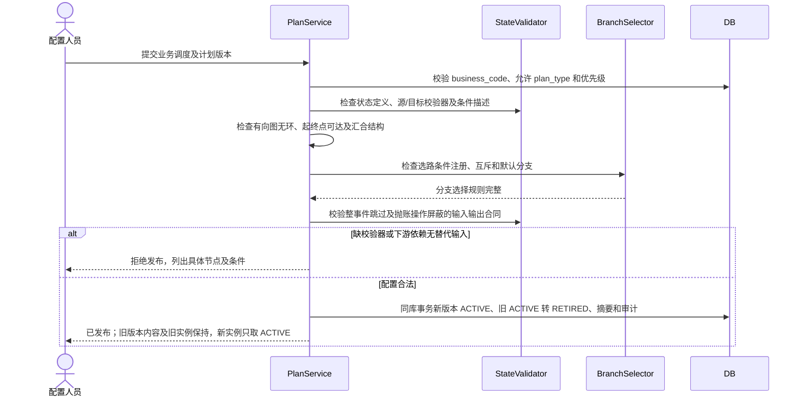

不变量：配置中的业务状态说明与实际校验器版本对应；不能用状态名称代替条件，也不能在配置中执行任意 SQL/脚本。

## 场景 2：业务任务挂载计划、多起点与业务信号

前提：任务有稳定业务键；类型在 BusinessSchedule 允许范围内。多起点选择规则、允许信号集合已定义。

结果：一个任务幂等挂载一个计划；只激活已选根。尚未发生的动作保留事件占位，收到真实信号后才固化载荷。

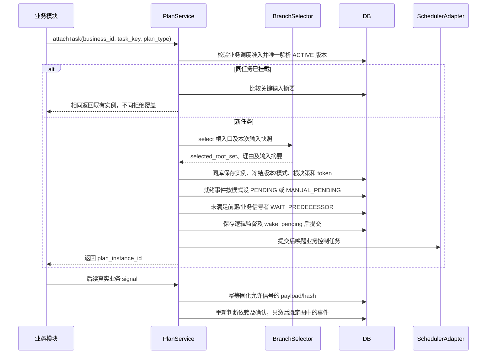

不变量：任务挂载不抛账；未发生的业务动作不提前造载荷；运行中不得因扫描发现新条件而新增根或改变已选路径。

## 场景 3：MANUAL_CONFIRM 首次确认与失败后事件重试

前提：各系统模式和计划版本已冻结。确认事实按 plan_instance_id+system_code 保存，整计划命令可一次明确确认多个所选系统。

结果：首次确认只放行就绪事件，后续事件继承；失败恢复另记事件重试，不再次做首次确认。

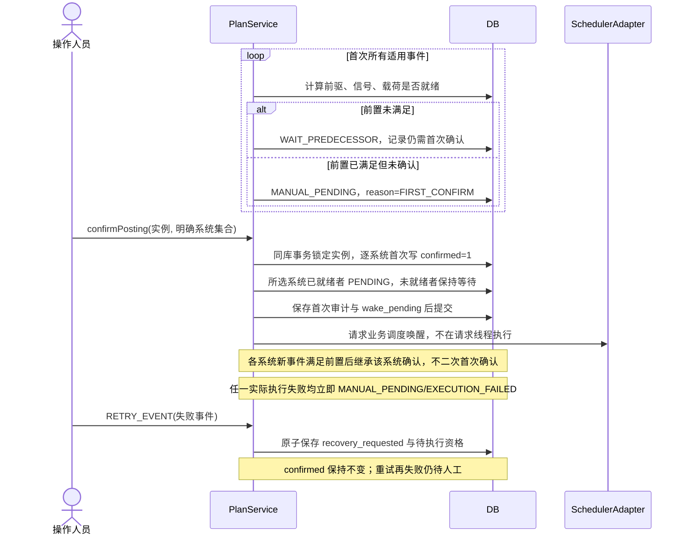

不变量：首次等待不是执行异常，不增加失败次数；确认与放行共同回滚；确认不能越过前驱、资源或真实业务信号。

## 场景 4：正常执行、源/目标校验与成功检查点

前提：业务统一调度已允许该类型，事件前置及模式门禁满足，enabled=true。

结果：事件完成 SUCCESS，token 从 S1 到固定 S2，后继唯一激活。示意同时展示外部步骤及本地步骤，实际 operation 可以只有其中一种。

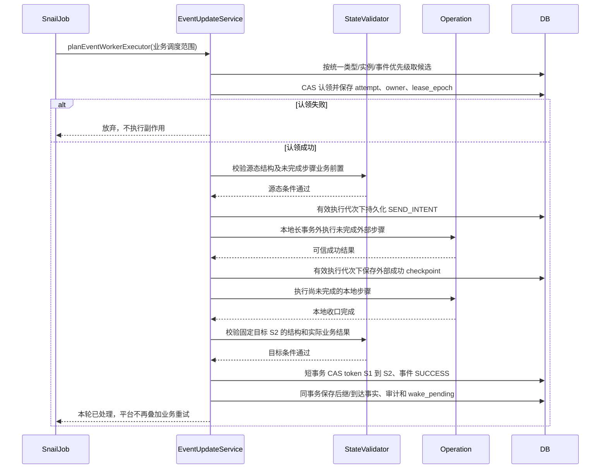

不变量：若本地结果写入与事件完成同库，相关收口同事务；外部成功独立保存，不能因后续本地事务失败而撤销成功证据。

## 场景 5：BYPASS 只屏蔽非本系统接口抛账操作

前提：enabled=true，模式 BYPASS，操作注册元数据区分类型和目标系统。业务操作工具类自身的方法在匹配屏蔽时不调用。

结果：只有匹配的接口抛账步骤 SKIPPED_MODE；其余步骤仍实际执行，事件最终 SUCCESS，流程状态正常推进。

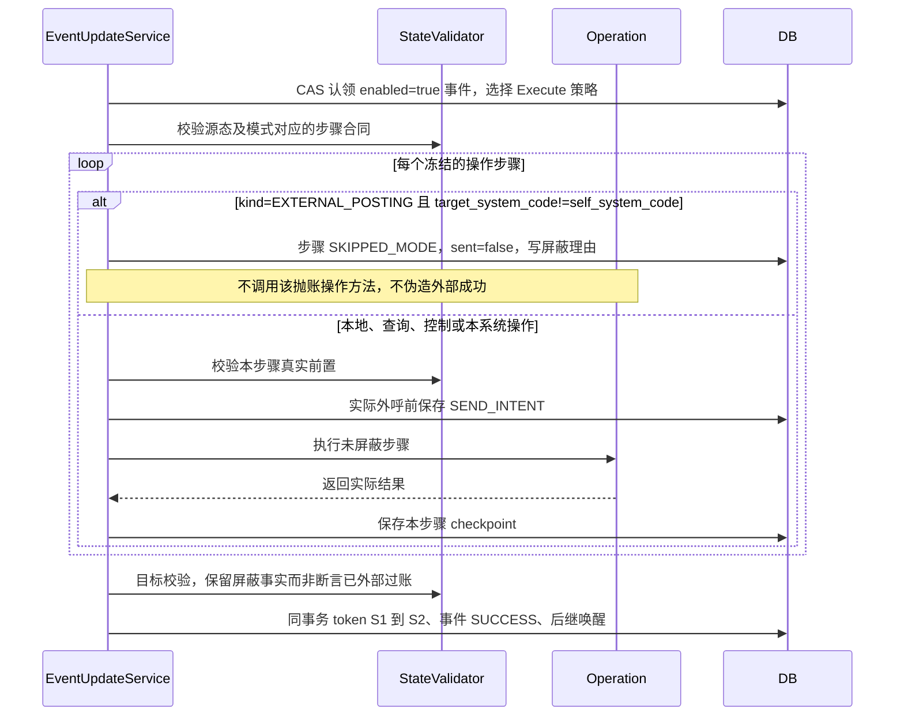

不变量：不能按 URL 猜测接口类型；不能屏蔽全部外部接口。剩余步骤失败按自动模式有限重试/人工异常规则处理，BYPASS 不增加首次确认。

## 场景 6：enabled=false 整事件纯跳过

前提：事件允许整事件跳过，前置及首次确认门禁满足，替代输入合同有效。

结果：初态到终态的变更和事件 SKIPPED 同事务提交，完全不调用任何内部 Operation。

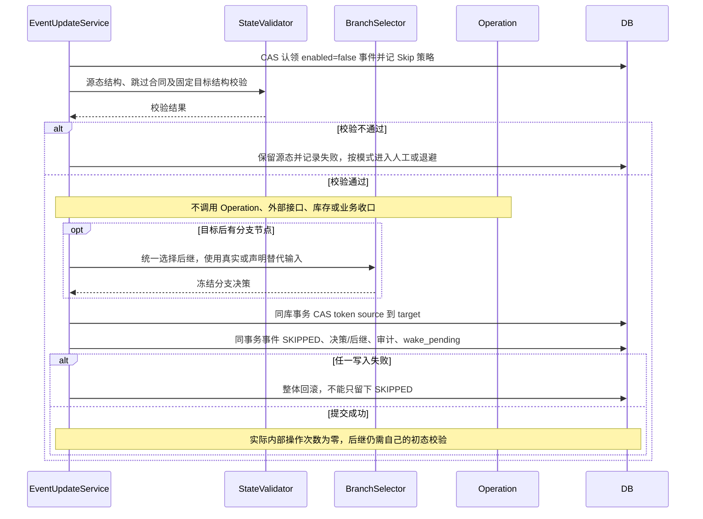

不变量：跳过不是删除图中的边。下游真实依赖被跳过的产物而没有替代输入时，发布/跳过命令拒绝，不伪造业务数据。

## 场景 7：BranchSelector、XOR/AND 分支及汇合

前提：到达已发布的决策节点。动态分支的决策时点是本次真正到达节点时，根选择则发生在挂载时。

结果：同 scope 一次决策，重试复用；XOR 只走已选路径，AND 全部期待分支到达才放行。

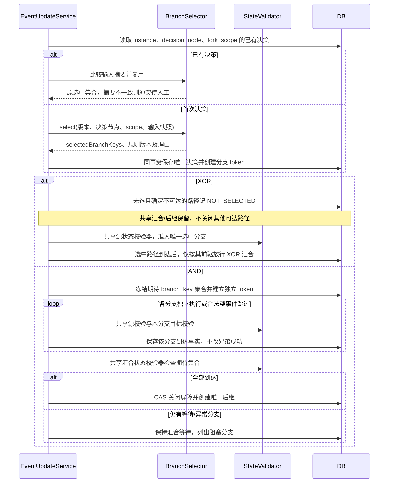

不变量：分支工具只决策，不执行事件或直接改状态；后继创建、到达事实和事件完成同事务。多终点按 ALL_SELECTED 或显式 ANY_SUCCESS 收敛，未收敛副作用不能直接取消。

## 场景 8：失败分类、回源态或统一异常停留

前提：执行中的本轮失败，已知操作阶段和步骤证据。异常位置和人工/自动门禁分别判断。

结果：无副作用失败保留源态；外部成功、本地失败或未知/部分成功进入本计划统一 EXCEPTION_HOLD。人工模式无论何种执行失败都立即待人工。

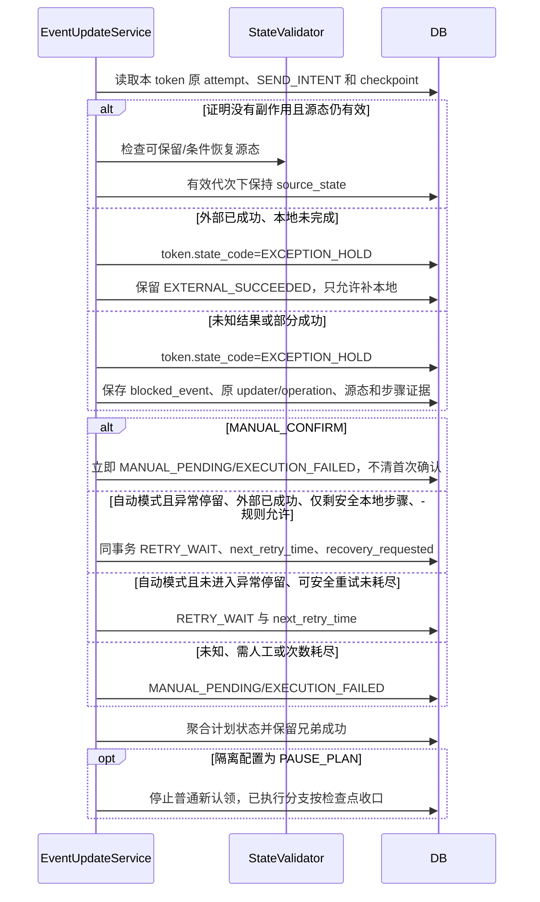

不变量：租约回收先 CAS 撤销旧执行权；有发送意图无确定结果视为未知。只有可信幂等或排除旧执行/迟到请求的证据才可重发，不凭一次“没查到”判断未执行。

异常停留下不能只有 RETRY_WAIT 而没有定向恢复资格。自动本地恢复只适用于明确配置且具备可信成功检查点的情况；其他异常待人工。MANUAL_CONFIRM 不生成自动恢复请求。

## 场景 9：事件重试、局部回源与检查点续跑

前提：目标为可恢复失败事件；成功、跳过、最终失败不可复活。人工暂停优先，需先恢复暂停。HTTP 命令只排队，不对账或外呼。

结果：按失败 token 的原尝试恢复，直到目标状态并满足后继初态；原成功步骤不重做。

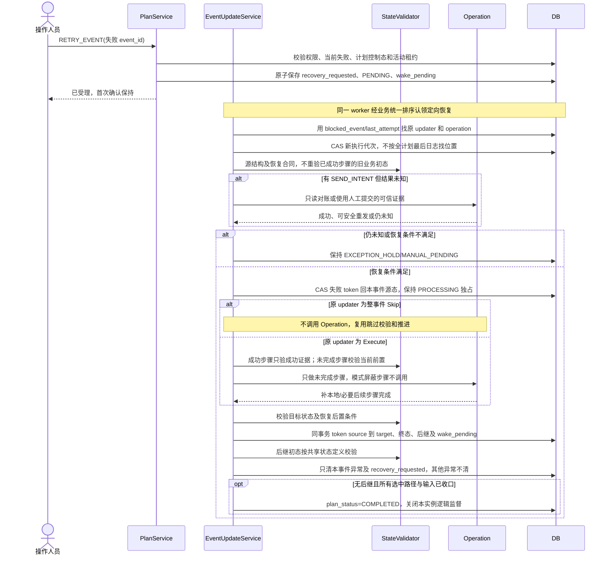

不变量：EXCEPTION_HOLD 中仅允许明确请求的定向恢复候选，不先把整个计划改为 RUNNING；外部成功只补本地。恢复再次失败按原模式处理，MANUAL_CONFIRM 仍立即待人工。

自动模式明确允许的安全本地恢复可由失败事务直接设置 recovery_requested，替代图中人工排队步骤，其余认领、检查点和目标校验相同；仍需到期且未被人工暂停。

## 场景 10：业务统一调度、计划监督、优先级及自动启停

前提：BusinessSchedule 登记该业务允许的计划类型及优先级。SnailJob 按需开启；类型/实例/事件优先级统一作用于合法候选。

结果：业务控制长期运行，各计划逻辑监督持续检查，空闲仅休眠 worker；各计划不得独立绕过统一调度。

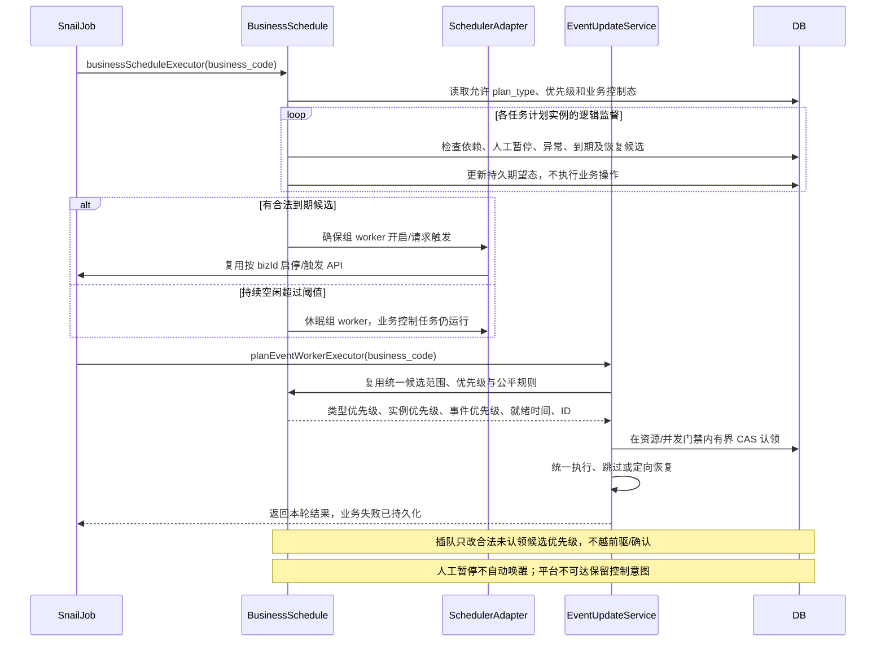

不变量：不开第二套调度平台；控制、worker 两种固定执行器代码复用参数。实例终态关闭自身逻辑监督，不暂停服务其他计划的业务控制任务。每实例物理监督为可选映射，也不直接取业务任务。

## 场景 11：调度执行描述与运维查询

前提：已存在冻结状态描述、校验器条件说明、执行/校验审计及调度控制事实。默认查询不重新运行校验，更不触发业务操作。

结果：返回已执行计划、按有效优先级待执行计划、活动计划逐分支所处事件、已达/下一状态及校验条件；异常附停留位置与恢复要求。

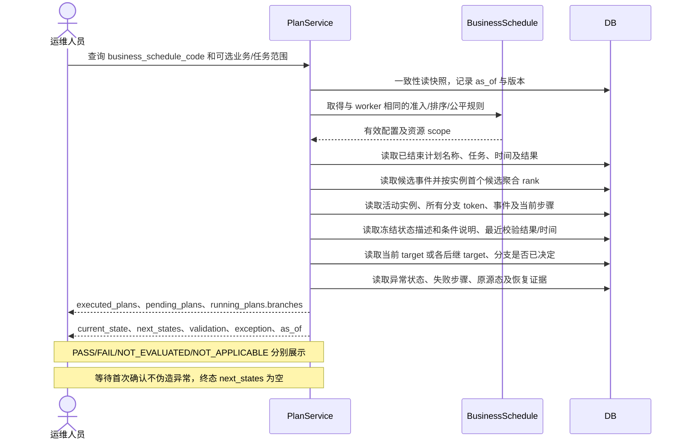

不变量：等待首确、前置、资源或未来重试者有 eligible=false 与原因，不冒充即将执行；已开始但等待的计划归活动计划。位次注明资源 scope；分支未决定列候选目标，不把后继 source 重复当下一目标。显式重新校验仅调用无副作用检查入口，历史结果与最新观察分开保存。

## 场景 12：从挂载到执行、跳过、异常恢复的整合链路

前提：业务统一调度和计划版本已发布。示例包含人工确认、整事件跳过、统一分支选择及外部成功后本地失败。

结果：失败事件从原检查点恢复，已成功外部步骤不重复，最终满足全部结束屏障才完成。

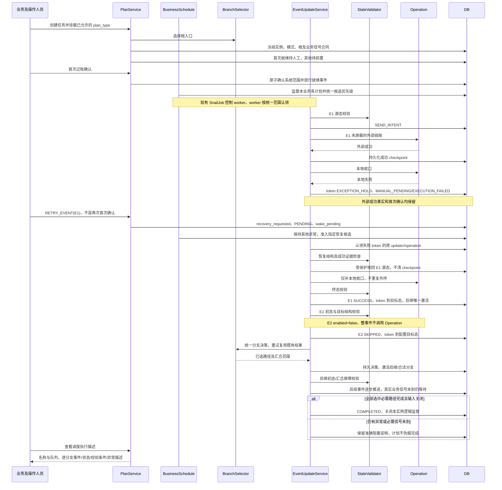

不变量：示例不是唯一业务图。若 E1 为 BYPASS，则仅其外部抛账步骤 SKIPPED_MODE、本地步骤继续；E2 的整事件跳过语义不变。源状态/目标状态从配置读取，不硬编码在工具类中。

## 场景 13：Web 配置、逐系统确认与事件重试

前提：配置人员登录 Web；计划版本已定义多个系统，每个系统各有一个模式值。复杂审批可选启用 Warm-Flow，简单首次确认直接调用计划命令。

结果：配置草稿和发布结果可审计；确认按所选系统分别持久化；重试只排队，不在 HTTP 请求中调用外部系统。

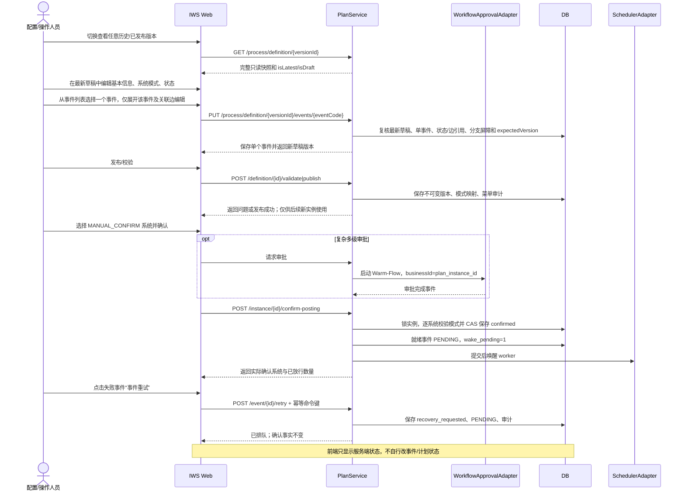

不变量：一个事件只解析自己系统码对应的模式；前端提交的系统集合只能是人工模式且属于该实例；确认和重试均使用服务端事务、权限与幂等。

## 场景 14：计划总览、计划链与事件执行描述

前提：后端已维护定义、token、事件、attempt 和调度控制记录；Web 查询权限允许查看业务范围。查询是只读快照。

结果：运维先看计划总览，再进入一个计划的分支链，最后打开事件抽屉查看 attempt 和请求；三个层级各有时间与版本，不根据日志猜测。

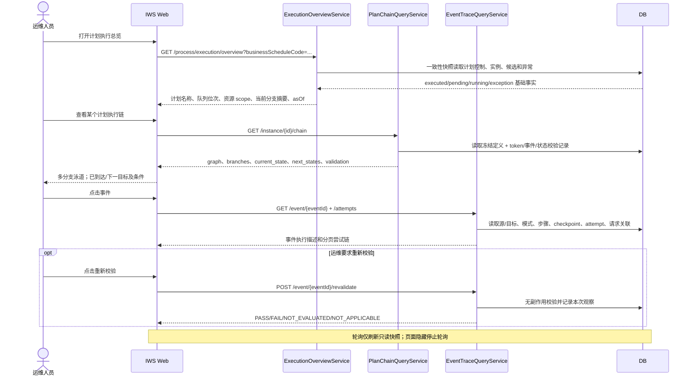

不变量：计划总览的待执行顺序来自统一调度服务；计划链不把并行分支压成一个节点；事件详情不把 request_id 日志成功当成事件完成。页面错误/空数据保留明确说明。

## 场景 15：代码绑定动作、移动与编辑门禁

前提：计划版本、动作/校验器/恢复适配器注册元数据存在；Warm-Flow 节点身份和内置监听器依赖已在定义中标注。

结果：浏览器只允许编辑元数据声明的字段；代码实现、校验逻辑、恢复协议和固定节点身份只读。拓扑移动仅在当前版本和注册元数据允许时通过全图校验。

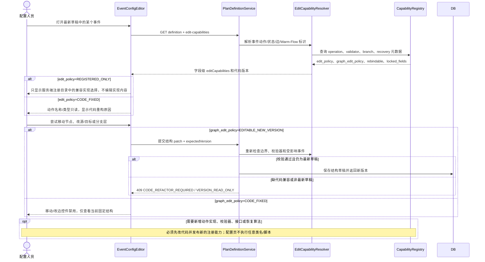

不变量：画布坐标移动不改变业务语义；改变边、顺序、网关或汇合属于拓扑变更。代码绑定字段只读，服务端对构造请求返回明确错误；运行实例和旧版本永不随新草稿移动。

## 场景 16：配置、执行、编辑、删除与重试的全动作审计

前提：现有 HTTP 操作日志可用；领域模块写入追加式 action audit。人工和系统动作分别使用真实用户或稳定系统账号。

结果：每个动作都有可查询的前后状态、版本、操作者、时间和结果；审计写入与状态变更一致，外部调用前后证据可关联。

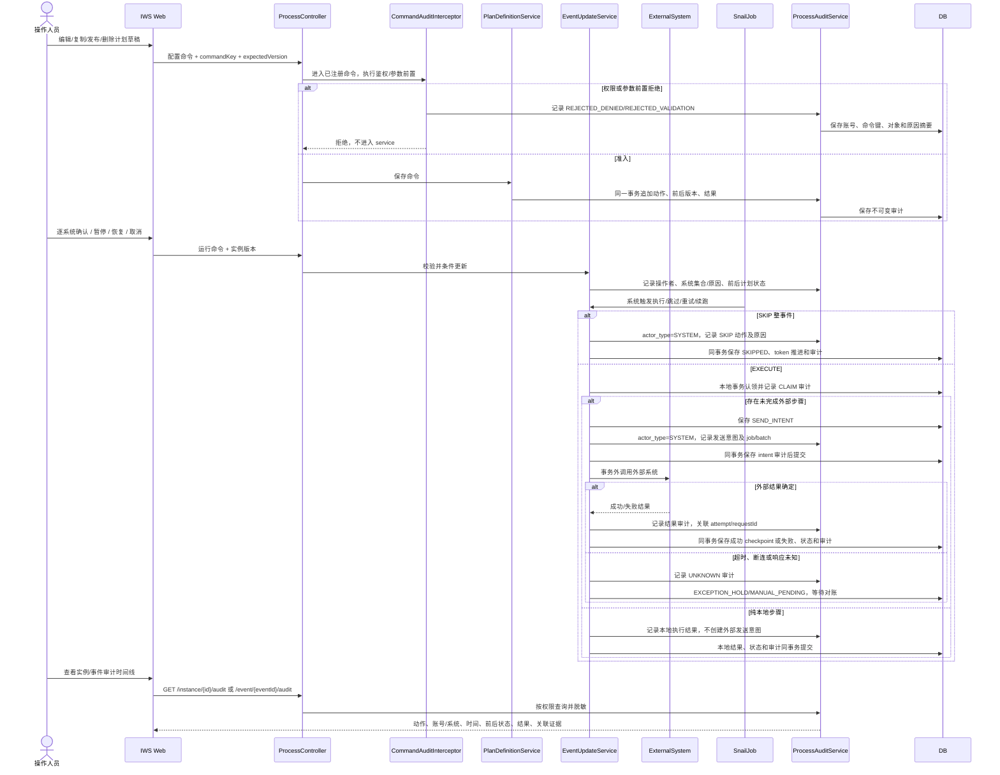

不变量：领域审计以 commandKey 和业务/attempt/request ID 关联；现有 @Log 只补充入口记录，不假设已有 traceId。审计为追加记录，不提供修改/删除接口；删除配置仅限未发布、未引用的最新草稿并记录删除前快照。审计失败时普通命令不返回成功；已发生外部副作用保留 checkpoint 并转人工。

## 需求覆盖索引

| 原始要求 | 覆盖场景 |
| --- | --- |
| 1 系统字段及不同过账模式 | 1、3、4、5 |
| 2 启用、初态及终态配置 | 1、6 |
| 3 跳过且状态一致 | 6、12 |
| 4 抽象状态及校验 | 1、4、6、11 |
| 5 计划状态机、共享初终态校验、固定转换 | 4、7、9 |
| 6 多分支、多起点、多终点 | 2、7、12 |
| 7 链路状态管理索引 | 主方案 §7.3；11 的定义图叠加运行事实 |
| 8 回初态或统一异常停留条件 | 8、9 |
| 9 多任务与唯一任务计划 | 2、10 |
| 10 事件定时、计划监督、排序和插队 | 10 |
| 11 统一事件更新工具 | 4、6、9 |
| 12 执行操作与纯跳过分离 | 4、5、6 |
| 13 原更新策略/操作检查点续跑 | 8、9、12 |
| 14 可选模块及复用 | 共同契约、10；主方案 §12 |
| 新增统一分支选择工具 | 2、6、7、12 的 BranchSelector |
| 新增业务统一调度及计划类型优先级 | 1、2、10 |
| 新增调度执行描述 | 11、14；主方案 §11.3 |
| 前后端配置、逐系统确认与重试 | 13；主方案 §13 |
| 计划/事件两级执行链详情 | 14；主方案 §13.4 |
| Warm-Flow 人审复用 | 13；主方案 §13.1 |
| 计划与事件统一配置页面、单事件编辑 | 13；主方案 §13.3 |
| 新配置只影响新计划/实例，旧计划保留旧配置 | 13；主方案 §3.1、§4.3、§11 |
| 版本切换查看、仅最新草稿可编辑 | 13；主方案 §4.1、§4.3、§13.3 |
| 代码绑定动作、移动和节点身份编辑门禁 | 15；主方案 §4.5、§13.3 |
| 配置/执行/编辑/删除/重试等全动作审计 | 16；主方案 §11.5、§13.2 |
| 命令版本与权限 | 13、14；主方案 §13.2、§13.4 |
| 最终失败/取消 | 8、9；主方案 §5.3、§13.2 |

本轮验证仅针对文档与图表；后续按主方案验收矩阵验证真实业务状态、数据库事务、并发、SnailJob 接线和外部幂等。
