# IWS 计划事件分场景及整合时序图

日期：2026-10-22。状态：目标设计，尚未实施。

[完整方案](plan-event-state-machine-design.md)为唯一规格；[模块复用与新增实施计划](plan-event-state-machine-implementation-plan.md)说明复用边界和开发动作；[核验依据](plan-event-state-machine-evidence.md)记录源码、依赖和目标数据库事实。本文将其具体化为 34 个场景，包含业务统一调度、唯一长期监督与有限轮次、QUEUE/IMMEDIATE 两模式、PLAN_SLOT 与公平插队、BranchSelector、外部触发准入、入站与出站 HTTP 协议、仅本地处理事件、同 JVM 跨模块 HTTP、方向记录、异步回执、可扩展事件类型、iws-endpoint 独立基础配置、外部系统目录与一次性抛账屏蔽、前后端管理台、计划总览与两级执行描述、代码绑定动作编辑门禁、全动作审计和防自调用循环。示例状态不是现有业务数据库状态。

## 共同契约

- 一个业务可有多个任务，一个任务一个计划实例；BusinessSchedule 是业务分组，登记允许的 plan_type、类型优先级和统一准入。所有 worker 都受同一业务调度与资源门禁约束。
- 每个业务按 (businessScheduleCode, planType, scheduleScope) 恰有一个长期监督计划，唯一键冲突即配置错误；每个业务计划实例绑定一个 supervisorInstanceId。监督是 planRole=SUPERVISOR 的长期 RUNNING 实例，只承载 eventRole=DECISION/LOCAL 的 INTERNAL 事件，不为每个业务实例另建监督。
- 监督轮次是唯一递增 roundNo 的有限 DAG：DECISION 只选择候选/分类，LOCAL 只在本库提交一个调度效果，即持久准入、控制意图或恢复标记；零业务 HTTP、零子计划动作、零 receipt、零 CALL permit。roundKey 参与 eventKey/token/localEffectKey；轮次 close 后才建下一轮，重启续原轮次并复用原 effectKey。监督不执行子计划；业务事件仍为 INBOUND/OUTBOUND/INTERNAL，由子计划 worker 执行。
- 调度模式只有 QUEUE 与 IMMEDIATE。QUEUE 的 activePlanLimit 为 1 时串行、为 N 时并行，并允许先挂起等待和受控插队；IMMEDIATE 同时只允许一个计划，调用方同步取得成功或失败。模式、上限和范围属于监督的冻结配置，不能用未声明的隐式队列或线程池替代。
- 运维展示名和文档说明使用中文；代码标识、状态码、eventDirection、endpointRole、purpose、字段名和外部协议值保持英文。eventDirection=INBOUND/OUTBOUND/INTERNAL 的中文展示名分别为“入站/出站/仅本地处理”。中文 job_name 只供展示，不进入技术唯一键。
- 新配置只创建新计划版本并供新实例挂载；旧版本定义和旧计划实例保留原冻结配置，不自动迁移、覆盖或重跑。
- 可扩展事件类型用 eventTypeKey + eventTypeVersion 标识。现有 Spring 注册机制提供该精确版本的合同、校验、恢复和可编辑字段；发布与 worker 都按精确版本解析，缺版本阻断且不回退。eventStatus 是独立生命周期维度，不为类型新增 Controller/Job/Factory，也不允许在线脚本或类名。
- 每个事件版本只表示一次逻辑动作。eventDirection=INBOUND/OUTBOUND/INTERNAL 必选且三者互斥。INBOUND/OUTBOUND 冻结不可变 callContractKey + callContractVersion 和一个 effectKey，以及 OUTBOUND 目标合同或 INBOUND 匹配合同；INTERNAL 的 callContract 和 effectKey 均为空，改冻结恰好一个 localActionKey + localActionVersion 和一个 localEffectKey。发布拒绝 IN/OUT 的零调用、多调用、多个独立 effectKey，以及 execute、reconcile、validator 中隐藏的额外 HTTP 调用；也拒绝 INTERNAL 出现 callContract、收发/出站 HTTP、receipt、方向记录、permit、多个本地动作、跨模块 HTTP 或隐藏第二动作。取消 event.steps[]、多 operation 和同一事件内串行步骤。
- 多个必需入站来源分别建成多个 INBOUND 事件，每个事件对应一个逻辑请求和一个 canonical receipt，可保留多来源 receipt 证据；再由 AND 汇合等待全部前驱。多个出站每次一个 OUTBOUND 事件，按依赖顺序或并行汇合；同一事件不能先接收触发再外呼，也不能兼作 QUERY/CONTROL/RESULT_CALLBACK。
- 同一 effectKey 可由替代可信来源 ANY_AUTHORIZED 指向同一个逻辑调用。该配置表示来源替代关系，不表示多个必需来源；事务内只应用一次业务效果。相同 sourceRequestId 重投只新增到达日志并返回原 receipt，不产生新逻辑调用；同键异参明确冲突。多个必需来源通过独立事件和 AND 汇合，不建立事件内多信号汇总。
- 计划版本按 (plan_version, system_code) 各保存一条单值过账模式；事件只按自身 system_code 解析实例快照。plan_status 管理实例，token.state_code 表示已提交流程位置，event_status 管理事件执行，token_status 只是元数据。
- 每条事件固定 source_state → target_state；StateValidator 校验已冻结结构和本库已存证据。恢复按检查点校验，不要求已成功调用前的旧业务初态重新成立。
- INBOUND 事件先核前驱。前驱未满足为 WAIT_PREDECESSOR，已满足后才等待本事件唯一的一次入站调用：BUSINESS_TRIGGER 进入 WAIT_EXTERNAL_TRIGGER/BUSINESS_TRIGGER，RESULT_CALLBACK 进入 WAIT_EXTERNAL_TRIGGER/RESULT_CALLBACK。到达日志、request 与 receipt 同事务绑定本事件；提前到达只保留 receipt。不用 RECEIVED 或伪造回执越过前驱，也不建接收端 attempt。
- OUTBOUND 事件不等待额外入站触发。前驱已经提交所需业务数据，且系统模式要求的首次确认满足后，事件直接进入 MANUAL_PENDING/FIRST_CONFIRM 或 PENDING；AUTOMATIC、BYPASS 的成功前置相同。数据库数据未提交时不得发送。
- INTERNAL 事件只执行本库一个已注册本地动作。前驱/输入已满足且系统确认满足后，事件直接进入 MANUAL_PENDING/FIRST_CONFIRM 或 PENDING；不存在 WAIT_EXTERNAL_TRIGGER，也不等待或伪造 HTTP ACK。执行在一个本地事务内完成唯一动作、效果证据、checkpoint 和事件/token 收口，零收发/出站 HTTP、零 receipt、零方向记录、零 SEND_INTENT、零 CALL permit。接收 HTTP 请求后在请求事务内调用内部 Service 的事件仍是 INBOUND，不能改标为 INTERNAL。
- 出站调用合同必须冻结 completion。completion=BUSINESS_COMPLETION 时，只有可信业务完成证据齐全，OUTBOUND 才可 SUCCESS。completion=ACCEPTANCE 时，只有接收端可信 ACCEPTED 受理证据齐全，才可完成“已提交/已受理”合同；此时 event SUCCESS 只表示提交合同达成，outcome=ACCEPTED、sent=true 绝不表示业务过账成功。HTTP 200、ACCEPTED、remoteTaskId 和 UNKNOWN 都不能被写成业务完成。
- 异步调用拆成 O_submit 与 I_result 两个事件。O_submit 是一个 OUTBOUND 事件，只对应一次逻辑提交，使用 completion=ACCEPTANCE；每个发送 attempt 至多一个 HTTP 请求，可靠重试原调用可产生多条 request/方向记录，但不得形成第二个 effect。I_result 是必需的独立 INBOUND 事件，purpose=RESULT_CALLBACK，冻结 originOutboundEventId、幂等键与 externalTaskId 匹配合同。只有 I_result 得到可信最终结果，且后续必需事件完成，计划才可 COMPLETED。O_submit 的 ACCEPTED 只完成提交事件，不能代替 I_result 或整项过账成功。
- 取消同一事件内的 WAIT_REMOTE_RESULT 挂起和新 attempt 消费 callback 路径。原事件只完成自己的发送合同或转入对账；回调始终由 I_result 持有、匹配和消费。已受理的 O_submit 不得因计划取消或超时再次发送。
- callback 先持久化为 I_result 的 INBOUND receipt，再匹配 originOutboundEventId、调用合同、effectKey、幂等键和 externalTaskId。前驱未满足时 I_result 保持 WAIT_PREDECESSOR；重复、迟到、异参或终态结果保留证据并进入对账。正向回调不清除 MANUAL_PENDING/EXECUTION_FAILED、暂停或终态门禁。
- O_submit 的 ACK 未知且尚无可信受理时，停在 EXCEPTION_HOLD/MANUAL_PENDING 或明确对账态，不自动重发。若可信 I_result 或已存证据已证明同一调用的受理/结果，可只读引用该证据帮助原 O_submit 对账收口；回调所有权仍归 I_result，不因此新增 HTTP 或把结果写成 O_submit 的业务成功。
- 认领、发送意图、检查点和收口均检查 event_id、version、lease_epoch、owner。存在 SEND_INTENT 而无可信结果即未知，不凭超时、租约回收或一次未查到直接重发。
- T1认领只做资源容量预检、不扣量；T2同一事务原子取得容量并在创建 SEND_INTENT 时建立持久 schedule_control(scopeType=CALL, scopeKey=原 OUTBOUND eventId)。control 状态固定为 INTENT/IN_FLIGHT/ACCEPTED/WAIT_RESULT/RELEASED；前两者占用同一 CALL 资源，不存在“T1已扣量无控制行”或“ACK后才补建permit”窗口。ACK转ACCEPTED/WAIT_RESULT移交I_result；ACK丢失/崩溃继续占用；CAS只释放一次。O_UNKNOWN 是“最新attempt/checkpoint为UNKNOWN或SEND_INTENT后无最终可信结果且无完成证据”的判定，不是event_status，QUERY/I_RESULT/安全终止共用。
- 最终失败只允许从未被活动租约占用且无未收口副作用的事件进入。取消先禁止新认领，并在发送准备中重验：取消后不得新建业务发送意图；取消前已提交 SEND_INTENT 的调用等待对账。存在 PROCESSING 或未知结果时不能直接保存 CANCELLED。
- enabled=false 是整事件 Skip：零业务 operation、零业务 HTTP、零本地动作、零内部业务副作用，但仍须满足前驱和已发布 skipContract。INBOUND 默认 skipContract=REQUIRE_REAL_INBOUND，必须真实接收匹配请求并保存到达记录后才可 SKIPPED；允许替代证据时必须显式冻结，且不得伪造 receipt。INTERNAL 可直接禁用唯一本地动作，不创建 receipt、SEND_INTENT、方向记录或 permit。缺少入站证据时保持 WAIT_EXTERNAL_TRIGGER，不把“没收到”写成收到。
- BYPASS 只适用于 OUTBOUND 且 callPurpose=EXECUTE_ACTION、目标为本系统之外的接口抛账。命中记 SKIPPED_MODE、sent=false、无 OUTBOUND 记录；INBOUND 永不因 BYPASS 被屏蔽，也不能伪造“未收到”；INTERNAL 永不因 BYPASS 被禁动作，仍按前驱/输入和系统确认执行或走 enabled=false Skip。被屏蔽事件不等待 callback，不抹除已经到达的入站记录。enabled=true 的其他 OUTBOUND 事件按各自合同执行。
- MANUAL_CONFIRM 在前驱及合同要求的输入满足后才进入 MANUAL_PENDING/FIRST_CONFIRM；确认按实例+系统保存。首次确认后自动执行，任一实际执行失败立即 MANUAL_PENDING/EXECUTION_FAILED；QUEUE 后续命令是 RETRY_EVENT，首次确认事实不清除。AUTOMATIC 与 BYPASS 可在 QUEUE 按规则有限重试；IMMEDIATE 不使用 RETRY_EVENT。
- BranchSelector 统一选择 XOR/AND 和起点，决策按 scope 持久一次、重试复用。多个必需入站和多个出站均按独立事件 ID 建模；未选路径为 NOT_SELECTED，不冒充跳过执行。跨计划依赖不得形成 O_submit 等待 I_result、I_result 又等待 O_submit 的业务环。
- 只复用现有 SnailJob，并接线 businessScheduleExecutor 与 planEventWorkerExecutor 两个固定执行器。监督任务展示名使用“计划监督－{业务中文名}－{计划类型中文名}－{范围中文名}”，事件 worker 使用“计划事件－{业务中文名}－事件执行－{职责中文名}”；executor 标识和 bizId 保持稳定技术键。监督 LOCAL 提交后，SnailJob 适配器在事务外应用平台启停/触发，属于控制平台接线；事件内不得直接 HTTP。适配器只消费已提交的控制意图并分别回报 desired/observed，失败保留意图待下轮补偿。
- 计划级资源与调用级许可是两个概念：QUEUE 中独立 PLAN_SLOT 从计划首次准入到整个计划安全终结持有；等待回调、人工处理或重试仍占已准入名额；尚未开始且 holdStart=true 的挂起实例不占名额、不产生 rank。release-start 只解除未准入挂起，解除后仍重算前驱/确认/容量资格，不直接准入或执行。CALL permit 仍只属于 OUTBOUND；既有业务 INTERNAL 事件没有 CALL permit，但仍受 PLAN_SLOT 约束，不能把两者合并计数。
- QUEUE 公平规则按每 K 次成功准入至少选择一名最久就绪的普通候选，K=fairnessWindowSize 必须配置并冻结；无普通候选不积累欠账，失败、失效决策和无候选轮次不计成功准入。窗口计数随准入事务写入业务共享 scope，展示 rank 与 worker 同规则、同 scope。插队只调整尚未认领候选的次序，不能抢占 PROCESSING、越过依赖/确认/资源门禁或耗尽普通候选。
- IMMEDIATE 发布只接受有界同步可完成图，不得包含 future INBOUND、callback、人工 wait 或异步 acceptance。POST /process/schedule/{id}/execute-immediate 先按 commandKey 读回原命令，再由监督 DECISION→LOCAL 单事务重验 revision/lease、任务唯一、输入和起始门禁，原子 claim PLAN_SLOT、挂载计划和写 PROCESSING 锚点；LOCAL 不调用 driver，提交后立即 close 准入轮次。事务外由业务 driver 逐事件调用同一 EventUpdateService，监督只完成准入。忙、OPEN 轮次被占、暂停、模式不符或初始门禁不满足立即返回 BUSY/SUPERVISOR_BUSY/SUPERVISOR_PAUSED/MODE_MISMATCH/NOT_READY，且不创建实例；runtime safeFailureContract 不成立返回 FAILED_HOLD 并保留 slot。
- IMMEDIATE 业务结果统一放 R.ok(data) 的 data.resultCode；R.code=200 只表示响应可解析。只有 planStatus=COMPLETED 且 resultCode=SUCCEEDED 算成功；确定失败且无在途/未知、部分成功均有证据时收口 FAILED_FINAL，返回 resultCode=FAILED 并同步释放 slot；UNKNOWN、断连、期限、在途分别返回 RESULT_UNKNOWN/RESPONSE_TIMEOUT，slot 保持到证据收敛。resultCode=PROCESSING 只表示同 commandKey 原命令仍在处理，必须带原 instanceId/queryUrl 并禁止新执行；GET 可查，显式恢复只处理原 UNKNOWN，终态重开必须新 taskKey 并引用原实例 checkpoint。IMMEDIATE 的 FAILED_FINAL 是终态，禁止 RETRY_EVENT；RESULT_UNKNOWN/RESPONSE_TIMEOUT 只允许显式恢复原实例和证据收敛，不重发已发出业务；已确定失败需新 taskKey 重开时还必须满足 P1 跨任务效果去重合同。executionDeadline 持久且不随重投/续租延后；单次调用预算不得超过剩余期限，到期 CAS 写 stopRequested 并返回 RESPONSE_TIMEOUT，晚到只存证据/安全收口、不启动后继。
- 即时请求与周期 tick 共用同一 OPEN 轮次门禁：若已有其他轮次正在推进，当前请求立即返回 SUPERVISOR_BUSY，不等待下一 tick、不创建子计划或名额；同 commandKey 已有命令时优先读回原命令。LOCAL 提交后立即 close 准入轮次并释放监督 lease，子计划运行期间只持 PLAN_SLOT/业务 lease。
- IMMEDIATE 的显式恢复固定使用 /event/{id}/retry(recoveryOnly=true)，由原 planEventWorkerExecutor 的唯一 executionPurpose=RECOVERY_ONLY 例外承接；要求原实例仍占 PLAN_SLOT、原 epoch 无活跃业务动作，只允许原版本已发布的对账 QUERY 或本库 checkpoint 收口，不重新发送原 OUTBOUND、不重新执行 LocalAction、不执行尚未开始的后继，ImmediateExecutionService 不被该 worker 调用。缺参、已确定终态或恢复会产生新业务效果时拒绝；证据证明原事件完成且全图已完成才收口 SUCCEEDED，否则以可安全终结的 FAILED 收口并提示后续业务修订。
- 监督轮次与子计划调度记录复用追加式 action_audit，分别形成 SupervisorRoundVO/DispatchRecordVO；至少关联 dispatchId、supervisorInstanceId、supervisorDefinitionVersion、roundNo/roundKey、supervisorEventId/attemptId、可空 childInstanceId、commandKey、decision/result/reason、slotBefore/After、lease_epoch、控制 revision、平台任务/批次、desired/observed、actor、开始/结束/耗时和配置版本。记录只追加，不用任务日志替代领域事实；拒绝回滚后独立记录，正常意图随所属短事务提交。commandKey 以 receiptKey=scheduleId+commandKey 建立唯一锚点，保存初始 PROCESSING/原始响应；后续结果只追加引用锚点的新审计，不 UPDATE 锚点。读模型从锚点关联中取最新确定结果，无确定结果才返回 PROCESSING。
- 复用现有 Warm-Flow 仅用于可选多级人审、待办和审批轨迹；简单首次确认直接调用领域确认命令。审批启动、查询和确认走跨模块 HTTP，审批模块先提交自身结果与持久关联，再幂等调用 process；不共享事务，Spring 事件只唤醒补查，flow_status 不能当成 event_status。
- 入站 Controller、鉴权和协议映射只调用统一业务命令。调用者带可信服务身份、sourceRequestId、payloadHash 和业务关联；跨 HTTP 不传播 Spring 事务或登录 ThreadLocal，原用户 actor 只作审计。iws_process_trigger_receipt 以 caller + callContractKey/version + sourceRequestId 去重，同摘要返回原 ACK，异摘要冲突；未唯一关联时保持待关联或明确拒绝，不能创建错误计划。
- 出站统一经既有 HTTP 业务调用封装，transport 固定 HTTP；参考 PCBA 已核验的 RestTemplate、具名业务门面和双向日志做法，按 Boot 4/IWS 现状最小移植。不另造通用客户端、Gateway、Connector 或集成审计平台。QUERY、CONTROL 若需远端交互，各自建成独立 OUTBOUND 事件，不能藏在 execute、reconcile、validator 或其他事件处理器中。
- 自动对账需要已存可信证据，或图中预发布的独立 QUERY OUTBOUND 恢复分支。QUERY 事件冻结 recoveryForEventCode，仅 O_UNKNOWN+显式 recoveryRequested 准入，不以 O_SUCCESS 为前置，不打开普通后继，也不参加业务容量预检/扣量；它挂靠原 CALL、不另占 permit。查询证据只读帮助原事件收口，不能替代 I_result、伪造 receipt 或推进业务完成；运行中不改图。结构检查、规则校验和本库证据判断不发 HTTP。缺证据保持等待/人工。
- process 的 INBOUND 事件只持久化、校验并消费本次 request、receipt 和已到达证据，不直接调用 WMS 或其他模块 Service。若入站语义是“请求执行本地/WMS 业务”，必须激活已发布图预留的后续 OUTBOUND action 事件并经 HTTP 调用实际业务入口；该 action 接收端点可在一个 HTTP 请求的自身事务内调用本模块内部 Service，sender O 与 receiver I 仍是两个关联事件。若入站已经携带业务效果或完成事实，只登记证据并复用该事实，不能执行第二次。跨服务 HTTP 转发、多个独立业务效果或调用另一个事件必须拆到图中独立事件，不能用 opaque handler 隐藏多调用。
- 平台自管双方使用 self HTTP 时，发送侧 O_submit 与接收侧 I_result/BUSINESS_TRIGGER 是两个事件 ID，通过 correlationId/originEventId 关联。默认在接收侧可靠持久 receipt 后即返回 ACK；ACK 只表示接收事实，不等同接收侧 worker 已消费 I，也不等待发送侧 worker 或资源。若合同必须同步业务完成，由接收端自身 HTTP 请求事务完成本次唯一业务效果并保存证据，I 只消费该证据；HTTP 线程不得等待由发送侧占满的 worker 或 CALL 资源。业务依赖不得形成两事件互等的环。同一个 HTTP 请求只发送一次，两个方向记录关联两个不同事件，不双计逻辑过账。
- 出入站记录复用 PCBA 参考仓库及 IWS 现有 HTTP 日志能力。每次 HTTP 分别形成 direction=INBOUND/OUTBOUND 记录，以 rootId/correlationId 关联；purpose 区分 BUSINESS_TRIGGER、EXECUTE_ACTION、QUERY、CONTROL、RESULT_CALLBACK。一个 OUTBOUND 事件只有一个逻辑 intent；一个 INBOUND 事件可有多个来源 receipt 到达证据，但只有一个 applied/canonical_receipt_id。重复 sourceRequestId 只增加到达日志。eventDirection=INTERNAL 不产生收发/出站 HTTP，因此不得生成 direction/request/response/receipt 记录。
- 业务抛账仅统计 OUTBOUND + EXECUTE_ACTION + 外部接口抛账并按 effectKey 去重；HTTP 请求数、方向记录数和逻辑业务效果数分别统计。QUERY、CONTROL、RESULT_CALLBACK、本地校验、BYPASS/SKIP 的 sent=false 都不新增业务过账；INTERNAL 的 localEffectKey 只计本地动作效果，不计 HTTP 请求、方向记录或外部业务抛账。
- 本轮只编写文档并可启用现有 SnailJob，当前关闭不构成阻断。全部代码完成并验收后，按 M12 新建独立平台接入/使用 Skill，覆盖最终公开接入点，再用 darwin-skill 优化；当前不提前创建 Skill。

## 长期监督轮次图

同一 (businessScheduleCode, planType, scheduleScope) 只对应一个长期 RUNNING 的监督实例。每轮是有限 DAG，只含 DECISION/LOCAL INTERNAL 事件；轮次全部事件终态并 close 后才创建下一轮，重启读取当前轮次并复用原 eventKey/token/localEffectKey。该图只描述监督控制，不改变场景 1-26 的业务事件含义。

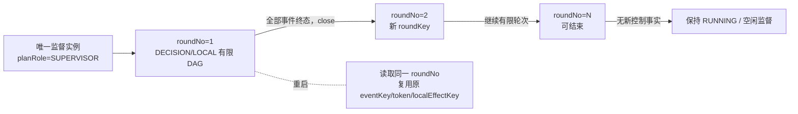

## 现状基线

本节只记录已核对的当前实现，用于识别迁移差异。下文序列均为目标设计。

| 主题 | 当前实现 | 证据 |
| --- | --- | --- |
| 前端部署产物 | Nginx 产物没有源码和 Git；语言包有“接口异常重试记录”菜单文案，但有界检索未命中本文所需的 /iws/retry、/outbound/order/posting、MANUAL_CONFIRM、MANUAL_PENDING、WAIT_PREDECESSOR 页面调用或状态文案。部署包无法证明新页面契约。 | C:/code/company/ui/vietnam-pcba-web/dist-pcba/static/js/index-KhyucIum.js:1 |
| 过账追溯查询 | 已有 GET /iws/retry/events、GET /iws/retry/{id}/trace、GET /iws/retry/{id}/requests、GET /iws/retry/{id}/requests/{requestId}。列表项清除请求和响应正文，完整请求内容只能经单请求详情读取。 | C:/code/company/vietnam_pcba_avc/ruoyi-system/src/main/java/com/ruoyi/system/rest/PcbaPostingTraceController.java:29-80；C:/code/company/vietnam_pcba_avc/ruoyi-common/src/main/java/com/ruoyi/common/business/posting/PcbaPostingEventTrace.java:13-18；C:/code/company/vietnam_pcba_avc/ruoyi-common/src/main/java/com/ruoyi/common/business/posting/PcbaPostingRequestDetail.java:15-45 |
| 当前模式 | GET /outbound/order/posting/mode 与 POST /outbound/order/posting/mode 使用 BYPASS、MANUAL_CONFIRM、AUTOMATIC。切换请求只有 mode 和 expectedMode；服务把 midwms.feedback.bypass.enabled 与 pcba.outbound.feedback.box-level 映射为三种模式。没有独立的 scope=SYSTEM 字段，也没有 skip_scope。 | C:/code/company/vietnam_pcba_avc/innolux-wms/src/main/java/com/ruoyi/wms/outbound/posting/domain/PcbaOutboundPostingMode.java:6-9；C:/code/company/vietnam_pcba_avc/innolux-wms/src/main/java/com/ruoyi/wms/outbound/posting/domain/dto/PcbaOutboundPostingModeSwitchDto.java:14-18；C:/code/company/vietnam_pcba_avc/innolux-wms/src/main/java/com/ruoyi/wms/outbound/posting/service/PcbaOutboundPostingModeService.java:73-111；C:/code/company/vietnam_pcba_avc/innolux-wms/src/main/java/com/ruoyi/wms/external/midWms/common/MidWmsFeedbackBypass.java:21；C:/code/company/vietnam_pcba_avc/innolux-wms/src/main/java/com/ruoyi/wms/outbound/box/service/PcbaOutboundBoxFeedbackModeProvider.java:15 |
| 当前模式快照 | 模式固化在稳定事件 ORDER_POSTING_CONTEXT 的 payload 中，首批写入 postingMode 和 confirmed=0，首次确认后改为 confirmed=1。 | C:/code/company/vietnam_pcba_avc/innolux-wms/src/main/resources/mapper/outbound/posting/PcbaOutboundPostingModeMapper.xml:105-115；C:/code/company/vietnam_pcba_avc/innolux-wms/src/main/java/com/ruoyi/wms/outbound/posting/domain/PcbaOutboundPostingContext.java:12-23 |
| 当前首次确认 | 只为新建且尚为 PENDING 的业务事件加 WAIT_ORDER_CONFIRM 门禁。POST /outbound/order/posting/{outOrderNo}/retry 在未确认时写 confirmed=1，再执行所选事件；POST /{outOrderNo}/manual-pending 把待执行事件转人工待处理。 | C:/code/company/vietnam_pcba_avc/innolux-wms/src/main/java/com/ruoyi/wms/outbound/postingevent/service/PcbaOutboundPostingEventStore.java:62-69,177-188；C:/code/company/vietnam_pcba_avc/innolux-wms/src/main/java/com/ruoyi/wms/outbound/posting/service/impl/PcbaOutboundPostingServiceImpl.java:303-315,385-401；C:/code/company/vietnam_pcba_avc/innolux-wms/src/main/java/com/ruoyi/wms/outbound/posting/controller/PcbaOutboundPostingOrderController.java:87-128 |
| 当前前置等待 | WAIT_PREDECESSOR 是查询时根据依赖计算出的展示状态，不是独立的持久运行态；实际状态仍可为 PENDING 或 RETRY_WAIT。 | C:/code/company/vietnam_pcba_avc/innolux-wms/src/main/resources/mapper/outbound/posting/PcbaOutboundPostingMapper.xml:74-93；C:/code/company/vietnam_pcba_avc/innolux-wms/src/main/java/com/ruoyi/wms/outbound/posting/service/impl/PcbaOutboundPostingServiceImpl.java:700-704 |
| 当前失败续跑 | 瞬时错误在阈值内进入 RETRY_WAIT 并按退避到期；达到上限或业务拒绝进入 MANUAL_PENDING。RETRY_WAIT 的人工命令只提前到期。除整单入口外另有批量、按箱、最终失败路由；其中按箱入口当前直接拒绝。 | C:/code/company/vietnam_pcba_avc/innolux-wms/src/main/java/com/ruoyi/wms/outbound/process/service/PcbaExternalFeedbackProcessServiceImpl.java:298-320；C:/code/company/vietnam_pcba_avc/innolux-wms/src/main/java/com/ruoyi/wms/outbound/process/service/PcbaOutboundEventManualRetryService.java:94-101；C:/code/company/vietnam_pcba_avc/innolux-wms/src/main/java/com/ruoyi/wms/outbound/posting/controller/PcbaOutboundPostingOrderController.java:95-129；C:/code/company/vietnam_pcba_avc/innolux-wms/src/main/java/com/ruoyi/wms/outbound/posting/service/impl/PcbaOutboundPostingServiceImpl.java:176-191 |
| 当前状态投影 | 运维查询把 MANUAL_PENDING、前置等待、执行中、成功、最终失败映射为 2、4、0、1、3；提示文案包含“请到工单过账确认页面整单处理”和“等待前置事件完成”。 | C:/code/company/vietnam_pcba_avc/ruoyi-system/src/main/resources/mapper/system/InterfaceRetryMapper.xml:143-176 |

当前接口已经存在，但不是本文的目标执行协议。新设计需要增加计划版本和冻结配置，显式区分 plan_status、state_code、event_status，并让模式确认、异常停留、恢复和调度控制可独立寻址。

## 场景 1：业务调度、计划与事件配置发布

前提：业务调度登记可挂载计划类型及优先级；草稿中的每个事件都声明 eventDirection、源/目标状态和分支关系。INBOUND/OUTBOUND 还各自声明精确 callContractKey/version、effectKey 和匹配或目标合同，OUTBOUND 另声明目标系统、endpointRole、completion；INTERNAL 声明恰好一个 localActionKey/version、localEffectKey，callContract 与 effectKey 为空。

结果：发布前证明每个事件恰好一次逻辑动作且方向明确。INBOUND/OUTBOUND 恰好一个调用合同和一个 effectKey；INTERNAL 恰好一个注册本地动作和一个 localEffectKey，零调用合同、零收发/出站 HTTP、零 receipt、零方向记录、零 permit。多个必需入站来源、多个出站动作、额外远端查询或控制都拆成独立事件。非法组合原子拒绝，合法配置冻结为不可变版本，发布不等待 SnailJob 在线。

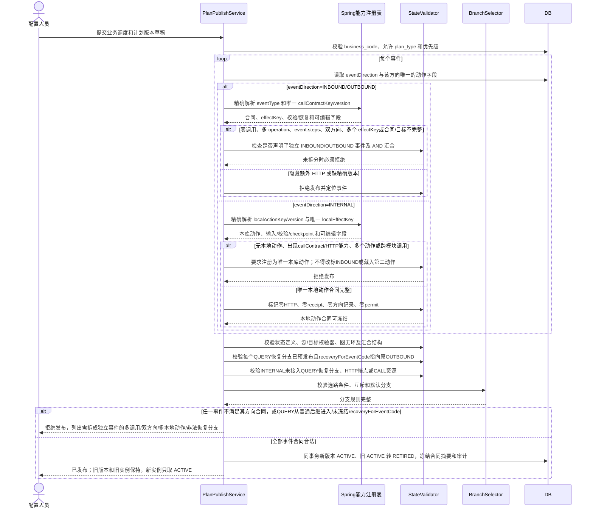

不变量：eventDirection=INBOUND/OUTBOUND/INTERNAL 三者互斥。INBOUND/OUTBOUND 各有且仅有一个 callContract 和一个 effectKey；INTERNAL 的 callContract/effectKey 必须为空，且恰有一个 localActionKey/version、一个 localEffectKey 和一个本库动作，不能藏 HTTP、receipt、方向记录、permit、跨模块调用或第二动作。接收 HTTP 请求后在请求事务调用内部 Service 仍属 INBOUND。不能以“同事件多步骤”承载顺序业务，也不能先入站接收再出站抛账。多个必需入站拆成多个事件后由 AND 汇合；多个出站每次一个 OUTBOUND 事件，按顺序或汇合连接。QUERY、CONTROL 若存在也各有独立事件，INTERNAL 不能作为 QUERY 恢复分支。QUERY恢复分支必须在发布时冻结recoveryForEventCode及专用准入，不能作为普通后继，也不能运行时改图。校验只访问注册能力和本库结构，不执行 HTTP。

模式复核：发布服务按 eventDirection 分流校验：INBOUND/OUTBOUND 解析调用合同，INTERNAL 解析唯一本地动作合同。注册表按精确版本提供能力，校验链负责组合和拒绝。提交后唤醒只是 Observer 式提示，数据库中的不可变事件合同、版本摘要和 ACTIVE 状态才是事实。

## 场景 2：业务任务挂载计划、多起点与独立入站事件

前提：任务有稳定业务键且 plan_type 已被 BusinessSchedule 允许；每个事件已按场景 1 冻结方向。INBOUND/OUTBOUND 各有一个调用合同和唯一 effectKey；INTERNAL 有一个 localActionKey/version 和唯一 localEffectKey。多个必需来源在图中是多个 INBOUND 事件，替代来源由 ANY_AUTHORIZED 指向同一 effectKey。

结果：一个任务幂等挂载一个计划；只激活已选根。尚未发生的外部输入保留各自 INBOUND 事件占位，收到某次真实入站才绑定该事件的一份 request/receipt，不把多个必需信号压入一个集合槽。INTERNAL 只建本地动作占位，等待前驱/输入和系统确认，不建请求、receipt、发送意图或 CALL permit。

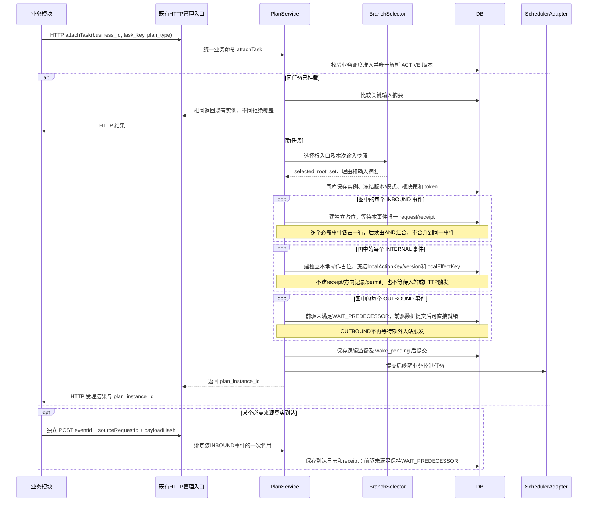

不变量：挂载不抛账，也不为未发生的事件创建假 request/receipt。INTERNAL 只登记自己的本地动作和 localEffectKey，不因挂载创建 HTTP、receipt、方向记录或 permit。多个必需来源只能通过多条入站到达多个 INBOUND 事件并进入 AND 汇合；一个事件不能先收业务触发再向外部抛账。OUTBOUND 的前驱数据必须已提交，未提交或只持锁时不得发送。

模式复核：PlanService 用命令受理，BranchSelector 只负责选路。每个 INBOUND 事件和每次 HTTP 方向调用由独立记录承载，INTERNAL 只由本地动作 checkpoint 承载；AND 汇合按事件完成计算。同任务摘要不同时拒绝覆盖，唤醒只做非权威提示。

## 场景 3：MANUAL_CONFIRM 首次确认与失败后事件重试

前提：本场景仅适用于 QUEUE；IMMEDIATE 发布拒绝首次人工确认等待。各系统模式和计划版本已冻结。确认事实按 plan_instance_id + system_code 保存；INBOUND 等待自己的真实入站，OUTBOUND 在前驱数据已提交后判断系统确认，INTERNAL 在本地输入齐全后判断系统确认。

结果：首次确认只放行已就绪的 INBOUND/OUTBOUND/INTERNAL 事件，后续同系统事件继承；INTERNAL 不等待额外入站触发，也不等待 HTTP ACK。执行失败立即转人工，QUEUE 后续命令只做事件重试，不再次首次确认；IMMEDIATE 不使用该人工重试路径。

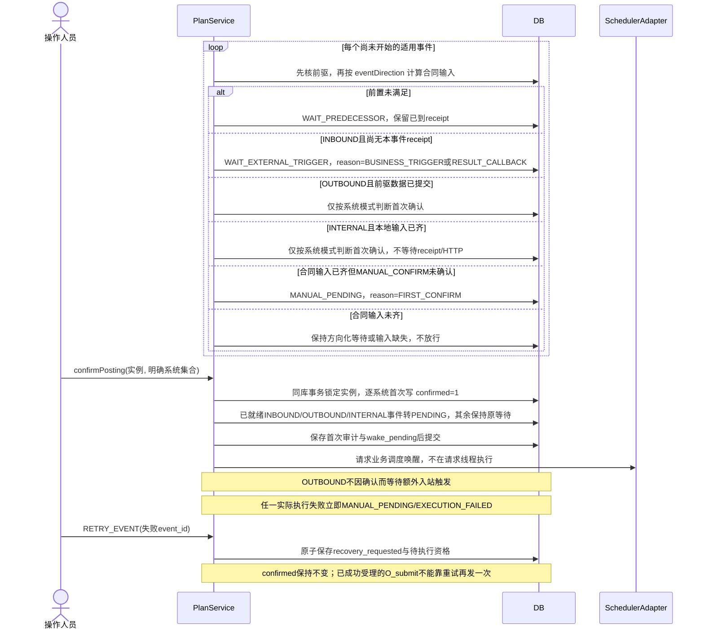

不变量：确认与放行共同回滚；确认不能越过前驱、OUTBOUND数据提交、INBOUND真实到达或INTERNAL本地输入。INTERNAL 不因确认补造 receipt、HTTP ACK、方向记录或 permit。首次等待和回调等待都不是执行异常。MANUAL_CONFIRM 失败立即人工，重试只针对未收口的失败事件，首次确认事实不清除。

模式复核：确认走统一命令入口，模式与初态门禁按固定顺序运行。INBOUND 看自己的一份 receipt，OUTBOUND 看已提交数据，INTERNAL 看已齐输入，三者再按系统确认放行；审批观察者不能直接改写事件状态。

## 场景 4：逐事件执行、方向校验与完成证据

前提：业务统一调度允许该类型；当前只认领一个满足前驱、输入、确认和资源门禁的事件。INBOUND/OUTBOUND 已冻结一个调用合同，INTERNAL 已冻结一个本地动作合同；事件都不再包含内部业务 step 列表。

结果：worker 按事件循环处理。INBOUND 事件只消费自己的一份真实 receipt 和证据，不直接执行业务模块 Service；需要执行业务时激活已发布图预留的后续 OUTBOUND action 事件。INTERNAL 在本地事务内执行恰好一个已注册动作，写 localEffectKey、checkpoint 和事件结果，无 HTTP、receipt、方向记录或 permit。每个 OUTBOUND 发送 attempt 至多一次 HTTP；可靠重试原调用可增加 request 记录但不能形成第二 effect。同步合同等待可信业务完成，受理合同只完成“已提交/已受理”，异步后续由独立 I_result 事件承载。

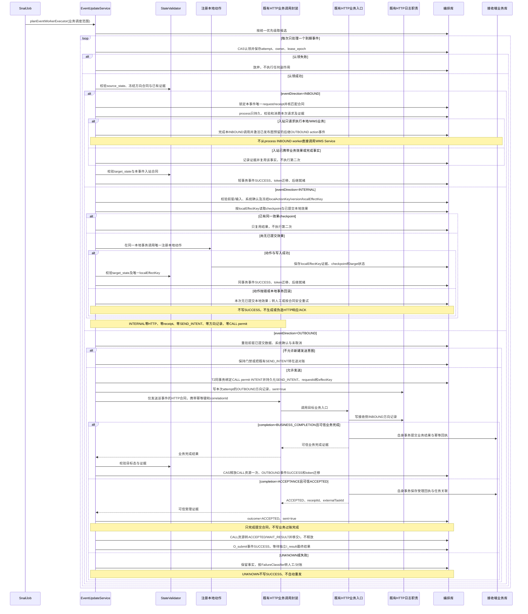

不变量：事件内部不存在按步骤循环；多个出站动作由多个 OUTBOUND 事件按图顺序执行，多个必需入站由多个 INBOUND 事件和 AND 汇合完成，INTERNAL 只执行一个本库动作。process 的 INBOUND 只记录和消费方向请求，不能把 WMS Service 调用藏在其 worker 中；实际业务入口接收 HTTP 后可在自身事务调用内部 Service，并登记已有业务效果，后续事件只复用证据而不重做。INTERNAL 不接触 HTTP，本地动作、效果证据、checkpoint 与事件/token 收口必须同事务；动作失败回滚本次效果，已提交 checkpoint 复用同一 localEffectKey，不执行第二动作。T2 必须在 SEND_INTENT 之前或同一事务持久 CALL permit；可靠重试原调用只增加 request 记录，不产生第二逻辑效果。编排端不共享接收端事务。

模式复核：统一更新器按三方向选择受理、发送或本地动作策略，HTTP 适配器只转换协议。INTERNAL 的策略只调用已注册本库动作，不生成请求/回执；INBOUND/OUTBOUND 的 ACCEPTED 只满足 ACCEPTANCE 合同，BUSINESS_COMPLETION 必须有接收端可信业务完成，UNKNOWN 停留或人工；任何 Observer 或日志成功都不能替代合同证据。

## 场景 5：BYPASS 只屏蔽单一 OUTBOUND 外部抛账事件

前提：enabled=true，系统模式 BYPASS，事件已经通过前驱和系统确认门禁。BYPASS 只参与 OUTBOUND 外部抛账事件；INBOUND/INTERNAL 不因该系统模式改变自身合同。

结果：仅 OUTBOUND + EXECUTE_ACTION + 外部目标抛账命中的事件记 SKIPPED_MODE、sent=false；其他 OUTBOUND 事件照常执行。INBOUND 永不被 BYPASS，INTERNAL 仍执行唯一本地动作，绝不因 BYPASS 被禁动作。

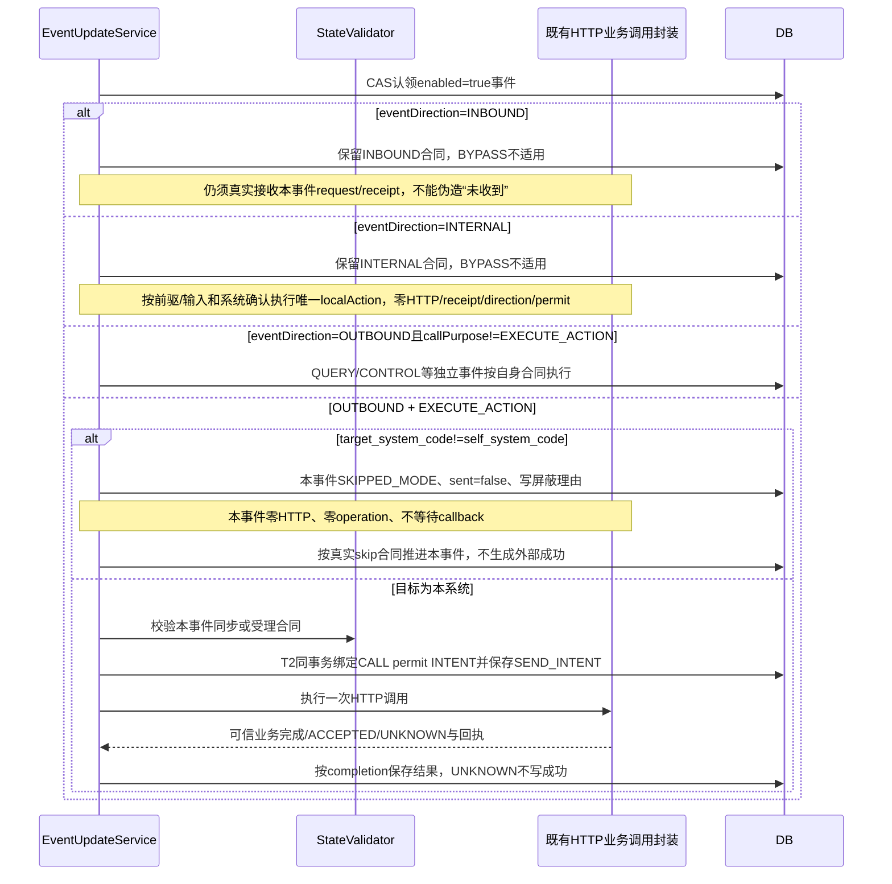

不变量：BYPASS 只适用于 OUTBOUND + EXECUTE_ACTION + 外部目标抛账。不能按 URL 猜测业务类型，不能屏蔽 INBOUND、INTERNAL、QUERY、CONTROL 或本系统调用。BYPASS 命中只影响当前单个外部抛账事件，不抹除已到达的 INBOUND 记录，不禁止 INTERNAL 本地动作，也不伪造触发或跳过产物。

模式复核：BYPASS 是仅针对 OUTBOUND 外部抛账的事件级发送策略，在认领后、发送意图前判定。INBOUND/INTERNAL 直接绕过该判定并通过各自方向策略执行；OUTBOUND 命中时零发送，未命中时仍按合同发送。屏蔽事实和实际结果由数据库保存，日志或观察者不能替事件完成。
## 场景 6：enabled=false 整事件纯跳过

前提：事件允许整事件跳过，前驱和系统门禁满足；INBOUND 已冻结 skipContract，OUTBOUND 已有明确跳过规则，INTERNAL 已明确是否禁用唯一本地动作。BYPASS 与整事件禁用是两套判定，前者不改 enabled。

结果：事件从初态到终态和 SKIPPED 同事务提交，本事件零业务 operation、零业务 HTTP、零本地动作。INBOUND 默认必须先收到真实请求并保存 receipt；缺少入站时保持等待，不伪造回执。INTERNAL 可被 Skip 禁用唯一 localAction，不生成 HTTP 记录或 CALL permit。

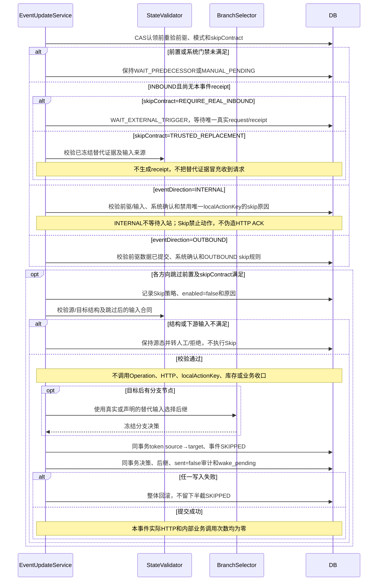

不变量：enabled=false 不改写为 BYPASS，也不允许在事件内部只跳一部分。INBOUND 通常先真实接收再 Skip，必须显式冻结缺入站跳过合同；任何合同都不能伪造到达记录或回执。OUTBOUND Skip 不创建发送意图、不发送 HTTP。INTERNAL Skip 不调用 localActionKey、不写 localEffect，也不生成 receipt、方向记录、SEND_INTENT 或 permit。

模式复核：Skip 是独立执行策略，方向和 skipContract 决定前置事实，状态迁移与审计同事务。INTERNAL 的禁用动作先于本地事务执行；替代输入缺失时拒绝或等待，数据库中的跳过资格和真实入站事实不能由观察者补齐。

## 场景 7：BranchSelector、独立事件节点与 AND 汇合

前提：冻结图已把多个必需入站拆成多个 INBOUND 事件，把多个出站拆成多个 OUTBOUND 事件，把多个本库动作拆成多个 INTERNAL 事件。动态选路在真正到达决策节点时发生；根选路发生在挂载时。

结果：同 scope 一次决策，重试复用。XOR 只放行选中路径，AND 等待明确的事件前驱集合全部到达；不存在事件内多信号槽、多个 operation 或一个 INTERNAL 事件内的多个本地动作。

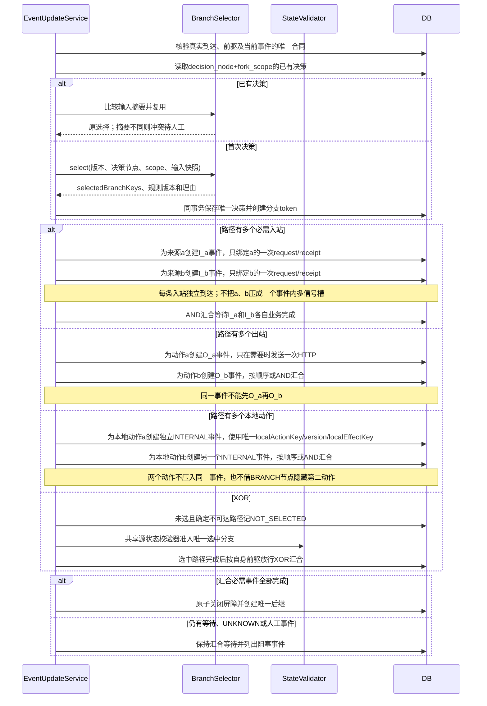

不变量：BranchSelector 只决策，不调用 HTTP，也不直接改事件状态。多个必需入站按事件和 receipt 独立核对后 AND；多个出站动作各有事件 ID，不能借一个 opaque handler 连续执行；多个本地动作也各有 INTERNAL 事件 ID 和一个 localEffectKey。多终点按 ALL_SELECTED 或显式 ANY_SUCCESS 收敛，未收口副作用不能直接取消。

模式复核：选路策略与事件执行协调器分离，分支 token、决策、入站到达与本地效果 checkpoint 是数据库事实。输入摘要变化时冲突，AND 未齐时等待；通知不能作为可靠完成信号。

## 场景 8：失败分类、人工门禁与方向化停留

前提：当前事件本轮失败，已知 eventDirection、方向合同或本地动作合同、是否已有 SEND_INTENT/receipt/本地 checkpoint，以及可信结果证据。INBOUND 等待回执、OUTBOUND 已受理后的 I_result 等待和 INTERNAL 尚未到期的重启检查都不属于本轮失败。

结果：INBOUND 失败只影响本次 receipt 的持久化、校验或证据消费；已发生业务效果只复用证据，请求执行 WMS 业务时留给后续 OUTBOUND action 事件。INTERNAL 的本地事务回滚后无已提交效果，按 checkpoint 决定安全重试；提交结果不确定时重读本库，不伪造成功或 HTTP ACK。OUTBOUND 明确无副作用才安全退避，UNKNOWN 不重发，ACCEPTANCE 合同完成后等待独立 I_result。MANUAL_CONFIRM 任一实际执行失败立即人工。

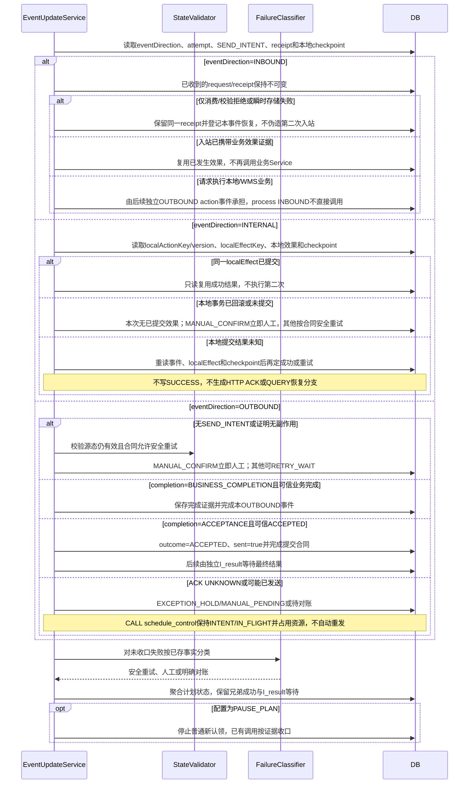

不变量：UNKNOWN 不等于未执行，也不等于成功；没有新的可信证据不能补发。ACCEPTED 只满足受理合同，不能消除 I_result 等待或把计划写 COMPLETED。INBOUND 失败不能删除已收到的事实，也不能再伪造一份 receipt。INTERNAL 失败只允许在本地事务无已提交效果时安全重试；已提交 localEffect 或 committed checkpoint 只复用，不执行第二动作，也不能用 HTTP 回执包装本地失败。

模式复核：FailureClassifier 只解释已存事实，方向合同决定哪些结果可完成。INTERNAL 以本库事件、localEffect 和 checkpoint 判断重试边界，不参与 permit/ACK 对账。人工模式失败即人工，自动模式才考虑安全退避；permit、checkpoint 和 I_result 状态都在数据库事务中保存，异常观察者不能替代。

## 场景 9：事件重试、证据对账与检查点续跑

前提：本场景仅适用于 QUEUE 子计划；IMMEDIATE 不使用 RETRY_EVENT。目标为可恢复失败事件；SUCCESS、SKIPPED、FAILED_FINAL 不可复活。已 ACCEPTED 的 O_submit 只等待 I_result，不能用 RETRY_EVENT 重发；INBOUND 等待、人工暂停和终态也不能用重试绕过。INTERNAL 重试使用原 localActionKey/version、localEffectKey 和 checkpoint，不转成 INBOUND 或 OUTBOUND。

结果：INBOUND 复用原 receipt 重试本事件的持久化、校验和证据消费；请求执行 WMS 业务时激活原图中已发布的后继 OUTBOUND action 事件。INTERNAL 只在 checkpoint 证明无已提交效果时重试同一本库动作；已提交则只读收口，零 HTTP、零 receipt、零 permit。OUTBOUND 只补发已证明无副作用且未发送的原调用。结果未知时使用已存可信证据，或进入已预发布的 QUERY 恢复分支；事件处理器不暗藏查询，也不在运行时改图。IMMEDIATE 的 FAILED_FINAL 是终态，不能借本场景重试；RESULT_UNKNOWN/RESPONSE_TIMEOUT 只做显式证据/恢复，不重发。

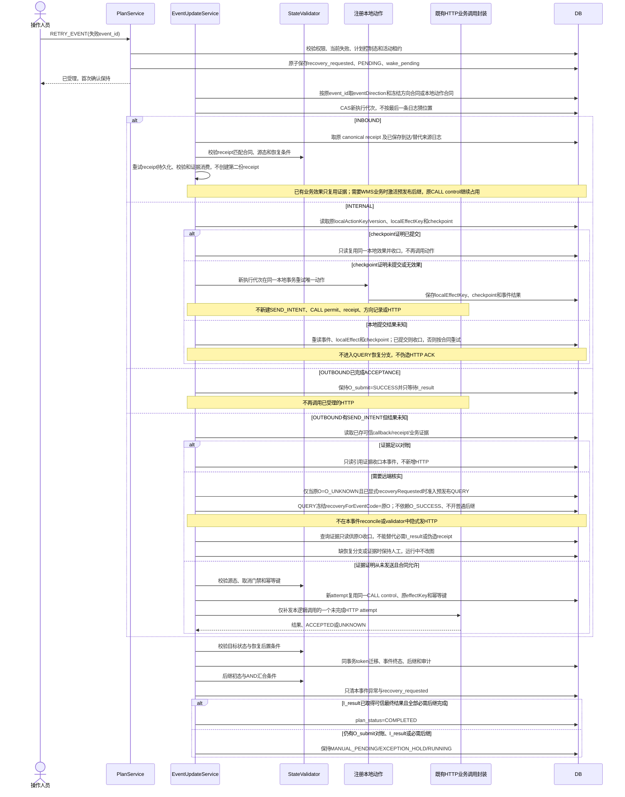

不变量：重试保持原 eventDirection、调用合同或 localActionKey/version、effectKey 或 localEffectKey 和幂等身份；INBOUND 不重新接收，INTERNAL 不执行第二动作，OUTBOUND 不把已 ACCEPTED 当失败重发。QUERY 只能从冻结 recoveryForEventCode 的预发布恢复分支进入，准入要求原 O_UNKNOWN 与显式 recoveryRequested，不以 O_SUCCESS 为前置，也不放行普通后继；INTERNAL 不使用 QUERY。查询证据只读帮助原 O 收口，不能替代必需的 I_result 或伪造 receipt；运行中不改图。查不到不代表未执行，缺证据交人工。

模式复核：恢复使用持久 checkpoint 和原能力版本，不靠日志重放。三方向分别使用 receipt、本地效果/checkpoint 和发送证据决定能否续跑；HTTP 封装只执行明确 OUTBOUND 合同，Observer 只唤醒扫描。

## 场景 10：长期监督、事件资格与两模式调度

前提：BusinessSchedule 是业务分组；每个 (businessScheduleCode, planType, scheduleScope) 恰有一个 planRole=SUPERVISOR 的长期监督实例，每个业务计划实例绑定一个 supervisorInstanceId。监督只含 eventRole=DECISION/LOCAL 的 INTERNAL 事件，按唯一递增 roundNo 组成有限 DAG；业务计划仍按 INBOUND/OUTBOUND/INTERNAL 事件由子计划 worker 执行。模式为 QUEUE 或 IMMEDIATE。

结果：businessScheduleExecutor 只推进监督轮次和持久控制意图。DECISION 选择候选/分类；LOCAL 在 process 本库提交一个持久准入、控制意图或恢复标记，不调用业务 HTTP、不执行子计划、不产生 receipt/CALL permit。LOCAL 提交后由 SnailJob 适配器在事务外应用平台启停/触发，平台 desired/observed 分开记录。QUEUE 的 PLAN_SLOT 与 OUTBOUND CALL permit 独立计数；IMMEDIATE 由场景 30 的同一 EventUpdateService 同步驱动。

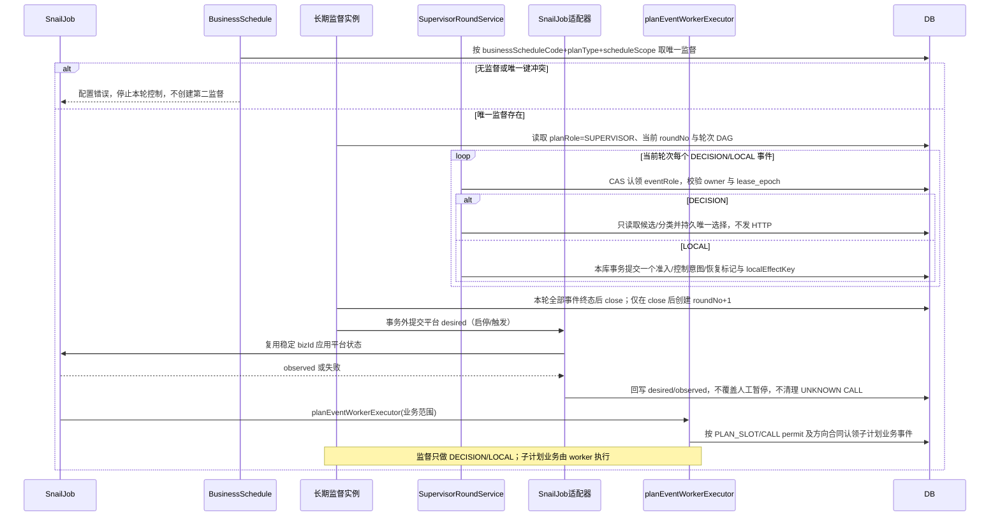

不变量：唯一监督只由 (businessScheduleCode, planType, scheduleScope) 确定，业务实例只绑定一个 supervisorInstanceId。监督长期 RUNNING；roundNo 唯一递增、每轮有限，roundKey 进入 eventKey/token/localEffectKey，轮次 close 前不得创建下一轮，重启续原轮并复用原 effectKey。监督只含 DECISION/LOCAL INTERNAL，DECISION 不执行动作，LOCAL 只提交一个本库调度效果；零业务 HTTP、零子计划动作、零业务 receipt、零 CALL permit。SnailJob 适配器只在 LOCAL 提交后事务外应用平台启停/触发，属于控制平台接线；平台响应不改写事件或业务事实，人工暂停不被 auto 覆盖，未知 CALL 不清理，旧 epoch 的收口零行退出。QUEUE 中既有业务 INTERNAL 事件仍占 PLAN_SLOT；IMMEDIATE 不把同步 driver 放进 SnailJob。

模式复核：监督是长期计划实例和有限轮次状态机，不是每业务实例一个 Job；适配器是控制平台 Adapter，注册表只解析 DECISION/LOCAL 能力。数据库中的轮次、控制意图、slot 和审计是权威，SnailJob 的 job 状态不替代它们；子计划业务执行保持原场景 4/5/6/19/20/21/26 的含义。

## 场景 11：调度执行描述与方向化事件查询

前提：已有按 (businessScheduleCode, planType, scheduleScope) 唯一的长期监督、有限轮次、planRole/eventRole、调度模式、PLAN_SLOT、公平配置、子计划方向合同、执行审计以及 receipt/outbound/local checkpoint。查询只读数据库，不运行远程校验。

结果：返回业务分组、唯一监督及其 mode、activePlanLimit、fairnessWindowSize、当前 roundNo/roundKey/轮次状态，并返回 DispatchRecordVO 所需的子计划实例、slot 前后状态、holdStart、queueRank、commandKey、lease_epoch、平台 desired/observed 和配置版本。INBOUND/OUTBOUND 展示 callContractKey/version、effectKey、目标或匹配合同、HTTP request 记录数、completion/outcome；INTERNAL 展示 localActionKey/version、localEffectKey、checkpoint 和本地效果，明确无 request/方向记录/receipt。I_result 的 ownerEventId 是自身，originOutboundEventId 只是原 OUTBOUND 来源引用；QUERY 恢复分支显示 recoveryForEventCode。

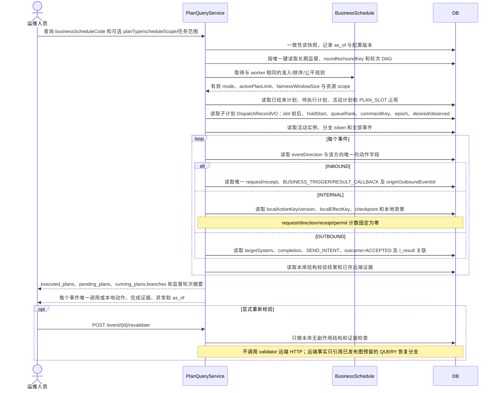

不变量：唯一监督只按 tuple 返回一个，业务实例的 supervisorInstanceId 必须指向它；roundNo 唯一递增，roundKey 与 eventKey/token/localEffectKey 一致。等待 BUSINESS_TRIGGER/RESULT_CALLBACK、INTERNAL 输入/确认、首次确认、前驱、资源或重试者都有 eligible=false 与原因。holdStart=true 的未开始实例不占 PLAN_SLOT、不产生 queueRank；已准入计划等待回调/人工/重试仍占 slot。PLAN_SLOT 与 CALL permit 分栏，CALL permit 只属于 OUTBOUND；既有业务 INTERNAL 仍显示 PLAN_SLOT 占用且 request/receipt/方向记录/CALL permit 为零。公平保底按每 K 次成功准入计算，失败/失效/无候选不计，列表 rank 与 worker 同 scope、同顺序。QUERY 只展示预发布 recoveryForEventCode，仅原事件 O_UNKNOWN+显式 recoveryRequested 准入，不依赖 O_SUCCESS、不进入正常完成屏障、不另占业务 permit（挂靠原 CALL）；O 其他可终结状态完成时未激活 QUERY=NOT_SELECTED。O_submit ACCEPTED 与 I_result 最终结果分栏。

模式复核：查询服务只组装数据库读模型，轮次/槽位/dispatch 记录不在浏览器重算；INTERNAL 只从本地动作合同、效果和 checkpoint 组装，不伪造 HTTP 详情；远端 QUERY、CONTROL 是独立 OUTBOUND 事件。分页、筛选、rank 和详情必须复用同一资格规则；页面快照和通知不承担恢复或完成可靠性。

## 场景 12：从挂载到逐事件执行、回调和最终完成

前提：业务调度和计划版本已发布。示例含两个必需 INBOUND 事件、一个 INTERNAL 本地动作事件、一个 BUSINESS_COMPLETION OUTBOUND、一个 ACCEPTANCE O_submit、其必需 I_result，以及一个 enabled=false OUTBOUND 事件。

结果：worker 逐事件推进，不从事件内部步骤恢复。I1/I2 各自 receipt 后只消费证据并 AND 汇合；L1 在同一本地事务执行唯一动作，零 HTTP；O1 只有可信业务完成才成功，O2 只完成提交，I_result 获得最终结果后才能完成计划。L1 不生成 receipt、方向记录、SEND_INTENT 或 CALL permit。

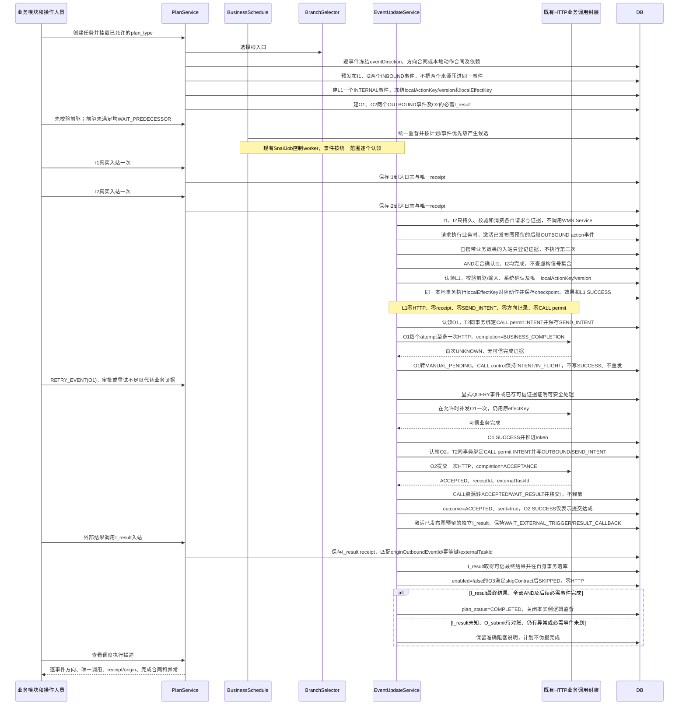

记录关联：I1/I2 各自产生一条与事件绑定的入站 receipt；L1 只产生 localEffectKey、checkpoint 和领域审计，不产生 HTTP/receipt/方向记录/permit；O1、O2 各产生本事件的一条 OUTBOUND 方向记录和对应接收侧 INBOUND 记录。O2 与 I_result 通过 originOutboundEventId、幂等键和 externalTaskId 关联，但仍是两个事件；O2 的 ACCEPTED 不计 I_result 结果。

不变量：同一事件没有第二次业务调用或第二个本地动作；多个必需入站、多个出站和多个本地动作都由独立事件与 AND/顺序表达。L1 的本地效果与 checkpoint 同事务，重启只复用已提交结果。O1 的 UNKNOWN 不重发，O2 已 ACCEPTED 不因重试再发，I_result 不抢 O2 的发送权。enabled=false 事件只做零调用、零本地动作的本地迁移。

模式复核：整合链由命令、事件资格、方向合同和持久证据协调。INTERNAL 由本地动作事务和 checkpoint 协调，不入 HTTP 日志；接收端事务独立提交；I_result 是回调所有者，O_submit 的受理与最终业务结果分属两个事件，任何日志或通知都不能合并成一次成功。

## 场景 13：Web 配置、逐系统确认与事件命令

前提：配置人员登录 Web；计划版本包含多个系统，每个事件只声明 INBOUND/OUTBOUND/INTERNAL 之一，并对应唯一的调用合同或本地动作合同。复杂审批可选启用 Warm-Flow，简单首次确认直接调用计划命令。事件重试只适用于 QUEUE；IMMEDIATE 不显示也不接受 RETRY_EVENT。

结果：Web 以事件为单位编辑方向、合同和边，IN/OUT 不能塞入多个调用，INTERNAL 不能塞入 HTTP 或第二个本地动作；确认按所选系统持久化，三类事件都须满足前驱/输入与系统确认。QUEUE 重试只排队失败事件，INTERNAL 继续使用原 localActionKey/localEffectKey，不在 HTTP 请求内执行任何业务；IMMEDIATE 的 FAILED_FINAL 不可重试，UNKNOWN 只走显式恢复。

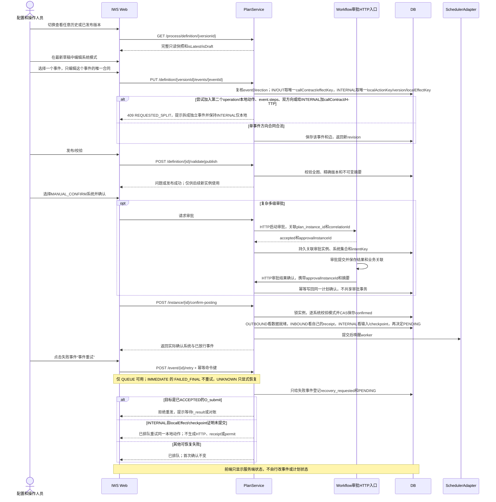

不变量：一个事件只解析自身系统模式并只含一个方向合同：IN/OUT 一个 callContract/effectKey，INTERNAL 一个 localActionKey/version/localEffectKey 且无 callContract。Web 不能隐藏第二调用或本地动作，服务端发布校验和事件保存共同拒绝。确认不能放行前驱不足、OUTBOUND 数据未提交、INBOUND 尚无真实 receipt 或 INTERNAL 输入不足的事件；INTERNAL 不等待/伪造 HTTP ACK。已受理 O_submit 不以重试重发。

模式复核：Web 只发送命令，后端按 eventDirection 做权限、版本和合同校验。编辑返回明确拆分错误，确认和重试用 CAS 与幂等命令；INTERNAL 的确认只放行本地动作，重试只复用本地 checkpoint。审批跨模块经 HTTP，Spring 事件只唤醒补查。

## 场景 14：计划总览、事件链与单次调用详情

前提：后端已维护冻结事件、token、attempt、入站 receipt、出站意图、INTERNAL 本地效果/checkpoint、I_result 关联和调度控制。Web 查询权限允许访问业务范围，查询只读。

结果：总览进入计划分支链，再打开事件抽屉。INBOUND/OUTBOUND 显示调用合同与 call/outbound 证据，INTERNAL 显示 localActionKey/version、localEffectKey、checkpoint 和本地结果，并明确无 HTTP 记录；O_submit 与 I_result 显示关联但不合并状态。

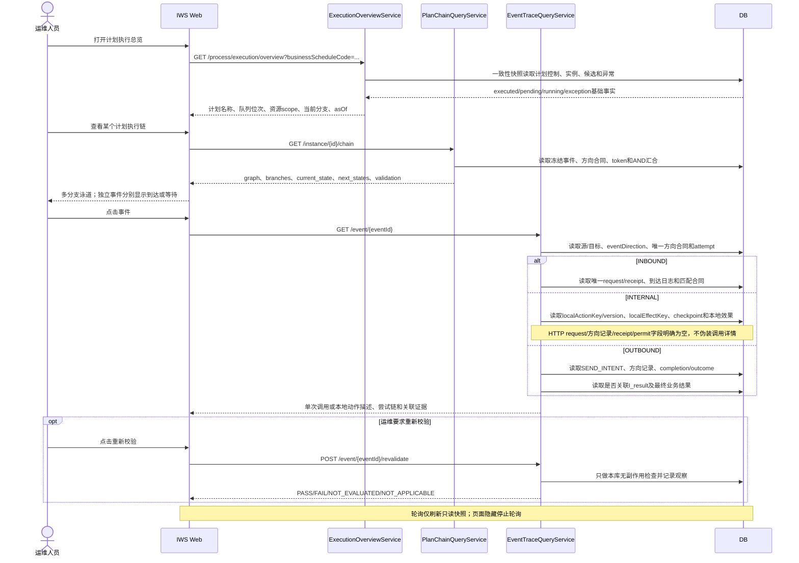

不变量：事件详情不显示 event.steps、多 operation 或多本地动作；多个必需来源是多个 INBOUND 节点，多出站是多个 OUTBOUND 节点，多本地动作是多个 INTERNAL 节点。INTERNAL 不显示 callContract、HTTP request/receipt/direction 或 permit，只显示唯一 localActionKey/localEffectKey 和 checkpoint。O_submit 的 ACCEPTED 只显示提交完成，I_result 的 DONE/FAILED/UNKNOWN 单独展示。request_id 日志成功不能当事件完成。

模式复核：总览、链和事件详情都是数据库读模型。INTERNAL 的详情只读取本地合同、效果与 checkpoint；需要远端事实时只链接预发布的 QUERY 恢复分支，并要求原事件 O_UNKNOWN 与显式 recoveryRequested。旧请求晚到、跨实例快照或 403 明确展示，前端刷新不运行状态策略。

## 场景 15：代码绑定动作、事件拆分与编辑门禁

前提：计划版本、eventTypeKey/version 和动作/校验器/恢复适配器注册元数据存在。INBOUND/OUTBOUND 的 callContract、effectKey、目标或匹配合同可校验；INTERNAL 的 localActionKey/version、localEffectKey 和本地动作实现可精确解析。Warm-Flow 标识和监听器依赖已标注。

结果：浏览器只编辑元数据声明字段；代码实现、校验逻辑、恢复协议、端点角色和事件方向只读。增加第二次调用或第二个本地动作时，必须拆为另一个事件和新版本，不能把多个 operation 塞回原事件；INTERNAL 不允许改绑为 HTTP 动作。

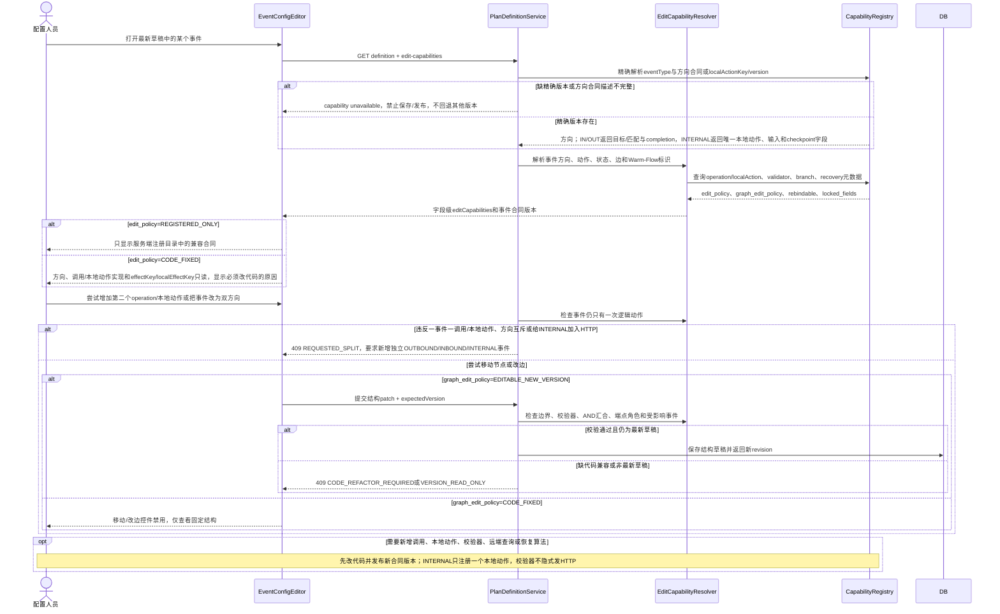

不变量：画布坐标移动不改变业务语义；改变边、顺序、网关或汇合属于拓扑变更。删除 event.steps 后，同一事件不得通过 opaque handler 再隐藏多调用；跨服务转发、多个独立效果或第二个本地动作必须拆图。INTERNAL 的编辑目录只能绑定一个本地动作，不能加入 callContract、HTTP 端点、receipt、方向记录或 permit。服务端对构造请求返回明确错误，旧实例不随草稿移动。

模式复核：配置服务承担命令受理，EditCapabilityResolver 和注册目录按精确版本区分调用合同与本地动作合同。版本冲突或合同不完整时拒绝，保存结果以带 revision 的数据库草稿为事实。
## 场景 16：配置、执行、编辑、删除与重试的全动作审计

前提：INBOUND/OUTBOUND 可复用现有 HTTP 操作日志；领域模块为三类事件写追加式 action audit，入站另有回执。人工、远程调用者和系统动作分别使用真实用户、可信服务身份或稳定系统账号。

结果：每个动作都有前后状态、版本、操作者、时间、结果和关联事件。INBOUND receipt、OUTBOUND SEND_INTENT、ACCEPTED/业务完成、INTERNAL localEffect/checkpoint 和 I_result 最终结果分别审计；不能把一份日志同时当作意图、调用和成功，也不能为 INTERNAL 生成伪造的 HTTP 日志。

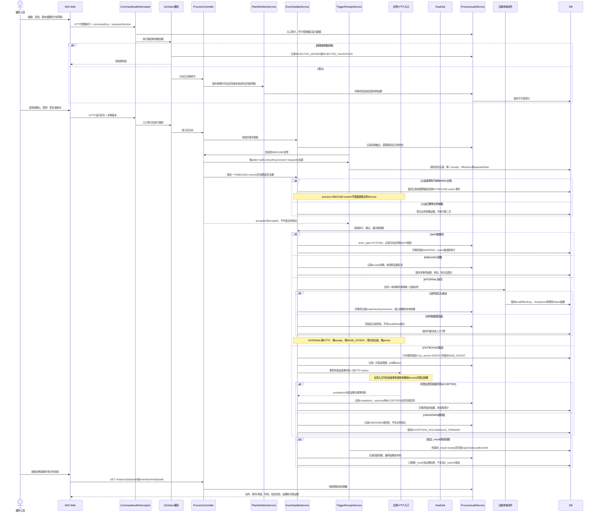

不变量：领域审计以 commandKey、event_id、效应键和必要的 receiptId/direction record 关联；INTERNAL 使用 localActionKey/version、localEffectKey 和 checkpoint，effectKey/receiptId/direction record 为空。INBOUND/OUTBOUND 事件才有 SEND_INTENT 或匹配 receipt；INTERNAL 恰好一个本地动作且不调用 HTTP。业务入口已经发生的效果只保存证据，不由 process INBOUND 再执行。O_submit 的 ACCEPTED 和 I_result 最终结果分开审计。审计写入失败时普通命令不返回成功。

记录关联：发送前先写 OUTBOUND，接收侧写 INBOUND 时共用 rootId/correlationId；同一 HTTP 请求对应不同事件 ID 时分别记录。INTERNAL 不进入 HTTP 记录链，只关联自身 localEffectKey、checkpoint、事件和审计；不能借其他事件的 requestId 冒充执行证据。requestId 重投只增加到达日志，不增加业务效果；QUERY、CONTROL、RESULT_CALLBACK、INTERNAL 与 BYPASS/SKIP 的 sent=false 不按业务抛账计数。

模式复核：审计服务持久化事实，Controller 和适配器只受理并转换协议。INTERNAL 的本地动作、效果和 checkpoint 在一个事务，失败后单独记录恢复事实；INBOUND/OUTBOUND 的权限拒绝独立审计，HTTP 已成功但检查点未提交时转对账；Observer 不能替代权威记录。

## 场景 17：INBOUND HTTP 受理、单一事件回执与可信命令

前提：入站复用现有 Controller、鉴权和签名方式；iws_process_trigger_receipt 是计划语义回执及去重存储。每个事件版本冻结一个 eventDirection=INBOUND 和一个不可变 callContractKey/version 匹配合同。

结果：一次可唯一匹配的入站绑定一个 INBOUND 事件，并选定唯一 canonical receipt；替代来源/重投保留各自到达与 receipt 证据。未关联和已有业务效果都有确定结果，process 不直接调用 WMS Service。接收请求后在请求事务内调用内部 Service 仍属于该 INBOUND 事件的业务效果，不能因“只调用本库”改标 INTERNAL。

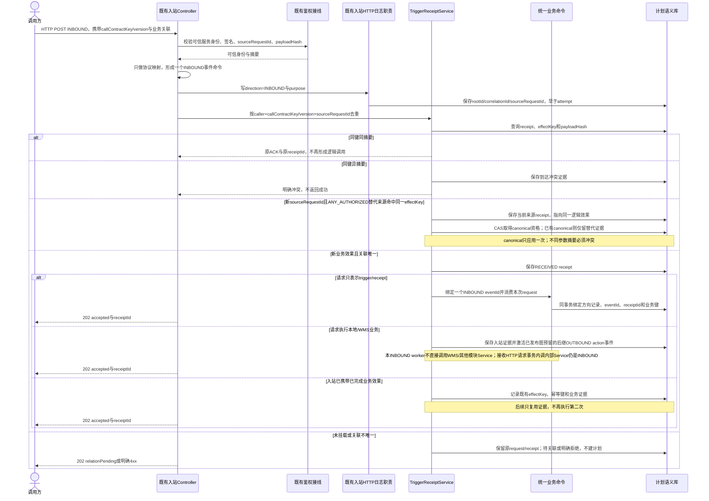

不变量：ACK 前唯一匹配时，INBOUND 方向记录绑定一个 instanceId/eventId 和一个 canonical receiptId，其他来源 receipt 作为证据；不建立事件内触发槽或多信号聚合。requestId 重投只新增到达日志；ANY_AUTHORIZED 只应用一次，异参冲突。早于挂载保留请求与 receipt，后续唯一关联后同事务消费。INBOUND 的存在由真实 HTTP 请求和 receipt 证明，接收请求内部的本地 Service 不把它改成 INTERNAL。

模式判定：Controller、鉴权接线和回执服务只受理、验证、去重和绑定。需要后续 WMS 业务时生成独立 OUTBOUND action 事件；已有效果只记录证据。INTERNAL 只指没有收发 HTTP/receipt 的事件合同，不能用来重标接收请求内部 Service。HTTP 不传播 Spring 事务或登录 ThreadLocal。

## 场景 18：前驱、单一入站事件与人工确认准入

前提：每个必需来源已经建成独立 INBOUND 事件；触发可以早于前驱到达，并先保存为该事件的一份 request/receipt。OUTBOUND 事件没有额外入站触发门禁。INTERNAL 事件已有唯一本地动作合同，不创建入站事实。

结果：INBOUND 尚未开始的事件按“前驱 → 本事件 receipt → 系统确认 → PENDING”计算；前驱未满足时即使 callback 已到也保持 WAIT_PREDECESSOR。OUTBOUND 按“已提交前驱数据 → 系统确认 → PENDING”，INTERNAL 按“前驱/本地输入 → 系统确认 → PENDING”。INTERNAL 从不进入 WAIT_EXTERNAL_TRIGGER；多个必需来源由各事件完成后的 AND 汇合，不存在事件内多信号槽。

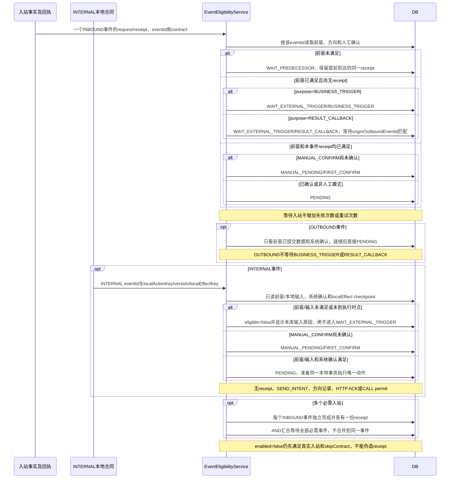

记录关联：本场景处理一个 INBOUND 事件的 canonical request/receipt，并保留其他来源到达证据。提前回调归 I_result；前驱满足后才消费，不抢 O_submit 发送权。多个必需来源分别从独立 INBOUND 事件和汇合节点查询。

不变量：替代可信来源 ANY_AUTHORIZED 只针对同一 effectKey 的来源替代，不改变事件方向或增加必需数量。额外、未授权或异参入站只审计/冲突；RESULT_CALLBACK 不进入普通 BUSINESS_TRIGGER 门禁。INTERNAL 不等待任何入站，WAIT_EXTERNAL_TRIGGER 只属于 INBOUND。WAIT_EXTERNAL_TRIGGER 不能覆盖 PROCESSING、人工失败、暂停或终态。

模式判定：准入策略按三方向只计算门禁；INBOUND receipt、前驱、OUTBOUND 数据就绪、INTERNAL 本地输入和系统确认都是数据库事实。INTERNAL 不经过入站等待策略；多个必需来源靠独立事件与 AND 汇合，而不是事件内信号槽。

## 场景 19：OUTBOUND 调用分类、既有封装与接收端事务

前提：每个 OUTBOUND 事件冻结一个 callContractKey/version、一个 effectKey、targetSystem、endpointRole 和 completion=BUSINESS_COMPLETION/ACCEPTANCE；transport=HTTP 固定。QUERY 与 CONTROL 若需要分别建成独立 OUTBOUND 事件。INTERNAL 不进入本场景，不能借用 HTTP 封装。

结果：外部系统、同 JVM 其他后端模块和 IWS 自有业务入口都通过 HTTP。process 只提交本事件的一次动作；业务入口在自己的请求事务中可调用本模块内部 Service。需要二次跨服务调用或多个独立效果时，发布拒绝并要求拆图。

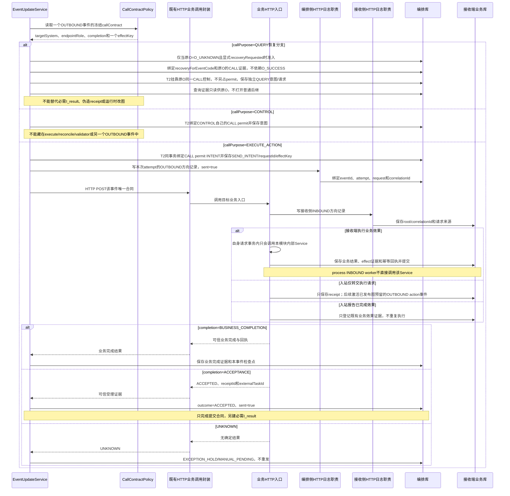

不变量：一次 OUTBOUND 事件只允许一次 HTTP 和一个 effectKey；多个业务效果拆成多个事件。INTERNAL 零 HTTP，不能把本地 Service 包成 EXECUTE_ACTION，也不能生成目标/endpoint/completion 合同。接收端可在“一个 HTTP 请求对应的一次接收事务”内调用自己的内部 Service，但该 Sender O/Receiver I 是分立关联；process 的 INBOUND 消费不得直接调用 WMS Service。跨服务转发、多个独立效果或另一个事件不能藏入 opaque handler，发布时校验拒绝。

模式判定：CallContractPolicy 只处理 INBOUND/OUTBOUND 的同步完成或受理合同，HTTP 封装只做调用与协议转换；INTERNAL 由本地动作策略执行。接收端事务和编排 T5 各自提交；ACCEPTED 不进入业务完成计数，UNKNOWN 不重发。

## 场景 20：异步 O_submit、可信受理与独立 I_result

前提：当前事件是单个 OUTBOUND O_submit，completion=ACCEPTANCE；已在有效租约内提交 SEND_INTENT，且没有既有可信结果。它不再在同一事件内转 WAIT_REMOTE_RESULT，也不再由新 attempt 消费 callback。

结果：可信受理时 O_submit 完成提交合同，outcome=ACCEPTED、sent=true，但不表示业务过账成功；激活已发布图预留的必需 I_result 等待 RESULT_CALLBACK。事件只有一个逻辑调用和一个 CALL 资源，可靠重试原调用可增加 request 记录但不能形成第二 effect。受理证据未知时不写 SUCCESS，可信回调只读帮助原事件对账，回调由 I_result 消费。

```mermaid
sequenceDiagram
  participant E as EventUpdateService
  participant C as 既有HTTP业务调用封装
  participant T as 接收端HTTP入口
  participant OL as 编排侧HTTP日志职责
  participant IL as 接收侧HTTP日志职责
  participant J as Worker
  participant D as 编排库
  participant B as 接收端业务库
  E->>D: 核验lease_epoch、owner、requestId、effectKey和CALL control
  E->>D: T2同事务绑定schedule_control(scopeType=CALL,scopeKey=原O_eventId)=INTENT，再保存SEND_INTENT
  E->>OL: 写O_submit本次attempt的OUTBOUND方向记录，sent=true
  OL->>D: 绑定eventId、attempt、request和correlationId
  E->>C: HTTP POST一次，completion=ACCEPTANCE
  C->>T: 调用目标业务入口
  T->>IL: 写接收侧INBOUND方向记录
  IL->>B: 关联独立Receiver I事件，不伪造源attempt
  alt 可信ACCEPTED
    T-->>C: ACCEPTED、receiptId、externalTaskId
    C-->>E: 可信受理证据
    E->>D: O_submit outcome=ACCEPTED、sent=true
    E->>D: 事件SUCCESS仅表示提交合同达成
    E->>D: CALL control转ACCEPTED/WAIT_RESULT并移交I，不释放
    E->>D: 激活已发布图预留的必需I_result，保持WAIT_EXTERNAL_TRIGGER/RESULT_CALLBACK
    Note over E,D: 不推进为业务完成，不把remoteTaskId当最终结果
    E-->>J: 结束O_submit本轮；I_result等待独立receipt
  else ACK UNKNOWN
    E->>D: EXCEPTION_HOLD/MANUAL_PENDING或待对账
    E->>D: 保留SEND_INTENT、INTENT/IN_FLIGHT CALL资源和幂等键
    Note over E,D: 不写SUCCESS，不自动重发
    opt I_result receipt先到并含可信受理证据
      E->>D: 只读引用receiptId/externalTaskId帮助O_submit对账收口
      E->>D: 若证明ACCEPTED则CALL转ACCEPTED/WAIT_RESULT并等待I结果，仍不释放
      Note over E,D: 不增加HTTP，不把回调改归O_submit
    end
    E-->>J: 等待可信证据或人工，不允许“没查到”即重发
  else 明确业务拒绝或可信最终失败
    E->>D: 按FailureClassifier进入人工/终态策略
    E->>D: 只有最终证据允许且control version/CAS成功才释放CALL一次
  end
```

不变量：O_submit 只对应一次逻辑调用和一个 CALL 资源；每个 attempt 至多一个 HTTP，可靠重试原调用可产生多条 request/方向记录但不形成第二 effect。ACCEPTED 只完成 ACCEPTANCE 合同，事件 SUCCESS 不等同业务过账成功。I_result 是独立 INBOUND 事件，通过 originOutboundEventId、幂等键和 externalTaskId 匹配。UNKNOWN 停留或人工，CALL 继续占用；可信回调只作原事件对账证据，计划取消或超时不得突破 CAS 二次释放。

模式判定：O_submit 只有一个逻辑发送资格；发送 attempt 失败时仅在可靠证据允许下重试原调用。I_result 独立受理和消费回调；两者方向互斥、各有事件 ID 和状态，不使用同一事件 WAIT_REMOTE_RESULT 或 callback 抢租约路径。
## 场景 21：I_result 回执、提前到达与最终结果

前提：I_result 是独立 INBOUND 事件，冻结 originOutboundEventId、effectKey、幂等键、externalTaskId 和匹配合同。callback 使用独立入站接口；它不从 O_submit 继承 WAIT_REMOTE_RESULT，也不由 O_submit 的新 attempt 消费。

结果：callback 先成为 I_result 的 receipt；多来源可有多条证据，但只选定一个 canonical。前驱未满足保持 WAIT_PREDECESSOR，满足后只由 I_result 消费。重复/异参不产生新逻辑调用，UNKNOWN 不完成，O_submit 未知 ACK 可只读引用该证据对账。

```mermaid
sequenceDiagram
  actor A as 回调调用方
  participant C as 既有入站Controller
  participant L as 既有入站HTTP日志职责
  participant R as TriggerReceiptService
  participant I as I_result更新器
  participant O as 原O_submit
  participant F as FailureClassifier
  participant D as DB
  A->>C: HTTP POST RESULT_CALLBACK
  C->>L: 写INBOUND purpose=RESULT_CALLBACK
  L->>D: 保存root/correlationId；ownerEventId仅I_result，originOutboundEventId仅为来源引用
  C->>R: 先持久化caller、sourceRequestId、payloadHash
  R->>D: 唯一约束保存I_result receipt
  R->>D: 绑定I_result eventId与originOutboundEventId
  alt 同requestId同摘要重投
    R-->>C: 返回原receipt ACK，不新增逻辑调用
  else 同requestId或同effectKey异参
    R->>D: 保留到达与冲突证据
    R-->>C: 明确冲突，不改I_result
  end
  alt I_result前驱尚未满足
    I->>D: 保持WAIT_PREDECESSOR，receipt可提前存在
    Note over I,O: 提前回调不放行事件，也不抢O_submit发送权
  else 前驱已满足且尚无receipt
    I->>D: WAIT_EXTERNAL_TRIGGER/RESULT_CALLBACK
  else 前驱已满足且receipt唯一匹配
    I->>D: CAS认领I_result，核origin/effect/externalTaskId
    alt 可信最终成功结果
      I->>D: 保存最终结果证据，I_result SUCCESS
      I->>D: 最终证据允许时CAS释放CALL资源一次，重复结果不再释放
      I->>D: 放行后续必需事件；计划仍按全部后继收敛
    else 可信最终失败
      I->>F: 按已存事实分类最终失败
      F-->>I: 等待重试/人工/最终失败门禁
      I->>D: 保存失败证据，不复活O_submit
      I->>D: 最终负向证据允许时CAS释放CALL资源一次
    else UNKNOWN、迟到、终态或人工门禁
      I->>D: 保留证据并保持等待/人工，不写SUCCESS
    end
  end
  opt 原O_submit的ACK仍未知
    I->>D: 回调证据只读链接到O_submit对账
    Note over I,O: 帮助原O收口，所有权和消费仍属I_result；不新增HTTP
  end
```

不变量：I_result 是一个独立 INBOUND 逻辑调用，可保留多来源 receipt，但只选定一个 canonical，ownerEventId 只指向 I_result；originOutboundEventId 只是原 O_submit 来源引用。它不创建 O_submit 的第二个业务调用。提前到达只存证据，前驱满足后才消费；重复/冲突、BYPASS、终止、人工失败和暂停都保留证据。正向结果不清除人工门禁，UNKNOWN 不完成。

模式判定：Controller 与回执服务负责受理和去重，I_result 更新器只消费自己的最终结果。O_submit 的发送资格在 ACCEPTED 后关闭；回调只读证据可帮助 O 对账，不能把 I_result 的业务结果写回 O 的成功或再发一次 HTTP。

## 场景 22：端点角色、平台自管 self HTTP 与防同步环

前提：端点注册冻结 role=TRIGGER_EVENT/RESULT_CALLBACK/EXECUTE_ACTION/QUERY/CONTROL；平台自管双方的发送 O 和接收 I 都作为独立事件存在，correlationId/originEventId 关联但不合并事件身份。INTERNAL 没有 endpointRole，不参与 self HTTP。

结果：一次 self HTTP 只有一个发送事件和一个接收事件。默认在接收侧可靠持久 receipt 后返回 ACK，ACK 只表示接收事实；接收侧 worker 随后独立消费 I，不等待发送侧响应、worker 或 CALL 资源。若合同要求同步业务完成，接收端在自身 HTTP 请求事务完成本次唯一业务效果并保存证据，I 只消费证据。业务依赖不得形成 O 等 I、I 又等 O 的环。

```mermaid
sequenceDiagram
  actor U as 配置人员
  participant V as 合同与图校验
  participant Eo as 发送侧O事件
  participant C as 既有HTTP业务调用封装
  participant R as 接收端HTTP请求事务
  participant Ei as 接收侧I事件worker
  participant L as 双端HTTP日志职责
  participant D as DB
  U->>V: 绑定role、targetSystem、origin关系和业务依赖
  alt 试图把O和I合成同一事件或形成O↔I业务环
    V-->>U: 拒绝发布，要求两个eventId和无环依赖
  else 方向/合同/端点合法
    V->>D: 冻结O、I、correlationKey、effectKey和依赖
  end
  Eo->>D: 前驱数据已提交，O_submit进入PENDING
  Eo->>D: T2同事务绑定CALL permit INTENT并保存SEND_INTENT
  Eo->>L: 写O侧OUTBOUND方向记录并绑定eventIdO
  Eo->>C: 仅发送该O事件的HTTP合同
  C->>R: HTTP POST一次，携带correlation/origin
  R->>L: 写I侧INBOUND方向记录并绑定eventIdI
  R->>D: 先保存本I来源receipt，必要时选定唯一canonical
  R->>D: 标记I可独立处理；不等待O收到响应
  alt 默认受理合同
    R-->>C: reliable ACK/receiptId
    C-->>Eo: ACCEPTED或UNKNOWN
  else 合同要求同步业务完成
    R->>D: 接收端自身HTTP请求事务完成唯一业务效果并保存证据
    R-->>C: 可信业务完成/ACCEPTED与回执
    C-->>Eo: 可信业务完成/ACCEPTED
    Note over R,Ei: 仅业务endpoint；I只消费证据，HTTP线程不等待sender worker/CALL
  end
  alt Eo收到可信ACCEPTED
    Eo->>D: O_submit完成提交合同
  else Eo收到SYNC业务完成
    Eo->>D: 仅按BUSINESS_COMPLETION成功并CAS释放CALL一次
  else Eo响应丢失
    Eo->>D: CALL保持INTENT/IN_FLIGHT；UNKNOWN/对账，I仍可继续
  end
  opt I只表示trigger/receipt
    Ei->>D: 消费receipt；需要业务时激活已发布图预留的后继O_action事件
    Note over Ei,D: process I worker不直接调用业务Service
  end
  opt 同步业务完成
    Ei->>D: process INBOUND只消费已存业务证据，不再次执行
    Note over R,Ei: ACK不冒充worker消费；已有效果不做第二次
  end
  Note over Eo,Ei: 同一个HTTP请求只有1次发送，2条方向记录，O/I事件不双计逻辑过账
```

不变量：配置校验和图门禁同时限制端点角色，INTERNAL 不得声明端点或进入 self HTTP。reliable ACK 不等于 I 已被 worker 消费；需要同步业务完成时由接收端自身请求事务完成唯一效果并保存证据。O_submit 不能把 I 的最终完成作为 HTTP 同步返回条件，I_result 也不能要求 O 再启动同一 HTTP；HTTP 线程不得等待发送侧占满的 worker/CALL 资源。若业务上需要结果后的动作，作为 I_result 后续独立 INBOUND/OUTBOUND/INTERNAL 事件推进。

模式判定：端点注册提供合同和角色，图校验负责无环与一事件一调用，HTTP 封装只转换协议。数据库回执让 I 独立推进；响应丢失由 O 对账，不能用同步回调闭环修复。

## 场景 23：后端其他模块与 IWS 的同 JVM HTTP 调用

前提：同 JVM 的后端模块也按跨模块 HTTP 处理。模块可先提交业务数据与待发送记录，再通过现有 HTTP 封装调用 IWS；IWS process 的 INBOUND 只消费 receipt，需要执行业务时激活已发布图预留的 OUTBOUND action 事件。IWS 内部无需 HTTP 的业务只能作为已发布 INTERNAL 事件执行。

结果：业务任务和待发送记录在本库同事务提交，提交后才发送。sender O 与 receiver I 是两个事件 ID；业务入口的接收事务可调用自己的内部 Service，但 process INBOUND 不直接调用模块 Service。

```mermaid
sequenceDiagram
  participant M as 后端业务模块
  participant S as 持久发送扫描
  participant CM as 模块侧HTTP封装
  participant I as IWS INBOUND事件
  participant R as TriggerReceiptService
  participant E as IWS EventUpdateService
  participant O2 as IWS OUTBOUND action事件
  participant CI as IWS侧HTTP封装
  participant T as 业务HTTP入口
  participant L as 双端HTTP日志职责
  participant MD as 模块库
  participant ID as IWS库
  M->>MD: 同事务保存业务任务与PENDING_SEND发送记录
  M->>MD: 提交事务并释放锁
  M-->>S: afterCommit只唤醒扫描，不是可靠事实
  S->>MD: 读取未发送或UNKNOWN记录
  S->>L: 写模块sender O的OUTBOUND方向记录
  L->>MD: 绑定sender eventIdO、sourceRequestId和effectKey
  S->>CM: 使用原sourceRequestId和correlationId发送一次HTTP
  CM->>I: 调用IWS触发入口，受信服务身份与原actor审计
  I->>L: 写IWS receiver I的INBOUND方向记录
  L->>ID: 绑定receiver eventIdI与correlationId
  I->>R: 先保存本次request的receipt，必要时选定canonical
  R->>ID: 去重并绑定I事件，尚未执行业务Service
  I-->>CM: reliable ACK与receiptId；不代表I已被worker消费
  alt 受理成功
    CM-->>S: receiptId
    S->>MD: 标记SENT并保存receiptId
  else 失败或超时
    CM-->>S: UNKNOWN或失败
    S->>MD: 保留PENDING_SEND/UNKNOWN，稍后同sourceRequestId重试
  end
  alt 入站请求执行模块/WMS业务
    E->>ID: 由I消费receipt并激活已发布图预留的O2 OUTBOUND action事件
    E->>ID: O2的T2同事务绑定CALL permit INTENT并保存SEND_INTENT
    E->>CI: O2经HTTP调用业务入口一次
    CI->>T: HTTP POST action
    T->>L: 写action接收侧INBOUND方向记录
    T->>MD: 自身请求事务内调用本模块内部Service并保存效果/回执
    T-->>CI: 业务完成/ACCEPTED/UNKNOWN
    CI->>ID: 只保存O2自己的合同证据和checkpoint
  else 入站报告效果已完成
    E->>ID: 只登记证据，不创建第二次业务调用
  end
  Note over MD,ID: 不持业务锁同步self HTTP，不传播事务/ThreadLocal
  Note over I,E: I消费不依赖CM是否收到响应；HTTP线程也不等待发送侧worker/CALL资源
```

不变量：业务任务与待发送记录同事务提交，回滚时不得发送。一次 A→IWS 请求形成 O/I 两条方向记录和两个事件关联；O2 只能来自已发布图，不能在运行时新增。接收请求后的内部 Service 仍归 INBOUND/O2 的业务效果；无需 HTTP 的本库动作使用已发布的 INTERNAL 事件，不能把跨模块调用伪装成本地动作。reliable ACK 不代表 I 已消费；需要同步业务完成时由 action 接收端自身 HTTP 事务完成唯一效果并保存证据。process I 不得直接调用模块 Service，已有效果只登记证据，HTTP 线程不等待发送侧 worker/CALL 资源。

模式判定：模块与 IWS 都复用既有 HTTP 封装，Controller 只受理并转换协议。请求超时用原 sourceRequestId 重试，接收端按 receipt 去重；afterCommit 和 Observer 只负责非可靠唤醒。

## 场景 24：方向记录、单一事件关联与业务抛账计数

前提：复用 PCBA/IWS 已有入站、出站 HTTP 记录能力。eventDirection 表示计划事件合同方向，direction 表示每条 HTTP 方向记录；两者不能混用。O/I 分别有事件 ID；INBOUND 可有多个来源 receipt 到达证据但唯一 canonical。INTERNAL 只形成本地动作效果和 checkpoint，不形成 HTTP 方向记录。

结果：一个 HTTP 请求在发送侧和接收侧各有一条方向记录，以 rootId/correlationId 关联两个事件。相同 sourceRequestId 重投只增加到达记录；同一 effectKey 只计一个业务效果，已发生业务效果只登记证据。INTERNAL 的 localEffectKey 独立计本地效果，HTTP 请求数、方向记录数、receipt 数和 CALL permit 数均为零。

```mermaid
sequenceDiagram
  participant A as 发送侧O事件
  participant C as 既有HTTP业务调用封装
  participant OA as 发送侧HTTP日志职责
  participant B as 接收侧I事件
  participant IB as 接收侧HTTP日志职责
  participant R as TriggerReceiptService
  participant Q as HTTP记录查询职责
  participant D as 计划语义库
  A->>OA: T2同事务绑定CALL permit INTENT并写OUTBOUND purpose=EXECUTE_ACTION、effectKey
  OA->>D: 保存senderEventId、sourceRequestId、root/correlationId
  A->>C: 发送一次HTTP，携带originEventId与幂等键
  C->>B: 同JVM HTTP调用
  B->>IB: 写INBOUND purpose=EXECUTE_ACTION、effectKey
  IB->>D: 只绑定receiverEventId、correlationId与来源
  B->>R: 保存来源receipt或复用canonical
  R->>D: 绑定receiptId；早于挂载则保留待关联
  alt 入站承诺执行本地/WMS业务
    B->>D: 激活已发布图预留的后继OUTBOUND action事件，process I不直接调Service
  else 入站已发生业务效果
    B->>D: 登记effectKey、幂等键和业务证据，不再次执行
    Note over B,D: 已有业务效果只关联证据，不伪造一次新动作
  end
  B-->>C: 业务结果、ACCEPTED或UNKNOWN与回执
  C-->>A: HTTP结果
  OA->>D: 补写O方向结果，关联原correlationId
  Q->>D: 按rootId/correlationId查询两个事件和两个方向
  Q-->>A: 1条OUTBOUND、1条INBOUND、独立eventId、canonical receipt及效果
  Note over A,D: HTTP请求数=1，方向记录数=2，同一effectKey逻辑效果=1
  Note over A,D: RESULT_CALLBACK/QUERY/CONTROL/local validation单列，不计抛账
  Note over A,D: BYPASS/SKIP的sent=false仅在审计/checkpoint，不生成OUTBOUND方向记录
```

不变量：发送侧和接收侧各有一条方向事实，不能一条冒充两端。INBOUND 绑定一个 instance/event 和一个 canonical receipt，可有其他来源证据，不建立信号槽；重复 sourceRequestId 只加到达。OUTBOUND 绑定一个 eventId、一个逻辑调用/effectKey；不接受第二合同。可靠重试原调用可多 request，仍同一幂等身份/effect。INTERNAL 绑定一个 eventId、一个 localActionKey/version 和一个 localEffectKey，不得生成或借用任何 HTTP 方向记录。

业务抛账仅统计 OUTBOUND + EXECUTE_ACTION + 外部接口抛账，并按 effectKey 去重；QUERY、CONTROL、RESULT_CALLBACK、本库校验、INTERNAL、BYPASS/SKIP 的 sent=false 都不新增外部业务过账。INTERNAL 本地效果按 localEffectKey 去重，另计本地动作，不生成 OUTBOUND request_detail。sent=false 只进 attempt/checkpoint/领域审计。入站已有效果不是新动作。

模式判定：HTTP 日志职责只保存 INBOUND/OUTBOUND 方向事实，TriggerReceiptService 保存计划回执，INTERNAL 只保存本地效果/checkpoint，查询按方向组合数据库记录。缺一侧记录时不伪造配对；Controller、封装和 Observer 都不能用日志计数改写事件结果，也不能为 INTERNAL 补造请求/回执。

## 场景 25：事件类型发布、单方向合同与旧实例冻结

前提：新事件类型由现有 Spring 注册机制提交 eventTypeKey/eventTypeVersion，描述一个 eventDirection。INBOUND/OUTBOUND 恰有一个 callContractKey/version、一个 effectKey 及匹配或目标合同；INTERNAL 的 callContract/effectKey 为空，恰有一个 localActionKey/version、一个 localEffectKey 及本库输入/checkpoint 字段。类型描述没有 steps，也不组合多个 operation 或多个本地动作。

结果：精确版本发布后只供新实例使用；已有实例继续使用挂载时冻结的类型版本。多个调用或多个本地动作在计划图中拆成多个事件；INTERNAL 不含 HTTP/receipt/方向/permit/恢复分支。发布或执行找不到精确能力时阻断。

```mermaid
sequenceDiagram
  participant C as 代码能力注册
  participant R as Spring能力注册表
  participant P as 发布服务
  participant D as DB
  participant I as 旧实例
  participant W as Worker
  C->>R: 注册eventTypeKey/version和一个direction
  alt key/version重复、steps、多operation、双方向，或INTERNAL含callContract/HTTP/多动作
    R-->>C: 启动或发布校验失败，要求拆成独立事件并保持INTERNAL仅本地
  else 精确版本可注册
    R-->>P: descriptor(key,version,direction,合同或唯一localAction)
    P->>D: 草稿每个事件只引用一个精确类型及对应方向合同
    alt 发布时无法解析该版本、方向合同不完整或INTERNAL动作不唯一
      P->>D: 拒绝发布并审计，不激活新版本
    else 发布校验通过
      P->>D: 冻结合同或localActionKey/version、localEffectKey并发布
    end
  end
  I->>W: 旧实例冻结eventTypeVersion=V1
  W->>R: 按V1精确解析唯一direction及合同或localAction
  alt V1缺失或描述不兼容
    W->>D: CAPABILITY_UNAVAILABLE，停止认领并告警
    Note over W,D: 不回退V2、不调用业务HTTP、不改eventStatus冒充成功
  else V1可精确解析
    W->>D: 每个事件按冻结方向执行；INTERNAL只走本地动作事务，新类型只进入新实例
    Note over W,D: 多调用或多本地动作由图中多个事件承担，类型本身无steps
  end
```

不变量：eventTypeKey/version 是冻结能力身份，eventStatus 只描述运行生命周期。INBOUND/OUTBOUND 冻结 callContractKey/version 和 effectKey；INTERNAL 不填这两项，只冻结一个 localActionKey/version 和 localEffectKey。注册重复、方向合同字段缺失、INTERNAL含调用合同/HTTP/多动作、含 steps/多 operation/双方向、发布缺版本或 worker 缺冻结版本均阻断；配置不能提供在线类名、脚本或类型专属 Controller/Job/Factory。

模式复核：注册表只查已装配能力，不创建多调用对象或多本地动作对象。发布校验按方向要求拆图，worker 缺能力时停止认领；数据库冻结快照决定执行协议，不回退最新版本。全部代码完成并验收后，再按 M12 新建独立使用 Skill 并经 darwin-skill 优化。

## 场景 26：仅本地处理事件的成功、失败、重启、无网络记录与多动作拒绝

前提：事件版本固定 eventDirection=INTERNAL，恰有一个 localActionKey/version 和一个 localEffectKey；callContract/effectKey、目标端点、completion、receipt、SEND_INTENT、CALL permit 和 recoveryForEventCode 均不存在。前驱/本地输入已完成，系统确认满足，动作限定为一个本库本地事务。

结果：成功时唯一动作、localEffectKey 效果、checkpoint、事件/token 和审计同事务提交；失败时动作及效果回滚，再按模式转人工或安全重试。worker 重启或提交结果未知时，重读本库事件/效果/checkpoint 决定复用或重试，同一 localEffectKey 不产生第二动作。全程零 HTTP、零 receipt、零方向记录、零 CALL permit；多个动作或跨模块 HTTP 在注册/发布拒绝。BYPASS 不适用，enabled=false 的 Skip 可禁用该动作。

```mermaid
sequenceDiagram
  participant P as 发布服务
  participant R as 能力注册表
  participant E as EventUpdateService
  participant A as 唯一本地动作
  participant Q as 查询与审计
  participant D as DB
  P->>R: 提交INTERNAL类型及localActionKey/version/localEffectKey
  alt 含callContract/HTTP/receipt/direction/permit，或零个/多个本地动作
    R-->>P: 拒绝注册或发布，要求拆成独立INTERNAL事件且每事件一个动作
  else 唯一本地动作合同完整
    R-->>P: descriptor(direction=INTERNAL, localActionKey/version, localEffectKey)
    P->>D: 冻结本地动作合同；BYPASS不适用
  end
  E->>D: CAS认领一个INTERNAL事件，校验event_id/version/lease/owner
  E->>D: 校验前驱/输入、系统确认与localEffect checkpoint
  alt 门禁未满足
    E->>D: WAIT_PREDECESSOR/eligible=false或MANUAL_PENDING/FIRST_CONFIRM
    Note over E,D: 绝不进入WAIT_EXTERNAL_TRIGGER，不等待HTTP ACK
  else 已提交同一localEffect
    E->>D: 只读复用结果，不再执行动作
  else 可执行且尚无已提交效果
    E->>A: 在同一本地事务执行唯一动作
    alt 动作与事务提交成功
      A->>D: 保存localEffectKey、checkpoint、target状态和token
      E->>D: 同事务保存事件SUCCESS与领域审计
      Note over E,D: localEffect=1；HTTP=0，receipt=0，direction=0，permit=0
    else 动作抛错或事务回滚
      E->>D: 回滚动作/效果后记录失败并转人工或RETRY_WAIT
      Note over E,D: 不写SUCCESS，不伪造HTTP ACK
    end
  end
  opt worker重启或本地提交结果未知
    E->>D: 重读事件、localEffectKey和checkpoint
    alt checkpoint显示已提交
      E->>D: 复用已提交效果并收口，不执行第二动作
    else 未提交且可安全重试
      E->>D: 用同一localAction和localEffectKey重新执行本地事务
    end
  end
  Q->>D: 查询INTERNAL合同、localEffect、checkpoint和审计
  Q-->>P: 显示本地动作与结果；HTTP/receipt/direction/permit字段为空
  Note over P,D: enabled=false的Skip禁用动作；BYPASS不适用于INTERNAL
```

不变量：INTERNAL 恰有一个本库动作、一个 localActionKey/version 和一个 localEffectKey，callContract/effectKey 为零；不产生收发/出站 HTTP、receipt、方向记录、SEND_INTENT 或 CALL permit。前驱/输入和系统确认满足后直接进入 PENDING 并由本地事务/checkpoint 完成，永不进入 WAIT_EXTERNAL_TRIGGER，也不伪造 HTTP ACK。失败仅在事务无已提交效果时重试；已提交效果或 checkpoint 只复用，重启不执行第二动作。BYPASS 不适用，enabled=false 可按 skipContract 禁用动作；多动作、跨模块 HTTP 和隐藏第二调用均在注册或发布拒绝。

模式复核：执行器把 INTERNAL 路由到唯一本地动作事务，而不是 HTTP、receipt 或 CALL 资源策略；Success/Failure/Restart 都以本库事件、localEffect 和 checkpoint 为权威。查询与审计只读这些本地事实，并保留 HTTP/receipt/direction/permit 的零值，不补造网络记录。

## 场景 27：唯一长期监督、有限轮次 DAG 与非法发布拒绝

前提：BusinessSchedule 是业务分组；监督计划按 (businessScheduleCode, planType, scheduleScope) 唯一，planRole=SUPERVISOR，只含 eventRole=DECISION/LOCAL 的 INTERNAL 事件。每个业务计划定义 planRole=BUSINESS，业务事件仍为 INBOUND/OUTBOUND/INTERNAL。发布前冻结 mode、activePlanLimit、fairnessWindowSize 和轮次 DAG；已发布定义 immutable。

结果：同一 tuple 的第二个监督、监督内业务事件/HTTP/多动作、单轮有环或无界节点/边均拒绝发布；长期跨轮次持续运行是需求，不拒绝。合法监督长期 RUNNING；业务实例挂载时绑定 supervisorInstanceId。当前 roundNo 的有限 DAG 全部终态并 close 后才创建下一轮；重启读取同一 round 并复用原 eventKey/token/localEffectKey，不产生第二个调度效果。运行监督切换新定义只允许 activate-version，要求监督已 PAUSED 且无 OPEN round、无占用 PLAN_SLOT、无未收敛 CALL、无平台在途控制；条件不满足返回 VERSION_SWITCH_CONFLICT，旧轮次继续引用旧版本，不能迁移半轮图。

```mermaid
sequenceDiagram
  actor U as 配置人员
  participant P as PlanPublishService
  participant R as 能力注册表
  participant D as DB
  participant S as 长期监督实例
  participant E as 子计划worker
  U->>P: 提交 BusinessSchedule、监督定义和子计划定义
  P->>D: 按 tuple 检查唯一监督，并核对 planRole
  alt 同一 tuple 已有两个监督、scope 为空或监督/子计划角色混淆
    P-->>U: 拒绝发布，返回 UNIQUE_SUPERVISOR_CONFLICT 或 ROLE_CONFLICT
  else 唯一 tuple 与角色成立
    P->>R: 精确解析 DECISION/LOCAL 的 INTERNAL localActionKey/version/localEffectKey
    alt 监督含 IN/OUT 业务事件、HTTP、receipt、CALL permit、多个本地动作、单轮有环或无界
      R-->>P: 拒绝，要求监督只保留 DECISION/LOCAL INTERNAL
    else 有限轮次 DAG 且每事件只产生一个调度效果
      P->>D: 发布 planRole=SUPERVISOR；子计划保持 planRole=BUSINESS
      P->>D: 冻结 mode、activePlanLimit、fairnessWindowSize 和轮次边界
    end
  end
  U->>P: activate-version(definitionVersionId, commandKey, expectedVersion, reason)
  P->>D: 校验监督 PAUSED、无 OPEN round、无 PLAN_SLOT、无未收敛 CALL/平台在途
  alt 条件不满足或待执行子计划快照不兼容
    P-->>U: VERSION_SWITCH_CONFLICT；旧版本和旧轮次不变
  else 条件满足
    P->>D: 原子切换版本并审计；定义 immutable，旧轮次引用旧版本
  end
  U->>P: 挂载业务任务
  P->>D: 解析唯一监督并写 supervisorInstanceId，不另建监督
  S->>D: 读取当前 roundNo、roundKey 和有限 DAG
  loop 当前轮次按 DAG 执行
    S->>D: DECISION 选择候选/分类，或 LOCAL 提交一个本库调度效果
  end
  S->>D: 全部事件终态后才 close 本轮
  S->>D: close 后创建 roundNo+1 与新 roundKey
  opt 监督重启
    S->>D: 重新读取同一 open round，复用原 eventKey/token/localEffectKey
  end
  Note over S,E: 监督不执行子计划；业务事件由子计划 worker 执行
  E->>D: 子计划 INBOUND/OUTBOUND/INTERNAL 业务事件独立认领和收口
```

不变量：唯一监督只由 (businessScheduleCode, planType, scheduleScope) 确定，任何第二监督、空 scope 或跨业务复用都拒绝；业务实例只绑定一个 supervisorInstanceId。监督长期 RUNNING，只含 DECISION/LOCAL INTERNAL；DECISION 不执行动作，LOCAL 只提交一个持久准入、控制意图或恢复标记，零业务 HTTP、零子计划动作、零业务 receipt、零 CALL permit。每轮是有限 DAG，roundNo 唯一递增，roundKey 进入 eventKey/token/localEffectKey；close 前不得创建下一轮，重启续原轮且 effectKey 不变。发布拒绝监督含业务事件、多个本地动作、单轮有环或无界、隐藏 HTTP、receipt 或 CALL permit；长期跨轮次运行本身不构成拒绝。已发布定义 immutable；activate-version 只允许在监督 PAUSED、无 OPEN round、无 PLAN_SLOT、无未收敛 CALL、无平台在途时原子切换并审计，旧轮次引用旧版本，待执行子计划保持原 BUSINESS 快照，不兼容则拒绝。子计划业务仍按既有 INBOUND/OUTBOUND/INTERNAL 语义执行。

模式复核：监督是长期计划实例与有限轮次状态机，不是每业务实例一个 Job；DECISION/LOCAL 是监督内唯一两种职责策略，注册表只查精确能力，发布校验负责拒绝非法组合。数据库中的轮次、事件、slot 和控制意图是事实；SnailJob 只做平台接线，不能替代监督状态机。版本切换是监督控制行上的显式命令和 CAS/审计，不能由发布或自动唤醒顺带完成。

## 场景 28：QUEUE 串并行、PLAN_SLOT 与 holdStart 挂起

前提：mode=QUEUE，activePlanLimit=1 表示串行、为 N 表示并行；每个子计划有独立 PLAN_SLOT。holdStart 默认 false；holdStart=true 是显式人工挂起，不占 slot、不产生 rank。release-start 只允许未准入且 holdStart=true 的实例，只清挂起标记；解除后仍可能因前驱、确认、输入或容量无资格，不能直接准入。

结果：计划从首次准入到整个计划安全终结持有 PLAN_SLOT；等待回调、人工处理或重试仍占已准入名额。activePlanLimit=1 时只放行一个计划，N 时最多 N 个。容量不足时保持 holdStart 原值（通常 false），eligible=false/WAIT_PLAN_SLOT，可保留候选 rank 但未准入，不创建 attempt；绝不把默认 false 改成 true。既有业务 INTERNAL 事件不占 CALL permit，但仍占 PLAN_SLOT。

```mermaid
sequenceDiagram
  actor A as 业务模块
  participant P as PlanService
  participant S as 长期监督
  participant Q as 准入服务
  participant W as 子计划worker
  participant D as DB
  A->>P: attachTask(plan, holdStart=true/false)
  P->>D: 保存 child instance、supervisorInstanceId 和 holdStart 原值
  alt holdStart=true
    Note over P,D: HELD_BEFORE_START；不占 slot、不产生 rank
  else holdStart=false
    Note over P,D: 候选可计算 rank，但尚未准入
  end
  A->>P: release-start(commandKey, expectedVersion)
  P->>D: 只校验未准入、holdStart=true、权限和版本
  alt 已准入或并非挂起
    P-->>A: ALREADY_ADMITTED 或 INVALID_STATE
  else 未准入挂起
    P->>D: 只清 holdStart 并审计；不检查依赖/slot、不 claim、不执行
  end
  S->>D: DECISION 只读取 holdStart=false 且未准入的候选及资格
  S->>Q: LOCAL 提交准入请求
  Q->>D: 单事务重验前驱、确认、输入和 activePlanLimit
  alt 前驱/确认/输入不满足
    Q->>D: eligible=false；保持 holdStart 原值，不占 slot、不建 attempt
  else 依赖满足但 PLAN_SLOT 已满
    Q->>D: eligible=false/WAIT_PLAN_SLOT；保持 holdStart 原值，保留候选 rank，未准入
  else 有独立 PLAN_SLOT 容量
    Q->>D: 原子 claim 一个 PLAN_SLOT，保存 slot 前后状态和审计
    Note over Q,D: 1 个 slot 为串行；N 个 slot 为并行；每计划只 claim 一次
  end
  W->>D: 仅对已准入子计划认领业务事件
  alt eventDirection=OUTBOUND
    W->>D: 另取 CALL permit；与 PLAN_SLOT 分开计数
  else eventDirection=INTERNAL
    W->>D: 既有业务 INTERNAL 不取 CALL permit，但继续持有 PLAN_SLOT
  end
  alt 等待 callback、人工处理或重试
    Note over D: PLAN_SLOT 保持 HELD，已准入名额不被释放
  else 计划 COMPLETED、FAILED_FINAL 或安全 CANCELLED
    D->>D: 在无未收口副作用后 CAS 释放 PLAN_SLOT 一次并审计
  end
```

不变量：QUEUE 的并行度严格由 activePlanLimit 决定，1 串行、N 并行；不能用未声明的线程池扩大并发。PLAN_SLOT 是计划级独立资源，从首次准入到整个计划安全终结持有；等待回调、人工或重试都仍占名额，不能因事件暂时不可执行而释放。holdStart=true 的未开始实例不占 slot、不产生 rank；release-start 只清未准入挂起，解除后仍重算前驱/确认/输入/容量资格，不抢占、不直接执行。PLAN_SLOT 满时保持 holdStart 原值并返回 WAIT_PLAN_SLOT，可为候选 rank 但不是已准入；不得把容量等待写成人工挂起。CALL permit 仍只属于 OUTBOUND；既有业务 INTERNAL 事件没有 CALL permit，但必须显示并占用 PLAN_SLOT。

模式复核：release-start 只清人工挂起，准入服务在后续 LOCAL 单事务中重验资格并原子 claim PLAN_SLOT；监督 DECISION/LOCAL 只提交准入控制效果，子计划 worker 才执行业务。队列、slots、holdStart 和 rank 都来自数据库；display 与 worker 使用同一 scope 和规则。

## 场景 29：插队命令、依赖门禁与公平保底

前提：QUEUE 存在普通候选与被显式提升的候选；fairnessWindowSize=K 已配置并冻结，且为正整数。公平计数按成功准入次数，不按监督 tick 或轮次。插队只针对尚未认领的候选。

结果：插队命令只提高候选次序，不抢占 PROCESSING、不越过前驱/确认/资源门禁，也不改变已准入计划的 PLAN_SLOT。每 K 次成功准入至少选择一名最久就绪的普通候选；无普通候选不积累欠账，失败、失效决策和无候选轮次不计数。worker 与展示使用同一排序和成功准入窗口计数。

```mermaid
sequenceDiagram
  actor U as 运行主管
  participant C as PriorityCommandService
  participant S as 长期监督/调度
  participant D as DB
  participant W as 子计划worker
  U->>C: 插队 commandKey + expectedVersion + reason
  C->>D: 锁定候选并读取 eventStatus、依赖、确认和 slot
  alt 目标 PROCESSING、终态或已被认领
    C-->>U: 拒绝，不抢占执行
  else 依赖/确认/资源门禁未满足
    C-->>U: 拒绝并列出阻塞原因，不改变原次序
  else 合法未认领候选
    C->>D: 持久提升候选次序并追加审计
  end
  S->>D: 读取最近 K 次成功准入窗口和普通候选入选数
  alt 最近 K 次成功准入内尚无普通候选入选
    S->>D: 在下一次成功准入至少选择一名最久就绪普通候选
  else 窗口已有普通候选入选
    S->>D: 按类型/实例/事件优先级、就绪时间和稳定 ID 排序
  end
  D-->>S: 统一候选顺序与 queueRank
  W->>D: 按同一顺序认领，不另算顺序
  S-->>U: 展示同一 queueRank、窗口计数和阻塞原因
```

不变量：插队只调整尚未认领候选的次序，不能把 PROCESSING、人工暂停、未知结果或已准入计划挤出；不能越过依赖、首次确认、资源门禁或 PLAN_SLOT。公平规则按每 K 次成功准入至少入选一名最久就绪的普通候选，K=fairnessWindowSize 必须配置并冻结；无普通候选不积累欠账，失败、失效决策和无候选轮次不计成功准入。计数随准入事务更新在业务共享竞争 scope，worker、rank 和前端展示使用同一 scope、同一计数和同一比较器。持续高优先级流量不得使普通候选无限饥饿。

模式复核：优先级命令只改候选次序事实，调度器仍按统一资格和公平窗口选择；不做抢占式线程调度，不新增独立队列中间件。数据库保存优先级、窗口和 rank，通知只加速，不替代排序事实。

## 场景 30：IMMEDIATE 同步执行、resultCode、BUSY/NOT_READY 与同 key 去重

前提：mode=IMMEDIATE 且 activePlanLimit=1；发布图只含有界同步可完成节点，不得包含 future INBOUND、callback、人工 wait 或异步 acceptance。入口为 POST /process/schedule/{id}/execute-immediate，调用方提供稳定 commandKey、taskKey、businessId、planType 和输入；结果查询为 GET /process/schedule/{id}/commands/{commandKey}。业务结果统一放在 R.ok(data) 的 data.resultCode，R.code=200 只表示响应可解析。

结果：同 commandKey 的 PROCESSING 只表示原命令仍在处理，返回原 instanceId/queryUrl 并禁止新执行；同 key 已终态只读原结果；异摘要冲突。新 key 先由监督 DECISION 读取 OPEN 轮次，若已有其他轮次立即返回 SUPERVISOR_BUSY，不等待 tick；否则 LOCAL 单事务重验 revision/lease/任务唯一/输入/门禁，claim PLAN_SLOT、挂载计划并以 receiptKey 写唯一 PROCESSING 锚点，提交后立即 close 准入轮次并释放监督 lease。事务外由业务 driver 逐事件调用 EventUpdateService 执行单动作，不投放 SnailJob；LOCAL 不调用 driver。忙、OPEN 轮次被占、暂停、模式不符或初始门禁不满足立即返回 BUSY/SUPERVISOR_BUSY/SUPERVISOR_PAUSED/MODE_MISMATCH/NOT_READY，且不创建新实例。只有整个计划 COMPLETED 才返回 resultCode=SUCCEEDED；确定失败且无在途/未知、部分成功均有证据时收口 FAILED_FINAL 并返回 resultCode=FAILED、同步释放 slot；UNKNOWN、断连、期限或在途返回 RESULT_UNKNOWN/RESPONSE_TIMEOUT，slot 保持到证据收敛。后续结果只追加引用锚点的新审计，不更新锚点；FAILED_FINAL 禁止原 RETRY_EVENT，UNKNOWN 只能用 /event/{id}/retry(recoveryOnly=true) 做 QUERY/本地检查点收口，不重发业务、不跑未开始后继。

```mermaid
sequenceDiagram
  actor C as 调用方
  participant H as ImmediateController
  participant K as ImmediateCommandService
  participant S as 长期监督
  participant E as EventUpdateService
  participant B as 业务driver
  participant D as DB
  C->>H: POST execute-immediate(commandKey, taskKey, businessId, planType, input)
  H->>K: 校验可信身份、参数、commandKey 和摘要
  K->>D: 查询同 commandKey 回执与 taskKey 唯一性
  alt 同 key 且 PROCESSING
    K-->>H: resultCode=PROCESSING、原 instanceId、queryUrl
    H-->>C: 原命令处理中，只查询、不新执行
  else 同 key 已终态且同摘要
    K-->>H: 原 data.resultCode 与结果
    H-->>C: 只读返回，不重做计划
  else 同 key 异摘要
    K-->>H: COMMAND_CONFLICT
  else 新 key
    alt 同 taskKey 已有实例或命令
      K->>D: 读回原实例/命令，不占第二名额
      K-->>H: 原结果或 COMMAND_CONFLICT
    else 新 taskKey
      K->>S: DECISION 生成本次准入决定
      S->>D: 读取候选、监督 revision 和当前 OPEN 轮次
      alt 已有其他 OPEN 轮次或监督 lease 被占
        S-->>K: SUPERVISOR_BUSY
        K-->>H: 立即返回 SUPERVISOR_BUSY，不等待下一 tick、不建实例
      else 监督可准入
        S->>D: LOCAL 单事务重验 revision/lease/任务唯一/输入/门禁，claim PLAN_SLOT、挂载、写 PROCESSING 锚点
        alt BUSY、SUPERVISOR_PAUSED、MODE_MISMATCH 或 NOT_READY
          D-->>S: 拒绝，不建实例、不占新 slot
          S-->>K: 对应 resultCode 与阻塞原因
        else LOCAL 提交
          S->>D: 立即 close 准入轮次并释放监督 lease
          K->>B: 事务外启动同步业务 driver
          B->>E: 逐个就绪事件调用 EventUpdateService
          E->>D: 认领并执行一个事件的单动作，按原方向合同收口
          E-->>B: 单动作结果
          alt 整个计划 COMPLETED
            B->>D: 收口命令 SUCCEEDED，同步释放 PLAN_SLOT
            B-->>K: SUCCEEDED + 最终结果/链路
          else 明确无副作用或确定失败且安全收敛
            B->>D: FAILED_FINAL，同步释放 slot，禁止自动 retry
            B-->>K: resultCode=FAILED + 失败原因
          else 到 executionDeadline
            B->>D: CAS stopRequested + RESPONSE_TIMEOUT，阻止新认领/发送
            B-->>K: 晚到只存证据/安全收口，不启动后继
          else safeFailureContract 不成立
            B->>D: FAILED_HOLD，保留 PLAN_SLOT/EXCEPTION_HOLD
          else UNKNOWN、断连或在途
            B->>D: 保持 PLAN_SLOT，记录 RESULT_UNKNOWN 或 RESPONSE_TIMEOUT
            B-->>K: 明确未决错误 + instanceId/queryUrl，不伪释放、不重做
          end
          K-->>H: R.ok(data.resultCode, instanceId, queryUrl, effectResult)
        end
      end
    end
  end
  H-->>C: R.ok(data)；Web 仅把 SUCCEEDED 当成功
  C->>H: GET commands/{commandKey}
  H->>D: 读取最新结果、originalResponseCode、slot 和 asOf
  H-->>C: 返回最新事实，PROCESSING 不启动动作
  opt 显式恢复原 UNKNOWN
    C->>H: recovery(commandKey, 原实例)
    H->>D: 只对原实例对账/恢复，不暗中创建第二计划
  end
  opt 终态重开
    C->>H: 新 taskKey + 原实例 checkpoint
    H->>D: 新建执行并引用 checkpoint，禁止盲重发原调用
  end
```

不变量：IMMEDIATE 同时只允许一个计划，无队列、无挂起、无插队、无自动 retry。发布拒绝 future INBOUND、callback、人工 wait、异步 acceptance、缺少执行时限/有界动作/safeFailureContract 或不收敛图。POST 返回 R.ok(data)，resultCode 取值 SUCCEEDED/FAILED/FAILED_HOLD/BUSY/SUPERVISOR_BUSY/NOT_READY/SUPERVISOR_PAUSED/MODE_MISMATCH/RESULT_UNKNOWN/RESPONSE_TIMEOUT/PROCESSING；R.code=200 不是计划成功。仅 SUCCEEDED（且 planStatus=COMPLETED）用成功反馈；FAILED/FAILED_HOLD/BUSY/SUPERVISOR_BUSY/NOT_READY/SUPERVISOR_PAUSED/MODE_MISMATCH/RESULT_UNKNOWN/RESPONSE_TIMEOUT 立即错误提示并保留 instanceId/queryUrl；PROCESSING 只表示同 commandKey 原命令处理中，不启动任何动作。SUPERVISOR_BUSY 表示其他 OPEN 轮次正在推进，立即返回、不等待 tick、不创建子计划/名额。commandKey 的 receiptKey 只建立一条唯一锚点审计；后续结果追加新审计并引用锚点，禁止 UPDATE append-only audit；GET 读模型取最新确定关联，无确定结果才返回 PROCESSING 并保留 originalResponseCode。监督 DECISION→LOCAL；LOCAL 单事务重验并 claim PLAN_SLOT、挂载、写 PROCESSING 锚点，提交后立即 close 轮次/释放监督 lease；LOCAL 不调用 driver。事务外业务 driver 再逐事件调用 EventUpdateService 执行单动作；监督事件内零业务动作，执行不投放 SnailJob。BUSY/SUPERVISOR_BUSY/SUPERVISOR_PAUSED/MODE_MISMATCH/NOT_READY 不创建新实例。executionDeadline 持久且不随重投/续租延后，单次调用预算不得超过剩余期限；到期 CAS 写 stopRequested、返回 RESPONSE_TIMEOUT，晚到只存证据/安全收口，不启动后继。runtime safeFailureContract 不成立返回 FAILED_HOLD，计划 EXCEPTION_HOLD、保留 PLAN_SLOT 和已成功效果，不标 FAILED_FINAL/RESULT_UNKNOWN；后续只能以可信证据/revalidate/finalize 收口。FAILED 才对应 FAILED_FINAL 并同步释放 slot；RESULT_UNKNOWN/RESPONSE_TIMEOUT 保持 slot 到证据收敛。GET 与同 key 重投只读原执行；FAILED_FINAL 禁止原 RETRY_EVENT；显式恢复必须 recoveryOnly=true，由原 planEventWorkerExecutor 的唯一 RECOVERY_ONLY 例外承接，原 epoch 无活跃动作，只执行原 QUERY/本地检查点收口，不重发业务、不跑未开始后继，ImmediateExecutionService 不经该 worker；终态重开必须新 taskKey 并引用原实例 checkpoint。

模式复核：IMMEDIATE 是请求内的同步协调器，不是另一套调度引擎；监督 DECISION 只产决定，LOCAL 单事务只完成准入/挂载/PROCESSING 锚点并立即闭轮，业务 driver 是外层协调者，逐事件调用 EventUpdateService 执行单动作。commandKey 回执是幂等事实，PLAN_SLOT 是资源事实，EventUpdateService 仍复用场景 4 的固定执行主链。其他 OPEN 轮次返回 SUPERVISOR_BUSY，不等待 tick。业务错误留在 R.ok(data).resultCode，避免现有 Web 对非 200 直接 reject 后丢失 instanceId/queryUrl；Web 只认 SUCCEEDED，PROCESSING 显示原命令处理中，其余立即报错并提供查询入口。网络 reject 用原 commandKey 查询回执，禁止自动换键重提；单次请求超时可按服务端公开期限覆盖，不改全局默认。

## 场景 31：监督重启续轮、UNKNOWN CALL、暂停保护与旧 epoch fencing

前提：监督长期 RUNNING，当前 roundNo 尚未 close；LOCAL 已提交一个控制意图，SnailJob 平台启停/触发可能已发出但结果未知，进程随后重启。人工暂停和旧执行者的 lease_epoch 都是持久事实。

结果：重启读取同一 roundNo/roundKey 和已提交 LOCAL 的 localEffectKey，只续原轮；不新建轮次、不更换 effectKey、不重复调度效果。未知平台结果保持控制意图和资源，不清理 UNKNOWN CALL；人工暂停不被 auto 覆盖；旧 epoch 收口零行。

```mermaid
sequenceDiagram
  actor U as 运行主管
  participant S1 as 监督进程1
  participant S2 as 监督进程2
  participant E as planEventWorkerExecutor
  participant A as SnailJob适配器
  participant J as SnailJob
  participant D as DB
  S1->>D: LOCAL 事务提交控制意图、roundKey、localEffectKey 和审计
  S1->>A: 事务外请求平台启停/触发
  A->>J: 调用平台，返回前进程中断
  Note over S1,S2: 进程重启，roundNo 尚未 close
  S2->>D: 读取唯一监督、open roundNo/roundKey、事件/token 和 LOCAL checkpoint
  alt 同一 LOCAL 已提交
    S2->>D: 复用原效果，不创建新轮或第二 localEffectKey
  else 平台结果未知
    S2->>A: 读取 desired/observed，保留控制意图
    A->>J: 查询平台状态，不清理 UNKNOWN CALL
    S2->>D: 保持待收敛，不伪释放 slot
  end
  U->>D: pause，写 MANUAL_PAUSED 与新控制 revision
  S2->>D: 读取人工暂停，不把 desired 覆盖为 AUTO
  S2->>D: 仅全部监督事件终态时 close 当前轮
  opt executionDeadline 到期
    S2->>D: CAS stopRequested + RESPONSE_TIMEOUT，阻止新认领/发送
    Note over S2,D: 晚到只存证据/安全收口，不启动后继
  end
  opt 显式 recoveryOnly
    E->>D: 只认领 RECOVERY_ONLY 例外，执行原 QUERY/本地证据收口
    Note over E,D: 原 epoch 无活跃动作；不执行普通业务或未开始后继
  end
  opt 旧执行者晚到
    S1->>D: 用旧 lease_epoch 收口
    D-->>S1: 零行，旧代次不得覆盖新事实
  end
```

不变量：重启只续当前 open round，roundNo/roundKey/eventKey/token/localEffectKey 全部复用；close 前不得建下一轮。已提交 LOCAL 只复用，不执行第二个调度效果。平台调用结果 UNKNOWN 时控制意图和资源保持，不清理 UNKNOWN CALL、不凭一次查询释放。人工暂停 MANUAL_PAUSED 的 revision 高于 auto 期望，监督不得自动覆盖；恢复也需显式命令重新计算资格。executionDeadline 持久，到期 CAS stopRequested 返回 RESPONSE_TIMEOUT，晚到只存证据/安全收口，不启动后继。recoveryOnly 只由原 planEventWorkerExecutor 的 RECOVERY_ONLY 例外承接，原 epoch 无活跃动作，只执行原 QUERY/本地证据，不执行普通业务或未开始后继；显式恢复另有独立持久 recoveryDeadline 和有限预算，原 executionDeadline/stopRequested 不变，仅 RECOVERY_ONLY 认领/发送使用恢复期限，超期不自动续期或重试；safeFailureContract 不成立返回 FAILED_HOLD 并保留 slot。所有收口检查 event_id/version/owner/lease_epoch；旧 epoch 返回零行即停止，不能改写新一轮。

模式复核：监督重启走持久 checkpoint 和同轮恢复，不走日志重放；SnailJob 适配器只对账 desired/observed，平台未知不等于可重发。人工暂停是控制事实，UNKNOWN CALL 是未收敛副作用，二者都由数据库和 CAS 保护；旧执行者只能被 fencing 拒绝。

## 场景 32：前端监督轮次、调度记录、即时结果与权限

前提：后端提供 SupervisorSummaryVO、SupervisorDetailVO、RoundVO、DispatchRecordVO、ImmediateExecutionVO、方向化事件和 action_audit 查询。页面扩展现有 src/views/process/schedule/index.vue，详情使用 SupervisorDetailDrawer.vue 与 DispatchRecordTable.vue，复用链路和事件抽屉；不另造管理后台。前端只读服务端事实，不重算轮次、slot、rank 或结果。

结果：按业务调度分组展示唯一监督、mode、activePlanLimit、fairnessWindowSize、roundNo/roundKey、轮次状态、已占/上限、最近错误、worker desired/observed；dispatch 记录展示 slotBefore/After、holdStart、queueRank、commandKey、decision/result/reason、epoch、控制 revision、平台任务/批次和审计时间线。QUEUE 子计划分未准入候选/挂起等待/已准入活动/历史，已准入等待回调仍显示占用；IMMEDIATE 区不显示排队、挂起或插队按钮，只提供执行和命令结果查询。即时结果读取 R.ok(data).resultCode：R.code=200 只表示可解析，仅 SUCCEEDED 显示成功，PROCESSING 显示原命令处理中，其他立即错误提示并保留 instanceId/queryUrl。命令回执按 receiptKey 唯一锚点关联追加结果审计，读模型取最新确定结果，不更新锚点。

```mermaid
sequenceDiagram
  actor U as 运行/审计人员
  participant W as IWS Web
  participant A as 权限接线
  participant P as 查询与命令服务
  participant D as DB
  U->>W: 打开业务调度、监督轮次与调度记录页
  W->>A: 校验 process:schedule:query、process:execution:list、process:instance:query
  alt 无权限
    A-->>W: 403
    W-->>U: 显示无权限，不自动重试、不显示伪造数据
  else 有权限
    A->>P: 放行查询
    P->>D: 一致性快照读取监督 tuple、轮次、dispatch、slot、命令回执和审计
    P->>D: 按 receiptKey 锚点读取追加结果审计，选最新确定关联；无确定结果才是 PROCESSING
    P-->>W: SupervisorSummaryVO、RoundVO、DispatchRecordVO、ImmediateExecutionVO 和 asOf/版本
    W-->>U: 展示轮次、slot 前后、holdStart、queueRank、epoch、desired/observed、reason
  end
  opt QUEUE 运行命令
    U->>W: hold-start/release-start/priority 或 pause/resume/restart-worker
    W->>A: 校验 process:instance:hold/release/priority 或 process:schedule:pause/resume/restart
    A->>P: 放行命令
    P->>D: 校验 allowedActions/状态/commandKey/expectedVersion，并按数据范围过滤
    P-->>W: 控制意图已提交或结构化拒绝，不伪报平台完成
  end
  opt 监督版本切换
    U->>W: activate-version(definitionVersionId)
    W->>A: 校验 process:schedule:edit
    A->>P: 放行命令
    P->>D: 校验 PAUSED、无 OPEN round/PLAN_SLOT/未收敛 CALL/平台在途
    P-->>W: 已切换审计或 VERSION_SWITCH_CONFLICT
  end
  opt IMMEDIATE 执行与结果
    U->>W: execute-immediate(commandKey, taskKey)
    W->>A: 校验 process:instance:execute
    A->>P: 放行命令
    P->>D: 读取命令回执、PLAN_SLOT 和最终事实
    P-->>W: R.ok(data.resultCode, instanceId, queryUrl, effectResult)
    alt resultCode=SUCCEEDED
      W-->>U: 成功反馈和最终结果/链路
    else resultCode=PROCESSING
      W-->>U: 原命令处理中，只提供原命令查询
    else FAILED/FAILED_HOLD/BUSY/SUPERVISOR_BUSY/NOT_READY/SUPERVISOR_PAUSED/MODE_MISMATCH/RESULT_UNKNOWN/RESPONSE_TIMEOUT
      W-->>U: 立即错误提示并保留 instanceId/queryUrl，不自动重提
    end
  end
  opt 查看审计
    U->>W: 打开监督轮次→子计划→业务事件/attempt 时间线
    W->>A: 校验 process:audit:query 与原请求报文权限
    A->>P: 查询 action_audit
    P-->>W: dispatchId、round/attempt、child、commandKey、result/reason、slot、epoch、平台任务/批次、actor/time/duration/configVersion
  end
```

不变量：前端只显示服务端返回的 SupervisorRoundVO、DispatchRecordVO、ImmediateExecutionVO 和方向化事件；roundNo/roundKey、slot、holdStart、queueRank、commandKey、epoch、desired/observed 不在浏览器重算。holdStart=true 显示无 rank；已准入等待显示 slot 仍 HELD；PLAN_SLOT 与 CALL permit 分栏，既有业务 INTERNAL 显示 slot 占用且 CALL permit 为零。即时结果只看 data.resultCode：仅 SUCCEEDED 成功，PROCESSING 只表示同 commandKey 原命令处理中，FAILED/FAILED_HOLD/BUSY/SUPERVISOR_BUSY/NOT_READY/SUPERVISOR_PAUSED/MODE_MISMATCH/RESULT_UNKNOWN/RESPONSE_TIMEOUT 立即错误并保留 instanceId/queryUrl；FAILED_HOLD 显示“业务失败，等待安全收口”。权限至少区分查询、hold/release/priority、pause/resume/restart、activate-version、IMMEDIATE 执行、审计与报文；按钮隐藏不替代后端对象/状态/范围校验。403 不自动重试，旧快照标过期，空数据不伪造记录。action_audit 只追加：commandKey 的唯一锚点不改，结果追加新行，前端按最新确定关联展示并可跳转监督轮次和子计划事件。

模式复核：Web 是读模型消费者和命令入口，不拥有状态机；查询与命令共用后端资格/排序/slot 规则。现有 request.ts 对非 200 会 reject 并丢失 data，所以即时领域错误留在 R.ok(data).resultCode；全局 Axios 拦截器不改，单次请求可按服务端公开期限覆盖 timeout。网络 reject 用原 commandKey 查询回执，禁止自动换键重提；页面隐藏、断网或停止轮询只中止读，不当作取消执行。

## 外部系统汇总与屏蔽判定

该判定只服务计划配置菜单 `/process/definition` → `definition/edit.vue` 的“系统模式”页签：`ExternalSystemPostingDialog.vue` 汇总当前 BUSINESS 版本完整 DAG。系统目录/IP 已归独立 `iws-endpoint` 的“系统接入配置”基础菜单；计划弹窗只显示只读地址摘要并按权限跳转基础页，屏蔽菜单本身仍不独立。目录/IP 与当前计划模式分开，改 IP 只影响后续未发送的地址解析。

```mermaid
flowchart TD
  A["/process/definition → definition/edit.vue 系统模式 tab"] --> B[ExternalSystemPostingDialog]
  A --> X[只读地址摘要 + 查看/维护链接]
  X --> C[系统接入配置基础页<br/>system/environment/address]
  B --> D[读取当前 BUSINESS 完整 DAG]
  D --> E[遍历所有分支/disabled/QUERY 恢复事件]
  E --> F[按 stable systemCode 汇总 IN/OUT target/caller 候选]
  C --> G[displaySystems 行：中文名/code/环境/地址/事件/mode]
  F --> G
  G --> H{OUTBOUND EXTERNAL_POSTING<br/>target != self?}
  H -->|是| I[bypassableEvents；policy system=target]
  H -->|否| J[unaffected/只读说明，不生成 BYPASS]
  I --> K[policySystems mode 向量]
  J --> K
  K --> L[preview 仅本库影响]
  L --> M[PUT 原子保存当前草稿+审计]
  M --> N[旧实例快照不变；目录共享不私有]
```

## 场景 33：外部系统汇总与一次性抛账屏蔽配置

前提：屏蔽入口唯一为现有计划配置 `/process/definition` → `definition/edit.vue` 的“系统模式”页签 → `ExternalSystemPostingDialog.vue`；屏蔽菜单本身仍不独立。系统目录/IP 由独立 `iws-endpoint` 的“系统接入配置”基础菜单维护（`endpoint/system/index.vue`、`environment/index.vue`、`address/index.vue`）。计划弹窗只显示只读地址关联摘要，按权限提供“查看/维护地址”链接到基础页并保留 system/ref/env 筛选与受控 returnTo，不在计划弹窗改共享 IP。只编辑最新 BUSINESS 草稿，SUPERVISOR 只读。系统目录是跨计划共享的稳定 systemCode/中文名；环境地址以 (environmentCode, endpointRef) 唯一、只维护一处，调用合同以 targetSystemCode+endpointRef 多对多引用；protocol/host/port/basePath 属共享地址，不按 system 复制。参考 PCBA `ip_config` 的集中地址思路，目标尚无时最小移植，不复制真实 IP/凭据。

结果：后端从所选版本完整 DAG 静态收集所有 IN/OUT 的政策 systemCode、target、可信 caller 候选及调用合同，包括全部分支、disabled 和恢复 QUERY；caller 只作为来源候选，不取得 policy 所有权，按 stable systemCode 去重。GET 返回 definitionRevision、catalogRevision、environmentCode、asOf 及 displaySystems rows（中文名/code/环境/endpoints/events/eligible/bypassable/reasons/currentMode），不返回凭据；displaySystems 可含 policy/target/caller，仅用于展示与选择。policySystems 只含完整定义实际政策 systemCode（含 INTERNAL），preview/PUT 的 mode 向量只提交 policySystems。INBOUND callerSAP/policyMID 合法；SAP 若无政策事件则仅来源行，currentMode=null/modeEditable=false/原因“无政策归属”，不新建 SAP policy、不伪造默认。共享 endpoint 修改在 endpoint 侧只返回 system-address 关联/环境，不反查 process 合同；process 合同影响只在 process 影响预览或可选链接查询，endpoint-only 不要求合同前置，模式仍逐系统。

```mermaid
sequenceDiagram
  actor U as 配置人员
  participant W as definition/edit.vue 系统模式
  participant Dlg as ExternalSystemPostingDialog
  participant X as 基础配置链接
  participant P as PlanDefinitionService
  participant C as 共享系统目录
  participant D as DB
  participant A as action_audit
  U->>W: 打开 /process/definition 计划配置
  W->>Dlg: 系统模式页签打开“外部系统抛账配置”
  Dlg->>P: 检查当前单事件草稿
  alt 有未保存草稿
    P-->>Dlg: 保存/放弃/留在当前编辑
    Note over Dlg,P: 未处理前不读取或聚合浏览器分页列表
  else 无脏稿
    Dlg->>P: GET /process/definition/{versionId}/external-systems
    P->>D: 读取最新 BUSINESS 草稿 revision 与完整 DAG
    P->>D: 遍历全部分支/disabled/恢复 QUERY，按 stable systemCode 去重
    P->>C: 读取中文名/code、environment、endpointRef/protocol/host/port
    C-->>P: 地址与 hasCredential；不返回凭据值
    P->>D: 生成 rows：三组事件、eligible/bypassable/reasons、currentMode
    P-->>Dlg: definitionRevision/catalogRevision/environmentCode + rows
  end
  opt 维护共享目录/IP
    U->>X: 查看/维护地址
    X->>C: 跳转系统接入配置基础页，保留 system/ref/env 筛选和 returnTo
    C-->>X: 返回后重取 catalogRevision；计划 mode 不由基础页修改
    Note over X,C: 计划弹窗不编辑共享 IP；返回计划页重新预览
  end
  U->>Dlg: 只勾选目标系统，其余保留原 mode
  Dlg->>P: POST system-policies/preview（policySystems mode 向量+expectedVersion/catalogRevision/env）
  P->>D: 仅本库重算可屏蔽/不受影响事件、受影响 O、依赖 I skip 合同错误、有效摘要
  alt 非法/版本或目录变化/依赖缺替代
    P-->>Dlg: 影响报告错误；不保存、不探活、不发送
  else 预览通过
    P-->>Dlg: 影响报告与摘要
  end
  U->>Dlg: 一次保存
  Dlg->>P: PUT system-policies（policySystems 完整向量+commandKey/reason+expectedVersion+catalogRevision+env）
  P->>D: 锁定最新 BUSINESS 草稿并整体校验全部 system
  alt 任一非法、目录/图/revision 变化或版本冲突
    D-->>P: 整体回滚，不保存任何一行
    P-->>Dlg: 冲突/错误；重新获取全表
  else 全部通过
    P->>D: 同事务保存已有 planVersion+system 的 policy 行
    P->>A: 逐系统追加前后 mode 差异审计
    P-->>Dlg: 新 definitionRevision + 最终影响报告
    Dlg->>P: 关闭后回读完整草稿
  end
  Note over P,D: 只为已有事件系统保存 policy；无事件系统不臆造行
  Note over P,D: 地址独立；缺地址不自动 BYPASS；BYPASS 仅在 skipContract 有效时零发送
  Note over P,D: T2 SEND_INTENT 冻结 endpointRef/配置 revision/目标摘要；UNKNOWN 不按新 IP 重发
```

不变量：屏蔽入口仍在计划配置页的系统模式页签，屏蔽菜单不独立；系统目录/IP 入口归 iws-endpoint 的“系统接入配置”基础菜单，计划弹窗只读地址摘要+跳转，不直接编辑共享地址，返回后重取 catalogRevision 并重新影响预览。目录跨计划共享，批量 mode 只改当前 BUSINESS 草稿，旧实例快照不变，SUPERVISOR 只读。静态汇总必须覆盖完整 DAG 的所有分支、disabled 和恢复 QUERY 事件，保留每个事件的唯一 IN/OUT 合同，按 stable systemCode 去重；displaySystems 可含 policy/target/caller，policySystems 只含完整定义实际政策 systemCode（含 INTERNAL），非政策 caller（如 callerSAP/policyMID）仅展示、currentMode=null/modeEditable=false/“无政策归属”，不新建 policy、不伪造默认。caller、host/IP、gateway 都不是 policy 归属，policy systemCode 必须等于 targetSystemCode。只有 OUTBOUND + EXTERNAL_POSTING + target!=self 可 BYPASS；INBOUND、QUERY、CONTROL、INTERNAL、本系统 action 均不受屏蔽，系统无 bypassableEvents 时只读说明。目录展示中文名/code、environment、endpointRef、protocol/host/port 和关联事件/call，凭据只给 hasCredential，不返回值；共享 endpoint 以 (environmentCode,endpointRef) 唯一、地址只存一处，调用合同以 targetSystemCode+endpointRef 多对多引用；同 IP 不同 system 分行、一 system 多 endpoint 仍只有一个整系统 mode，改共享 IP 在 endpoint 侧只返回 system-address 关联/环境，process 合同影响只在 process preview/可选链接查询，endpoint-only 不要求合同前置，不复制 IP、不新建 policy、不改 mode。

不变量：弹窗打开前必须处理单事件草稿，GET 只基于服务器完整定义，不读取浏览器分页聚合。preview 只做本库影响校验，不探活、不发送；PUT 必须提交 policySystems 的完整 mode 向量与 `expectedVersion/catalogRevision/environmentCode/commandKey/reason`，后端重算并同事务整体保存已有 planVersion+system 的 policy，任一非法或版本错全不保存并返回影响报告。未勾选系统保留原 AUTOMATIC/MANUAL，勾选才设 BYPASS；取消原 BYPASS 必须显式选择 AUTOMATIC 或 MANUAL，无事件系统不得臆造 policy。地址与 mode 独立：缺失/禁用/多匹配地址显示 UNCONFIGURED/DISABLED/AMBIGUOUS，缺地址可保存 BYPASS 但仅命中且 skipContract 有效的事件可零发送；其他必发 QUERY/本系统 action 缺地址阻断配置或运行，不自动 BYPASS，缺地址不等于已屏蔽。T2 在 SEND_INTENT 同事务冻结 endpoint 配置 revision 与目标摘要；UNKNOWN 重试/对账不按新 IP 改发或故障切换，未发送才按当前受控环境地址解析，冻结 system/endpointRef 与执行地址分列。

模式复核：目录与计划模式是共享读模型和草稿命令两个职责；`ExternalSystemPostingDialog` 只渲染服务端 rows 和 policySystems 向量，`iws-endpoint` 的“系统接入配置”只维护共享 system/environment/address，均不重算事件集合或 rank。计划弹窗不编辑共享地址，跳转返回后重取 catalogRevision 并重做 preview；共享端点修改只改地址/catalogRevision 并列出 endpoint 已知 system-address 关联/环境；process 合同影响只在 process preview/可选链接查询，不写 system policy，endpoint-only 不依赖合同。preview/PUT 共用同一后端汇总与全图校验，前端分页/过滤仅是编辑便利；原子保存以 definition/catalog revision 和命令幂等为事实，旧实例、旧 SEND_INTENT 和 supervisor 不被批量 mode 或换 IP 改写。

## 场景 34：iws-endpoint 独立基础配置、可选装配与计划页协作

前提：`iws-modules/iws-endpoint` 通过 `iws.endpoint.enabled` 独立启用，拥有 `iws_endpoint_system`、`iws_endpoint_environment`、`iws_endpoint_address`、`iws_endpoint_system_address`、`iws_endpoint_catalog_control` 和独立 `iws_endpoint_audit`；endpoint 不依赖 process/job/wms，也不反查 process 合同。process 可选依赖 endpoint，通过窄 `EndpointCatalogReader` 在配置基础设施层读取系统和环境映射、共享锁读 `catalogRevision`，不发业务 HTTP。宿主装配 process 时缺 endpoint 模块/Bean/当前环境映射明确阻断启动；process 关闭时 endpoint 基础配置独立可用。基础菜单“系统接入配置”含 `endpoint/system/index.vue`、`environment/index.vue`、`address/index.vue`，使用普通列表+弹窗 CRUD/分页/权限/禁用引用，不使用 WMS `IwsCrudPage`；权限为 `endpoint:system/environment/address:list/query/add/edit`，计划 mode 仍用 `process:definition:edit`。

结果：系统/环境/地址及 `system_address` 关联在基础页维护，共享地址 `(environmentCode,endpointRef)` 只存一份，一系统可关联多个地址，同一地址可被多个系统合同引用；地址修改显示 endpoint 能独立计算的受影响 system/关联，不声称掌握 process 合同或运行实例，credentials 只返回 `credentialRef/hasCredential`，不返回值。基础页可按权限维护多个环境并切换配置浏览/维护范围；当前运行环境只来自可信部署配置且只读，环境行选中不等于切换运行环境。只有 process 的汇总/preview/PUT 要求请求 `environmentCode` 等于当前运行环境；基础 system/environment/address API 不因非运行环境一概拒绝。版本冲突、引用禁用、共享影响和敏感字段检查在保存前展示；计划页只展示摘要，返回后重取目录并重做 preview，旧 mode 和旧 SEND_INTENT 不变。

```mermaid
sequenceDiagram
  actor U as 配置/运行人员
  participant W as 系统接入配置基础页
  participant E as iws-endpoint
  participant D as DB
  participant M as 宿主装配
  participant P as process
  participant X as 计划屏蔽弹窗
  U->>W: 打开“系统接入配置”
  W->>E: GET /endpoint/systems、/endpoint/environments、/endpoint/addresses
  E-->>W: 目录/环境/共享地址与关联；凭据仅 hasCredential
  U->>W: 编辑 system/environment/address 或 system_address
  W->>E: POST/PUT（commandKey/expectedVersion/reason）
  E->>D: 锁 catalog_control，校验版本/引用/共享影响
  alt 版本冲突、被引用删除或敏感字段非法
    D-->>E: 拒绝，不写对象/关联/revision/audit
    E-->>W: 冲突或错误，重取当前行
  else 校验通过
    E->>D: 同事务保存对象/关联、递增 catalogRevision、追加 endpoint audit
    E-->>W: 已保存；列出受影响 system/关联
  end
  U->>W: 选择非运行环境维护
  W->>E: 仅切换配置范围，不改变 current-environment
  Note over W,E: 基础页可维护多 env；process 策略请求才要求当前 env
  M->>P: process 启用时装配 endpoint 依赖
  P->>E: EndpointCatalogReader 读取系统/环境/目录 revision（本地配置，不发 HTTP）
  alt 缺 endpoint 模块/Bean 或当前环境映射
    P-->>M: 启动明确阻断；endpoint-only 仍可运行
  else 依赖完整
    P-->>M: 可启动
  end
  X->>P: GET /process/definition/{versionId}/external-systems
  P->>E: 读取只读系统/地址摘要与 catalogRevision
  X-->>U: 摘要；具 endpoint:address:query 才显示 IP
  U->>X: 打开“查看/维护地址”链接
  X->>W: 跳基础页，保留 system/ref/env 筛选和 returnTo
  W-->>X: 返回计划页
  X->>P: 重取 catalogRevision 并重新 preview；原 mode 不变
  Note over P,E: endpoint 不反查 process 合同；计划屏蔽不需要额外 endpoint 编辑权限
```

不变量：endpoint 是独立可选模块，`iws.endpoint.enabled` 控制其系统/环境/共享地址基础配置与 `/endpoint/systems`、`/endpoint/environments`、`/endpoint/addresses` API；无 process 时仍可运行。endpoint 不依赖 process/job/wms，不反查 process 合同，不保存计划 mode/任务/事件；process 可选依赖 endpoint，只经 `EndpointCatalogReader` 读配置和锁 revision，不发 HTTP。宿主启用 process 时缺 endpoint 模块、Bean 或 current-environment 映射必须启动阻断；process 关闭只保留 endpoint 基础配置。三个基础页面用普通列表/弹窗 CRUD、分页、权限和禁用引用，不套 `IwsCrudPage`；权限为 `endpoint:system/environment/address:list/query/add/edit`，配置审计用 `endpoint:audit:query`，计划 mode 用 `process:definition:edit`。

不变量：地址以 `(environmentCode,endpointRef)` 唯一且只存一份，`system_address` 以 systemCode+addressId 多对多关联；系统/地址/关联修改在 catalog_control 锁下校验 expectedVersion、commandKey、reason 和引用，一次事务保存对象、关联、catalogRevision 与独立审计，冲突或敏感字段非法整体回滚。基础页可根据权限维护多个环境并切换配置范围；current-environment 来自可信部署配置且只读，选中非运行环境不改变运行环境，只有 process 的汇总/preview/PUT 要求请求 env 等于 current。地址 DTO 不返回 credential 值；系统页显示共享关联，地址页显示引用系统和 hasCredential，不引入 process 合同反查。计划弹窗只读摘要，按 `endpoint:address:query` 决定是否展示 IP；计划编辑者不必拥有 endpoint 编辑权限即可屏蔽。跳转基础页保留 system/ref/env 与受控 returnTo，返回后重取 catalogRevision 并 preview，原 mode、旧实例快照和旧 SEND_INTENT 均不改写。

模式复核：endpoint 是独立有界配置模块，process 仅通过窄 reader 消费共享目录，二者是配置基础设施协作而非跨模块业务 HTTP；endpoint 不反依赖 process，保证单独启用。基础页是普通 CRUD 读模型/命令入口，不引入 WMS 生成器或第二套客户端；计划页只负责屏蔽模式和目录摘要，地址维护跳转独立基础页。catalog_control 串行化目录 revision，endpoint audit 与 process 模式审计分开；版本冲突、共享引用和敏感字段由后端判定，页面隐藏按钮不替代授权。

## 需求覆盖索引

| 原始要求或新契约 | 覆盖场景 |
| --- | --- |
| 1 系统字段及不同过账模式 | 1、3、4、5 |
| 2 事件启用、初态及终态配置 | 1、6 |
| 3 跳过且状态一致 | 6、12 |
| 4 抽象状态及校验 | 1、4、6、11 |
| 5 计划状态机、共享初终态校验、固定转换 | 4、7、9 |
| 6 多分支、多起点、多终点 | 2、7、12 |
| 7 链路状态管理索引 | 主方案 §7.3；11 的定义图叠加运行事实 |
| 8 回初态或统一异常停留条件 | 8、9 |
| 9 多任务与唯一任务计划 | 2、10 |
| 10 事件定时、计划监督、排序和插队 | 10、28、29 |
| 11 统一事件更新工具 | 4、6、9 |
| 12 执行操作与纯跳过分离 | 4、5、6 |
| 13 原更新策略与检查点续跑 | 8、9、12 |
| 14 可选模块及复用 | 共同契约、10；主方案 §12 |
| BranchSelector | 2、7、12 |
| 业务统一调度及计划类型优先级 | 1、2、10、27、28 |
| 调度执行描述 | 11、14、32；主方案 §11.3 |
| 前后端配置、逐系统确认与重试 | 13；主方案 §13 |
| 计划/事件两级执行链详情 | 14；主方案 §13.4 |
| Warm-Flow 人审复用 | 13；主方案 §13.1 |
| 计划与事件统一配置页面、单事件编辑 | 13、15；主方案 §13.3 |
| 新配置只影响新计划/实例，旧计划保留旧配置 | 13、25；主方案 §3.1、§4.3、§11 |
| 版本切换查看、仅最新草稿可编辑 | 13、15 |
| 代码绑定动作、移动和节点身份编辑门禁 | 15；主方案 §4.5、§13.3 |
| 配置/执行/编辑/删除/重试等全动作审计 | 16、32；主方案 §11.5、§13.2 |
| 命令版本与权限 | 13、14、16、30、32 |
| 最终失败/取消与不得重发已受理动作 | 8、9、20；主方案 §5.3、§13.2 |
| eventDirection=INBOUND/OUTBOUND/INTERNAL 必选且三者互斥 | 共同契约、1、4、7、15、25、26 |
| INBOUND/OUTBOUND 每事件恰一不可变 callContractKey/version、一个 effectKey；INTERNAL 两项为空 | 1、15、19、25、26 |
| INTERNAL 恰一 localActionKey/version/localEffectKey，零 HTTP/receipt/方向记录/CALL permit | 共同契约、1、4、11、14、16、25、26 |
| INTERNAL 前驱/输入和系统确认后 PENDING，永不进入 WAIT_EXTERNAL_TRIGGER | 共同契约、3、10、18、26 |
| INTERNAL 本地动作、效果、checkpoint、事件/token 同事务；失败/重启按本库事实收口 | 4、8、9、12、16、26 |
| INTERNAL 零个/多个动作、跨模块 HTTP、隐藏第二动作均在注册/发布拒绝 | 1、15、19、25、26 |
| 接收 HTTP 请求后在请求事务调用内部 Service 仍为 INBOUND | 共同契约、4、17、19、22、23、24、26 |
| 多个必需入站各建 INBOUND 事件并由 AND 汇合 | 2、7、12、18、24 |
| 多个出站每次建一个 OUTBOUND 事件 | 2、7、12、19、24 |
| 同一事件不能先接触发再外呼 | 1、2、15、19 |
| OUTBOUND 数据已提交且系统确认后 PENDING，不等额外入站触发 | 3、4、10、18 |
| INBOUND 前驱后等待单一 BUSINESS_TRIGGER/RESULT_CALLBACK | 17、18、21、24 |
| 替代来源 ANY_AUTHORIZED 复用同一逻辑效果且只应用一次 | 17、18、24 |
| 相同 sourceRequestId 只增到达日志，异参冲突 | 17、21、23、24 |
| 异步拆分 O_submit 与独立 I_result | 1、4、8、12、20、21 |
| O_submit ACCEPTED 只完成提交，不宣称业务过账成功 | 4、8、12、16、20、21 |
| BUSINESS_COMPLETION 需要可信业务完成，UNKNOWN 不成功 | 4、8、12、16、19、20 |
| 取消旧同事件 WAIT_REMOTE_RESULT 与 callback 新 attempt 路径 | 20、21 |
| callback 先存 I_result receipt；前驱未满足 WAIT_PREDECESSOR | 18、21 |
| O_submit ACK 未知时 callback 只读证据对账，不新增 HTTP | 9、20、21 |
| QUERY/CONTROL 各自独立 OUTBOUND，validator/reconcile 不暗藏 HTTP | 9、11、14、15、19 |
| 自动对账需 QUERY 事件或可信已存证据，缺证据人工 | 9、11、19、20 |
| process INBOUND 只消费 request/receipt/证据，不直接调用 WMS Service | 4、8、16、17、19、22、23、24、26 |
| 业务 endpoint 可在自身 HTTP 事务调用内部 Service；O/I 分立关联 | 4、19、22、23、24 |
| 入站已发生业务效果只记录证据，不执行第二次 | 4、8、16、17、19、21、23、24 |
| 跨服务转发、多个独立效果或本地动作必须拆图，不能藏入 opaque handler | 1、15、19、22、23、25、26 |
| self HTTP 的发送 O/接收 I 是两个事件 ID，禁止 O↔I 业务环 | 22、23、24 |
| T2 在 SEND_INTENT 前/同事务持久 CALL permit，INTENT/IN_FLIGHT 占用且 CAS 只释放一次 | 共同契约、4、8、9、10、12、16、19、20、21、22、24 |
| QUERY 只能从预发布 recoveryForEventCode 分支准入，证据不替代 I_result | 1、9、11、14、15、19、20、21 |
| self HTTP reliable ACK 不等于 I 已消费，HTTP 线程不等 sender worker/CALL 资源 | 19、22、23、24 |
| I_result 的 ownerEventId 只指向自身，originOutboundEventId 只是来源引用 | 11、21 |
| 一请求两方向记录关联两事件，不双计 effectKey | 22、23、24 |
| 一事件一逻辑动作；IN/OUT 一调用，INTERNAL 一本地动作，重试不形成第二 effect | 共同契约、4、10、20、21、24、26 |
| enabled=false 整事件零 operation/本地动作；INBOUND skipContract 不伪造回执 | 6、12、18、26 |
| BYPASS 仅 OUTBOUND 外部抛账；INBOUND 不可伪造“未收到”，INTERNAL 不被禁动作 | 5、24、26 |
| MANUAL_CONFIRM 执行失败立即人工，重试不清首次确认 | 3、8、13 |
| PCBA HTTP 复用，不新增通用平台或集成日志产品 | 4、12、16、19、20、22、23 |
| 事件类型精确版本、中文展示英文代码、无 steps，三方向合同可精确解析 | 1、13、15、25、26 |
| M12 在全部代码验收后新建独立使用 Skill 并经 darwin-skill 优化 | 共同契约、25、26；实施计划 §7.1 |
| 每业务每计划类型唯一长期监督；实例绑定 supervisorInstanceId | 27、10、11 |
| 监督 planRole=SUPERVISOR，长期 RUNNING，有限递增轮次；roundKey 进入事件/token/localEffectKey | 27、31、10 |
| 监督仅 DECISION/LOCAL INTERNAL，零业务 HTTP/子计划动作/receipt/CALL permit | 27、10、12、26 |
| SnailJob 适配器 LOCAL 提交后事务外启停/触发，desired/observed 分开 | 10、27、31 |
| QUEUE activePlanLimit=1/N，串行/并行、先挂起等待 | 28、10、11 |
| PLAN_SLOT 首次准入至安全终结；等待回调/人工/重试仍占；holdStart 不占无 rank | 28、11、31 |
| release-start 只解除未准入挂起，解除后仍重算资格；插队不抢占/不越依赖；每 K 次成功准入公平保底 | 28、29、10、11 |
| CALL permit 仅 OUTBOUND；既有业务 INTERNAL 仍占 PLAN_SLOT | 28、10、11、24 |
| IMMEDIATE activePlanLimit=1，有界同步图，无队列/挂起/插队/自动 retry | 30 |
| IMMEDIATE 原子 claim/mount/receipt，同一 EventUpdateService 同步驱动，不走 SnailJob | 30 |
| IMMEDIATE R.ok(data).resultCode：仅 SUCCEEDED 成功；FAILED/FAILED_HOLD/BUSY/SUPERVISOR_BUSY/UNKNOWN 等错误保留 instanceId/queryUrl | 30、32 |
| IMMEDIATE commandKey/taskKey 去重、PROCESSING 仅同 key 原命令、GET 结果、显式恢复、终态重开 | 30、32 |
| executionDeadline 持久/stopRequested CAS；safeFailureContract/FAILED_HOLD 保留 slot | 30、31 |
| recoveryOnly=RECOVERY_ONLY 原 worker 唯一例外、独立 recoveryDeadline，不执行普通业务/未开始后继 | 30、31、32 |
| 监督重启续原轮、UNKNOWN CALL 不清理、暂停不被 auto 覆盖、旧 epoch fencing | 31、10、27 |
| RETRY_EVENT 仅 QUEUE；IMMEDIATE FAILED_FINAL 不可重试，UNKNOWN 只显式证据/恢复 | 3、9、13、30 |
| activate-version 仅在 PAUSED 且无 open round/PLAN_SLOT/未收敛 CALL/平台在途时切换；定义 immutable | 27、31、32 |
| action_audit 追加 SupervisorRoundVO/DispatchRecordVO：round/dispatch/attempt/child/commandKey/result/reason/slot/epoch/platform/actor/time/configVersion | 32、16、27、31 |
| commandKey 唯一锚点 + 追加结果审计；不更新 append-only audit，读模型取最新确定关联 | 30、32 |
| 前端监督轮次/调度记录、即时 resultCode、命令锚点与权限 | 32、11、14、30 |
| 外部系统目录/共享 endpoint(env,endpointRef)、displaySystems/policySystems 集合边界、完整 DAG 汇总、一次菜单逐系统屏蔽与原子保存 | 33；主方案 §4.2.1 |
| iws-endpoint 独立开关、process 可选依赖、系统/环境/address 基础页、catalog_control/audit 与计划页跳转 | 34；主方案 §18、§4.2.1 |

本轮验证仅针对文档与图表；后续按主方案验收矩阵验证真实业务状态、数据库事务、并发、SnailJob 接线和外部幂等。
