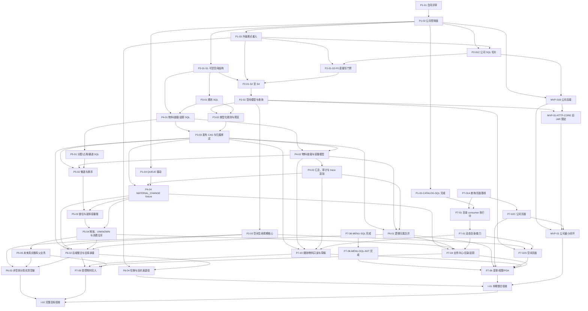

# IWS+ 在库管理实施任务图

> **2026-11-02 重新评审纠偏：** 当前缺陷、阶段缺口及重排依赖见[重新评审与交接](C:/code/company/innolux-iws/work/inventory-reassessment-20261102/review-and-handoff.md)第 2、6、7 节。其 R1—R6 复用本图 INV 任务，并覆盖以下历史记录中与最新边界冲突的默认执行顺序：标准新项目不承担旧版兼容；真实 MOVE/非空清空仍为后续范围，不作为本期其他底座完成的统一前置。现有 done 只保留原切片证据，不新增父任务完成声明；优先解决空库结构与 P1/P2 问题，后续不使用子代理。

> **2026-11-03 本期整合验收：** P1—P7 当前标准化范围已完成，复评 REV-01—REV-08 已关闭，`INV-I-01` 保持 `done`。正式空库最新入口为 `181` 表、`77` WMS 表、`256` 菜单；最终 JAR `4C2515415A427CF1AC1A516DA05A408F7491B8E227CBEB9DCC6D5552BD95EBC3` 完成健康检查、普通账号登录、计划能力/10 个 ACTIVE 定义/空间与规则接口和同库重启验证。全 WMS `481/481`、根 reactor `43/43` clean `test-compile`、全应用 `43/43` package、Web `264/264`、空间生命周期 `70/70`、类型检查、Oxlint、构建及普通账号本机/LAN 代理浏览器均通过。规则详情 readiness 已补齐生产绑定快照字段并经正式 API 复核为 `READY/executionReady=true`。空库管理员已保持需求密码值不变，分别写入 BCrypt/SHA-256/PBKDF2 哈希并重新初始化验证。`INV-P5-05`、`INV-P6-03`、`INV-P7-05`、`INV-I-02` 继续作为真实 MOVE、非空清空和正式物料写入的后续扩围项。

日期：2026-10-29（Asia/Shanghai）。当前状态以[当前实施前沿](C:/code/company/innolux-iws/work/implementation-frontier-20261029/report.md)、[后继切片清单](C:/code/company/innolux-iws/work/implementation-frontier-20261029/next-slices.md)与[实施交接](handoff-20261029-inventory-implementation.md)为准：空间十表、P4 物料十一表 core/init、Scope Guard 及条件/结果/装载纯内核均已有主接受的限定证据；15 个 WMS 类 `281` 项加 SSE `12` 项共 `293` 项通过，`38` 个模块 package 成功，固定 JAR 为 `589E0FD0…`，新包 LAN 已通过鉴权快基线及在途切号 `2/2`。P4 core/init 现为 `66/170/66/242/133`，旧 `55/159` 结构和数据不变；Scope Guard 最终有效 `82/0/0/0`，由首轮 `69` 通过加 scopeGuard `13` 复验构成，不是首轮整套全绿。空间菜单 2026-10-29 版本已完成 `67` 次执行、`83` 项断言，待主验收与 init 同步；trace 持久化代码已准备，待根 Maven 执行 `13` 项集成。父任务、真实库、部署与整体 HTTP 仍未完成。

本图只落实用户已确认的主方案与专题范围。需求以[主方案](../docs/inventory-management-design-20261026.md)、[SQL 专题](../docs/inventory-management-sql-upgrade-plan-20261026.md)、[Web 专题](../docs/inventory-management-web-crud-plan-20261026.md)、[分配专题](../docs/inventory-allocation-rules-20261026.md)、[初始化配置值表](../docs/inventory-initial-configuration-20261026.md)和当前[P1 目标模型与交付合同](inventory-p1-contract-20261027.md)为单一来源；本文记录执行顺序、范围、依赖和验收，不替代这些合同。

本次修订按 2026-10-29 的空间、P4、规则结果/装载内核与 SSE 报告重排状态层，只修改授权文档，不重新运行产品检查。早先 Web 194 项、空间只读前端 237+70 及历史 LAN 证据继续按原版本复用；当前新增证据在 §1.2 分片记录。完整 P2/P3/P4、S2—S4、非空 MOVE、外部写主体清单、B04/B05 和切换仍单列。

## 0. 范围冲突与当前目标

- 原方案与交接明确：P5 本期验收挂载/原子事实底座，真实移库等扩展业务后续接入；非空拆分/收缩又要求先完成真实移库清空。两者不能同时由 fixture 满足。
- 任务图不自行把真实 `MOVE` 解释为已授权，也不删除 A19/A22 的目标。当前基线只允许实现空间核心和不依赖清空链的能力；非空拆分、真实移库、正式物料父业务写入分别标记为 `INV-P5-05`、`INV-P6-03`、`INV-P7-05` 的后续阻塞项。
- P1 合同 D01 是正式物料写入口缺真实父业务；D02 是非空空间调整与真实移库范围冲突；D03 是默认 QUEUE 与当前 process/scheduler/SnailJob 开关关闭的冲突。D01/D02 保持扩围阻塞，D03 由 `INV-P1-04` 实现三开关门禁和隔离驱动验收，当前部署不得静默回退 IMMEDIATE。
- 解锁条件：用户显式扩大实施范围并接受相关入库/出库/移库、证据、QUEUE、数据库与验收成本；在此之前相关入口必须保持能力关闭或返回明确的范围阻碍。
- 用户已决定储位地址为巷道、排、层、列、深五个独立可空文本属性，对应 `aisle_text/row_text/level_text/column_text/depth_text`，均可为非数字；同一仓库五项组合唯一，NULL 按同值，五项全空同仓最多一条，退役行继续占组合。比较只清理首尾 ASCII 空格，空串归一为 NULL，不折叠大小写、全半角、Unicode 或前导零。
- 深位跨储位通道锁、装拆容量账、升级断点重入、旧位置约束退役和 QUEUE 驱动属于当前底座必须解决的合同与实现缺口；Web 动态目录必须先于物料变更动作开放。`/wms/crud/{tableCode}` 作为统一入口，由服务端按登记处理器委托原子 CRUD、领域命令或计划，前端不串联第二条命令。通用查询中字段未出现表示不过滤，显式空串作为字段条件且不匹配 NULL，清空输入不发送筛选；精确定位另用五条显式字段条目区分缺项与 NULL。生成值列类型/表达式/STORED 与字节级 ASCII TRIM CHECK、`warehouse_id` 与父链一致、通道成员锁旧新通道和储位，以及 S1—S4 阶段与父链共锁，也属于当前底座合同。
- `INV-S2-F0` 不是完整 S2。公司实际纳入范围是创建、改名备注、启停（`setEnabled` 一个命令族）和管理范围替换，供应商范围为 add/update/remove/import；component/schema/release 为 `WMS_DIRECT_WRITE/1/INV-WMS-DIRECT-WRITE-1`。离线登记、共享/排他锚点、直接冻结和不自动解除的合同以 P1 合同第 5.7、11.0 节为准。本轮主 Review 发现并已派修跨 release unsafe run 漏检、NULL/default 签名碰撞及失败留证冻结 gap，均尚无真实测试闭环。
- 目录 SQL 只关闭两表结构/verify 的限定切片；旧 verify `D2A065F3...` 的 55 项矩阵不迁移到当前 `C5E12515...`。Catalog 菜单 SQL 的 105 项隔离断言和只读 Web consumer 源码切片已分别限定接受，Catalog 菜单 inline empty-init 现已限定接受，动态目录真实后端闭环继续保持 `in_progress`。

## 1. 当前基线与边界

下表为本轮只读核对的工作树快照。文档修改前 D/B/W 均保留并发 dirty，表中数量只作交接待审基线，不把未跟踪目录内的文件数误算为 Git 条目数。

| 位置 | 当前工作树事实 | 本任务处理 |
| --- | --- | --- |
| `D = C:/code/company/innolux-iws-inventory-design` | 分支 `codex/inventory-design-20261026`，HEAD `2d15d09b219a3f48cd53b20012f6a2ca2548a6ef`；文档修改前 `git status --short` 为 15 条，其中 4 个跟踪文件修改、11 个未跟踪顶层条目。 | 本轮只修改本任务图和 P1 合同；保留所有其他未提交文档。 |
| `B = C:/code/company/innolux-iws` | 分支 `main`，HEAD `49408110bf98eea063271f8feac0c577da11c861`；本轮扫描时 82 条状态，其中 13 个跟踪文件修改、69 个未跟踪顶层条目；本轮另只新增 `work/implementation-frontier-20261029/`。 | 核对报告和源码 hash；保留现有 Java/SQL/测试/work 改动，不改业务代码或 SQL。 |
| `W = C:/code/company/ui/innolux-iws-web` | 分支 `main`，HEAD `0c7ec33171c3e7cfff575d308211ec435a89f168`；本轮扫描时 59 条状态，其中 36 个跟踪文件修改、23 个未跟踪顶层条目。 | Web 源码本轮未改；仅当相关源码未变时复用 `244+70`、`tsc/lint/build` 旧证据。 |
| `P = C:/code/company/ui/innolux-iws-pda-plus` | 分支 `master`，HEAD `c5d2e67d2706614e97e863c6e69c85f5de424d99`；工作树无改动。 | 本轮未修改。 |

历史基线：先前只读观测为 MySQL 8.0.45、124 表、WMS 20 表为空，APK/process 有运行记录；当时未作本轮复核。当前事实：主 Review 已接受[真实旧库只读报告](C:/code/company/innolux-iws/work/inventory-real-baseline-readonly-20261029/report.md)：MCP 首查 SHOW GRANTS 确认专用只读账号；dev `3306/innolux-iws/8.0.45` 当前 124 张基础表中，20 张 WMS 表逐表精确 COUNT(*) 均为 0，检查的新 23 个对象及 S1 列未部署。当前 dev 空源演练无需编造 B04/B05 行级映射，生产 B04/B05、完整 S2/S3/S4 和 cutover 仍未关闭；APK 3 条，process 3 COMPLETED + 1 RUNNING，均不得清理重置。执行 SQL 前仍须重新核对目标、权限、结构指纹、活动实例及写冻结，不得重跑空库初始化取得“干净”环境。

### 1.1 本轮实际成果与待验收

| 交付 | 当前状态 | 已适用证据 | 尚未验收/边界 |
|---|---|---|---|
| Terra 对 P1 的有限范围评审 | `review` | 有限范围评审通过，结论只覆盖该范围。 | P1 全合同、D01—D03/B01—B10 和整体验收未关闭，不得写成 P1 已完成。 |
| 公司后端 | `review` | 2026-10-27 的 39 项为历史证据：公司 MySQL 8.4 集成测试 27 项及查询契约 12 项；后续空间只读回归已更新为公司 27 项、查询契约 13 项、空间 23 项，共 63 项通过，并有 JDK 21 全应用编译证据。报告目录：`B/iws-modules/iws-wms/target/surefire-reports/`。 | 全应用编译和隔离测试不替代真实 HTTP、菜单/权限、浏览器联调、部署或真实目标库验收。 |
| 公司最小闭环 SQL | `review` | [历史 MySQL 8.0.46 报告](C:/code/company/innolux-iws/work/iws_inventory_management_mysql_validation_20261027.md)验证公司 5 表、菜单门禁、DDL checkpoint、重跑和冲突拒绝；S1 后续在 MySQL 8.0.45 重新验证公司升级的 `LEGACY/EMPTY` manifest、首次升级、目标态重跑和公司 verify。先前记录的 `upgrade.sql` 为 1588 行、SHA-256 `060715279CF6D198C58890F7CC2CB3A29F3A3668160B4FE85AE350AAE2445E5C`；`verify.sql` 为 719 行、SHA-256 `A576BF98A42A89AAFE04F277564045BA111C3C5A2E8F7F69E99FC01DFD91735F`，本轮未重验该组摘要。 | 仅隔离容器，未连接或写入真实目标库；未覆盖真实库版本/权限/引擎/数据、并发部署、应用同版切换和完整空间验收。 |
| 通用空字符串查询与 Web 公共基线 | `done`（`INV-P7-01A`） | 原切片证据为 26/26 文件、194/194 Web tests，公司/API/CRUD hook 定向 5/5 文件、89/89 tests，以及 lint、构建通过。后端查询契约由历史 12 项更新为上述 63 项回归中的 13 项。 | 只覆盖原查询、页面交互和前端反馈切片；动态目录、服务端 capability 闭环及正在验收的跨 tab/卸载修复不据此关闭。 |
| 公司 Web | `done`（`INV-P7-02C`） | 原切片评审通过；证据为早先 HTTP 环境全量 194/194、公司相关隔离 Mock 89/89、LAN 真实浏览器 15/15；公司查询/受控命令、表单、启停和管理范围对话框可构建。 | 浏览器结论仅适用于原评审版本，未保存独立 HTML 报告；上轮 231 项检查不扩大为当前修复全链验收。真实后端、权限/revision、会话和菜单 seed 留给 `INV-MVP-01`。 |
| 公司最小闭环整体 | `in_progress` | 公司后端历史 39 项、后续 63 项组合回归、公司 SQL 隔离报告、公司 Web 已验收切片及 `INV-MVP-01-HTTP-CORE` 的真实 LAN/API 主链路均已有证据；固定 JAR 另外完成 12 个真实 LAN 场景；SSE 当前源码新增真实 MVC 12 项通过。 | SSE 尚未新 package/LAN，OAuth 仅 stub，`INV-S2-F0`、真实目标环境账户/权限、完整菜单部署和整体汇总仍未验收；不得标记整个公司项为 `done`。 |
| 空间 S1 独立 SQL | `done`（`INV-P2-01-S1`） | 控制/S1 四脚本已通过 MySQL 8.0.45 的 74/74 权限矩阵，源码、报告与日志摘要一致，独立 Sol 复审通过；历史 S1 报告另覆盖空库 130 表、core/init 26 张 WMS 表零差异、升级/重跑/部分恢复及公司 manifest 兼容。 | 只关闭 S1 可空结构；历史 core/init 签名不验收当前七表整合，不关闭 S2—S4 或完整 P2。 |
| 空间后端只读切片 | 只读切片评审通过；`INV-P2-02` 保持 `in_progress` | 空间 23 项、查询契约 13 项、公司 27 项，共 63 项通过，JDK 21 全应用编译通过；范围、父链和非法查询等修复已通过独立复审。 | 完整空间模型、版本、visibility、通道锁、地址唯一约束、生命周期及真实 HTTP 尚未验收。 |
| 空间 Web | 只读页面前端切片 `done`（`INV-P7-02S-READONLY`）；`INV-P7-02S` 保持 `in_progress` | 主 Review 已核对取消与离页处理；237 项 Vitest、独立 70 项 lifecycle、vue-tsc、lint、构建及 mock browser 通过，`tests/wms-space/last-run.json` 记录 canceled/reactivate。 | 只关闭只读页面前端切片；完整空间 Web、配置版本、容量、非空调整、真实 HTTP 和完整 P2 模型未验收。 |
| 储位/空间完整模型 | `in_progress` | S1 独立 SQL、后端只读评审及空间 Web 已有上述分层证据。 | S2 冻结、S3 回填/父链审核/生成列/CHECK/`NOT NULL`/同仓地址唯一键/并发、S4 完整空间、生命周期、完整服务/页面、真实库和切换均未完成。 |
| Process 授权接缝 | 原 P2 已关闭；`INV-P1-02` 保持 `in_progress` | 多 policy allow OR 与监督目标统一已有 13/13 定向测试，原独立 Sol 复审关闭 P2。主代理又读真实 `SupervisorRuntimeService`，确认其仅写 `planType/supervisorKey`，普通业务字段保留，未见新增可达问题。 | 该源码核对及接缝复审不证明 WMS 实际策略已注册、真实流程或 P1 全合同通过。 |
| catalog SQL | `done`（`INV-P1-02-CATALOG-SQL`，限定切片） | 两处 P2 已由主 Review 关闭；当前 catalog/verify 完整行集合、权限、尾列、索引、default 和真实不可见 trigger 定向证据见 [恢复复检报告](C:/code/company/innolux-iws/work/iws_inventory_type_catalog_resume_evidence_20261028.md)。 | 旧 verify `D2A065F3...` 的 55 项矩阵不绑定当前 `C5E12515...`；只关闭目录 SQL 结构/verify，动态目录 API、Web consumer 和 TG08 未完成。 |
| core/init 七表同版初始化整合 | `done`（`INV-P1-02-COREINIT`） | 完整 init 实测 137 表/WMS 33 表，core 33 表；三路七表元数据均为 210 行/20251 字节，SHA-256 `C1EC…`，SHOW CREATE 摘要 `B68C…` 一致。证据见 [恢复复验报告](C:/code/company/innolux-iws/work/empty-init-integration-20261028/recovery-verified/report.md)。 | 只关闭七表初始化整合切片；完整 P1 升级、TG05、S2/S3 数据承接仍为 `in_progress`，且未写真实库。 |
| 空间只读菜单 SQL | `done`（`INV-P7-06-MENU-SQL`） | MySQL 8.0.45 隔离矩阵 100 项断言通过；主 Review 已复核限定 Standards/Spec、门禁、事务、权限与报告 provenance，见 [报告](C:/code/company/innolux-iws/work/space-menu-20261028/report.md)。 | 只关闭独立 upgrade/verify SQL；未写真实角色授权，也未做完整浏览器路由；完整 `INV-P7-06` 保持 `in_progress`。 |
| 空间菜单空库入口 | `done`（`INV-P7-06-MENU-SQL-INIT`，限定集成） | 主 Review 已通过新 init `9F436FAA4472450A6A1BB3B68F5D154FE5B1BFE98B7C7B3DDDA4DDDA3557F44B` 的限定集成；MySQL 8.0.45 实测 `137/33/241/53/133`，独立 verify、菜单重跑和前后结构不变均通过，见 [报告](C:/code/company/innolux-iws/work/space-menu-init-20261028/report.md)。 | `core` 本来不承载菜单；本切片只证明 empty init 自包含四个空间菜单，不证明真实角色授权、浏览器路由或完整 TG08。 |
| 当前直接写 schema 门禁 | `in_progress`（`INV-S2-F0`） | 主 Review 已读 report/code/registerCanonical，限定 CODE/SQL/local tests 通过；fence fixture 已修，本轮 fence 17 项纳入 106 项全绿。固定 fingerprint `1b236346b990fbf9410aeea49bb323f174112e1a44c133998baccb2ddac06909`。旧 JAR 的 12 个真实 LAN 场景含公司四写和正式 fence 登记；当前 SSE 修复另有 MVC 12 项。 | 真实 HTTP 场景不能关闭完整 TG13/S2；当前 SSE 尚未新 package/LAN，完整冻结、外部 writer、B04/B05 仍待验收。 |
| 真实 HTTP 主链路 | `done`（`INV-MVP-01-HTTP-CORE`，旧 JAR 限定） | [真实隔离 HTTP 报告](C:/code/company/innolux-iws/work/http-verify/real-20261028/runs/20261028-210237-resume/report.md)：LAN `192.168.1.21:18000` 登录、公司创建/改名备注/启停/管理范围替换、space query/unique/ambiguous 主链路通过；旧 init `CE6C3819A2F4E3B2D34EAEBE46D25C272625F273A5DE156811B132CC2A7128EA` + 独立 4 菜单得到 `137/33/241/133`。首轮 30 API 为 `24 PASS / 6 断言错`，修正复核 `9/9` 通过，未改产品。 | 只绑定 JAR `5D0C5EE77E72F4F6AF1252B7DDEFA3D7D99C05672A8AD1BD2EB13751B89EBE4D`；其余 8 个 HTTP 场景须用当前 JAR 补验，后续 fence 与登记脚本也不在该旧 JAR。报告只证明上述计数，不推断其他 HTTP 数字。 |
| 真实 HTTP 整体 | `in_progress`（`INV-MVP-01`） | 公司/空间请求主链路由旧 JAR 限定切片关闭；[固定 JAR 真实 LAN 报告](C:/code/company/innolux-iws/work/http-verify/real-20261029/report.md)绑定 `3B44BC58…` 的 12 个场景通过。当前源码的 SSE MVC 媒体链另为 `12/0/0/0`，完成于 `13:04:47`。 | 新 SSE 与 scope 改动尚未 package/LAN；OAuth 真实 provider、整体 HTTP、真实部署和 F0 完整门禁仍未关闭。 |

当前 company/fence/rule/catalog Java 使用 MySQL 8.0.45；space Java 23 项仍使用 MySQL 8.4。原 company 8.4、公司 SQL 8.0.46 及旧隔离结果均为历史版本证据，不替代当前同版或真实库验收。Hume 的真实 dev 只读复核已限定接受，当前 20 张 WMS 表精确全空；不据此关闭生产 B04/B05 或完整 S2—S4。

本文件不授权提交、推送、真实数据库写入、设备外呼、部署或调度启停。后续任务中的隔离库执行、产品构建和测试须按届时授权实施；真实库切换和发布另行确认。

### 1.2 限定子任务与证据（2026-10-29）

下表把恢复的 Harness todo、独立 SQL/源码切片和父任务状态分开。任一子任务通过都不关闭完整 P3、Catalog/TG08、完整 S2、完整 HTTP 或主方案整体。

| 限定子任务/事实 | 状态 | 当前证据 | 不得扩大为 |
|---|---|---|---|
| Harness 会话 `session-4dfae017…` 恢复 | `done`（恢复动作） | [恢复报告](C:/code/company/innolux-iws/work/harness-resume-20261029/report.md)：P3 Java `14/14`、S3 SQL `61/61`，会话无开放 turn/step/pending call。 | 库存管理整体完成、提交/推送、真实库部署或完整 P3/S2。 |
| P3 规则 Java 首切片 | 限定代码切片通过；父 P3 `in_progress` | 主 Review 已亲读历史日志：全 WMS `106 tests / 0 Failures / 0 Errors / 0 Skipped`、`BUILD SUCCESS`；company 27、fence 17、query 13、catalog 5、rule 21（7+4+7+3）、space 23。全应用 package `BUILD SUCCESS`。3 个 Mapper 去除列端 CAST、保留参数 CAST BINARY（索引列为 utf8mb4_0900_bin），规则 S/X 锁序和 fence fixture 修复获主 Review 限定接受；规则 21 项属于该历史门禁。 | 完整 typed DSL、目标对象存在/管理范围/storage 有效快照、任务绑定仍未完成；该历史结果不覆盖后续结果/装载/SSE/scope 改动。 |
| 纯条件 kernel 限定切片 | `done`（仅纯 kernel；父 `INV-P3-02`、P3 仍 `in_progress`） | 7 个生产类与 1 个测试；原始 Maven/Surefire：79 tests、0 failures、0 errors、0 skipped、time `1.866 s`、完成于 `2026-10-29T07:52:05+08:00`；之后 8 个 Java 文件仅补头注，正文逐字节相同，未再跑 Maven。见[实施说明](C:/code/company/innolux-iws/work/rule-dsl-20261029/implementation.md)、[验证摘要](C:/code/company/innolux-iws/work/rule-dsl-20261029/verification.json)、[源清单](C:/code/company/innolux-iws/work/rule-dsl-20261029/source-manifest.json)（SHA-256 `ee4aa049…`）。 | 只接受纯条件 kernel；未接发布、服务、SQL、HTTP、事实快照或任务绑定。79 不与 106 相加。 |
| 空间 S3 SQL | `review` | [Harness 恢复报告](C:/code/company/innolux-iws/work/harness-resume-20261029/report.md)记录 MySQL 8.0.45 隔离矩阵 `61/61`，且未写真实 dev。 | 只覆盖 S3 SQL 合同；不包含 S2 完整冻结、外部写主体、B04/B05、S4、应用切换或 cutover。 |
| P3 独立 12 表 DDL | `done`（限定结构） | [规则 DDL 报告](C:/code/company/innolux-iws/work/iws_inventory_management_rules_mysql_validation_20261028.md)：原隔离矩阵 `148/148`；本轮主 Review 复核目标结构、精确元数据预检和 SQL verify，未发现新阻断。 | 不包含 Java/API 完整行为、typed DSL、无效 storage 快照、任务绑定、规则 seed、真实库迁移或 P3 父任务完成。 |
| P3 12 表 core/init 同版整合 | `done`（限定集成） | [整合报告](C:/code/company/innolux-iws/work/rules-core-init-20261029/integration-report.md)：MySQL 8.0.45 三路元数据一致，`core 45`、`full init 149`、`menu 241`、`role-menu 133`；core/init SHA-256 `9A4B5F39…`、`1BA86A2B…`。主 Review 接受。 | 不证明完整 P3、规则/seed 行、菜单增量、空库重跑、真实库或应用同版切换。 |
| Catalog 只读 Web consumer 源码切片 | `done`（源码限定） | 主 Review 已读源，未发现新阻断；现有测试仅为旧 `7 unit / 20 browser mock`。 | 未做真实后端联调、当前版本全量测试、停用历史恢复、capability 拒绝或完整 TG08；父任务仍 `in_progress`。 |
| Catalog 菜单 SQL | `done`（隔离 SQL 限定） | [Catalog 菜单报告](C:/code/company/innolux-iws/work/catalog-menu-20261029/report.md)：`105` 项断言、`98` 次 SQL 文件执行，主 Review 已接受；upgrade `9a895033…`、verify `bb8dac9d…`。菜单元数据仅由页面 `1761400000000050300` 自身承载 `inventory:business:query`，不另建 F 权限，不写 `sys_role_menu`。 | 未写真实库、未授角色、未做浏览器路由；不关闭完整 P7-06/TG08。 |
| Catalog 菜单 inline empty-init | `done`（限定集成） | 主 Review 接受 [报告](C:/code/company/innolux-iws/work/catalog-menu-init-20261029/report.md)；MySQL 8.0.45 `149/45/242/133`，page 1/grant 0/规则行 0，init SHA-256 `7D3940199D66813B932EBE15D236ED40F45641D3D4A017B2C4034B39E890FF46`。 | 不关闭真实角色授权、浏览器路由或完整 TG08；旧 149/241、137/241 及其 hash 保留为历史。 |
| 六 SQL 精确 metadata 修复 | `done`（限定修复） | 主 Review 已接受[六 SQL 精确 metadata 修复报告](C:/code/company/innolux-iws/work/sql-metadata-exact-20261029/report.md)（SHA-256 `71465397782884bf3eef57d7e5b4bdf1f90341cd2fc1b263001c5d11f5e87f7c`）：实际 metadata 使用 JSON canonical/NULL-safe binary，修复 default 大小写及 INDEX_COMMENT 比较；target DDL 不变。MySQL 8.0.45 的 22 项定向和重新执行的 74 项 control/S1 回归通过；74 不是六份脚本所有行为的全量矩阵。控制五表目标指纹为 `5e8161d1e6a4182446624443de3992436b0a202faf8fe905c3cf7f4d901a905c`，与 F0 manifest `1b236346b990fbf9410aeea49bb323f174112e1a44c133998baccb2ddac06909` 分属不同合同。22/74 绑定报告列明的六份 SQL 哈希和执行时 runner `94e4fb6b…`；datadir 已可恢复迁到 Temp，当前 runner `e35a6040…` 的路径 smoke 未执行 SQL，未冒称已用新 runner 重跑 22/74。 | 保留旧 74 历史，本次 74 是重新执行的 control/S1 回归；不关闭 P1-03/TG05、完整升级或真实部署。 |
| 全模块 Java 测试（105 项历史） | 历史未通过 | 本轮 DeepSeek 执行 Maven，主 Review 读日志复核 `105 tests / 103 PASS / 1 failure / 1 error`；旧 35 个 TestDatabase 路径错误已消除，company `27/27` 通过。failure 是跨 scope 并发 publish 用例 20 秒超时，主怀疑 Mapper 列端 CAST 破坏索引点查，待修；error 是新 fence 测试历史 `WMS_HISTORICAL-1` 登记跨用例未清，原 coder 正在修 fixture。 | 该历史版本不是绿色，P3 `14/14` 不能抵消当前失败；不等待后续结果阻塞本轮文档交付，最新复验见下一行。 |
| 全模块 Java 测试与 package（历史整体基线） | `done`（历史版本检查限定） | 主 Review 已亲读日志：全 WMS `106 tests / 0 Failures / 0 Errors / 0 Skipped`、`BUILD SUCCESS`；company 27、fence 17、query 13、catalog 5、rule 21（7+4+7+3）、space 23。全应用 package `BUILD SUCCESS`。3 个 Mapper 去除列端 CAST、保留参数 CAST BINARY（索引列为 utf8mb4_0900_bin），规则 S/X 锁序和 fence fixture 修复获主 Review 限定接受；[最终测试日志](C:/code/company/innolux-iws/work/verification-resume-20261029/wms-tests-final.log)、[全应用 package 日志](C:/code/company/innolux-iws/work/verification-resume-20261029/iws-admin-package.log)；[runner 报告](C:/code/company/innolux-iws/work/verification-resume-20261029/report.md)记录旧版本事实。 | 仅关闭该历史版本；不覆盖后续内核/SSE/scope 源码，也不反向关闭父任务或真实 HTTP。 |
| 固定 JAR 与隔离 LAN HTTP | `done`（旧 JAR 12 场景限定；整体 HTTP 仍 `in_progress`） | [报告](C:/code/company/innolux-iws/work/http-verify/real-20261029/report.md)绑定 JAR SHA-256 `3B44BC58…`、LAN `192.168.1.21:18000`；公司四写、双标签 1 HTTP/1 DB、受控 500/断网原 key 恢复、换号 POST 0、401 重登、加密登录和有效 SSE 等 12 项通过。 | 仅关闭该固定 JAR。OAuth 是 stub；不能覆盖当前 SSE/scope 源码变动，整体 HTTP 未通过。 |
| scopeGuard 补强 | `done`（限定 Guard/集成专项；父 P3-03 仍 `in_progress`） | 21 个交付文件及最终有效 `82/0/0/0` XML 已获主读全类接受。`82=69` 首轮通过加 scopeGuard `13` 复验；首轮实际 `82/1/1/0`，两个新增测试错误已修，不能称首轮整套全绿。见[报告](C:/code/company/innolux-iws/work/rule-scope-guard-20261029/report.md)。 | 正式产品 schema 未补列，未 package/LAN/部署；Gauss 后续 15 个 WMS 类加 SSE 12 当前回归结果未出，不预测总计。 |
| Web 本轮检查 | 通过（旧 Web 源码限定，可复用） | `244+70`、vue-tsc/lint/build 旧结果对应未变 Web 源码；本轮只读复核 Git 状态，不重跑。 | 这些检查不是 HTTP 证据；任何相关 Web 源码变化都需补验。 |
| 空间 foundation 10 表与 core/init | `done`（独立 DDL 与同版整合限定；父 P2/S2 `in_progress`） | 独立 DDL 为 10 表/109 列/51 索引/24 CHECK、88 断言；[core/init 报告](C:/code/company/innolux-iws/work/space-core-init-20261029/report.md)记录 MySQL 8.0.45 `core 55 / init 159 / WMS 55 / menu 242 / role-menu 133`，三路结构/verify 同版，原 45/149 结构与 seed 摘要一致。 | 只关闭结构/整合切片；未写真实 dev。业务同通道/无环、父链、继承、CAS、S2—S4、服务分配/切换仍待验收。 |
| 外部真实库只读复核 | `done`（限定只读） | 主 Review 已接受[真实旧库只读报告](C:/code/company/innolux-iws/work/inventory-real-baseline-readonly-20261029/report.md)：MCP 首查 SHOW GRANTS 确认专用只读账号；dev `3306/innolux-iws/8.0.45` 当前 124 张基础表中，20 张 WMS 表逐表精确 COUNT(*) 均为 0，检查的新 23 个对象及 S1 列未部署。当前 dev 空源演练无需编造 B04/B05 行级映射，生产 B04/B05、完整 S2/S3/S4 和 cutover 仍未关闭；APK 3 条，process 3 COMPLETED + 1 RUNNING，均不得清理重置。 | 当前 dev 空源无行级映射阻碍，不证明生产空库、外部 writer 停止、真实冻结或 cutover；APK/process 不重置。 |
| P4 material 目标 DDL | `done`（限定结构，主 Review 已接受修复） | [报告](C:/code/company/innolux-iws/work/material-foundation-20261029/report-spec-fixes.md)：11 表、220 列、85 条索引列元数据、34 个 CHECK；当前受影响 MySQL 8.0.45 `24/24` 通过。 | 旧 78/86 仅复用未变部分，不能写成当前完整 102 项重跑；不关闭 P4。 |
| P4 material core/init | `done`（当前正式空库同版） | 最新全量入口已纳入 `181/77/256` 结构；历史 `core 66 / init 170 / WMS 66` 报告保留版本追溯。 | 当前任务已随 P4/P1—P7 本期验收关闭；旧库迁移和真实部署不包含。 |
| 规则结果 kernel | `done`（纯内核限定） | `RuleResultKernelTest` 实际 Maven `56/0/0/0`，完成于 `2026-10-29T13:10:29+08:00`；条件 8 文件未变。见[结果内核说明](C:/code/company/innolux-iws/work/rule-result-20261029/ready.md)。 | 无生产用途注册、service/publication 接入或发布 binding 快照；不关闭完整 P3。 |
| P4 装载 kernel | `done`（纯内核） | 最终仍为 `23` 项；主已读修复并接受 SUM 用例替换旧 overflow。SUM 精确 `BigDecimal`，单叶仍 `decimal(20,6)`。见[实施记录](C:/code/company/innolux-iws/work/load-kernel-20261029/implementation.md)。 | 未 Maven/DB、未接服务、事务、持久化、容量账或 SQL，不关闭 P4-02。 |
| SSE 认证响应 | `review`（MVC 限定） | `SseAuthenticationMvcTest` `12/0/0/0`，真实 MVC 媒体转换链通过，完成于 `2026-10-29T13:04:47+08:00`。 | 未 package/LAN；不覆盖旧 JAR 报告，不关闭整体 HTTP。 |
| P2 target contract extract | `done`（只读探索） | Kuhn 已只读提取完整 P2 target contract。 | 尚未实施或验证；不关闭 P2/S2。 |
| 全量回归与 package | `done`（当前版本限定） | [验证报告](C:/code/company/innolux-iws/work/verification-current-20261029/report.md)：15 个 WMS 类 `281` 项加 SSE `12` 项共 `293/0/0/0`，16 个 reactor 模块成功；`38` 个模块 package 退出码 0。固定 JAR `589E0FD0BE949E068C54562D66F9F7EBDB0955ED8437C0F2C9AF6BEFBF87E265`，263,075,306 字节。 | package 跳过测试；输入清单外变更不覆盖；不证明新包 HTTP、真实库或部署。 |
| 新包 LAN HTTP | `done`（2 场景限定） | [run summary](C:/code/company/innolux-iws/work/http-verify/sse-auth-20261029/runs/20261029-182319/summary.json)：新 JAR、初始 `170/66/242/133`，鉴权快基线与在途切号 `2/2` 通过，`state=PASSED`。 | 只覆盖 2 个场景；不再覆盖旧 JAR 12 场景矩阵，OAuth 真实 provider 未验。 |
| 空间菜单 SQL 2026-10-29 | `in_progress`（待主验收） | `script/sql/iws_inventory_space_menu.sql`（`967741CB…`）与 `_verify.sql`（`3D5377D4…`）；`work/space-menu-20261029/results.json` 记录 `67` 次执行、`83` 项断言全部通过。 | 报告未出、未获主验收；`init` 未同步；与 18:23 LAN 使用的 `827F2187…` 不同，须重验。 |
| P4-03 trace 持久化 | `in_progress`（代码准备完成） | `iws-wms/.../material/trace/**`、Mapper XML、3 个测试类；JDK 21 编译 15 个生产类与 3 个测试类通过，Mapper `3 insert / 6 select / 0 update / 0 delete`；见 `work/material-trace-20261029/ready.md`。 | 13 个 MySQL 集成场景未运行；未接 SAME_TX、未验收。 |
| 空间目标契约 V2 | `in_progress`（提案） | `work/space-target-contract-20261029/proposal.md` 与 `sql-implementation-design.md`；已定单一权威指针、warehouse `enabled`、zone `revision`、storage `version` CAS。 | 无 SQL/Java 实施；提案未定稿。 |
| 规则发布绑定快照 | `in_progress`（提案） | `work/rule-publication-binding-20261029/proposal.md`：`attribute-bindings/1`、11 字段快照、锁序与用途范围。 | 无 Java/SQL 实施；生产 provider 与用途注册缺失，仍 fail-closed。 |

## 2. 状态与完成语义

| 状态 | 含义 | 当前使用 |
| --- | --- | --- |
| `pending` | 前置交付未验收、必要决定未解决或执行条件未满足。 | 尚未开始的后续任务。 |
| `ready` | 前置交付已按对应验收通过，必要决定已解决；不代表已有实施授权。 | 当前无。 |
| `in_progress` | 已指定执行者及写入范围。 | 本期当前无。 |
| `review` | 交付物已形成，等待合同评审或必要验收；复审问题未关闭时不得视为通过。 | `INV-SSE-AUTH-01`；不属于在库管理 P1—P7 本期关闭条件。 |
| `done` | 对应切片验收通过，证据仅适用于所记录版本及范围，后续变更须补验受影响部分。 | P1—P7 本期任务及 `INV-I-01`；旧库迁移 `INV-P6-04` 按标准化项目边界转不适用完成，不表示执行过真实旧库切换。 |
| `blocked` | 存在明确外部阻碍及解除条件；独立分支仍可继续。 | `INV-P5-05`、`INV-P6-03`、`INV-P7-05`、`INV-I-02`，均等待范围扩展授权。 |

Terra 历史有限评审、后续源码复核、正式空库、最终 JAR、隔离 MySQL、Web、LAN 代理和浏览器证据已合并为本期验收，复评 REV-01—REV-08 已关闭，`INV-P1-01` 不再作为未关闭的独立评审。用户已明确标准化新项目不承担旧库迁移、旧结构和旧接口兼容，因此 `INV-P6-04` 的历史切换不再作为本期主线和 `INV-I-01` 依赖；真实 MOVE、非空清空和正式物料写入仍由 `blocked` 后续任务承接。任务状态变化必须在本文记录日期、基线提交/工作树、写入范围和可复现证据。

完成语义：

- 代码任务以当前基线可编译、相关测试通过、行为可回读为依据；测试计划或子代理退出不构成 `done`。
- SQL 任务以静态检查、隔离同版 MySQL 的空库初始化、旧基线升级、二次/三次重跑、结构和数据守恒为依据；只做文本审阅不能关闭。
- 计划事件任务以能力出现于定义选项、允许挂载关系、隔离发布、实例/事件/attempt/checkpoint 和业务屏障可回读为依据；fixture 可验收底座合同，不能被表述为真实父业务已接入。
- Web 任务以服务端权限和 capability 拒绝对照、Vitest、项目构建及真实分页/交互为依据；静态页面不能替代业务动作。
- 当前真实库、设备、并发和生产性能不得由隔离测试、H2、Mock 或文档检查推断为已通过。

## 3. 任务依赖图

共享文件或资源冲突以下列调度约束串行处理，不增加虚假的业务依赖：

- `B/script/sql/iws_init_from_empty.sql`、`B/script/sql/iws_wms_smt_core.sql` 和 `iws_inventory_management*.sql` 由 SQL 任务共享，同一时刻只允许一个任务修改并验证。
- 空间菜单 `241` 空库入口已由 menu/init 切片完成并主 Review；`INV-S2-F0` 当前不并行改写 init。后续把独立登记纳入 empty 时必须与同一新代码版本同批验证；`core` 不承载菜单，不因菜单切片反向要求 core 增加菜单。
- `B/iws-modules/iws-wms/src/main/java/com/innolux/iws/wms/support/meta/`、`controller/IwsCrudController.java`、`iws-modules/iws-process/` 的注册入口按任务顺序合并，避免 capability 和路由双写。
- `W/src/components/IwsCrudPage/`、`W/src/hooks/crud/`、`W/src/api/wms/crud/` 是共享前端合同，P7 任务串行收敛后再增加领域页面。
- 菜单、权限、字典和 seed ledger 随所属阶段增量补齐，同一 SQL 发布批次内只能一个任务生成最终摘要。

### 3.1 本轮依赖修正

- 空间父任务拆为已完成的 `INV-P2-01-S1` 与后续 S2—S4。`INV-P3-01`、`INV-P4-01` 的 DDL 只依赖 S1 已冻结的仓库/库区/储位稳定身份，不再等待 S2/S3 的写冻结和数据回填；后者只阻塞要求真实承接数据或完整空间行为的任务。
- `INV-P7-01` 拆为已完成的查询/页面基线 `INV-P7-01A` 与仍在进行的动态目录/服务端能力部分。公司 Web 只依赖前者，并以隔离 Mock 和真实浏览器验证前端合同；后端权限/revision 和真实 HTTP 放入 `INV-MVP-01`，不再把公司页面等待完整公共能力或公司后端作为硬前置。
- `INV-P3-03` 的首次逻辑归属要写 `wms_inventory.logical_assignment_id` 等物料事实，因此补上真实前置 `INV-P4-01` 的物料 schema；旧物料归版和任务快照仍由该任务负责，归属批合并由 `INV-P6-01` 另行承接。
- D01—D03、真实 `MOVE`、非空拆分/收缩、真实目标库和部署都不是公司最小闭环的硬依赖。公司最小闭环只依赖已形成的公司后端/SQL 切片、前端切片及其隔离 HTTP 整合验收。
- 目录 SQL 拆为已完成的 `INV-P1-02-CATALOG-SQL` 与执行中的 `INV-P7-01-CATALOG-CONSUMER`。SQL 证据不能反向关闭动态目录 API、consumer、停用历史恢复或 TG08。
- 当前直接写门禁拆为 `INV-S2-F0`，只依赖控制五表、公司五表和供应商结构的现有切片；它不要求完整 S2/S3，也不能解锁完整 S2。真实 HTTP 旧 JAR 切片与新 fence 互不覆盖。
- 空间十表 core/init 已由独立结构切片解锁并完成 `INV-P2-01-SPACE-COREINIT`；完整 P2/S2 仍等待 S2 冻结、S3 回填、S4 与切换验收。Kuhn 的 P2 target contract 只作为后续实施输入，尚无实现证据。
- P4 material 目标 DDL 与 core/init 同版整合已分别限定接受；`INV-P4-01-MATERIAL-COREINIT` 实测为 `66/170/66/242/133`，旧 `55/159` 结构和数据不变。结果、装载与 SSE MVC 仍为独立切片，不能解锁完整 P3/P4/HTTP。

## 4. P1 合同与公共控制面

依据：主方案 §2、§10、§15、§16；SQL 专题 §3、§4、§6、§7；Web 专题 §2、§5、§6、§8；分配专题 §1、§2、§7。

### `INV-P1-01` P1 实施合同评审与冻结

- 状态：`done`
- 依赖：无。
- 当前评审结论：Terra 已通过有限范围；该结论只关闭该范围内的合同问题。P1 全合同仍待完整评审，不能把 `INV-P1-01`、P1 能力组或整体目标写成 `done`。
- 交付：明确接受、驳回或补充本期表/列/唯一键/索引、状态枚举、混放键、精度、物理占位与历史逻辑归属、API/DTO/revision、逐事件注册、`businessType/planType` 目录及允许挂载关系、权限码、同版 SQL/seed 清单和旧库承接门禁；逐对象列出 CRUD 入口的受控路由，前端只提交一次动作，后端据 capability、状态和权限委托领域命令或计划。
- 允许写入：`D/work/inventory-implementation-tasks-20261027.md` 的评审结论；其他方案或代码文件须另获当次授权。
- 验收：A01—A40、WC01—WC22、AR01—AR21 均有任务覆盖或明确后续依赖；专题中重复的 `AR19` 以场景文字分别映射；现场必填保持空值/阻断，不生成默认公司、楼层、单位或设备；明确记录“非空拆分要求真实移库”与“真实移库属后续范围”的冲突，不得把任一写法冒充已解决；公司最小闭环的 CRUD 入口必须与服务端受控委托合同一致。
- 必须记录的未决项：真实内部移库是否扩入本期、物料正式父业务入口何时开放、非空拆分/收缩的交付时点；同时冻结深位跨储位通道锁、装拆容量账、升级断点重入、旧位置唯一约束退役、QUEUE 驱动和 Web W2/W3 目录挂载顺序。
- 解除条件：用户或授权评审者接受本期合同及范围边界。接受本期合同不等于授权真实移库或非空清空链；后者必须另有明确扩围。

### `INV-P1-02` 公共控制面、类型目录与审计底座

- 状态：`done`
- 依赖：`INV-P1-01`。
- 依据：主方案 §10、§11、§12；SQL 专题 §3、§6、§7；Web 专题 §2、§5、§6；计划事件项目接入的目录、挂载、权限和冻结事实合同。
- 交付：WMS 公共 schema、schema/version 基础、可扩展业务/计划类型目录、允许挂载关系、对象审计、失败 attempt、通用 capability/权限合同；空库 init、旧库 upgrade 和 seed ledger 公共骨架；动态目录查询。
- 允许写入：`B/iws-modules/iws-wms/**`、`B/iws-modules/iws-process/**` 中确有必要的注册适配及测试；`B/script/sql/iws_inventory_management*.sql`、`iws_init_from_empty.sql`、`iws_wms_smt_core.sql`。
- 验收：A26、A28、A29、A37—A40 的公共部分；WC11、WC12、WC18—WC20；动态返回 `businessType` 与 `planType`，不写死前端枚举或数据库 `CHECK`；目录停用不破坏历史恢复；不含 `FREEZE/UNFREEZE` 业务、按钮、权限或流程；升级公共骨架不得绕过 `INV-P1-03` 的断点验收。
- 当前证据/待验收：公司审计、失败 attempt、受控路由与查询契约已有工作树实现；后续回归为公司服务 27 项、查询契约 13 项及空间只读 23 项，共 63 项通过，JDK 21 全应用编译通过。core/init 七表同版整合已作为 `INV-P1-02-COREINIT` 验收，完整 init 为 137 表/WMS 33 表，core 为 33 表，三路元数据 210 行/20251 字节且 SHA-256 `C1EC097C…`、SHOW CREATE `B68C9E58…` 完全一致。目录 SQL 两处 P2 已由主 Review 关闭为 `INV-P1-02-CATALOG-SQL`；动态业务/计划目录 API、Web consumer、允许挂载关系、目录停用恢复和全量公共 schema 仍未完整验收。P1 全合同仍在评审，故本任务不得转 `done`。
- 2026-10-28 计划对象授权接缝历史：多 `ProcessAccessPolicy` allow OR 初版的 11 项测试曾通过；独立 Sol 复审发现监督列表使用 `planType/supervisorKey`、详情使用 `businessType/businessId`，真实监督创建形状下列表可见而详情/事件/dispatch 被拒绝的一致性 P2。
- 当前修复与复审：监督与普通实例按角色共用 `ProcessObjectAuthorizer.accessTarget`；定向测试已为 13/13，JDK 21 全应用 38 个 reactor 编译通过，原独立 Sol 复审已关闭上述 P2。主代理又读真实 `SupervisorRuntimeService`，确认其仅写 `planType/supervisorKey`，普通业务字段保留，未见新增可达问题。该接缝结论不等于已注册 WMS 实际策略或执行真实流程。
- catalog SQL 当前由独立子切片 `INV-P1-02-CATALOG-SQL` 关闭；该子切片只覆盖两表结构/verify，动态目录和能力闭环仍在 `INV-P7-01`。

### `INV-P1-02-CATALOG-SQL` 业务类型目录 SQL 限定切片

- 状态：`done`（限定切片）
- 依赖：当前 `wms_business_type`/`wms_business_plan_mount` 源定义和隔离 MySQL 8.0.45 测试资源。
- 交付：`iws_inventory_type_catalog.sql`、`iws_inventory_type_catalog_verify.sql` 的默认值精确比较和完整行集合验证。
- 允许写入：上述两份 SQL 及独立测试证据；本切片未修改 Java、Web、core 或 init。
- 验收：两处 P2 由主 Review 关闭；catalog SQL SHA-256 `5642914E286578829CF26A74FA7982EF9E63938EE3E989BBEE29AB24C18B61BC`、verify SQL `C5E12515775AE51FFD3B25B3F5E895DDAD534535ECA687568A49A20A0EC6D0EA`；verify 已移除 `GROUP_CONCAT`，按每表预期行数、实际行数和逐字段完整匹配行数判定。当前证据绑定真实 MySQL 8.0.45，尾列、索引尾字段、default、实际 table 级权限和真实不可见 trigger 均按定向场景补验。
- 证据：[目录 SQL 恢复复检报告](C:/code/company/innolux-iws/work/iws_inventory_type_catalog_resume_evidence_20261028.md)；`catalog-default-case-20261028-2110/` 与 `catalog-verify-rowset-20261028-2140/` 保留原始输出和哈希。
- 版本边界：旧 55 项矩阵绑定旧 verify `D2A065F3...`，不能称为当前 verify 的 55 项全量；当前完整行集合修正只采用定向补验与主 Review。本结论不关闭动态目录 API、Web consumer、停用历史恢复或 TG08。

### `INV-P1-03` 升级断点、批重入与失败恢复

- 状态：`done`（标准化新项目范围：正式空库与失败恢复）
- 2026-10-28 历史控制表切片：独立五表 DDL 和 verify 已完成 MySQL 8.0.45 复验；四份控制/S1 脚本权限矩阵 74/74 通过（48 项正式 stdin、26 项受控续错模拟），触发器元数据可见性与跨 schema 入向外键遗漏已修复并通过独立 Sol 复审。报告为 `B/work/iws_inventory_management_upgrade_control_mysql_validation_20261028.md`，原始结果为 `B/work/inventory-sql-permission-matrix-20261028/run-20261028-150636/results.csv`。core/init 七表同版整合已由 `INV-P1-02-COREINIT` 关闭；完整回填、应用门禁和 TG05 未完成，不能由该结构整合或独立脚本反向关闭本任务。 2026-10-29 当前六 SQL metadata 修复另获限定接受，22 定向及重跑的 74 control/S1 回归见 §1.2；不继承旧矩阵、不关闭完整 TG05。
- 依赖：`INV-P1-02`。
- 依据：SQL 专题 §4、§5、§8；主方案 A18、A37—A39。
- 交付：`wms_schema_version`、`wms_upgrade_run`、`wms_upgrade_checkpoint`、`wms_legacy_id_map`、`wms_upgrade_issue`；S0—S5 门禁、批大小/高水位、canonical digest、前向恢复和中文阻碍报告。
- 允许写入：`B/script/sql/iws_inventory_management_upgrade.sql`、`iws_inventory_management_verify.sql`、`iws_inventory_management_acceptance.sql` 及测试资源；必要时公共版本门禁涉及的 `iws-wms` 文件。
- 验收：TG05；在隔离库分别于预检后、DDL 后、每批回填后、验收中和 cutover 前中断，按已核实 checkpoint 前向续跑；成功批次重跑跳过，同业务键异摘要立即冲突；连接中断或结果未知不自动重试、不切换数据源、不删表重建；失败条件不把应用门禁写成完成。
- 当前证据/待验收：MySQL 8.0.46 一次性环境已验证公司 5 表首次升级、目标态重跑、部分表存在、DDL checkpoint 失败、菜单事务回滚和结构冲突拒绝，报告见 `B/work/iws_inventory_management_mysql_validation_20261027.md`。该报告没有覆盖 S0—S5 全部批回填中断、完整目标结构、真实执行器或真实目标库，因此 TG05 仍未完成。

### `INV-P1-04` QUEUE 父任务驱动与持久屏障

- 状态：`done`
- 依赖：`INV-P1-02`。
- 依据：主方案 §10、§10.1；分配专题 §2、§7、§8；P1 合同 §10.1；计划事件项目的 QUEUE、任务挂载、实例唯一、UNKNOWN 恢复合同。
- 交付：复用现有统一调度和 process 运行时；正式挂载前校验 process、process.scheduler、snail-job、environment 和唯一已发布定义，任一缺失返回 `QUEUE_RUNTIME_UNAVAILABLE`，不创建 stranded 实例也不静默回退 IMMEDIATE；父业务持久保存 expected `taskKey` 集合、实例、轮次、结果和屏障。
- 允许写入：`B/iws-modules/iws-wms/**`、`B/iws-modules/iws-process/**` 的适配及测试；相关 SQL。
- 验收：TG07；三开关门禁通过；使用显式启用调度器的隔离环境验证 QUEUE worker，fixture 只补测 LocalAction/attach 合同，不宣称当前部署已可运行 QUEUE；同一业务任务只挂一个实例；页面状态不驱动完成；SAME_TX 动作只落一个领域效果；UNKNOWN 保留原键和证据；父业务未满足持久屏障前不进入下一阶段；禁止 `LocalAction` 嵌套执行第二个计划。

## 5. P2 空间生命周期

依据：主方案 §4、§5、§10、§15；SQL 专题 §3—§5；Web 专题 §3、§4.1、§5；初始化配置值表的空间、可见部门和设备门禁。

### `INV-S2-F0` 当前直接写 schema 登记、门禁与直接冻结

- 状态：`in_progress`
- 执行：Boole 原实施已形成限定 CODE/SQL/local tests 证据；历史 WMS_HISTORICAL-1 跨用例污染的 fixture 已修，当前 fence 17 项随全 WMS 106 项测试通过，真实 HTTP 另验。
- 依赖：`INV-P1-03` 的控制五表结构切片、`INV-P2-01C` 公司五表结构和供应商当前已接受结构。依赖只表示结构前置，不把对应父任务或完整 S2 写成完成。
- 依据：P1 合同 C27—C37、§5.7、§11.0、§14；SQL 专题的控制/写冻结合同。
- 交付：
  - 独立离线登记 SQL：先精确核对控制五表、公司五表和供应商当前已接受结构，再登记 component `WMS_DIRECT_WRITE`、schema version `1`、release `INV-WMS-DIRECT-WRITE-1`，`source_fingerprint=target_fingerprint`；只表示 DIRECT_WRITE，不是完整 P1 发布。
  - F0 应用门禁：公司创建、改名备注、启停（`setEnabled` 一个命令族）和管理范围替换，以及供应商 add/update/remove/import 进入同一门户。
  - 登记锚点协议：每个实际写事务最先持该锚点 `FOR SHARE` 到提交；协议控制变更和冻结先持同一锚点 `FOR UPDATE`。两笔 READY 写可以共享，不增加应用级全局串行。
  - 直接冻结：写者排空后同事务写 `wms_upgrade_run` 和 `S2_DIRECT_WRITE_FENCE/VERIFIED` checkpoint；任何未安全完成 WMS run 阻断写，多个未完成 run 判冲突。
  - 供应商普通 CUD 增加事务边界；公司受理前 schema 拒绝不落 attempt，其他命令的审计、幂等和 UNKNOWN 原语义保留。
- 允许写入：`B/iws-modules/iws-wms/**` 的门禁、供应商事务和相关测试；`B/script/sql/iws_inventory_direct_write*.sql` 及隔离测试资源；如最终交付选择独立命名，仍须固定上述 component/schema/release。当前不修改 `iws_init_from_empty.sql`、core、菜单或集中 history。
- 验收：
  - 精确 VERIFIED 登记时公司四类写入口和供应商 CUD/import 可写；无登记、控制表缺失、指纹或 default 签名冲突、状态不支持、存在任一 release/version 的未安全完成 run 时返回 `SCHEMA_STATE_UNSUPPORTED`，元数据/列表/历史查询继续。
  - 公司 schema 门禁拒绝不创建 `wms_command_attempt`；门禁通过后的版本冲突、权限拒绝、失败命令重放、成功命令幂等和 UNKNOWN 保持当前语义。
  - 两个 READY 写事务可并发持有共享锚点，不同步串行；冻结排他锁等待写者完成，run/checkpoint 提交后的新写被阻断。
  - 冻结前零个未完成 run 才可继续，检查不得限定当前 schema version/release；一个或多个未安全完成 run 均保守阻断，多个未完成 run 返回明确冲突。token 单独不被当作排空证据。
  - checkpoint 只证明 F0 当前直接写入口关闭，不宣称完整 S2。持久冻结点成立后，后续失败/UNKNOWN 不自动解除；freeze 提交结果未知须回读 run/checkpoint，不凭客户端异常视为未生效，也不继续 S3。明确整事务回滚且无冻结事实时不宣称排空成功，这不是自动解冻，不新增持久 blocking 状态或可靠投递承诺。
  - 实际 metadata 按 NULL-safe 字节比较或无歧义 `JSON_ARRAY` canonical 核对，SQL NULL 与字面 `'<NULL>'`、空串及不同大小写不混同，不区分 MySQL 归一后不可观测的缺省类型；不扩展现有 DDL 状态枚举；登记同 key 同内容幂等、异内容或签名冲突阻断；离线 SQL 不自动 DDL、业务 seed 或 role/menu grant。
  - 测试 fixture 在各用例之间清理 `wms_schema_version` 历史登记，避免 `WMS_HISTORICAL-1` 污染后一新 fence 用例；在隔离 fixture 修复复验前，该类 error 仍算未通过。
  - `git diff --check`、相关 Java 测试/编译及隔离 MySQL 首次/重跑/冲突/并发/冻结恢复证据均按实际执行记录。
- 当前边界：主 Review 已接受 F0 限定 CODE/SQL/local tests，固定 fingerprint `1b236346b990fbf9410aeea49bb323f174112e1a44c133998baccb2ddac06909`，本轮 fence 17 项通过；历史 105 项中的 fixture error 已修。旧 JAR `3B44BC58…` 的 12 个 LAN 场景通过；当前 SSE 有 MVC 12 项但未 package/LAN，不关闭完整 F0/TG13/S2、外部 writer、B04/B05 或 S4。

### `INV-P2-01C` 公司最小闭环 SQL 切片

- 状态：`review`
- 依赖：`INV-P1-02`、`INV-P1-03`。
- 交付：`wms_company`、管理范围头/授权、对象审计和命令 attempt 的公司切片；公司菜单与权限 seed、旧态/空态增量、写前门禁、checkpoint、verify 和中文阻碍报告。
- 允许写入：`B/script/sql/iws_inventory_management_upgrade.sql`、`iws_inventory_management_verify.sql`、`iws_init_from_empty.sql`、`iws_wms_smt_core.sql` 及 SQL 测试资源；实际交付文件沿用当前工作树。
- 验收：公司 5 表可重复升级且不隐式删除/覆盖；菜单写前门禁、结构指纹、逐表 DDL checkpoint、失败回滚和 `verify` 退出码符合报告；脚本在隔离同版 MySQL 通过并有摘要。
- 当前证据/待验收：MySQL 8.0.46 隔离报告和当前文件摘要已记录在 §1.1；尚未在真实目标库执行，也未完成应用同版部署、真实权限/字符集/引擎/数据核对。该切片通过后只能解锁公司范围，不证明储位/空间 SQL 或整个 P2 完成。

### `INV-P2-01-S1` 空间可空结构首切片

- 状态：`done`
- 2026-10-28 历史复核：当时版本已覆盖未知 CHECK/FK/触发器写前拒绝、`type_config_version_id` 命名统一及 upgrade/verify 成功条件一致。控制/S1 四脚本完成 74/74 MySQL 8.0.45 隔离权限矩阵，当前源码、报告与日志摘要一致，6.1-sol medium 独立复审关闭原审查项。此完成仅限 S1 可空结构；core/init 新增控制表与目录表的同版整合另行验收。 当前精确 metadata 修复及重新执行的 74 control/S1 回归见 §1.2，目标 DDL 未变。
- 依赖：当前 WMS 20 表基线及其隔离验证材料；无未验收业务任务前置。
- 交付：`wms_warehouse` 独立仓库主档、`wms_warehouse_zone.warehouse_id`、`wms_storage.warehouse_id` 与五项可空文本地址列、两个支持索引、公司升级 `LEGACY/EMPTY` manifest 兼容、旧库只读冲突预检及 S1 升级/验收脚本。
- 允许写入：`B/script/sql/iws_inventory_management_space_s1_upgrade.sql`、`iws_inventory_management_space_s1_verify.sql`、`iws_init_from_empty.sql`、`iws_wms_smt_core.sql`、公司升级 manifest 及隔离测试资源。
- 验收：A18 的 S1 结构部分；S1 前后状态均为幂等可读；只新增 `wms_warehouse` 的 15 列/3 索引、七个可空列和两个索引；无回填、`NOT NULL`、生成列、CHECK 或地址唯一键；版本未知、对象冲突和旧库父链/地址阻碍在执行 DDL 前阻断或报告。
- 证据：`B/work/iws_inventory_space_s1_mysql_validation_20261027.md`；MySQL 8.0.45 隔离库空库入口 130 表、core/init 26 张 WMS 表签名零差异、S1 前旧态首次升级、完成态重跑、部分 DDL 恢复、错误列定义前置拒绝、9 项旧库只读阻碍及公司 `LEGACY/EMPTY` manifest 均通过。当前脚本摘要与报告一致。
- 边界：只关闭 S1 可空结构，不关闭 `INV-P2-01` 的 S2—S4，也不证明真实目标库、权限、并发唯一性或应用切换。

### `INV-P2-01` 空间结构与版本 SQL

- 状态：`done`
- 依赖：`INV-P2-01-S1`、`INV-P1-03`、`INV-S2-F0`；`INV-P1-02` 仅约束共享 schema/版本约定。
- 交付：仓库、物料库区、设备库区、储位、位置版本/生效指针、逻辑归属外键基础、深位通道与阻挡关系、空间重分区业务表；储位五项文本地址（巷道、排、层、列、深）、非空 `warehouse_id`、NULL 同值唯一键、生成列与字节级 CHECK、旧库地址冲突预检；空库与旧库升级增量、S1—S4 阶段门禁、映射预检和验证脚本。
- 允许写入：`B/script/sql/iws_inventory_management*.sql`、`iws_wms_smt_core.sql`、`iws_init_from_empty.sql` 及 SQL 测试资源。
- 验收：A01、A02、A18、A37—A39、A41、A42、A45 的空间部分；TG03 的通道结构和索引可约束不同储位的互斥资源；TG09 的结构、旧库冲突阻断、生成列/CHECK 元数据和隔离并发唯一性；TG12 的父链共锁；S1 只加可空列、S2 冻结、S3 回填查重和父链验证、冻结期收紧 `NOT NULL`/生成列/CHECK/唯一键；`warehouse_id` 先可空回填、全部父链复核后收紧 `NOT NULL`；五层父链唯一、跨仓/同类嵌套拒绝、储位单一当前设备库区；楼层只在仓库类型配置；旧行保留且不可证明映射阻断；不执行真实库写入。
- 当前证据/待验收：`INV-P2-01-S1` 已关闭；本任务剩余 S2 写冻结与快照、S3 映射/回填/收紧、S4 完整验收。S1 当前只新增仓库表、七个可空列和两个支持索引，没有回填、`NOT NULL`、生成列、CHECK、同仓五项地址唯一键、完整父链/版本模型、通道/阻挡、并发唯一性、真实库或切换证据。
- 当前边界：公司最小闭环 SQL 已单独记录为 `INV-P2-01C`；S1 证据不能关闭本任务。`INV-S2-F0` 只形成当前应用直接写的登记/冻结门禁，不能单独关闭 S2；完整 S2/S3/S4 继续受外部写主体清单、B04/B05 旧库映射材料、P1-03 断点恢复和隔离并发验收约束。

### `INV-P2-01-SPACE-FOUNDATION-10T` 独立空间目标 DDL 限定切片

- 状态：`done`（只关闭目标 DDL 结构；父 `INV-P2-01`/S2 保持 `in_progress`）
- 依赖：仅本独立目标 DDL 与自身 verify；不依赖 S2/S3 数据承接或真实 dev。
- 交付：`B/script/sql/iws_inventory_management_space_foundation.sql`、`iws_inventory_management_space_foundation_verify.sql` 的 10 表目标结构；未改 S1/S3/control/company/catalog/规则/fence、core/init、Java、Web 或设计证据。
- 验收：主 Review 已接受 [报告](C:/code/company/innolux-iws/work/space-foundation-20261029/report.md) 与 `capacity-fix-01/run02` 原始证据。MySQL 8.0.45 独占容器内 `10` 表、`109` 列、`51` 条索引元数据、`24` 个 enforced CHECK，`88` 项断言全部符合预期（含 `27` 项行为、`10` 项容量边界）；first/second/third/verify 退出 0，首次十表全空，有业务行重跑前后快照一致。source SQL SHA-256 `c266744eb443ad3af6c7c5e345261300b8a62689a373ab8c3b668f99da097c67`，verify SHA-256 `e6592ed892526740a38ed11075aaabcb9a3b2f26ed8dba277f19e64c39165f42`。
- 容量结构绑定 P1 C41 与 §5.2：`active_flag` 加 `STORED NOT NULL` 生成键，活动 `(storage_id,dimension_key)` 唯一、历史按 `capacity_id`，同维度 `capacity_version` 唯一；服务显式分配 ID；531 字符覆盖 64 个四字节维度；scale 一致性拒绝超精度；单位变化关闭旧活动并升版，不 seed。容器在验证后已 stop/remove。
- 边界：没有连接或写入真实 dev 3306，没有完成 P2/S2、S3 回填、应用同版切换或 cutover。独立 DDL 的 core/init 后续另有切片，不把本行结构证据扩大为服务或数据验收。业务跨表同通道/无环、物理父链、visibility 继承、location 不可变和 effective revision CAS 仍由服务事务负责。本轮未重跑的权限/对象冲突检查只按其旧结构版本和未修改比较逻辑复用；旧总表数 `137/149` 等不同版本分别保留。

### `INV-P2-01-SPACE-COREINIT` 空间十表 core/init 同版整合

- 状态：`done`（限定结构/初始化整合；父 `INV-P2-01`/P2/S2 仍 `in_progress`）
- 验收：[整合报告](C:/code/company/innolux-iws/work/space-core-init-20261029/report.md)记录 MySQL 8.0.45 隔离结果 `core 55 / init 159 / WMS 55 / menu 242 / role-menu 133`。三路十表结构元数据与 `SHOW CREATE TABLE` 同版，十表均无数据，独立 verify 全部退出 0。
- 守恒：原 `45` 个 WMS 表与旧 `149` 表的稳定结构及 `SHOW CREATE TABLE` 保持一致；旧 init 全部 seed/menu/grant 数据逐行摘要一致，新 init 为 `242` menu、`133` role-menu。比较使用同一会话 TIMESTAMP/UTC，未导出明文凭据。
- 版本：core SHA-256 `1fe76a09d530295726e9fb7496aedc5b1bcc23815aad12ca20a9c0045b74b6a6`，init SHA-256 `879948e37eb731b3c7b8b9fa2028d6e3a2a9c201ee249e9db9cacd1914bf1769`；十表独立 source/verify 保持 `c266744e…`/`e6592ed8…`。
- 边界：未纳入 P4 十一表、S3 收紧、旧字段改造、Java/Web、真实库或部署。`run01`—`run05` 的失败保留；正式结果由 `run05` 加 `resume01` 恢复证据组成，不把最终脚本从未重跑的整轮写成绿色。只关闭十表 core/init 同版切片。

### `INV-P2-01-TARGET-CONTRACT-V2` 空间目标契约修订

- 状态：`done`（当前正式空库已按最终契约实施）
- 依赖：`INV-P2-01-SPACE-COREINIT`、P1 合同 C42/C43。
- 交付：`B/work/space-target-contract-20261029/proposal.md`、`sources.md`、`sql-implementation-design.md`；统一 `wms_location_effective` 为所有既有空间对象唯一当前指针，仓库 `enabled` 默认 0 加独立 CHECK，zone 新增 `revision`，storage 使用既有 `version` 单一 CAS，API revision 显式映射。
- 边界：不新增 zone/storage 的 `current_location_version_id`，不双写、不双读、不做视图投影；warehouse 已新增的指针列须在同版标准结构中删除。产品尚未部署，不承担历史兼容；本切片不改 `core/init`、Java 或真实库。
- 验收：提案与 P1 C42/C43 一致，列出受影响 DDL、已验 hash 与后继独立 SQL 实施边界；结构修改须在隔离 MySQL 重跑 first/retry/verify 后才可另立 `done` 切片。

### `INV-P2-02` 空间模型、版本解析与查询

- 状态：`done`
- 2026-10-28 当前切片：已新增仓库/库区/储位只读分页和五项文本地址精确定位，JDK 21 全应用编译通过；主代理复跑 23 项空间 MySQL 8.4 集成测试、13 项查询契约、27 项公司集成回归，共 63 项全部通过。公司范围、逻辑删除、库区祖先链、重复 JSON 键、非法查询数组和显式 zone 越权修复已通过独立复审。本记录只覆盖只读查询切片，不关闭完整 P2-02，也不表示位置版本、两类库区、visibility、通道锁或地址唯一约束已实现。
- 依赖：`INV-P2-01`。
- 交付：公司/仓库/两类库区/储位领域模型与查询；稳定 ID、父链、`INHERIT/VALUE/CLEAR`、有效配置来源和快照；深位跨储位通道、独立 `access_order`、阻挡边、外部别名作用域和对象/部门权限；五项地址精确定位按显式字段条目与普通列表筛选分离。
- 允许写入：`B/iws-modules/iws-wms/**` 及测试；`B/iws-modules/iws-process/**` 仅在空间配置业务挂载确有缺口时修改。
- 验收：A01、A02、A16—A18、A41、A43、A44；WC01、WC14、WC23、WC24；非法树、第二父级、不可达深位和别名歧义由后端拒绝；地址文本不参与排序；通用查询显式空串作为字段条件、清空输入不发送筛选，空串不匹配 NULL；精确定位五条显式条目，缺项/缺值键/重复拒绝，空白值归一为 NULL，`value:null` 才匹配空值；同一通道只能按稳定资源键互斥，普通储位加入/移出/跨通道锁旧新通道和储位并检查活动分配锁/UNKNOWN，配置/成员/顺序/阻挡变更与分配同锁协议；任务冻结后普通配置变化不能改写其快照。
- 当前证据/待验收：通用空字符串条件、只读五项地址定位及范围校验已取得上述 63 项后端测试和独立复审证据；真实 HTTP 联调正在进行。空间锁、位置版本、完整领域模型及 PDA 仍未验收，不由只读切片反向关闭。

### `INV-P2-03` 空间生命周期核心

- 状态：`done`
- 依赖：`INV-P2-02`。
- 交付：创建、配置变更、空范围扩展/拆分/合并、退役和阻碍分页；范围锁定、停新分配、边界原子应用、历史与权限；持久空间业务单和计划任务；对非空拆分/收缩返回明确的范围未授权或真实移库未接入阻碍，不创建无证据的清空完成状态。
- 允许写入：`B/iws-modules/iws-wms/**`、必要的 `iws-process` 注册适配及测试；空间 SQL 增量。
- 验收：A03、A16、A20、A21、A45 的当前底座部分；WC02—WC04 的非清空部分；一个集合只能被一个目标认领，范围不重叠、数量守恒、空集合拒绝；库区跨仓变更与子储位写入共锁仓库/库区父链，跨仓锁旧新两侧；有子项/占用/开放任务的退役被阻止并返回分页原因；退役储位仍占原地址组合，地址冲突返回可定位阻碍；非空拆分/收缩保持能力关闭，返回可定位的范围阻碍，不以 fixture、假回执或直接改父级宣告完成。

## 6. P3 规则发布与读取

依据：主方案 §5、§8、§9、§15；SQL 专题 §3、§5、§6；Web 专题 §4、§5；分配专题 §4—§6；初始化配置值表。

### `INV-P3-01` 规则与归属 SQL

- 状态：`done`
- 依赖：`INV-P1-02`、`INV-P2-01-S1`。S2/S3 数据承接不阻塞规则 DDL，但共享 SQL 文件仍按 §3 串行调度。
- 交付：规则定义/草稿/不可变版本、条件/结果/作用域、规则包、唯一生效指针、属性目录、逻辑归属引用、seed ledger 的 DDL、升级和索引。
- 允许写入：`B/script/sql/iws_inventory_management*.sql`、`iws_init_from_empty.sql`、`iws_wms_smt_core.sql` 及 SQL 测试资源。
- 验收：A04、A18、A37—A39 的规则部分；已发布正文不可原位修改；生效指针有唯一 CAS 结构；同 code/version 异摘要冲突；不插入已发布计划图或伪造实例。
- 已验收切片：独立 12 表 DDL 原矩阵 `148/148` 通过，本轮主 Review 复核目标结构、精确元数据预检和 SQL verify 后未发现新阻断；core/init 三路同版元数据一致，MySQL 8.0.45 结果为 `core 45`、`full init 149`、`menu 241`、`role-menu 133`，主 Review 接受 [整合报告](C:/code/company/innolux-iws/work/rules-core-init-20261029/integration-report.md)。
- 当前证据：六份 SQL 精确 metadata 修复已由主 Review 限定接受，22 定向及重跑的 74 control/S1 回归见 §1.2；target DDL 不变，不把 74 扩大为全六脚本所有行为。P3 seed ledger、物料逻辑归属、完整升级、冻结、回填、父链和真实部署仍未完成。
- 版本：core/init SHA-256 分别为 `9A4B5F39…`、`1BA86A2B…`；上表证据只绑定这两个版本和 12 表限定结构，后续修改须补验。

### `INV-P3-02` 类型化规则、属性目录与预览

- 状态：`done`
- 依赖：`INV-P3-01`、`INV-P2-02`。
- 交付：字段白名单、类型/操作符、AND/OR/NOT、单值/集合/空值语义、草稿编辑、校验和无副作用预览；规则依赖版本由服务端冻结。
- 允许写入：`B/iws-modules/iws-wms/**` 及测试。
- 验收：A02、A09—A11、A17；WC05 的草稿/预览部分；未登记字段、脚本、任意列名和隐式通配拒绝；预览不写实例、锁、归属或占用；相同规则与快照得到稳定解释。
- 当前边界：完整 typed DSL、无效 storage 快照拒绝和任务绑定未完成，不由 P3 Java 首切片或 12 表结构通过推断完成。纯条件与不含服务的限定结果内核已分别通过，但本父任务仍为 `pending`。

### `INV-P3-02-CONDITION-KERNEL` typed condition kernel 限定切片

- 状态：`done`（只关闭纯条件 kernel；父 `INV-P3-02`、`INV-P3-03` 与 P3 保持未关闭）
- 依赖：P1 §5.3 主决定；不依赖发布、HTTP 或核心初始化接入。
- 交付：`B/iws-modules/iws-wms/src/main/java/com/innolux/iws/wms/rule/dsl/` 下 7 个生产类及 `RuleDslKernelTest`。实现 `iws.rule.condition/1`、封闭 `AND/OR/NOT/SCALAR_COMPARE/IS_NULL/ANY/ALL`、六类型、`IN` 标量 membership、ACTIVE 目录/基数/操作符/单位/版本绑定、Kleene 三值、独立限额与不可变绑定快照。
- 验收：主 Review 已亲读原始 Surefire XML 和 Maven log，并读 7 个核心实现，解析、Kleene、不可变 binding 与纯 kernel 功能边界通过。最终输入为 `79 tests / 0 failures / 0 errors / 0 skipped / BUILD SUCCESS`，suite time `1.866 s`，完成于 `2026-10-29T07:52:05+08:00`；此前 `66` 项完成于 `07:46:56`，新增 `13` 项覆盖 literal 文本和空串，无冲突。79 项后 8 个 Java 文件只补统一文件头，去掉首头注后正文逐字节一致，未再运行 Maven，因此不把注释版本表述为重新测试。`source-manifest.json` SHA-256 `ee4aa0499cf7248b228216aeba64e3db57247e4f851db07d3045fd782a5b3cf1`。证据见 [implementation.md](C:/code/company/innolux-iws/work/rule-dsl-20261029/implementation.md)、[verification.json](C:/code/company/innolux-iws/work/rule-dsl-20261029/verification.json)、[source-manifest.json](C:/code/company/innolux-iws/work/rule-dsl-20261029/source-manifest.json)。
- 边界：这是纯内存测试，不启动 Spring、MySQL、设备或调度。既有全 WMS `106` 是此前整体门禁，不是本次 66/79 的父集，也不能合并成 172 或 185。Draft/Publish 成功门禁、Controller/Mapper/SQL/core-init、HTTP、事实与目录持久化冻结、正式任务绑定及安全用途强制 ALL 适配仍未完成；不宣称 HTTP 兼容、真实 DB 写入或部署。

### `INV-P3-02-RESULT-KERNEL` typed result kernel 限定切片

- 状态：`done`（仅纯结果内核；父 `INV-P3-02`、P3 仍未关闭）
- 交付：新增 4 个生产类及 `RuleResultKernelTest`，覆盖不可变 `FILTER/TARGET_SET/SORT` payload、purpose/version/scopeType 合同、精确版本查找、用途注册、严格 JSON/字段/类型/限额校验和引用属性绑定。已验条件 8 个 Java 文件未修改。
- 验收：实际 Maven `56 tests / 0 failures / 0 errors / 0 skipped / BUILD SUCCESS`，suite time `0.984 s`，完成于 `2026-10-29T13:10:29+08:00`；5 个结果 Java 文件与 ready 哈希一致。见[结果内核说明](C:/code/company/innolux-iws/work/rule-result-20261029/ready.md)与[验证摘要](C:/code/company/innolux-iws/work/rule-result-20261029/verification.json)。
- 边界：没有生产用途注册、Draft/Publish 或 service 接入、独立 `binding` 持久化、发布 binding 快照、目标对象/权限/事实装载、任务绑定或安全用途 ALL 适配。Registry 不证明部署进程间版本一致，不执行 package、容器、数据库或外部调用；不关闭父 P3。

### `INV-P3-03` 规则发布 CAS 与物料归属绑定

- 状态：`done`
- 依赖：`INV-P3-02`、`INV-P4-01`；后者提供 `wms_inventory` 及逻辑归属字段，避免在物料 schema 尚不存在时先做首次归属绑定。
- 交付：不可变规则包发布、生效 CAS、首次归属事务内绑定、旧物料固定归属、任务依赖快照和缓存/版本校验；不允许把 `version` 冒充发布版本。
- 允许写入：`B/iws-modules/iws-wms/**` 及测试；规则 seed/menu SQL 增量。
- 验收：A04、A05、A07、A16；WC05、WC10；V1/V2 发布并发有唯一线性化，旧物料新任务仍用旧归属，重启不漂移；普通配置发布不迁移已有归属，只有显式归属合并才切换。
- 主 Review 限定接受：3 个 Mapper 去除列端 CAST、保留参数 CAST BINARY，规则 S/X 锁序修复；历史 106 项全绿含规则 21 项，只覆盖定义与发布 `scopeType` 等值等旧行为。
- Scope Guard 限定 `done`：21 个交付文件及最终有效 `82/0/0/0` XML 已获主读 Guard 全类和 XML 接受。精确 `82` 为首轮 7 个通过类 `69` 项加 scopeGuard `13` 项复验；首轮实际 `82/1/1/0`，两个新增测试错误修复后无生产变更，不能写成首轮整套全绿。
- 已验行为：五类 scope、空 `storageIds`、当前 DB 授权 S、锁后 current read、目标/父链精确类型、`zone.lifecycle_status`、缺列/NULL `409`、发布 ACTIVE 与历史三状态、授权撤权锁序、RR 候选后改类型/改挂拒绝均由真实 Mapper/MySQL 专项覆盖。见[报告](C:/code/company/innolux-iws/work/rule-scope-guard-20261029/report.md)。
- 边界：产品正式 core/init 尚未补 `zone_kind`/`storage.lifecycle_status`，fixture 不证明部署。Gauss 现接唯一根 Maven 槽执行 15 个 WMS 测试类加 SSE 12 项全当前回归并准备新包，尚无结果；不得提前填写总计。未 package/LAN、真实 DB、HTTP 或部署，完整 P3-03/P3 未关闭。

### `INV-P3-03-BINDING-SNAPSHOT` 规则发布属性绑定快照

- 状态：`done`（限定切片；父 `INV-P3-03` 与 P3 保持 `in_progress`）
- 依赖：`INV-P3-03`、P1 合同 C44。
- 交付：`B/work/rule-publication-binding-20261029/proposal.md` 与 `sources.md`；定义 `rule_version.attribute_bindings_json`（schema `iws.rule.attribute-bindings/1`）、11 个目录合同字段、condition 与 SORT 引用并集、摘要 v2、锁序 activation→definition→catalog→ACTIVE UPDATE，以及旧 NULL 版本只读规则。
- 边界：DRAFT 可 NULL、ACTIVE 必须完整；未知来源/用途/版本 fail-closed，不用最新目录重建历史；首期只注册 `STORAGE`，两个候选用途代码仅保留 v1；操作符先校验再 canonical 排序；DECIMAL 仍为单叶 `20,6`，容量 `38,12` 不注册为支持来源。
- 实际交付：`RulePurposeSelection` 精确选择 `STORAGE FILTER/SORT` 用途版本；`WmsRuleBindingService` 冻结属性目录版本和 limits，规范化 11 字段并生成稳定 v2 摘要；历史 NULL 快照保持 `LEGACY_UNBOUND`、`executionReady=false`，不自动回填。新增独立首次升级/幂等/verify SQL，未改 core/init。
- 验收：真实 MySQL 8.0.45 隔离环境规则集成套件 `41/41`，其中绑定 SQL `3/3`；P7 在库只读回归 `13/13`；JDK21 全 reactor main compile `17` 模块、WMS `288` 个主源文件通过。`git diff --check` 为 `0`。证据见 [ready](C:/code/company/innolux-iws/work/p3-rule-binding-20261102/ready.md)、[verification.json](C:/code/company/innolux-iws/work/p3-rule-binding-20261102/verification.json)、[source-manifest.json](C:/code/company/innolux-iws/work/p3-rule-binding-20261102/source-manifest.json)。
- 剩余边界：真实规则事实 provider、正式属性目录 seed、完整 typed DSL 发布执行适配、TG05 全量升级续跑、core/init 同版同步、真实库和现场发布均未完成；本行不关闭父 `INV-P3-03` 或 P3。

## 7. P4 物料、载具与 trace 底座

依据：主方案 §6、§7、§10.1、§11、§12、§15；SQL 专题 §3、§5、§6；Web 专题 §2、§4、§4.1、§5；计划事件项目的物料变更合同。

### `INV-P4-01` 物料、装载与 trace SQL

- 状态：`done`
- 依赖：`INV-P1-02`、`INV-P2-01-S1`、`INV-P3-01`。S2/S3 数据回填不阻塞目标 DDL，但不得在缺父链数据的隔离库里伪造迁移完成。
- 交付：生产信息、存放信息、物料单元、载具主档、统一装载节点/关系/历史、装载槽位、库存/流水调整、trace 头/item/N:M 家谱、对象审计和命令 attempt；初始化、升级、旧 ID 映射和约束。
- 允许写入：`B/script/sql/iws_inventory_management*.sql`、`iws_init_from_empty.sql`、`iws_wms_smt_core.sql` 及 SQL 测试资源。
- 验收：A08、A10、A11、A14、A18、A27、A30、A31、A35、A37—A39 的结构部分；每个节点至多一个当前父，生产家谱与装载父子分表；目标不复制 `uk_wms_container_storage` 为单容器约束；旧库存/流水/标签键可追；不删旧位置列或旧流水。

### `INV-P4-01-MATERIAL-FOUNDATION` P4 物料十一表目标 DDL

- 状态：`done`（限定目标 DDL）
- 结构：[修复报告](C:/code/company/innolux-iws/work/material-foundation-20261029/report-spec-fixes.md)记录 11 表、220 列、85 条索引列元数据、34 个 CHECK；最新源在真实 MySQL 8.0.45 的受影响验证为 `24/24` 符合预期。
- 修复：trace item 的 `material_code` 可空且无伪造料号，`stock_unit_code` 仍必填；`trace_kind` 只接受 binary `FACT/COMPENSATION`，FACT 反向引用为 NULL，COMPENSATION 反向引用非空、非自身；移除 `committed_at`，仅保留 `occurred_at/recorded_at`。
- 证据边界：旧 `78/86` 结果只复用未变化的 guard/metadata 部分，不能合并为当前源完整 `102` 项重跑；超精度服务拒绝、引用存在/长环、父 CARRIER 并发、容量去重和 append-only 权限仍待实现。未改 core/init、真实库、Java/Web 或部署。

### `INV-P4-01-MATERIAL-COREINIT` P4 物料十一表 core/init 同版整合

- 状态：`done`（当前正式空库同版）
- 验收：[报告](C:/code/company/innolux-iws/work/material-core-init-20261029/report.md)记录 MySQL 8.0.45 实测 `core 66 / init 170 / WMS 66 / menu 242 / role-menu 133`。三路目标 11 表均为 `11/220/85/34`，结构元数据、`SHOW CREATE` 和 verify 同版；目标 11 表均为空。
- 守恒：原 `55` 个 WMS 表与旧 `159` 表的完整结构、`SHOW CREATE`、逐表 COUNT 和逐行 SHA-256 均保持不变，包括所有 seed/menu/grant 数据。core/init 当前 SHA-256 为 `194ed2506efc278ae8f6cdc732e40e13d055782ebee5c623cab022651bcd48c9`/`252cded3e7bd86725da2b47c8c58746e1a19fb61ba8cffd146b2eeb937be2e58`。
- 边界：不把目标结构同版扩大为完整 P4、服务事务、迁移、真实库或部署；独立 DDL 的旧 `78/86` 证据仍按原范围复用，不称当前源完整 `102` 项重跑。

### `INV-P4-02` 物料、装载树与容量模型

- 状态：`done`
- 依赖：`INV-P3-03`、`INV-P4-01`。
- 交付：生产/存放分离、多层 MATERIAL/CARRIER 装载、环/双父/跨根/容量检查、根位置投影、载具单值/集合汇总、装载/拆载容量计算端口及关系历史。
- 允许写入：`B/iws-modules/iws-wms/**` 及测试；必要的装载计划注册适配。
- 验收：A08—A11、A31、A35；WC06、WC08—WC10；装、拆、换载一次事务更新关系、根投影、历史和容量影响；多个根节点共享同一储位按容量/混放/独占判定，不新增单容器唯一约束；任何叶子安全约束均对 ALL 求值；容量计算按根物理储位去重，P5 落地占用账后不得重复计载具和叶子。
- 跨任务验收：TG04 的持久容量账在本任务定义并接入调用点，最终并发/事务效果在 `INV-P5-03` 和 `INV-P6-02` 验收；本任务不以内存计算冒充已落地账。

### `INV-P4-02-LOAD-KERNEL` 纯装载树内核

- 状态：`done`
- 交付/证据：13 个生产类和 2 个测试类，覆盖 MATERIAL/CARRIER、显式单父、无环、深度 16/17、稳定森林、属性三态和单叶数量合同。JDK 21 隔离编译及 JUnit `23 tests / 0 failures / 0 skipped`，见[实施记录](C:/code/company/innolux-iws/work/load-kernel-20261029/implementation.md)。
- SUM 合同：主已冻结物料汇总使用 `BigDecimal` 精确加法，不沿用单叶 `decimal(20,6)` 作为整体总量上限，不新增 38 位上限、分批截断、舍入或回写实存；实存叶子仍严格校验 `decimal(20,6)`。最终仍为 23 项，主已读接受 SUM 用例替换旧 overflow 的修复。
- 边界：尚未 Maven/DB；不读取数据库，不含事务、锁、持久化、Controller、SQL、容量账、计划或部署。不能关闭 P4-02 或 TG04。

### `INV-P4-03` 库存汇总、对象审计与 trace 追加

- 状态：`done`
- 依赖：`INV-P4-02`。
- 交付：库存/预留/扣留/可用投影、最近一次载具和叶子去重、普通 CRUD 成功审计、失败 attempt、不可变 trace/家谱查询与快照；人工校正和反向 trace 合同。
- 允许写入：`B/iws-modules/iws-wms/**` 及测试。
- 验收：A10、A14、A16、A26、A28—A33；WC09、WC11—WC13、WC17；汇总与明细分页一致，空值/单位/规则版本不误聚合；审计写失败整体回滚；历史改名不反写；trace 追加本身不改库存。

### `INV-P4-03-TRACE-PERSIST` 内部 trace 追加持久化

- 状态：`done`
- 依赖：`INV-P4-01-MATERIAL-FOUNDATION` 的 trace 三表；不依赖完整 P4-02、P2 或 allocation。
- 交付：`B/iws-modules/iws-wms/src/main/java/com/innolux/iws/wms/material/trace/**` 15 个生产类、`mapper/wms/material/trace/WmsMaterialTraceMapper.xml`、3 个测试类及隔离 fixture；证据见 `B/work/material-trace-20261029/ready.md`、`verification.json`、`source-manifest.json`。
- 已执行：JDK 21 直接编译生产/测试类退出码 0；Mapper 为 `3 insert / 6 select / 0 update / 0 delete`；静态合同扫描无 `BaseMapper`、无 update/delete、无 Controller、无 `wms_inventory` SQL；19 个文件格式检查与 `git diff --check` 通过。
- 待验收：根 Maven 执行 `WmsMaterialTraceIntegrationTest` 的 13 个 MySQL 场景（同键回放、异摘要 409、并发单事实、RR 共享锁当前读、补偿只追加、`20,6`、NULL 料号、edge 单位/环、身份与位置快照往返、改名不漂移）；未通过前不得标记 `done`。
- 边界：使用 `Propagation.MANDATORY`，不自行开启事务；不写库存、SQL、`core/init`、Controller 或计划动作；只证明 trace 追加原语，不关闭 SAME_TX、checkpoint、汇总/审计查询、正式父业务或 P4-03。

### `INV-P4-04` `MATERIAL_CHANGE` 底座计划与原子事实（fixture）

- 状态：`done`（fixture 底座；正式物料父业务仍由 `INV-P5-05`/`INV-P7-05` 阻塞）
- 依赖：`INV-P3-03`、`INV-P4-03`、`INV-P1-04`。
- 交付：`CHECK_MATERIAL_CHANGE → APPLY_MATERIAL_CHANGE(SAME_TX) → VERIFY_MATERIAL_CHANGE`；父业务/明细/taskKey/instance/attempt/effectKey/inputHash 合同；库存/位置、装载、家谱、锁消费端口、trace 和 checkpoint 同事务；父业务屏障；以隔离 fixture 提供父业务身份和成功/失败/重试样例。
- 允许写入：`B/iws-modules/iws-wms/**`；`B/iws-modules/iws-process/**` 仅注册/适配及测试。
- 验收：A14、A26—A35 的 fixture 底座合同；WC06、WC11、WC17；AR20、AR21 的 fixture 部分；同键同摘要返回原事实，异摘要拒绝；失败、取消、UNKNOWN 只留执行审计；父业务不得先写物料后补历史，`LocalAction` 不得嵌套计划。
- 完成边界：本任务可以独立完成，但只证明计划、原子事务、屏障和审计合同；fixture 中的父业务不是可交付的正式入口，不能宣称物料正式写入已接入。真实父业务整合与验收由 `INV-P5-05` 单独承接，不反向阻塞本任务。

## 8. P5 分配、锁位与父业务整合边界

依据：主方案 §9.1、§10、§12、§15；分配专题 §1—§10；SQL 专题 §3、§5、§7；计划事件的 QUEUE、UNKNOWN、补偿和父业务合同。

### `INV-P5-01` 分配、占用与深位通道 SQL

- 状态：`done`
- 依赖：`INV-P3-01`、`INV-P4-01`。
- 交付：分配决策/候选、锁、释放、物理占用、数量预留、深位通道/阻挡资源键、通道配置/成员/顺序/阻挡变更与分配共用的锁协议、效果证据和结果聚合的 DDL、索引、升级和幂等键。
- 允许写入：`B/script/sql/iws_inventory_management*.sql`、`iws_init_from_empty.sql`、`iws_wms_smt_core.sql` 及 SQL 测试资源。
- 验收：A12、A13、A18、A23—A25、A37—A39 的结构部分；锁和占用分账；同一跨储位通道可被统一资源键锁定；TG10 的普通储位旧新通道+储位锁、配置变更互斥结构；`UNKNOWN` 有独立证据状态并阻断通道变更与分配；不得为冻结/解冻创建当前表、菜单或业务 seed。

### `INV-P5-02` 候选硬筛选、深位通道与稳定排序

- 状态：`done`
- 依赖：`INV-P3-03`、`INV-P4-02`、`INV-P5-01`。
- 交付：输入白名单、逐叶规则映射、安全/禁存/容量/扣留/占用/锁/深位可达筛选；兼容余量、稀缺保护、best-fit、多维残余和稳定唯一键；深位跨储位通道资源规划；深度只在储位地址保存，`access_order` 独立，地址文本不参与排序；只读预览与解释。
- 允许写入：`B/iws-modules/iws-wms/**` 及测试。
- 验收：A12、A17、A24、A43；AR04—AR08、AR16—AR18、AR22—AR24；TG03 的候选阶段；同一冻结快照确定排序，地址文本不改变访问顺序，跨储位共享通道不能形成互斥的空洞假设；预览不写实例或锁；不拆不可拆载具/物料标签。

### `INV-P5-03` 锁位计划、短事务与装拆容量账

- 状态：`done`
- 依赖：`INV-P5-02`、`INV-P4-04`、`INV-P1-04`。
- 交付：`EVALUATE_ALLOCATION → RESERVE_STORAGE → VERIFY_ALLOCATION`；按物理储位/跨储位通道稳定顺序短锁实时账；容量份额或实体槽位；与装载/拆载容量变化同事务重算；父任务 QUEUE 挂载和持久结果。
- 允许写入：`B/iws-modules/iws-wms/**`、必要的 `iws-process` 注册适配及测试。
- 验收：A12、A13、A23、A24；WC07；AR01、AR02、AR09—AR11、AR15、AR18 及“父业务放行边界”重复编号场景；TG03、TG04、TG10；并发两个储位共享通道时只有一个合法认领，配置/成员变更与分配互斥；取得储位锁后复核成员归属，锁域由 storage 变 channel 或反向时释放并按全序重试；装拆前后容量账守恒且物理储位只计一次；失败全成或全不成。

### `INV-P5-04` 释放、UNKNOWN、下发门禁与消费互斥

- 状态：`done`（隔离 provider 与对账合同；真实设备适配仍在后续范围）
- 依赖：`INV-P5-03`、`INV-P4-04`。
- 交付：`CHECK_RELEASE_EVIDENCE → RELEASE_ALLOCATION_LOCK → VERIFY_RELEASE`；送达意图、回执、消费、释放互斥和 generation 门禁；只释放本任务份额，重算聚合；UNKNOWN 查证/对账。
- 允许写入：`B/iws-modules/iws-wms/**`、必要的 `iws-process` 适配及测试。
- 验收：A13、A15、A23、A25；WC07、WC11、WC17；AR12—AR15、AR19（检查后并发下发/消费/释放）及“父业务放行边界”场景；超时不自动释放，ACCEPTED/UNKNOWN/CONSUMED 不按旧证据释放；实际占用不会被释放计划抹除。

### `INV-P5-05` 真实内部移库父业务与物料正式写入口

- 状态：`blocked`
- 依赖：`INV-P5-04`、`INV-P4-04`。
- 依据：主方案 §4.1、§10、§10.1；Web 专题 §4、§5；分配专题 §8。原方案明确移库业务属后续接入；本任务只记录实现其所需的范围扩展与依赖。
- 交付（扩围后）：可持久提交的 `MOVE` 内部移库业务单/明细和允许挂载关系；目标预留、扫码/人工可信到位证据、挂载 `MATERIAL_CHANGE`、父业务事实屏障、源占用扣减、目标占用和可核验历史。
- 允许写入：`B/iws-modules/iws-wms/**`；`B/iws-modules/iws-process/**` 的计划注册/适配；`B/script/sql` 中该业务类型/权限/菜单增量；相关测试。
- 验收（扩围后）：TG01、TG02；A19、A22、A25、A33、A34；AR20、AR21 的真实父业务部分；物料位置/数量、锁消费/占用和 trace 在一个 `SAME_TX` 动作完成；外部受理不等于到位，UNKNOWN 不自动重试；父业务未满足事实屏障不得完成；不建立独立 `MATERIAL_CHANGE` 业务头。
- 阻碍：真实移库不在当前授权范围，且依赖 P4-04/P5-04 已验收。解除条件是用户显式扩大范围；解除前不得创建业务码、菜单、权限、正式计划或写入入口。

## 9. P6 归属、整合、切换与后续清空边界

依据：主方案 §9、§10、§15、§16；SQL 专题 §4—§8；Web 专题 §5、§8、§9；分配专题 §8、§10。

### `INV-P6-01` 逻辑归属合并与扩展边界

- 状态：`done`
- 依赖：`INV-P3-03`、`INV-P4-02`、`INV-P4-03`。
- 交付：固定范围、规则兼容评估、分批重归属、收敛、冲突保留、源归属退役、例外处置；不搬实物、不复制容量；扩展类型/adapter 不开放任意类名或脚本。
- 允许写入：`B/iws-modules/iws-wms/**`、必要的 `iws-process` 注册适配及测试；相关 SQL 增量。
- 验收：A05—A07、A30、A35、A40；WC09、WC10、WC12、WC13；旧物料继续旧归属，只有显式合并成功后才切换后续读取；中断/重试幂等，冲突物料不强制迁移；不迁入新归属不宣称整单完成。
- 当前切片：`WmsLogicalMergePlanner` 已按固定来源范围、目标当前生效版本、规则包相同或显式兼容来源生成稳定计划和冲突保留结果，`WmsLogicalMergePlannerTest` `7/7`。`WmsLogicalMergeService` 已在真实 MySQL 中完成目标与归属锁后复核、来源 revision/作用域 CAS、当前归属切换、逐物料历史、`wms_command_attempt` effectKey 幂等/异摘要拒绝、历史失败整批回滚，以及不同 effectKey 双连接竞争仅一批提交并把死锁牺牲者收敛为 `LOGICAL_MERGE_CONCURRENCY_RETRY`，`WmsLogicalMergePersistenceIntegrationTest` `6/6`；证据见 `B/work/p6-logical-merge-persistence-20261101/ready.md`。并发压力与重试编排、批次暂停恢复、来源作用域退役、完整规则语义兼容和 P6-02 仍未完成，不能关闭 P6-01。

### `INV-P6-02` 后端整合、旧库承接与底座 fixture

- 状态：`done`（标准化新项目整合与 fixture；不包含旧库迁移）
- 依赖：`INV-P2-03`、`INV-P3-03`、`INV-P4-04`、`INV-P5-04`、`INV-P6-01`。
- 交付：跨阶段编译接线；S0—S4 结构/数据承接报告；旧公司、仓库、楼层、库区、储位、载具、库存、预留、流水、业务/任务/冻结只读取证；通用挂载/原子/权限/回滚 fixture；中文阻碍清单。
- 允许写入：`B/iws-modules/iws-wms/**`、必要的 `iws-process` 适配、`B/script/sql/iws_inventory_management*.sql`、`iws_init_from_empty.sql`、`iws_wms_smt_core.sql` 及测试资源。
- 验收：TG03—TG04 的整合部分；A01—A18 的后端整合、A26—A39；WC11—WC18 的后端能力；AR01—AR21；旧数据零隐式删除/截断/覆盖，业务键不可证明即阻断；P4-04/P5-04 的 fixture 底座可独立验收，不要求也不宣称真实 `MOVE` 或正式物料父业务入口已接入。

### `INV-P6-03` 非空空间拆分/收缩真实清空链

- 状态：`blocked`
- 依赖：`INV-P2-03`、`INV-P5-05`、`INV-P6-02`。
- 依据：主方案 §4.1、A19、A22；Web 专题 WC03；分配专题 §8。方案要求非空拆分前完成真实移库，但交接同时明确移库属后续范围；这是保留中的范围冲突，不以 fixture 消除。
- 交付：`CAPTURE_SPACE_RANGE(INTERNAL) → BLOCK_NEW_ALLOCATION(INTERNAL) → 关联真实 MOVE 子任务 → VERIFY_SPACE_EMPTY(INTERNAL) → APPLY_SPACE_BOUNDARY(INTERNAL) → VERIFY_SPACE_BOUNDARY(INTERNAL) → RELEASE_SPACE_GATE(INTERNAL)`；清空物、空载具、锁、预留、冻结只读、开放任务和 UNKNOWN 的统一阻碍查询。
- 允许写入：`B/iws-modules/iws-wms/**`、必要的 `iws-process` 计划适配与测试；空间/移库 SQL 增量。
- 验收（扩围后）：TG01；A19—A22；WC03；非空拟划出范围必须先完成真实移库及阻塞清空屏障，只改父级、仅库存数量为零或 fixture 回执均失败；并发两单只有一个取得边界提交权；中断保留已搬事实，未知效果不放行；取消未提交需安全收敛后释放门禁。
- 阻碍：依赖 `INV-P5-05` 和范围扩展授权。当前实现对非空拆分/收缩仅返回阻碍，不提供可执行入口；不得标记本期已完成。

### `INV-P6-04` 同版切换与旧位置唯一约束退役

- 状态：`done`（不适用：标准化新项目不执行旧库切换与旧约束退役）
- 依赖：`INV-P1-03`、`INV-P6-02`。
- 依据：SQL 专题 §4 S5/S6、§8；主方案 A18、A37—A39。旧 `uk_wms_container_storage` 退役属于当前模型切换必须前置解决的底座门禁，不依赖非空拆分清空链。
- 交付：应用/SQL/seed/menu/dict 同 release 门禁；写冻结与连接切换清单；旧索引定义、新并发约束证据和独立授权的退役步骤；升级前后中文核对报告。
- 允许写入：`B/script/sql/iws_inventory_management*`、`iws_init_from_empty.sql`、必要的启动门禁代码及测试；不得在本次任务图交付中执行真实库。
- 验收：TG06；S0—S6 在隔离旧基线和同版新库中完成；S1 只加可空列、S2 冻结、S3 回填查重和父链验证、冻结期收紧非空/生成列/CHECK/唯一键；S1 或 S3 DDL 已提交但 checkpoint 缺失时按 `INFORMATION_SCHEMA` 逐对象恢复；节点级唯一父/根位置和容量约束（不是一储位一容器约束）、装载环、多容器同储位、预留/占用互斥测试先通过；`uk_wms_container_storage` 只在写入口切换后由独立授权动作退役，执行前已保存定义，旧列和旧数据永久保留；未知连接或半完成 checkpoint 阻断切换。

## 10. P7 Web、CRUD、业务中心与 PDA

依据：主方案 §13、§15；Web 专题全文；SQL 专题 §6；初始化配置值表。

原始 Web 工作包的 W2 已包含 `MATERIAL_CHANGE`，而 W3 才补目录与允许挂载，形成依赖倒置。本任务图修正为：公共动态目录在 P1 交付，Web 先建立 capability/反馈底座和业务中心/追踪；受控物料写入只在真实父业务扩围验收后开放。

### `INV-P7-01A` 通用查询与页面交互基线

- 状态：`done`
- 依赖：当前 `IwsCrudPage`/`useCrudQuery` 公共源码及既有查询合同；该项只验收前端和隔离契约。
- 交付：字符串字段显式空串查询、清空输入撤销筛选、通用分页/列设置/失败与冲突反馈、受控命令键和焦点/输入保留等页面交互基线。
- 允许写入：`W/src/components/IwsCrudPage/**`、`W/src/hooks/crud/**`、`W/src/api/wms/crud/**`、`W/src/utils/**` 中与请求反馈、稳定 ID 和跨标签仲裁有关的公共代码及测试。
- 验收：WC12、WC18、WC21 的通用前端部分；HTTP 环境 Vitest 全量通过，lint 和生产构建通过，LAN 真实浏览器交互由当前评审记录覆盖；隔离 Mock 证明成功、冲突、未知和权限拒绝的展示契约。
- 原切片证据：2026-10-28 早先在 `W` HEAD `0c7ec33171c3e7cfff575d308211ec435a89f168` 对应的当时工作树执行 `pnpm exec vitest run`，26/26 文件、194/194 tests 通过；公司/API/CRUD 定向 5/5 文件、89/89 tests 通过；`pnpm lint` 与 `pnpm build` 通过；LAN 真实浏览器 15/15 为原评审记录。同一 HEAD 下工作树仍有后续变更，这组证据不等于本轮修复后版本的全链验收。
- 边界：不证明动态业务/计划目录、后端 capability 拒绝、真实 `/wms/crud` 权限或 revision 已联调；这些留在 `INV-P7-01` 和 `INV-MVP-01`。

### `INV-P7-01-CATALOG-CONSUMER` Web 动态目录消费

- 状态：`done`（Catalog consumer 与真实只读页面限定切片）
- 执行：主 Review 已读只读 consumer 源码；最终 `WmsInventoryCatalogIntegrationTest` `5/5` 覆盖权限、ACTIVE 挂载、停用历史可读但拒绝准入、计划/调度停用和未知类型/合同版本拒绝；最终 LAN 真实加载 Catalog 页面。
- 依赖：`INV-P7-01A`、`INV-P1-02-CATALOG-SQL`。
- 交付：Web 从后端读取动态 `businessType/planType/actualChangeKind`、状态和允许挂载关系；能力缺失或停用时默认不可写；不写死前端类型目录，不以静态按钮或本地常量推断挂载。
- 允许写入：`W/src/hooks/crud/**`、`W/src/api/wms/crud/**`、相关 `IwsCrudPage` 适配、对应 API/类型及测试；必要时与后端只读目录契约对齐，但不在本任务改目录 SQL。
- 验收：TG08 的 Web consumer 前半段；服务端返回的停用类型仍能显示历史，但不出现在可新建/可挂载选择；网络失败、空目录、未知类型、重复键和跨类型歧义给出明确不可用状态；前端请求只消费已返回目录，不以硬编码补项。
- 当前边界：本切片已包含 Catalog 后端 API、允许挂载、准入拒绝和 Web 消费；完整 TG08 仍缺正式业务父任务、写 capability/页面顺序和真实 `MOVE`，由 `INV-P7-01`/`INV-P7-04`/`INV-P7-05` 承接。

### `INV-P7-01` Web/CRUD 公共合同与动态能力底座

- 状态：`done`
- 依赖：`INV-P7-01A`、`INV-P7-01-CATALOG-CONSUMER`、`INV-P1-02`；P1 的其余能力组不阻塞本任务尚未实现的动态目录部分。
- 交付：`IwsCrudPage` 复用能力、`tableCode` 受控处理器合同、能力缺省关闭、DTO 白名单、结果反馈（受理/完成/待处理/冲突）、动态 `businessType/planType/actualChangeKind` 目录消费、权限和 revision 映射；前端一次 CRUD 请求由后端委托领域命令或计划，仅方案明确列出的无关系副作用字段可原子 CRUD+同事务审计；不新增第二套全局 CRUD。
- 允许写入：`W/src/components/IwsCrudPage/**`、`W/src/hooks/crud/**`、`W/src/api/wms/crud/**`、`W/src/utils/**` 相关测试；`B/iws-modules/iws-wms/**` 的元数据/路由公共部分。
- 验收：WC12、WC18、WC21、WC22；A36 的共享基础；能力字段缺失时不默认显示写入；公司/空间关系、状态与多步骤写操作必须在同一次请求中委托领域命令或计划，前端不自行串联第二次原子写入；已受理不显示生效，冲突保留输入；动态目录来自后端且可停用旧类型而不破坏历史。
- 当前证据/待验收：`INV-P7-01A` 已关闭原查询、页面交互、构建和浏览器基线；`INV-P7-01-CATALOG-CONSUMER` 已由 Catalog `5/5`、Web `248/248` 和最终 LAN 关闭 consumer/允许挂载准入切片。服务端 capability 拒绝、正式父业务写入口和物料动作顺序仍未完整联调，故本任务保持 `in_progress`。

### `INV-P7-02C` 公司 Web 页面

- 状态：`done`
- 依赖：`INV-P7-01A`。
- 交付：公司元数据/分页查询、创建、名称/备注修改、受控启停和管理范围替换的公司前端；复用通用查询/分页/列设置/反馈，按 `allowedActions` 隐藏未开放动作，保留冲突输入并区分受理/生效。
- 允许写入：`W/src/views/wms/inventory/company/**`、`W/src/api/wms/company/**`、对应测试及必要的公司菜单/权限元数据。
- 验收：WC12、WC14、WC18、WC21 的公司前端部分；A01、A36 的前端部分；公司查询/受控命令载荷符合已冻结 API，通用查询显式空串按条件提交、清空输入不产生筛选，成功/冲突/未知反馈保留输入，未开放动作不可见。服务端权限、revision 和真实路由由 `INV-MVP-01` 验收。
- 证据与边界：原公司前端切片评审通过；早先 HTTP 环境全量 194/194、公司相关隔离 Mock 89/89、LAN 真实浏览器 15/15，lint 与生产构建通过。这些记录适用于原评审版本，不改写为本轮 231 项全链验收。真实后端 `/wms/crud/wms_company` 联调正在进行且未验收，因此本任务只关闭原前端切片；不得据此宣称公司最小闭环或服务端权限已验收。

### `INV-P7-02S` 空间页面与五项地址定位

- 状态：`done`
- 已验收切片：`INV-P7-02S-READONLY` 为 `done`。主 Review 已核对 `cancelList` 与 hook `scope/deactivate`，页签选项请求取消，`reactivate` 后恢复；定位请求在关闭、改输入或 `deactivate` 时取消并丢弃迟到结果，切换范围先复位 `syncingZone`。237 项 Vitest、独立 70 项 lifecycle、`vue-tsc`、lint、构建和 mock browser 通过；`W/tests/wms-space/last-run.json` 含 canceled/reactivate 证据。
- 依赖：`INV-P2-02`、`INV-P2-03`、`INV-P7-01`。
- 交付：公司下的物理树、配置版本、容量摘要、范围条带、影响预览、阻碍分页和历史；储位地址精确定位表单以巷道、排、层、列、深五条显式条目提交，空字段发 `value:null`；特殊交互局部扩展，通用查询/分页/列设置/导入模板/导出复用。
- 允许写入：`W/src/views/wms/inventory/space/**`、对应 API 和测试；必要的菜单/权限元数据增量。
- 验收：WC01—WC04、WC14—WC16、WC23、WC24 的空间部分；A03、A16、A44 的前端部分；精确定位用五条显式字段条目并区分缺项与 NULL、空白归一为 NULL；非空拆分/收缩显示范围未授权/真实移库未接入的具体阻碍，`capability=false`，不显示可执行按钮；楼层只在仓库类型配置区。
- 当前边界：已实现只读空间页面和五项地址精确定位；配置版本、容量、生命周期、非空调整阻碍和完整历史界面未实现。只读页面、公司表单或通用空串查询不能关闭完整任务。
- 2026-10-28 复审闭环：上轮 231 项回归后发现的跨页签或卸载旧请求 P2 已修复并由主 Review 核对；该结论只关闭只读页面前端切片。完整 `INV-P7-02S`、真实 HTTP 和完整 P2 模型未验收。

### `INV-MVP-01-HTTP-CORE` 公司/空间真实 LAN HTTP 主链路

- 状态：`done`（旧 JAR 限定）
- 依赖：`INV-MVP-01B`、`INV-P2-02` 的只读查询切片；不依赖 D01—D03、真实 `MOVE`、新 fence 或 process 调度。
- 交付/证据：真实 LAN `http://192.168.1.21:18000` 的登录、公司创建/改名备注/启停/管理范围替换、空间范围和筛选、五项地址 unique/ambiguous；报告见 [真实隔离 HTTP 报告](C:/code/company/innolux-iws/work/http-verify/real-20261028/runs/20261028-210237-resume/report.md)。
- 版本：后端旧 JAR `5D0C5EE77E72F4F6AF1252B7DDEFA3D7D99C05672A8AD1BD2EB13751B89EBE4D`；前端 HEAD `0c7ec33171c3e7cfff575d308211ec435a89f168`；旧 init `CE6C3819...7128EA` + 独立四菜单；隔离 MySQL 8.0.45。
- 验收：首轮 30 API 为 24 PASS、6 个失败均为测试断言口径错误；修正后复核 9/9 通过。同一公司 `commandKey` 四并发创建全部 200 且仅 1 行，成功重放 revision 不变；管理范围和启停 commandKey 异输入均返回 `409 INPUT_HASH_CONFLICT`。
- 主决定：失败公司命令同 commandKey 重放保留原持久业务错误；本轮实例为 `409: 公司编码已存在`，契约不新增 `COMMAND_ALREADY_FAILED`。
- 计数与环境：旧 init + 独立 4 菜单最终 `137/33/241/133`；真实后端只连临时 `3307/6380`，未连接真实 dev `3306/6379`，未修改产品代码。
- 边界：只绑定上述旧 JAR；不包含 `INV-S2-F0`、WMS direct-write 登记/fence 或后续工作树代码。其余场景后来由固定 JAR `3B44BC58…` 的 12 场景报告限定覆盖；当前 SSE 源码虽已有 MVC 修复，但尚未新 package/LAN，不能由本切片、旧 JAR 报告或 MVC 测试关闭完整 HTTP 硬约束。

### `INV-SSE-AUTH-01` SSE 认证错误媒体响应修复

- 状态：`review`（真实 MVC 限定；不阻断本期在库管理 P1—P7）
- 交付：`SseController` 显式鉴权后才设置 SSE 响应头；`SaTokenExceptionHandler` 对匹配 SSE 且未提交的认证失败返回 HTTP 401 JSON UTF-8；普通 JSON 错误保持原协议。新增真实 MVC 媒体转换链测试，认证提供者和连接存储隔离。
- 验收：`SseAuthenticationMvcTest` 实际 Maven `12 tests / 0 failures / 0 errors / 0 skipped / BUILD SUCCESS`，耗时 `7.985 s`，完成于 `2026-10-29T13:04:47+08:00`。覆盖默认/自定义路径的缺失、失效、过期 token，拦截器前置拒绝，有效 200 event-stream/headers/owner，以及普通 JSON 认证/权限错误。见[修复说明](C:/code/company/innolux-iws/work/sse-auth-fix-20261029/ready.md)与[验证摘要](C:/code/company/innolux-iws/work/sse-auth-fix-20261029/verification.json)。
- 边界：未 package、未生成新 JAR、未执行新 LAN；不替代 Sa-Token/Redis/真实 provider 验证。旧 `3B44BC58…` 报告的 12 个场景保持原版本，不覆盖本轮 SSE 源码或后续 scope 改动。

### `INV-MVP-01B` 公司最小闭环后端

- 状态：`done`
- 依赖：`INV-P1-02`、`INV-P2-01C`。
- 交付：`/wms/crud/wms_company` 元数据/分页/创建/修改及受控启停、管理范围替换；DTO 白名单、对象范围、revision、同事务审计、失败 attempt 和 `FEATURE_NOT_OPEN` 边界。
- 允许写入：`B/iws-modules/iws-wms/**` 的公司模型、Mapper、服务、控制器、元数据/路由适配及测试；`wms_company` 相关 SQL、菜单与权限增量。
- 验收：WC12、WC14、WC18、WC21 和 P1 合同 §9.2 的后端部分；DTO 不能修改 `enabled/lifecycleStatus/warehouseIds/visibility`，公司 revision 与管理范围 revision 分离；启用只改变 `enabled`，停用不删除或退役；覆盖撤权、并发、幂等、提交结果未知和失败 attempt。
- 当前证据/待验收：公司后端历史 39 项测试为 27 项 MySQL 8.4 隔离容器公司服务测试与 12 项查询契约单测；后续公司 27 项、查询契约 13 项、空间只读 23 项，共 63 项回归通过，JDK 21 全应用编译通过。公司 SQL 切片保留 MySQL 8.0.46 隔离报告。`INV-MVP-01-HTTP-CORE` 已在旧 JAR 上通过公司创建/改名备注/启停/管理范围替换、权限/revision/attempt 和浏览器主链路；新 fence 未进入旧 JAR，完整 HTTP 硬约束和真实目标库部署仍未验收，故保持 `review`。

### `INV-MVP-01` 公司最小闭环（不依赖非空清空链）

- 状态：`done`
- 依赖：`INV-MVP-01B`、`INV-P7-02C`、`INV-MVP-01-HTTP-CORE`。
- 依据：P1 合同 §5.3、§9.1、§9.2、§12；本次评审要求单列不依赖非空清空链的公司最小闭环。
- 交付：首个可写 `tableCode=wms_company` 的身份与基础操作；元数据/分页、创建、名称/备注修改、受控启用/停用；创建固定 `lifecycle_status=ACTIVE`、`enabled=false`、`revision=1`。仓库关系/初始子仓、可见范围、根权限、退役/删除、导入和跨公司配置保持 `allowedActions=false` 并返回 `FEATURE_NOT_OPEN`。
- 允许写入：`B/iws-modules/iws-wms/**`、必要的 `iws-process` 适配及测试；`W/src/views/wms/inventory/company/**`、对应 API/测试；`wms_company` 相关 SQL、菜单与权限增量。
- 验收：WC12、WC14、WC18、WC21 和 P1 合同 §9.2；`/wms/crud/wms_company` 的元数据/查询/创建/修改及启停路径通过后端对象范围和 revision 校验；DTO 不能修改 `enabled/lifecycleStatus/warehouseIds/visibility`，失败 attempt 独立留证；启用只改变 `enabled`，停用不删除或退役；不依赖 `INV-P1-04`、P3 阶段任务、`INV-P4-04`、`INV-P5-05`、`INV-P6-03`。
- 当前证据/待验收：公司后端历史 39 项及后续 63 项组合回归、公司 SQL 隔离报告、公司 Web 原验收切片和 `INV-MVP-01-HTTP-CORE` 旧 JAR 真实 LAN/API 均已形成；固定 JAR `3B44BC58…` 又通过 12 个 LAN 场景。当前 SSE 源码新增 MVC 12 项，但尚未 package/LAN。早先 Web `244+70`、tsc/lint/build 与 LAN 浏览器证据按对应源码版本保留。OAuth 仅受控 stub，F0 schema hardening、真实 provider、完整菜单/权限部署和真实目标库仍待验收，故整体保持 `in_progress`。本任务不需要真实目标库、D01—D03、真实 `MOVE` 或 P3—P6 底座。

### `INV-P7-03` 规则/物料只读与草稿页面

- 状态：`done`
- 依赖：`INV-P3-03`、`INV-P4-02`、`INV-P4-03`、`INV-P7-01`。
- 交付：物料汇总/明细分页、生产/存放、载具树、规则草稿/不可变版本/预览、执行记录和只读历史；此阶段不开放生产属性、位置、库存或父关系的正式写入。
- 允许写入：`W/src/views/wms/inventory/material/**`、`rules/**`、对应 API 和测试；菜单/权限增量。
- 验收：WC05、WC08—WC10、WC15、WC16；A08—A11、A31、A36 的只读/草稿部分；能力缺失或未注册父业务时，物料变更按钮不显示；已发布规则的原位编辑只生成变更意图；草稿预览不占资源。
- 当前证据/边界：最终 LAN `20261102-131740` 已验证在库物料、规则页面及普通用户跨公司物料读取；`WmsInventoryReadIntegrationTest` `13/13`、`WmsInventoryCatalogIntegrationTest` `5/5`、Web Vitest `248/248`、`vue-tsc`、`oxlint` 和生产构建通过。完整规则草稿编辑、动态目录/允许挂载和正式父业务能力仍未关闭，见 [P7 验收证据](C:/code/company/innolux-iws/work/p7-inventory-read-20261101/ready.md)。

### `INV-P7-04` 业务中心、动态目录与物料追踪页面

- 状态：`done`
- 依赖：`INV-P4-04`、`INV-P5-04`、`INV-P6-01`、`INV-P7-01`。
- 交付：复用现有 process 执行/实例/事件审计页面；在库业务列表、动态类型和允许挂载关系、执行记录、trace 时间线、家谱/审计/版本对比、`allowedActions` 与 UNKNOWN 对账入口。
- 允许写入：`W/src/views/process/**`、`W/src/views/wms/inventory/business/**`、`trace/**`、对应 API 和测试；必要的元数据/菜单增量。
- 验收：WC11—WC13、WC17；A26—A36 的查询/追踪部分；业务类型、计划类型和实际效果分别筛选；计划完成不等于实物到位；历史按事件快照稳定分页；不新建第二套计划管理页。
- 顺序门禁：本任务完成前，W2 对应的物料变更动作保持 `capability=false`；不得以静态按钮或前端写死目录绕过允许挂载关系。
- 当前证据/边界：最终 LAN 已验证在库业务页面、trace 页面、UNKNOWN 抽屉，以及普通用户跨公司列表/详情/定位/trace/UNKNOWN 隔离和撤权即时生效。UNKNOWN 64 位 ID 已按字符串返回，避免 JavaScript 精度丢失。完整动态类型、允许挂载、能力拒绝和业务中心父任务仍未关闭，见 [P7 验收证据](C:/code/company/innolux-iws/work/p7-inventory-read-20261101/ready.md)。

### `INV-P7-05` 受控物料写入与真实父业务操作

- 状态：`blocked`
- 依赖：`INV-P5-05`、`INV-P6-02`、`INV-P7-03`、`INV-P7-04`。
- 交付（扩围后）：在已注册内部移库父业务下开放物料写入、扫码/到位证据、业务提交、实例查看、取消/对账和追踪跳转；标准 `add/update/remove/import` 经同一 `tableCode` 路由到父业务/计划；导入只预览并生成业务。
- 允许写入：`W/src/views/wms/inventory/material/**`、`business/**`、`trace/**`、对应 API 和测试；必要的读写 capability/菜单/权限元数据。
- 验收（扩围后）：TG02、TG08；WC06、WC07、WC11、WC14、WC15、WC18、WC21、WC22；物料正式写入必须有持久父业务，普通编辑、行内修改、Excel 导入不能直写；异步受理、处理中、阻塞、UNKNOWN 和完成分别显示；进入实际写入前动态目录与允许挂载必须已可读。
- 阻碍：依赖 `INV-P5-05` 与真实父业务范围授权。当前只开放只读/草稿能力，物料正式写入按钮和能力保持关闭。

### `INV-P7-06-MENU-SQL-INIT` 空间菜单空库入口限定集成

- 状态：`done`（主 Review 限定集成）
- 依赖：`INV-P7-06-MENU-SQL`、`INV-P1-02-COREINIT`。
- 交付：在 `iws_init_from_empty.sql` 自身内联空间页面及仓库/库区/储位三项查询权限，复用既有在库根；不新增 `sys_role_menu` 授权，不依赖外部 SOURCE。
- 允许写入/版本：`iws_init_from_empty.sql` 的当前限定改动；最终 SHA-256 `9F436FAA4472450A6A1BB3B68F5D154FE5B1BFE98B7C7B3DDDA4DDDA3557F44B`，568965 字节、6198 行、UTF-8 无 BOM、纯 LF。
- 验收：MySQL 8.0.45 隔离完整 init 为 `137 表 / WMS 33 / 菜单 241 / 计划事件菜单 53 / 角色菜单 133`；独立菜单 verify、菜单重跑和结构不变均通过，四个目标行逐字段匹配且冲突数为 0。
- 证据：[空间菜单纳入空库初始化报告](C:/code/company/innolux-iws/work/space-menu-init-20261028/report.md)；`core` 本来不承载菜单，不要求 core 增加菜单。
- 边界：只证明菜单空库入口；真实角色授权、浏览器路由、动态目录 consumer、完整 P7-06/TG08 和真实库部署未关闭。

### `INV-P7-06-MENU-SQL-20261029` 空间菜单升级 SQL（2026-10-29 版）

- 状态：`done`（隔离矩阵、init 同步和新包 LAN 限定验收）
- 依赖：`INV-P7-06-MENU-SQL`、`INV-P2-01-SPACE-COREINIT`。
- 交付：`B/script/sql/iws_inventory_space_menu.sql`（SHA-256 `967741CB…`）与 `iws_inventory_space_menu_verify.sql`（`3D5377D4…`）；在既有在库根下注册单个只读页面，组件为 `wms/inventory/space/index`，配 warehouse/zone/storage 三个既有查询权限，不新增无 API 的 space 权限，不写 `sys_role_menu`。
- 验收：`B/work/space-menu-20261029/results.json` 记录 MySQL 8.0.45 隔离矩阵 `67` 次执行、`83` 项断言全部通过，覆盖首次、重跑、部分补齐、同 ID 异配置、同 path 异 ID、缺父、NULL 字段和已有额外角色授权保留。
- 最终验收：当前 SQL `967741CB…` 已同步到 init `44A3A9C1…`，最终 JAR `273250CD…` 的 LAN `20261102-131740` 为 `7/7 PASSED`；普通角色路由和空间页面在一次性隔离库中真实加载。证据见 [P7 验收证据](C:/code/company/innolux-iws/work/p7-inventory-read-20261101/ready.md)。
- 边界：SQL 不写真实 `sys_role_menu`；LAN 角色授权只存在于一次性隔离库。该切片不关闭完整 `INV-P7-06`。

### `INV-P7-06` 菜单、权限、导入导出与 PDA 最小入口

- 状态：`done`（PDA 仅静态验收，未连接真机）
- 已验收切片：`INV-P7-06-MENU-SQL` 与 `INV-P7-06-MENU-SQL-INIT` 均为 `done`。前者通过独立 upgrade/verify 的 100 项隔离断言；后者由主 Review 通过 `9F436FAA4472450A6A1BB3B68F5D154FE5B1BFE98B7C7B3DDDA4DDDA3557F44B` init 的 `137/33/241/53/133` 限定集成。
- 新切片 `INV-P7-06-MENU-SQL-20261029` 已转 `done`：67 次执行、83 项断言、init 同步和最终新包 LAN 均通过。
- 新增限定切片：Catalog 菜单 SQL 已由主 Review 接受，`105` 项断言包含 `98` 次 SQL 文件执行；upgrade `9a895033…`、verify `bb8dac9d…`。页面 `1761400000000050300` 自身承载 `inventory:business:query`，不另建 F 权限，也不写 `sys_role_menu`。
- 最新限定集成：主 Review 已接受 Catalog inline init；SHA-256 `7D3940199D66813B932EBE15D236ED40F45641D3D4A017B2C4034B39E890FF46`，MySQL 8.0.45 `149/45/242/133`、page 1/grant 0/规则行 0，见 [报告](C:/code/company/innolux-iws/work/catalog-menu-init-20261029/report.md)。旧 137/241 与 149/241 绑定各自历史 hash。
- 当前证据：最终 LAN `20261102-131740` 已验证空间/Catalog/P7 页面路由、普通角色菜单、只读页面和 UNKNOWN 抽屉；导入预览与 trace 导出由后端/Web 授权契约和测试覆盖；PDA `locate.vue` 静态编译和 `pages.json` 路由通过。证据见 [P7 验收证据](C:/code/company/innolux-iws/work/p7-inventory-read-20261101/ready.md)。
- 当前边界：`core` 不承载菜单；生产角色授权仍需管理员显式执行。动态路由与 KeepAlive、完整权限/能力拒绝、真实导入生成业务、真实导出权限和完整 `INV-P7-06` 仍未关闭。
- 依赖：`INV-P6-01`、`INV-P7-02C`、`INV-P7-02S`、`INV-P7-03`、`INV-P7-04`。
- 交付：本期同版菜单/按钮/权限/字典/seed、元数据和能力门禁；稳定分页、导入预览和权限导出；PDA 仅交付储位/物料/载具定位和关键状态。真实父业务证据入口随范围扩展另接入。
- 允许写入：`W/src/**` 的相关路由、测试和菜单元数据；`B/script/sql` 的菜单/权限/字典/seed 增量；`P/src/**` 的上述最小范围。
- 验收：WC14—WC16、WC19、WC20 的本期部分；A16、A36、A40；历史没有 edit/delete/import；PDA 不做完整管理、规则编辑、树形配置或全量导出；真实 `MOVE`、物料正式写入和冻结/解冻均不得出现菜单、权限、流程或执行入口；角色不自动授予。

## 11. 整体整合验收

### `INV-I-01` 本期范围整合验收

- 状态：`done`
- 依赖：`INV-MVP-01`、`INV-P7-06`。
- 交付：本期同一版本的代码、SQL、菜单/权限/字典、规则 seed、测试与验收证据；公司最小闭环、底座 fixture 和当前 Web 能力；完整任务状态、范围阻碍和未执行项。
- 允许写入：本任务图的状态/证据；按授权产生的测试报告和目标仓库变更；不得借验收修改需求文档或删除旧数据。
- 验收：以下全部满足才可转 `done`。

1. P1 合同已接受；本期任务按真实前置转为 `done`，任务图无循环依赖、无被 fixture 掩盖的已授权必经业务。`blocked` 的后续范围任务不计入本期完成，但必须在报告中显著列出。
2. 后端至少完成受影响模块编译/测试和全应用编译；Web 完成当前 `pnpm lint`、Vitest 和生产构建；PDA 有改动时完成项目既有检查。
3. 在声明的同版 MySQL 上完成标准化新库验证：从最新正式空库入口一次生成 `181` 表、`77` WMS 表、`256` 菜单；结构、目录、挂载、父链、唯一当前关系、预留/占用和空业务表不变量由入口最终验收核对；当前 JAR 从该库启动、登录、调用只读接口并同库重启，未写真实库。旧基线升级和旧结构承接不属于标准化新项目本期验收。
4. 本期门禁通过：TG03—TG13 按当前标准化范围映射到全 WMS `481/481`、定向计划/并发/回滚/UNKNOWN/重启用例和正式空库验收；TG05/TG06/TG13 中仅属于旧库迁移的动作不再要求。P4-04 与 P5-04 fixture 只证明底座，正式物料入口仍按范围阻碍关闭；非空拆分/收缩保持能力关闭。
5. 适用验收 A/WC/AR（含两个重复编号 `AR19` 场景及新增 A41—A45、WC23—WC24、AR22—AR24）均有本期证据或明确后续项；A19/A22、TG01/TG02 由 `INV-I-02` 延续，不在本期宣称通过。不以静态页面、Mock、fixture、HTTP 200 或计划实例 `COMPLETED` 冒充领域事实。
6. 旧业务单、明细、库存、位置/装载、历史、任务、冻结只读事实及 APK/process 运行数据未被隐式删除、覆盖、重放或重建；真实库切换前有独立授权的备份、回退和版本门禁。
7. 本期不提供冻结/解冻、真实内部移库、物料正式父业务写入或非空拆分清空链；这些入口 capability=false 或返回明确阻碍。其他入库、出库、盘点、拆合仍为后续范围。
8. 每项证据记录代码/工作树基线、执行时间、命令或脚本、环境、结果、失败/未知项和适用版本；变更后旧证据失效，需复跑受影响检查。
9. 最终 JAR `4C2515415A427CF1AC1A516DA05A408F7491B8E227CBEB9DCC6D5552BD95EBC3` 已完成本机与 `192.168.1.21:18000` LAN 代理健康、普通账号登录、空间接口、规则页和规则包浏览器验收；两轮均为 13 checks、20 API、0 页面/控制台/网络/API 错误。

本期验收证据：全 WMS `481/481`、根 reactor `43/43` clean `test-compile`、全应用 `43/43` package、Web Vitest `264/264`、空间生命周期 `70/70`、`vue-tsc`、Oxlint、生产构建、普通账号本机/LAN 代理浏览器和同库重启均通过。正式空库日志为 `C:/code/company/innolux-iws/work/inventory-reassessment-20261102/empty-init-20261103-loginhash.log`，当前验证摘要为 `C:/code/company/innolux-iws/work/verification-current-20261103/summary.md`。PDA 未连接真机，只完成源码、路由和静态语法检查。

### `INV-I-02` 完整目标验收（范围扩围后）

- 状态：`blocked`
- 依赖：`INV-I-01`、`INV-P5-05`、`INV-P6-03`、`INV-P7-05`。
- 交付：在本期底座上完成真实内部移库父业务、非空空间拆分/收缩真实清空链和物料正式写入；补齐 A19/A22、TG01/TG02 及完整目标证据。
- 验收：TG01、TG02 及 A19/A22 全量通过；真实移库、清空屏障、物料原子事实、父业务屏障、菜单/权限和 Web/PDA 操作一致；fixture、假回执或直接状态修改不能通过。
- 阻碍：用户尚未授权真实移库及相应正式写入范围。解除前保持 `blocked`，不以本期验收代替。

## 12. 评审补充验收索引

TG01、TG02 属于后续范围，由 `INV-I-02` 验收；TG03—TG13 属于本期底座。TG08 本期验证动态目录消费和“目录/挂载未就绪时写入能力关闭”，真实物料写入仍待扩围。

| 编号 | 场景 | 必达证据 | 主任务 |
| --- | --- | --- | --- |
| TG01 | 非空拆分/收缩真实清空移库 | 真实关联移库单、扫码/到位证据、物料原子提交、清空屏障、并发集合守恒；fixture 不得替代。 | `P5-05`、`P6-03` |
| TG02 | 物料正式写入父业务入口 | 注册 `MOVE` 父业务命令创建持久单/任务，挂载 `MATERIAL_CHANGE`，无可绕过的通用直写。 | `P5-05`、`P7-05` |
| TG03 | 深位跨储位通道锁 | 不同 `storageId` 共享同一不可拆通道时使用同一资源键互斥；候选可达、锁顺序、并发和 UNKNOWN 均有证据。 | `P2-01`、`P2-02`、`P5-02`、`P5-03` |
| TG04 | 装拆容量账 | 装、拆、换载后储位占用和容量只按物理储位计一次；载具不重复贡献物料量；失败整体回滚。 | `P4-02`、`P5-03`、`P6-02` |
| TG05 | 升级断点重入 | 预检、DDL、回填、验收、cutover 各阶段中断后按 checkpoint 安全续跑；无重复、无自动重试、无删表重建。 | `P1-03`、`P6-04` |
| TG06 | 旧位置约束退役 | 新并发约束通过、写入口切换后才退役 `uk_wms_container_storage`；目标结构不含一储位一容器唯一约束，多根共享储位按容量/混放判定；旧列和数据保留。 | `P6-04` |
| TG07 | QUEUE 驱动 | 真实持久父任务、唯一实例、worker 推进、结果屏障、失败/取消/UNKNOWN 可回读；页面状态不驱动完成。 | `P1-04`、`P4-04`、`P5-03`、`P5-04` |
| TG08 | Web 目录/挂载顺序 | 先读取动态目录和允许挂载，再显示物料变更动作；未注册父业务或 `capability=false` 时无可写入口。 | `P7-01`、`P7-04`、`P7-05` |
| TG09 | 储位地址唯一与旧库冲突 | 同仓跨设备区五项组合唯一，NULL 同值、全空每仓至多一条、退役占组合；空串/空格/大小写/全半角/Unicode/前导零按精确语义；生成值列使用 `VARCHAR(64) CHARACTER SET utf8mb4 COLLATE utf8mb4_0900_bin`，按 `AS (...) STORED NOT NULL` 定义且表达式/STORED/字节级 TRIM CHECK 与元数据一致，生成键值等于规范化存值；索引字节未超限，`warehouse_id` 与父链一致；旧库重复/不可解析/父链不一致在唯一键前阻断；隔离并发插入、改址和退役/新建同组合有唯一性证据。 | `P2-01`、`P2-03`、`P6-04` |
| TG10 | 通道配置/成员变更与分配 | 普通储位加入/移出/跨通道锁旧通道、新通道和储位，检查两侧活动分配锁及 UNKNOWN；配置、成员、`access_order` 和阻挡变更与分配使用同一通道锁及锁序；分配取得储位锁后复核成员归属，锁域变化按全序重试；变更后 revision 复核失败不沿用旧候选，且无配置时可建通道但不能开放深位分配。 | `P2-02`、`P5-01`、`P5-03` |
| TG11 | 精确定位字段存在性与 NULL | 通用查询字段未出现不过滤，显式空串作为字段条件，清空输入不发送筛选；空串条件不匹配 NULL，地址列不保存空串；精确定位恰含五条 `{field,value}`，缺项、缺值键、重复、未知字段拒绝，空白值归一为 NULL，`value:null` 匹配空值；返回 0 或 1 条并有前后端 400/成功测试。 | `P2-02`、`P7-02S` |
| TG12 | 父区跨仓与子储位并发写入 | 库区跨仓变更与子储位新增/改挂/地址更新共锁仓库/库区父链，跨仓锁旧新两侧；取得父链锁后写 `warehouse_id`；并发只产生一致父链、仓库键和唯一地址，无陈旧跨仓键或漏判冲突。 | `P2-01`、`P2-03`、`P6-04` |
| TG13 | 当前直接写 schema 门禁与冻结锚点 | `WMS_DIRECT_WRITE/1/INV-WMS-DIRECT-WRITE-1` 精确 VERIFIED 登记后才允许公司创建、改名备注、启停、管理范围替换和供应商 CUD/import；无登记、控制表缺失、指纹或 default 签名冲突、状态不支持或任一 release/version 存在未安全完成 run 时写返回 `SCHEMA_STATE_UNSUPPORTED`，查询继续。两个 READY 写共享 `FOR SHARE`，全部控制变更/冻结先持 `FOR UPDATE`；冻结同事务写 run 与 `S2_DIRECT_WRITE_FENCE/VERIFIED`，提交为已知冻结点，任何未完成 run 保守阻断、多个未完成 run 冲突，token 不是独立排空证据；持久冻结点成立后，后续失败/UNKNOWN 不自动解除；freeze 提交未知须回读 run/checkpoint，不继续 S3；明确整事务回滚且无冻结事实不宣称排空成功，不属于自动解冻。 | `S2-F0`、`P1-03`、`P2-01` |

## 13. 当前状态与后续

本期 P1—P7 当前标准化范围、`INV-I-01`、正式空库、最终 JAR、隔离 MySQL、Web、LAN 代理和浏览器整合验收均已完成，复评 REV-01—REV-08 已关闭。当前无施工中的本期切片。

| 后续范围 | 状态 | 解除条件 |
|---|---|---|
| 真实内部 MOVE 与正式物料写入 | `blocked`，`INV-P5-05`/`INV-P7-05` | 用户明确扩大范围，提供真实父业务、设备/回执与持久屏障验收条件。 |
| 非空空间拆分/收缩清空链 | `blocked`，`INV-P6-03`/`INV-I-02` | 真实 MOVE、清空屏障、并发唯一提交和安全恢复可验收。 |
| 旧库迁移与旧约束退役 | 不适用，`INV-P6-04` | 标准化新项目按用户决定不执行；如未来需要迁移，须另立受控范围，不恢复为本期主线。 |
| 消息模块 | 独立遗留，`INV-SSE-AUTH-01` | 当前真实浏览器在消息关闭时仍有 `/resource/message` 404；由消息模块另行验收。 |

历史测试计数继续按版本分别保存，不与本期 `481/481`、Web `264/264` 或空间 `70/70` 相加。本期证据见 `C:/code/company/innolux-iws/work/verification-current-20261103/summary.md`。
